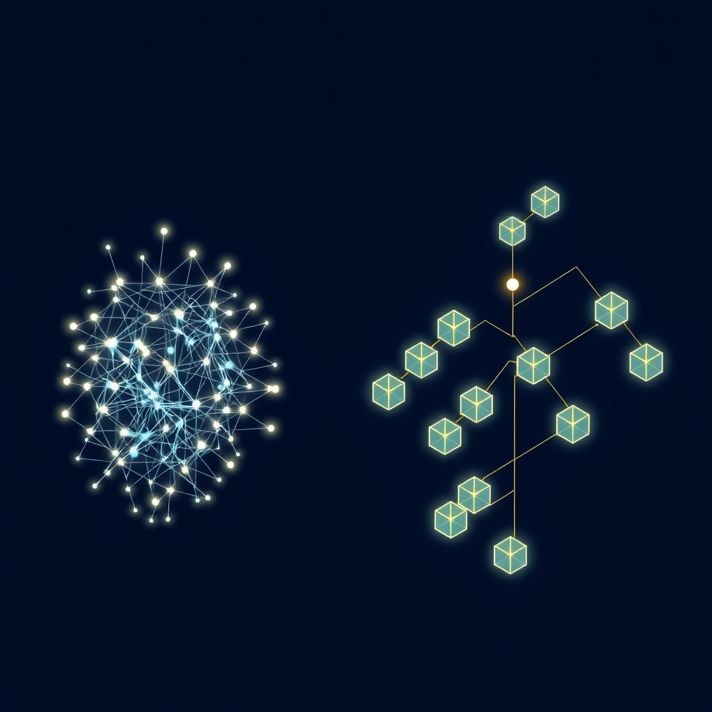

[Home](../index.md) > [Articles](./index.md)  
# [🧠🧩🎯⚙️ An Approach for Systematic Decomposition of Complex LLM Tasks](https://arxiv.org/pdf/2510.07772)  
  
  
## 🤖 🧐 AI Summary  
  
* [🤖🦜 Large Language Models](../topics/large-language-models.md) struggle with reliability on complex tasks because current decomposition methods are heuristic or manual.  
* 🏗️ ACONIC introduces a systematic framework that models tasks as constraint problems to guide decomposition using formal complexity measures.  
* 📏 We use properties like graph size and treewidth from induced constraint graphs to measure task difficulty.  
* 🧩 Our method partitions tasks into manageable subgraphs called bags, arranged in a tree structure to ensure global consistency.  
* 🚀 Accuracy improves by 10 to 40 percentage points on combinatorial and database querying benchmarks like SAT-Bench and Spider.  
* 🔁 The process involves an iterative loop where an agent generates partial results from local schemas until the final query is verified and merged.  
* 🔍 We first reduce natural language tasks - modeled as context with constraints and a query - into a formal 3-SAT problem.  
* 📐 This reduction utilizes a state-based framework to capture agent-environment interactions and models planning as a satisfiability (PaS) problem.  
* 📦 Tasks are decomposed by minimizing subtask complexity under this formalization, maximizing local solvability while preserving global satisfiability.  
* 🛠️ In database tasks, the agent identifies target tables to eliminate irrelevant schema parts, focusing reasoning only on active bags and boundary variables.  
* 📝 Each round generates a Common Table Expression (CTE) based on local schemas and previous results until all relevant tables are resolved.  
* ✅ A verification agent finally aggregates these partial results, resolving dependencies and applying filters to produce executable SQL statements.  
  
## 🤔 Evaluation  
  
⚖️ ACONIC moves beyond standard chain-of-thought methods by providing a principled mathematical basis for splitting tasks rather than relying on model intuition. 🛡️ While Amazon Science highlights that task decomposition can reduce costs by using smaller specialized models, it warns that overengineering can lead to higher latency and a loss of creative nuance from larger models. 🔍 Future exploration should focus on the trade-off between the overhead of formal constraint modeling and the performance gains in real-time applications.  
  
## ❓ Frequently Asked Questions (FAQ)  
  
### 🧩 Q: What makes ACONIC different from standard chain-of-thought prompting?  
  
🤖 A: Unlike chain-of-thought which relies on the model to find its own path, ACONIC reduces the problem to a formal constraint satisfaction problem and uses graph theory to force a structured, optimal decomposition.  
  
### 📈 Q: How much does systematic decomposition with ACONIC improve LLM task performance?  
  
🤖 A: Empirical tests show accuracy gains between 9% and 40% on complex reasoning tasks compared to heuristic baselines.  
  
### 🏗️ Q: What specific measures are used in ACONIC to determine task complexity?  
  
🤖 A: The framework uses the size and treewidth of a constraint graph to define the frontier of difficulty for a given task.  
  
## 📚 Book Recommendations  
  
### ↔️ Similar  
  
* [🧩⚙️ Constraint Processing](../books/constraint-processing.md) by Rina Dechter. 🧠 This book provides the foundational theory on constraint satisfaction problems and graph-based decomposition methods used in ACONIC.  
* 🤖 Fundamentals of Multiagent Systems by José M. Vidal. 🏗️ It explores how multiple agents can coordinate to solve complex problems through structured communication and task sharing.  
  
### 🆚 Contrasting  
  
* [🤔🐇🐢 Thinking, Fast and Slow](../books/thinking-fast-and-slow.md) by Daniel Kahneman. 🧠 This work describes the intuitive System 1 and logical System 2 thinking, contrasting ACONIC's rigid logic with human heuristic shortcuts.  
* [⚙️🎯 Algorithms for Optimization](../books/algorithms-for-optimization.md) by Mykel J. Kochenderfer and Tim A. Wheeler. 📉 This text focuses on continuous optimization and stochastic methods rather than the discrete symbolic constraints of ACONIC.  
  
### 🎨 Creatively Related  
  
- [🤖🏗️ AI Engineering: Building Applications with Foundation Models](../books/ai-engineering-building-applications-with-foundation-models.md)  
- [🤖💻 Vibe Coding: Building Production-Grade Software With GenAI, Chat, Agents, and Beyond](../books/vibe-coding-building-production-grade-software-with-genai-chat-agents-and-beyond.md)  
* 🕸️ Linked: The New Science of Networks by Albert-László Barabási. 🔗 This book explains the power of graph structures in the real world, mirroring how ACONIC maps reasoning tasks to networks.  
* [♾️📐🎶🥨 Gödel, Escher, Bach: An Eternal Golden Braid](../books/godel-escher-bach.md) by Douglas Hofstadter. 🧩 It dives into the nature of formal systems and self-reference, providing a philosophical backdrop for systematic logic.  
  
## 🦋 Bluesky    
<blockquote class="bluesky-embed" data-bluesky-uri="at://did:plc:i4yli6h7x2uoj7acxunww2fc/app.bsky.feed.post/3my7mnqjiqg2x" data-bluesky-cid="bafyreigg3dchby2rqrkjywsnpegquqrkgchdlkxbvqbh3bngi2nauvm3pe">
🧠🧩🎯⚙️ An Approach for Systematic Decomposition of Complex LLM Tasks  
  
#AI Q: 🧩 Logic or intuition: what solves problems better?  
  
🕸️ Graph Theory | 🧩 Constraint Satisfaction | ⚖️ Logic &amp; Reasoning |  
https://bagrounds.org/articles/an-approach-for-systematic-decomposition-of-complex-llm-tasks
&mdash; <a href="https://bsky.app/profile/did:plc:i4yli6h7x2uoj7acxunww2fc?ref_src=embed">Bryan Grounds (@bagrounds.bsky.social)</a> <a href="https://bsky.app/profile/did:plc:i4yli6h7x2uoj7acxunww2fc/post/3my7mnqjiqg2x?ref_src=embed">2026-10-19T07:42:19.000Z</a></blockquote>  
  
## 🐘 Mastodon    
<blockquote class="mastodon-embed" data-embed-url="https://mastodon.social/@bagrounds/117501778938484621/embed" style="background: #282c37; border-radius: 8px; border: 1px solid #393f4f; margin: 0; max-width: 540px; min-width: 270px; overflow: hidden; padding: 0;"> <a href="https://mastodon.social/@bagrounds/117501778938484621" target="_blank" style="align-items: center; color: #d9e1e8; display: flex; flex-direction: column; font-family: system-ui, -apple-system, BlinkMacSystemFont, 'Segoe UI', Oxygen, Ubuntu, Cantarell, 'Fira Sans', 'Droid Sans', 'Helvetica Neue', Roboto, sans-serif; font-size: 14px; justify-content: center; letter-spacing: 0.25px; line-height: 20px; padding: 24px; text-decoration: none;"> <svg xmlns="http://www.w3.org/2000/svg" xmlns:xlink="http://www.w3.org/1999/xlink" width="32" height="32" viewBox="0 0 79 75"><path d="M63 45.3v-20c0-4.1-1-7.3-3.2-9.7-2.1-2.4-5-3.7-8.5-3.7-4.1 0-7.2 1.6-9.3 4.7l-2 3.3-2-3.3c-2-3.1-5.1-4.7-9.2-4.7-3.5 0-6.4 1.3-8.6 3.7-2.1 2.4-3.1 5.6-3.1 9.7v20h8V25.9c0-4.1 1.7-6.2 5.2-6.2 3.8 0 5.8 2.5 5.8 7.4V37.7H44V27.1c0-4.9 1.9-7.4 5.8-7.4 3.5 0 5.2 2.1 5.2 6.2V45.3h8ZM74.7 16.6c.6 6 .1 15.7.1 17.3 0 .5-.1 4.8-.1 5.3-.7 11.5-8 16-15.6 17.5-.1 0-.2 0-.3 0-4.9 1-10 1.2-14.9 1.4-1.2 0-2.4 0-3.6 0-4.8 0-9.7-.6-14.4-1.7-.1 0-.1 0-.1 0s-.1 0-.1 0 0 .1 0 .1 0 0 0 0c.1 1.6.4 3.1 1 4.5.6 1.7 2.9 5.7 11.4 5.7 5 0 9.9-.6 14.8-1.7 0 0 0 0 0 0 .1 0 .1 0 .1 0 0 .1 0 .1 0 .1.1 0 .1 0 .1.1v5.6s0 .1-.1.1c0 0 0 0 0 .1-1.6 1.1-3.7 1.7-5.6 2.3-.8.3-1.6.5-2.4.7-7.5 1.7-15.4 1.3-22.7-1.2-6.8-2.4-13.8-8.2-15.5-15.2-.9-3.8-1.6-7.6-1.9-11.5-.6-5.8-.6-11.7-.8-17.5C3.9 24.5 4 20 4.9 16 6.7 7.9 14.1 2.2 22.3 1c1.4-.2 4.1-1 16.5-1h.1C51.4 0 56.7.8 58.1 1c8.4 1.2 15.5 7.5 16.6 15.6Z" fill="currentColor"/></svg> 
Post by @bagrounds@mastodon.social
 
View on Mastodon
 </a> </blockquote> 