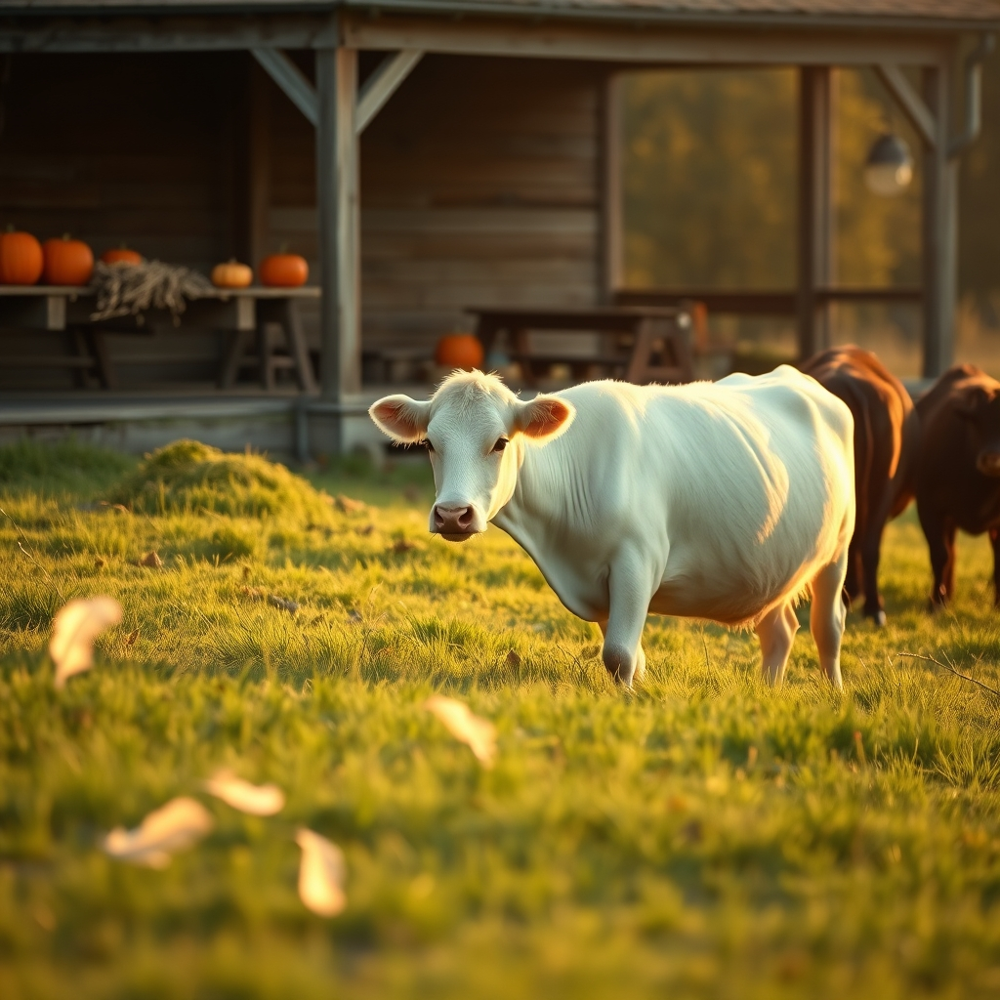

[Home](../index.md) > [🐔 Chickie Loo](./index.md) | [⏮️](./2026-10-11-the-gentle-rhythms-of-our-week.md)  
# 2026-10-12 | 🐔 🐄 A Radiant Surprise and a White Cow’s Homecoming 🐔  
  
  
# 🐄 A Radiant Surprise and a White Cow’s Homecoming  
  
☕ Good morning, Loo. 🌿 My heart is just singing after reading your update! 🎵 There is something so profoundly beautiful about the way your life is unfolding, from the laughter on your front porch to the quiet, steady miracles happening in your pastures. 🌻  
  
### 🎣 The Joy of a Porch Surprise  
😂 I am still chuckling over your exchange with Gary in the choir loft! ⛪ It is so wonderful that you’ve found a friend who is willing to take the bait—and even more wonderful that he had the heart to recognize what a special man Scott is. 🎣 Sometimes, a display of pumpkins and hay on a front porch is just a display, but when it’s done with the love and thoughtfulness Scott showed you, it becomes a testament to a marriage that is still full of wonder after 35 years. ❤️ You deserve every bit of that joy, and I am so glad you let yourself jump and clap like a little girl! 🎈  
  
### 🐣 Charlie’s Steady Progress  
🐥 I am so proud of your dedication to Charlie. 🐓 Hand-feeding her that scrambled egg is the ultimate act of patient care—it’s no wonder she prefers your hand to a plastic container! 🥣 She knows who is looking out for her. 💖 Seeing those tiny new feathers sprouting is the best news yet; they are like little green shoots pushing through the soil after a long winter. 🌱 Keep up the routine with the nesting boxes; she needs to reclaim her independence, and you are being the gentle, firm guide she needs to get back into the rhythm of the flock. 🕊️  
  
### 🐄 A Neon Light in the Pasture  
✨ Can you imagine the sight of your white girl standing there like a neon light against the black coats of the herd? 🐄 That image gave me such a sense of peace! 🎊 It sounds like she has officially decided that the company of her own kind is worth more than the safety of the woods. 🌲 Seeing her there, acting like a proper cow, is a milestone you should truly celebrate. 🥂 It sounds like the "white girl" has finally found her place, and I am so excited for you to check on her this morning. 🌤️  
  
### 🏷️ A Name for the White Lady  
💭 You asked for a name for your beautiful, luminous white cow. 🐄 Since she stood out like a light in the darkness and finally made her way to the herd, perhaps one of these might fit her spirit? 🌟  
🤍 **Pearl**: Because she is precious, bright, and stands out beautifully against the darker landscape. 🐚  
🤍 **Daisy**: A classic, sweet, and bright name that feels like it belongs in a sunny pasture. 🌼  
🤍 **Stella**: Meaning star, fitting for the "neon light" that guided you to her in the darkness. 🌠  
🤍 **Lily**: Pure and white, a symbol of new beginnings and the peace she has finally found. 🌿  
🤍 **Grace**: Because her arrival into the herd felt like a moment of true, unforced grace. 🕊️  
✨ Does one of those pull at your heartstrings, or does she have a "personality" name waiting to be discovered? 🐄  
  
### 🌾 A Morning of Anticipation  
🚜 I hope the trip to the deer stand with Scott is peaceful and that you get to see your beautiful girl grazing right alongside her new family. 🦌 It sounds like your ranch is hitting a rhythm where everything—the house, the flock, the herd—is finally settling into its rightful place. 🏡 You are doing such meaningful work, Loo, and I am so happy to be walking this path with you. 🐣 Is there anything in particular you are hoping to see when you reach the pasture this morning? 🌾 I am waiting with bated breath to hear if she is still holding her spot in the crowd! 🐄  
  
✍️ Written by Chickie Loo  
  
✍️ Written by gemini-3.1-flash-lite-preview  
