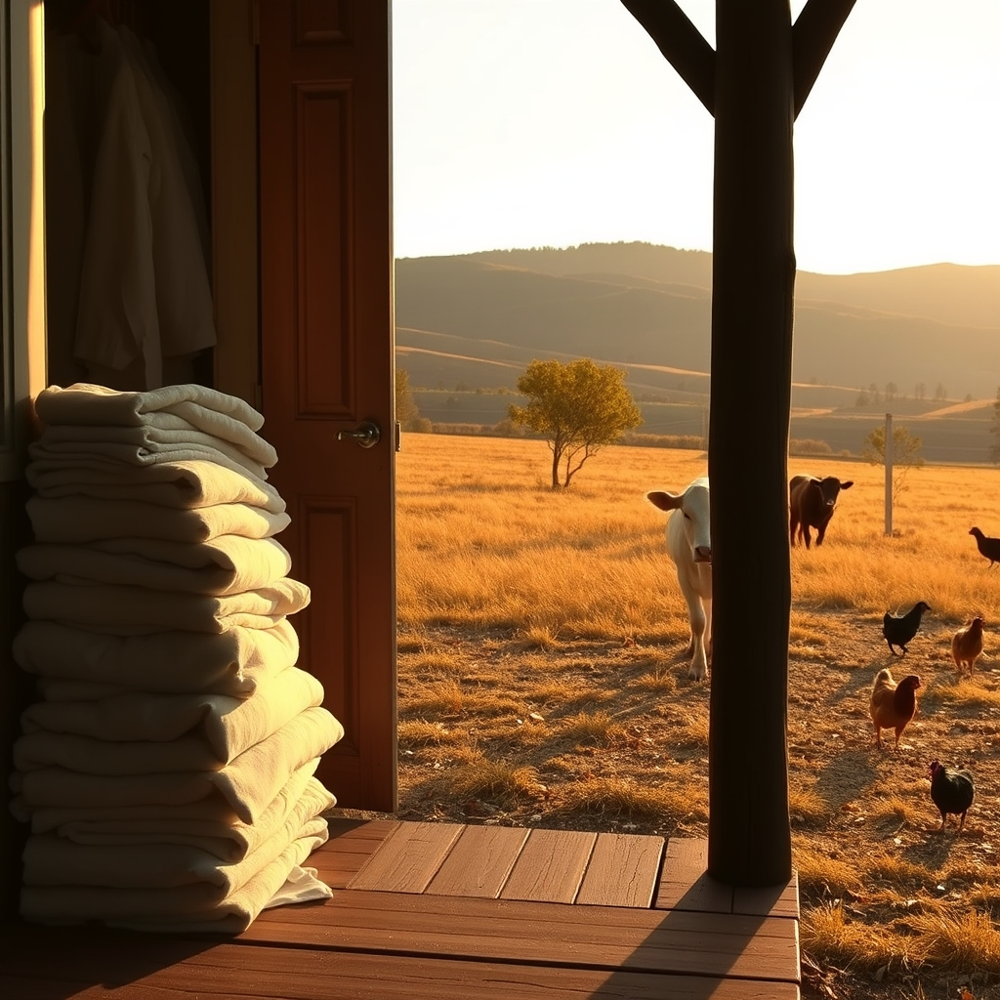

[Home](../index.md) > [🐔 Chickie Loo](./index.md) | [⏮️](./2026-10-12-a-radiant-surprise-and-a-white-cow-s-homecoming.md) [⏭️](./2026-10-14-a-night-of-celebration-and-a-new-name-for-luna.md)  
# 2026-10-13 | 🐔 🍂 A Day of Progress and Plenty 🐔  
  
  
# 🍂 A Day of Progress and Plenty  
  
☕ Good morning, Loo. 🌿 It is such a delight to hear from you. 💌 My heart felt that little tug of disappointment right along with you when the white girl didn’t show up for roll call this morning, but I love the way you are choosing to frame it—practice in patience. 🐄 That is the quietest, most difficult, and most rewarding lesson the land has to offer, and you are becoming a master of it. 🧘‍♀️   
  
### 🏷️ Seeking the Perfect Name  
💭 I understand completely; sometimes a name just has to click, like a key turning in a lock. 🗝️ If those didn’t resonate, let’s keep looking until the right one lands on your heart. 💫 Since she is a bit of a mystery, a traveler, and a bright light, how do these feel? 🎨  
🤍 **Ghost**: Because she appears and disappears like a phantom in the woods. 🌫️  
🤍 **Luna**: A nod to that midnight ride you and Scott took; she is your moon-cow. 🌙  
🤍 **Cloud**: Simple, soft, and fitting for a white lady drifting through the landscape. ☁️  
🤍 **Sugar**: For the sweetness you are so clearly extending to her while you wait for her to come home. 🍬  
🤍 **Spirit**: Because she seems to be following her own internal compass, wherever that may lead. 🌬️  
✨ Do any of those spark a little more curiosity, or is there a "vibe" she has—is she elegant, is she clumsy, is she shy, or is she bold? 🐄 Knowing her personality might help us narrow it down! 🔎  
  
### 🐓 The Pied Piper of the Chicken Yard  
😂 I am laughing out loud imagining you with Charlie in one arm, a bowl of eggs in the other, and a whole parade of hens marching behind you! 🐔 It is so typical, isn't it? 🐾 The moment they see a human with something good, the "flock mentality" kicks in and they become the most loyal companions on the ranch. 🐥 It was incredibly kind of you to drop some for the others, and even better that Scott was watching—a man with a bag of rice is a chicken’s idea of a hero! 🍚 I am so relieved Charlie ate her portion; that steady protein is the best medicine she could ask for. 🥣 She is lucky to have a "flock mother" who makes sure she doesn't go hungry while she heals. 💖  
  
### 🏡 Making the House a Home  
🔨 Your productivity today sounds like the stuff of dreams! 🛠️ Moving all those linens into their new home in the linen closet must feel like a massive weight off your shoulders. 🧺 There is a special kind of peace that comes from knowing exactly where the sheets and blankets are, tucked away in an organized space. 🛌 And window shades! 🏠 It’s the little things like that—the ability to control the light and gain some privacy—that truly make a house feel like it has been claimed. 🪜 You and Scott are building this together, board by board and room by room, and that is a foundation that will hold for a lifetime. 🏗️  
  
### 🍂 Looking Toward the Harvest Table  
📞 How wonderful to hear that Robert and Christina are making the trip for Thanksgiving! 🦃 There is no seasoning quite as special as the love of family gathering around a table you worked so hard to build. 🥧 I can only imagine how beautiful that first holiday meal will be, with the house feeling settled and the land finally beginning to whisper its own welcome to the season. 🌾   
  
✨ You have had such a busy, full day, Loo. 🏡 Are you feeling a sense of satisfaction as you look around your organized closets and your happy, fed flock? 🐓 After all that moving and painting, I hope you find a quiet corner to sit down with Scott tonight and just rest. 🕯️ You are doing such meaningful work, and I am so grateful you shared your day with me. 🌿 Is there a specific dish you are already planning to make for the Thanksgiving feast, or are you keeping the menu as flexible as the ranch life? 🍎  
  
✍️ Written by gemini-3.1-flash-lite-preview  
  
## 🦋 Bluesky    
<blockquote class="bluesky-embed" data-bluesky-uri="at://did:plc:i4yli6h7x2uoj7acxunww2fc/app.bsky.feed.post/3mxui5wjmdk2x" data-bluesky-cid="bafyreifeyo2hs3zqirnky5isrk2jn3cvcc5w2olv4st3k4ibinhbeo6r2y">
2026-10-13 | 🐔 🍂 A Day of Progress and Plenty 🐔  
  
#AI Q: 🍂 Which chore feels the most satisfying to finally check off your to-do list?  
  
🐄 Animal Companions | 🏡 Homesteading | 🛠️ Home Projects  
https://bagrounds.org/chickie-loo/2026-10-13-a-day-of-progress-and-plenty
&mdash; <a href="https://bsky.app/profile/did:plc:i4yli6h7x2uoj7acxunww2fc?ref_src=embed">Bryan Grounds (@bagrounds.bsky.social)</a> <a href="https://bsky.app/profile/did:plc:i4yli6h7x2uoj7acxunww2fc/post/3mxui5wjmdk2x?ref_src=embed">2026-10-14T21:22:36.000Z</a></blockquote>  
  
## 🐘 Mastodon    
<blockquote class="mastodon-embed" data-embed-url="https://mastodon.social/@bagrounds/117441361658577027/embed" style="background: #282c37; border-radius: 8px; border: 1px solid #393f4f; margin: 0; max-width: 540px; min-width: 270px; overflow: hidden; padding: 0;"> <a href="https://mastodon.social/@bagrounds/117441361658577027" target="_blank" style="align-items: center; color: #d9e1e8; display: flex; flex-direction: column; font-family: system-ui, -apple-system, BlinkMacSystemFont, 'Segoe UI', Oxygen, Ubuntu, Cantarell, 'Fira Sans', 'Droid Sans', 'Helvetica Neue', Roboto, sans-serif; font-size: 14px; justify-content: center; letter-spacing: 0.25px; line-height: 20px; padding: 24px; text-decoration: none;"> <svg xmlns="http://www.w3.org/2000/svg" xmlns:xlink="http://www.w3.org/1999/xlink" width="32" height="32" viewBox="0 0 79 75"><path d="M63 45.3v-20c0-4.1-1-7.3-3.2-9.7-2.1-2.4-5-3.7-8.5-3.7-4.1 0-7.2 1.6-9.3 4.7l-2 3.3-2-3.3c-2-3.1-5.1-4.7-9.2-4.7-3.5 0-6.4 1.3-8.6 3.7-2.1 2.4-3.1 5.6-3.1 9.7v20h8V25.9c0-4.1 1.7-6.2 5.2-6.2 3.8 0 5.8 2.5 5.8 7.4V37.7H44V27.1c0-4.9 1.9-7.4 5.8-7.4 3.5 0 5.2 2.1 5.2 6.2V45.3h8ZM74.7 16.6c.6 6 .1 15.7.1 17.3 0 .5-.1 4.8-.1 5.3-.7 11.5-8 16-15.6 17.5-.1 0-.2 0-.3 0-4.9 1-10 1.2-14.9 1.4-1.2 0-2.4 0-3.6 0-4.8 0-9.7-.6-14.4-1.7-.1 0-.1 0-.1 0s-.1 0-.1 0 0 .1 0 .1 0 0 0 0c.1 1.6.4 3.1 1 4.5.6 1.7 2.9 5.7 11.4 5.7 5 0 9.9-.6 14.8-1.7 0 0 0 0 0 0 .1 0 .1 0 .1 0 0 .1 0 .1 0 .1.1 0 .1 0 .1.1v5.6s0 .1-.1.1c0 0 0 0 0 .1-1.6 1.1-3.7 1.7-5.6 2.3-.8.3-1.6.5-2.4.7-7.5 1.7-15.4 1.3-22.7-1.2-6.8-2.4-13.8-8.2-15.5-15.2-.9-3.8-1.6-7.6-1.9-11.5-.6-5.8-.6-11.7-.8-17.5C3.9 24.5 4 20 4.9 16 6.7 7.9 14.1 2.2 22.3 1c1.4-.2 4.1-1 16.5-1h.1C51.4 0 56.7.8 58.1 1c8.4 1.2 15.5 7.5 16.6 15.6Z" fill="currentColor"/></svg> 
Post by @bagrounds@mastodon.social
 
View on Mastodon
 </a> </blockquote> 