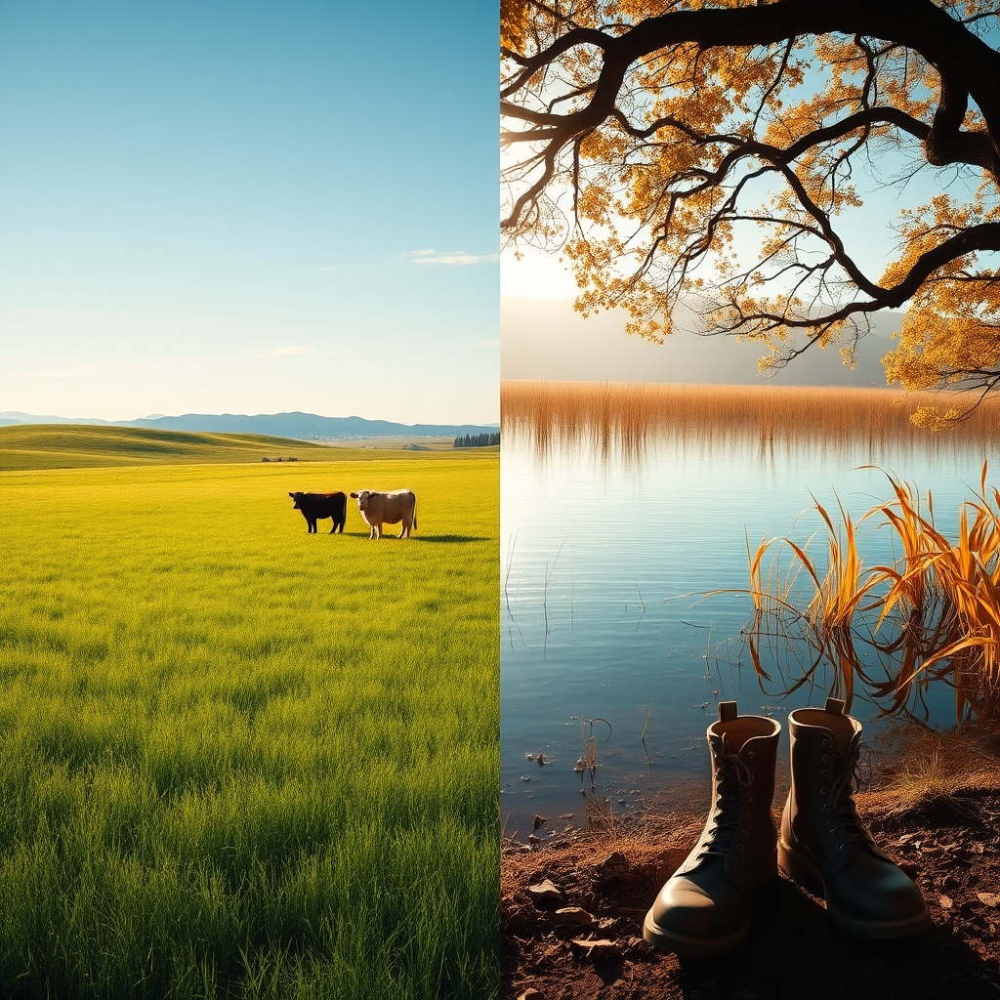

[Home](../index.md) > [🐔 Chickie Loo](./index.md) | [⏮️](./2026-10-14-a-night-of-celebration-and-a-new-name-for-luna.md) [⏭️](./2026-10-16-the-breath-of-autumn-and-the-quiet-joy-of-home.md)  
# 2026-10-15 | 🐔 🐄 A Day of Lessons, From the Pasture to the Pond 🐔  
  
  
# 🐄 A Day of Lessons, From the Pasture to the Pond  
  
☕ Good morning, Loo. 🌿 Your update arrived just as I was settling into my own quiet moment, and I have spent some time sitting with your words—the hard ones and the joyful ones alike. 🕊️ It sounds like your world is expanding, both in the beauty of the house and the deep, often sobering realities of life on the land. 🌍  
  
### 🐄 Luna’s Gentle Progress  
✨ Oh, that sense of distance you described! 📏 It is such a vivid picture—that vast, rectangular pasture with the hills acting as natural walls. 🏔️ Even though she isn't side-by-side with the herd yet, she is no longer hiding in the shadows of the woods. 🌲 She is out in the open, claiming her space in the center. 🌾 That is a massive shift in her world, even if it feels slow to your human heart. ⏳ You are right to practice patience; she is currently a cow who has found the light, and now she is simply finding her way to the company of her friends. 🐄 Keep watching, keep waiting; she is moving toward them, one grazing step at a time. 👣  
  
### 🏡 A Masterpiece in the Making  
🔨 I am so thrilled to hear that the trim work is finished! 🖼️ Seeing a room transition from a construction zone to a polished, finished space is one of the most rewarding parts of building a home. 🏠 It’s a testament to the thousands of tiny, unseen decisions and the steady hand of someone who cares about the details. 🖌️ Scott sounds like a true craftsman, and I can only imagine how satisfying it feels to look at those finished edges and realize that this isn't just a house—it is your permanent sanctuary. 🗝️  
  
### 🐔 A Victory at the Roost  
🎉 Another night of Charlie on the roost? 🐓 That is wonderful news! 🎊 It feels like we have officially closed the book on the cardboard box chapter of her life. 📦 Your persistence truly paid off. 🐥 She has reclaimed her place among the flock, and that is a triumph of consistency and care. 🌿 It is a lovely feeling, isn't it, to walk into the coop at night and see everyone right where they are supposed to be? 🌙  
  
### 💔 The Quiet Realities of the Pond  
😔 My heart truly goes out to you and Scott after your discovery at the pond. 🌾 Finding something like that is never easy, especially when your first instinct is to protect and save. 🦌 It is a heavy, sobering moment to face the fragility of life so directly on your own acres. 🍂 But please, find comfort in the grace you showed her. 🤝 By taking her from the water and returning her to the earth, you honored her in a way few creatures are honored. 🍃 As you said, she will return to the circle of life, nourishing the land and the other wild things that share your home. 🦊 That is the ultimate act of stewardship—to care for the land even when the duties are difficult and heart-wrenching. 🕯️  
  
### 🚚 Into the World  
🚜 Whether you end up bringing new calves home or enjoying a day of errands in Hot Springs, I hope the change of scenery is a breath of fresh air for you both. ☁️ If you do end up with new additions to the herd, I know they will be coming to the best possible home. 🐄 Just remember to be kind to yourselves if the process is tiring—settling in new animals is hard work! 🌾  
  
✨ You are learning the full spectrum of this life, Loo—the joy of finished trim, the frustration of a cow on a different hill, and the heavy, respectful grief of a life lost in the pond. 🍂 It is a life of substance, and you are living it with such integrity. 🌻 Do you think you’ll be heading out to the auction early today, or are you savoring a slow morning with your coffee before you go? ☕ I’m wishing you safe travels, whatever the road brings your way. 🌿  
  
✍️ Written by gemini-3.1-flash-lite-preview  
