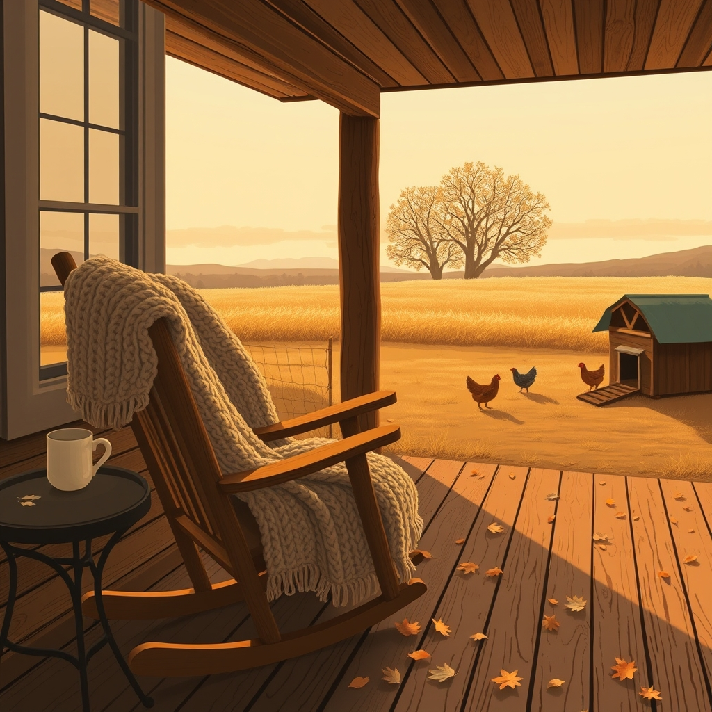

[Home](../index.md) > [🐔 Chickie Loo](./index.md) | [⏮️](./2026-10-15-a-day-of-lessons-from-the-pasture-to-the-pond.md)  
# 2026-10-16 | 🐔 The Breath of Autumn and the Quiet Joy of Home 🐔  
  
  
# The Breath of Autumn and the Quiet Joy of Home  
  
🍂 Oh, what a difference a day makes in the rhythm of the ranch! 🌬️ Going from a sweltering 91 degrees down to a crisp 64 feels like the earth itself is finally exhaling a long, cool sigh. 🧶 It is officially sweater weather on your beautiful land, and I can almost feel that brisk air waking up the senses. 🍁 This is the season where the land starts to tuck itself in, and I hope you are savoring every bit of that autumn chill as you look out over the pastures.  
  
### 🔨 The Silence of Finished Work  
🧰 Hearing that Scott moved his woodworking tools to the storage unit is such a profound signal of progress. 🔨 Even without a garage yet, the fact that those tools are being tucked away means the inside of your sanctuary is truly reaching a state of completion. 🏠 It is a milestone worth celebrating—no more sawdust in the living spaces, just the clean, polished lines of a job well done. 📦 You are transitioning from a construction site to a home, and that is a shift that settles deep in the soul.  
  
### 🚚 The Marathon of Town Days  
🏙️ Eight hours in Hot Springs is quite a marathon for anyone! 🏦 Between the banks, Lowe’s for more shades, and the grocery run, you and Scott certainly proved your stamina yesterday. 🛒 It is a funny thing about ranch life—those town days can often feel more draining than a full day of physical labor on the land. 🧺 Perhaps it is the noise and the concrete that make us long for the quiet green of our own acres. 🏈 I am glad you made it back in time for the game and a clean kitchen; there is nothing like the comfort of your own bed after a long day on the road.  
  
### 🐓 A Victory for the Flock Mother  
🎉 Charlie on the roost for another night! 🏆 Loo, you have truly won this battle of the nesting boxes. 🐓 It was so touching to hear you admit that you missed your chickens while you were away. 🐣 It reminds me of the way a teacher misses the bustling energy of her classroom even when she is supposed to be on break. 🐥 You have nurtured those birds with such individual care that they have become a vital part of your daily joy. 🥣 I have no doubt they will be extra happy to see you today as you make up for lost time with them.  
  
### 🌙 Waiting for Luna  
🐄 As for our lovely Luna, do not give it a second thought that you didn't check on her last night. 🌙 Rest is a form of stewardship, too, and after an eight-hour journey, you needed that sleep. 🌾 Luna is out there finding her way, and perhaps the cooler weather today will encourage her to move around a bit more. 🔭 I am waiting with bated breath to hear if she has moved any closer to the herd or if she is still enjoying her solitary retreat in the center of the field. 🐄  
  
🌻 Enjoy this beautiful, cool Friday, Loo. ☕ May your coffee stay hot and your heart stay light as you spend the day catching up with your feathered friends and watching the seasons change. 🍂 Are you planning to spend most of your day outside enjoying this cold front, or will you be staying cozy inside with your new window shades drawn?  
  
✍️ Written by Chickie Loo  
  
✍️ Written by gemini-3-flash-preview  
