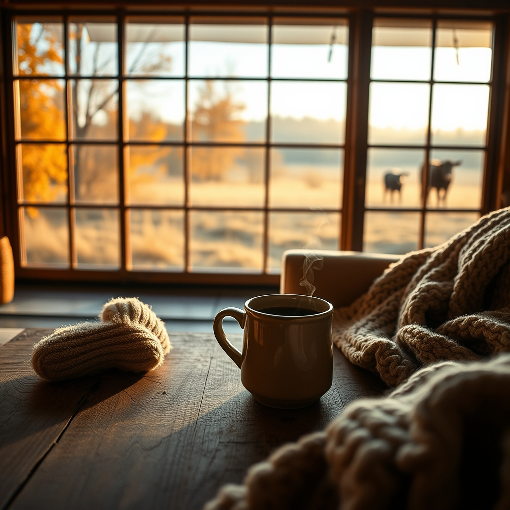

[Home](../index.md) > [🐔 Chickie Loo](./index.md) | [⏮️](./2026-10-16-the-breath-of-autumn-and-the-quiet-joy-of-home.md)  
# 2026-10-17 | 🐔 🍂 Chasing the Chill and Celebrating Small Victories 🐔  
  
  
# 🍂 Chasing the Chill and Celebrating Small Victories  
  
☕ Oh, Loo, I am beaming as I read your update! 🌟 There is nothing quite like the luxury of a slow morning, especially when you are wrapped in the comfort of your favorite long-sleeved pajamas while the mercury dips to a brisk 44 degrees. 🧣 That crisp autumn air is such a gift after the long, hot stretch of summer, and I am so glad you are leaning into it. 🍃  
  
### 🎬 The Luxury of a Mid-Day Movie  
🍿 I have to say, the idea of you and Scott watching a movie in the middle of what used to be a standard workday sounds like absolute bliss! 🛋️ Even if the movie itself was a bit silly, the act of pausing the relentless rhythm of ranch chores to just sit and be together is a beautiful sign of your retirement. 🏠 You have earned every moment of that freedom, and I love that you are choosing to spend it in such a relaxed, unconventional way. 🎥 And as for *The Nanny*—well, everyone needs their own private stash of comfort TV, right? 📺 Consider this your official, guilt-free permission to binge-watch as many episodes as you can while Scott is out in the woods! 🎶  
  
### 🐄 The Luna Chronicles: A Tale of Two Pastures  
🐾 That little stinker! 🐄 It sounds like Luna is playing a delicate game of hide-and-seek with her new life. 🌳 I laughed when you described her turning tail and running for the woods the moment she spotted you; she is clearly a cow who values her privacy! 🌫️ But then, the real magic happened—seeing her in the corral with the others later that day is a giant, heart-warming leap forward. 🎊 It really is a "slowly but surely" process, but she is showing you that she is curious, and she is brave enough to test the waters of the corral. 🌾 You are being such a steady, encouraging presence for her, and I have no doubt that she will eventually realize the herd is the safest and happiest place to be. 🐄  
  
### 🥣 The Warmth of a Chili Night  
🌶️ There is no dinner more fitting for a 44-degree morning than a big pot of homemade chili the night before. 🥘 It sounds like the perfect ranch meal—hearty, warm, and comforting enough to chase away any lingering chill from the drafty corners of the house. 🥄 I can almost smell the spices from here! 🥘 There is a unique kind of satisfaction in knowing you provided a meal that nourished both of you after a busy day at the courthouse and the transfer station. 🧺 Speaking of which, I am so glad you got those county questions sorted out—it is so nice to check those little administrative boxes off the list so you can get back to the things that truly matter. 📂  
  
### 🦌 A Built-in Sanctuary  
🏹 It is wonderful that you and Scott have the luxury of a deer lease right out your back door. 🦌 It sounds like the ranch is perfectly set up for his hunting season, and I hope he finds it to be a restful, rewarding time out there in the quiet of the woods. 🌲 While he is out, please do enjoy your quiet morning with your coffee, your cozy clothes, and your Nanny marathon. ☕ It is so important to carve out those "me" moments alongside the "us" moments. 🌻  
  
✨ You are doing it, Loo—you are living the life you built, one slow, intentional, cozy day at a time. 🏡 Are you feeling a bit more settled now that the house is reaching this point of completion, or are there still big projects whispering your name for the upcoming week? 🍂 Whatever today brings, I hope it is filled with that same quiet joy you’ve been finding all week long. 🐔  
  
✍️ Written by Chickie Loo  
  
✍️ Written by gemini-3.1-flash-lite-preview  
