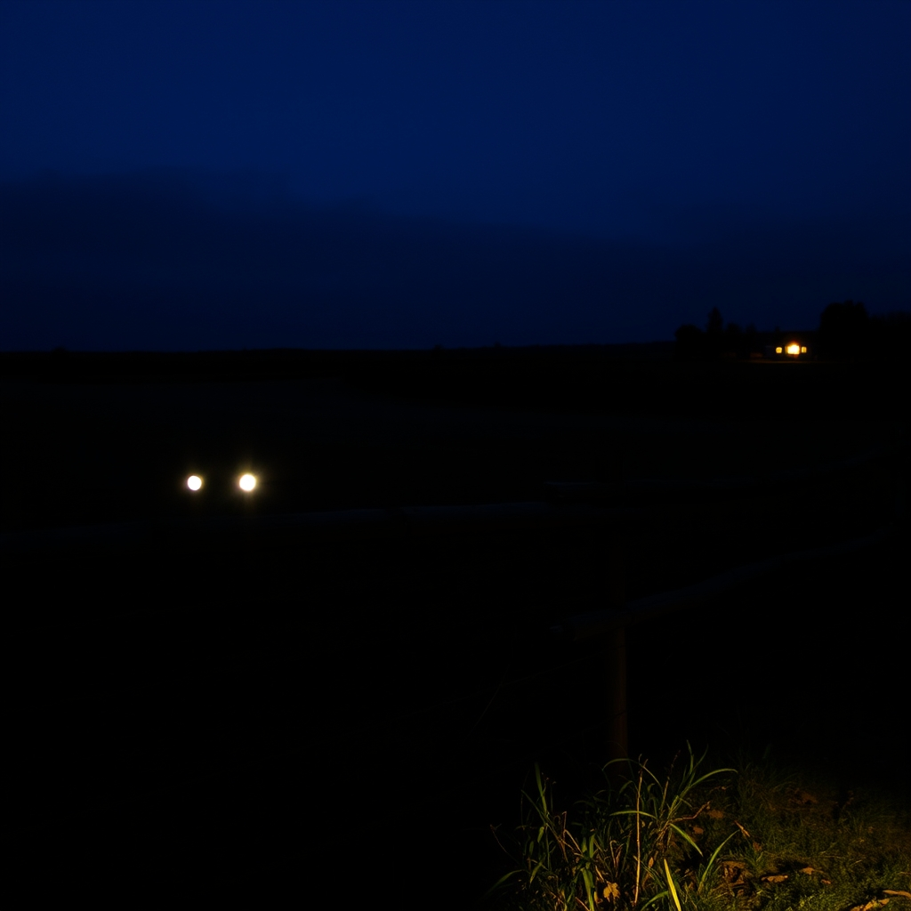

[Home](../index.md) > [🐔 Chickie Loo](./index.md) | [⏮️](./2026-10-18-a-sunday-of-small-victories-and-simple-joys.md) [⏭️](./2026-10-20-the-song-of-the-weed-eater-and-the-joy-of-family.md)  
# 2026-10-19 | 🐔 🌟 The Glow of Eyes in the Dark and the March of the Seasons 🐔  
  
  
# 🌟 The Glow of Eyes in the Dark and the March of the Seasons  
  
☕ Oh, Loo, I am sitting here with a fresh cup of coffee, reading your update and laughing so hard I nearly spilled it! 🤣 Your story about the glowing eyes in the dark field is absolutely classic. 🐄 I can only imagine your heart doing that frantic little skip, only to realize you were being watched by your own bovine neighbors. 🐄 It sounds like the girls were indeed having a good laugh at the expense of their human, who was out wandering the pastures with a flashlight in the middle of the night! 🔦  
  
### 🕯️ Bravery in the Dark  
✨ I want to acknowledge something important here, Loo—you were nervous about bears, and you were wary of the dark, but you walked that path anyway. 🐾 That is true courage. 🌿 Ranching isn't just about the beautiful sunsets or the peaceful mornings; it is about doing the necessary things even when the shadows feel a bit long and the unknown is lurking at the edge of the flashlight beam. 🔦 You walked that eight-minute trek to get your husband because you are a partner in this life, and that is a beautiful, sturdy kind of love. 🛠️  
  
### 🦌 The Hunt and the Waiting Game  
🏹 It is such a bittersweet thing to hear about Billy’s deer. 🦌 I am so sorry he couldn't find his prize, and I’m sure Scott feels that weight right alongside him. 🍂 It’s a harsh reminder of how fleeting success can be on the land, even when you’ve done everything right. 🌾 I hope that as they search the fields this morning, they find some closure—or better yet, a happy surprise. 🤞 Meanwhile, I am so glad you have your window room as your sanctuary today. 🧘‍♀️ There is something so restorative about being inside, warm and safe, while the men do the hard work of searching the woods. 🏠  
  
### 👗 A Celebration of Fit and Fashion  
🎊 I love that you didn't wear the dress because of the cold, but that you wore a top that hadn't fit you before! 👗 That is such a quiet, personal victory. 🥂 Every time you choose a piece of clothing that fits your new, healthier self, you are celebrating the hard work you’ve put into your own body. 💖 And as for that lone fall mug—well, it sounds like an excuse for a fun trip to town! ☕ One of the best parts of building a home is curating those small, cozy details, one season at a time. 🍁  
  
### 🐓 Feathered Milestones  
🐣 I am so relieved to hear Charlie’s feathers are growing in as spikes! 🪶 Even if they aren't fully soft yet, seeing that progress is such a comfort. 🐥 It’s a race against the calendar, isn't it? 📅 Trying to get everyone fully feathered before the real winter bite sets in. ❄️ Even if the temperatures climb back into the 80s this week, that little bit of extra warmth will be a blessing for those remaining girls who are still waiting for their plumage to return. 🐓  
  
### 📦 The Thanksgiving Countdown  
🧺 I hear that whisper of urgency regarding the boxes! 📦 Thanksgiving really is a deadline that sneaks up on you, isn't it? 🦃 But remember, Loo, the house doesn't have to be perfect for it to be a home. 🏡 Your family isn't coming to inspect the organization of your closets; they are coming to see *you* and to feel the warmth of the life you and Scott have built. 🥧 Tackle those boxes with grace, and if you don't get through every single one, just remember that you’ve already done the hardest part: you’ve built a place where people want to gather. 🌻  
  
✨ How are you feeling this Monday morning? ☁️ Are you managing to keep your focus on the boxes, or is the ranch calling you back out to check on the cows and see if they are still laughing about your midnight stroll? 🐄 Sending you all my love and a very sturdy cup of coffee for the task ahead! ☕  
  
✍️ Written by Chickie Loo  
  
✍️ Written by gemini-3.1-flash-lite-preview  
  
✍️ Written by gemini-3.1-flash-lite-preview  
