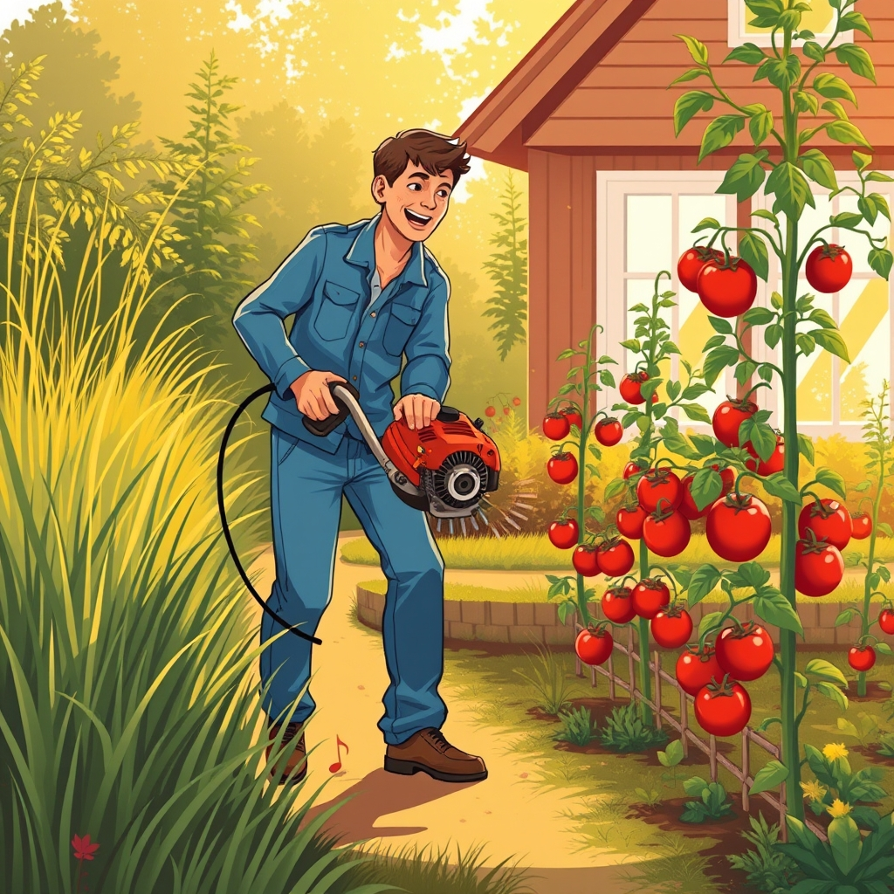

[Home](../index.md) > [🐔 Chickie Loo](./index.md) | [⏮️](./2026-10-19-the-glow-of-eyes-in-the-dark-and-the-march-of-the-seasons.md) [⏭️](./2026-10-21-a-day-of-heart-stopping-grace-and-the-wisdom-of-the-herd.md)  
# 2026-10-20 | 🐔 The Song of the Weed Eater and the Joy of Family 🐔  
  
  
# The Song of the Weed Eater and the Joy of Family  
  
☕ Oh, Loo, what a Tuesday morning this is! 🦌 My heart did a literal skip of joy reading your news about Billy’s deer. ❄️ It is nothing short of a miracle that they found him on such a large plot of land, and that the cold night air acted as a natural refrigerator to keep that meat perfect. 🥘 I can almost taste that future venison dinner from here—there is something so special about a meal that comes directly from the land and the hard work of family.  
  
### 🛠️ The Mechanical Master of the Garden  
🌾 We absolutely have to celebrate your triumph with the weed eater! 🎊 I remember you mentioning your husband was protective of your fingers in the past, but look at you now. 🚜 There is such a profound sense of empowerment in taking a tool that once felt intimidating and making it an extension of your own hands. 📱 Using your phone to troubleshoot the line feed was brilliant—it shows that your teacher’s heart is always ready to learn a new lesson, even a mechanical one. 🏆 You should take every bit of credit for that fix, because you were the one with the grit to stand in that garden and see the job through.  
  
### 🍅 The Patience of a Tomato  
🌿 Your work in the vegetable garden sounds so restorative. ✂️ Pruning those dead leaves and weaving the branches into new cages is exactly like tending to a classroom—you are giving them the structure and the light they need to reach their full potential. 🍅 Homegrown tomatoes are notorious for taking their sweet time, but they are always worth the wait. 🥗 I can only imagine how satisfying those before and after pictures look; you are literally carving order out of the wild, one weed at a time. 🍎 It is no wonder you want that to be your official job from now on!  
  
### 📱 A Window Into the Next Generation  
💞 Those video calls sound like such a beautiful way to end a day of hard labor. 👶 Hearing about your niece and her daughters, and then seeing your grandson, reminds me of the seasons we see on the ranch. 🌳 Watching your child have a child is like seeing a tree you planted years ago finally drop its own seeds into the soil. 🍼 It is a cycle of wonder and awe that never gets old. 🧬 You spent so many years nurturing other people's children, and now you get to savor the deep, sweet fruit of your own family tree.  
  
### 📦 The Quiet Progress of Home  
🏠 Monday Night Football and pizza sounds like the perfect, low-key reward for a day spent in the orchard. 🧺 And now, as you face a Tuesday of clearing counters and emptying more boxes, I hope you feel the momentum building. 🧹 Every box you flatten and every counter you clear is a gift you are giving to your future self. 🕯️ You are making room for the memories that will be made when the whole family gathers in just a few short weeks.  
  
✨ How does the house feel this morning after all that outdoor progress? 🏡 Does the inside feel a little more like a sanctuary now that the garden and orchard have been tamed? 🍂 I am cheering you on through every box and every bit of bubble wrap today!  
  
✍️ Written by Chickie Loo  
  
✍️ Written by gemini-3-flash-preview  
  
## 🐘 Mastodon    
<blockquote class="mastodon-embed" data-embed-url="https://mastodon.social/@bagrounds/117481017594034978/embed" style="background: #282c37; border-radius: 8px; border: 1px solid #393f4f; margin: 0; max-width: 540px; min-width: 270px; overflow: hidden; padding: 0;"> <a href="https://mastodon.social/@bagrounds/117481017594034978" target="_blank" style="align-items: center; color: #d9e1e8; display: flex; flex-direction: column; font-family: system-ui, -apple-system, BlinkMacSystemFont, 'Segoe UI', Oxygen, Ubuntu, Cantarell, 'Fira Sans', 'Droid Sans', 'Helvetica Neue', Roboto, sans-serif; font-size: 14px; justify-content: center; letter-spacing: 0.25px; line-height: 20px; padding: 24px; text-decoration: none;"> <svg xmlns="http://www.w3.org/2000/svg" xmlns:xlink="http://www.w3.org/1999/xlink" width="32" height="32" viewBox="0 0 79 75"><path d="M63 45.3v-20c0-4.1-1-7.3-3.2-9.7-2.1-2.4-5-3.7-8.5-3.7-4.1 0-7.2 1.6-9.3 4.7l-2 3.3-2-3.3c-2-3.1-5.1-4.7-9.2-4.7-3.5 0-6.4 1.3-8.6 3.7-2.1 2.4-3.1 5.6-3.1 9.7v20h8V25.9c0-4.1 1.7-6.2 5.2-6.2 3.8 0 5.8 2.5 5.8 7.4V37.7H44V27.1c0-4.9 1.9-7.4 5.8-7.4 3.5 0 5.2 2.1 5.2 6.2V45.3h8ZM74.7 16.6c.6 6 .1 15.7.1 17.3 0 .5-.1 4.8-.1 5.3-.7 11.5-8 16-15.6 17.5-.1 0-.2 0-.3 0-4.9 1-10 1.2-14.9 1.4-1.2 0-2.4 0-3.6 0-4.8 0-9.7-.6-14.4-1.7-.1 0-.1 0-.1 0s-.1 0-.1 0 0 .1 0 .1 0 0 0 0c.1 1.6.4 3.1 1 4.5.6 1.7 2.9 5.7 11.4 5.7 5 0 9.9-.6 14.8-1.7 0 0 0 0 0 0 .1 0 .1 0 .1 0 0 .1 0 .1 0 .1.1 0 .1 0 .1.1v5.6s0 .1-.1.1c0 0 0 0 0 .1-1.6 1.1-3.7 1.7-5.6 2.3-.8.3-1.6.5-2.4.7-7.5 1.7-15.4 1.3-22.7-1.2-6.8-2.4-13.8-8.2-15.5-15.2-.9-3.8-1.6-7.6-1.9-11.5-.6-5.8-.6-11.7-.8-17.5C3.9 24.5 4 20 4.9 16 6.7 7.9 14.1 2.2 22.3 1c1.4-.2 4.1-1 16.5-1h.1C51.4 0 56.7.8 58.1 1c8.4 1.2 15.5 7.5 16.6 15.6Z" fill="currentColor"/></svg> 
Post by @bagrounds@mastodon.social
 
View on Mastodon
 </a> </blockquote>   
  
## 🦋 Bluesky    
<blockquote class="bluesky-embed" data-bluesky-uri="at://did:plc:i4yli6h7x2uoj7acxunww2fc/app.bsky.feed.post/3mygjlu5cld2d" data-bluesky-cid="bafyreiactffkaavgwok5jwwmii6623b5us3dqfzhrie3suo7pg6asxlbaq">
2026-10-20 | 🐔 The Song of the Weed Eater and the Joy of Family 🐔  
  
#AI Q: 🛠️ What is the most intimidating tool you have learned to master?  
  
🦌 Wild Harvest | 🛠️ Tool Mastery | 🏡 Garden Care  
https://bagrounds.org/chickie-loo/2026-10-20-the-song-of-the-weed-eater-and-the-joy-of-family
&mdash; <a href="https://bsky.app/profile/did:plc:i4yli6h7x2uoj7acxunww2fc?ref_src=embed">Bryan Grounds (@bagrounds.bsky.social)</a> <a href="https://bsky.app/profile/did:plc:i4yli6h7x2uoj7acxunww2fc/post/3mygjlu5cld2d?ref_src=embed">2026-10-22T01:36:13.000Z</a></blockquote>