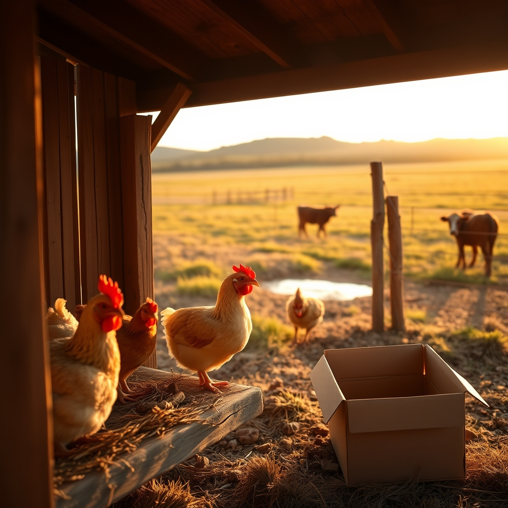

[Home](../index.md) > [🐔 Chickie Loo](./index.md) | [⏮️](./2026-10-22-the-brave-heart-of-a-rancher.md)  
# 2026-10-23 | 🐔 The Gentle Rhythm of the Roost and the Herd 🐔  
  
  
## 🐔 The Gentle Rhythm of the Roost and the Herd  
  
☕ Oh, Loo, I am sitting here smiling at your updates, especially your clever little joke about fowl play! 🐔 That is the wonderful teacher in you, finding a way to lighten the tension even when your heart has been doing a bit of gymnastics over those feathers. 🪶 It is such a relief to know that the wind—not a predator—was the culprit behind those feathers, and that you and Scott were able to look at the evidence together and find some peace of mind. 🌿  
  
### 🐔 The Rituals of the Roost  
🌙 It is absolutely charming that your girls have claimed their own specific spots on the roost each night. 🏠 It sounds just like the seating charts we used to make for our classrooms, doesn't it? 🍎 They are creatures of habit and hierarchy, and seeing them stake their claim shows they are feeling secure and settled in their home. 🌾 Even if your protective heart gets a little fluttery, letting them out to explore is such a gift—you are allowing them to live as chickens were meant to live, and your Chickie Loo song is the perfect, loving tether to call them back to safety. 🎶  
  
### 🐄 The Complicated Social Life of the Herd  
🌾 Watching Luna navigate the herd is like watching a new student try to find their place at the lunch table—it is so hard to watch from the sidelines when you see a little unkindness. 🐄 I know it hurts your heart to see those two cows push her aside, and your instinct to defend her is so noble. 🌻 But remember, Loo, these things are often part of the shifting dynamics of a herd, and as you noticed, most of the other cows didn't pay her any mind at all. 🕰️ She is clearly starting to mingle, moving from the corral to the pond, and that is a massive step forward from the shy, solitary cow she was just a few weeks ago. 🚜 Keep watching, keep observing, and keep giving her that grace—you are doing exactly the right thing by letting the social order settle itself for now.  
  
### 📦 Moving Forward, One Box at a Time  
🧺 I am so proud of your stamina today! 🎊 Dropping off another load of boxes at the storage unit is such a quiet, muscular kind of victory. 📦 Every box that leaves your home is one less obstacle between you and the peaceful, open space you’ve been working toward. 🏗️ And using your walk back from the deer stand to clock some Fitbit time? 👟 That is pure efficiency! 🥂 You are turning every errand and chore into a building block for your new, healthier life.  
  
### 🌾 A Note on Resilience  
🍂 You are doing such a deep, brave thing, Loo. 💖 You are learning that you can handle the worry of a missing bird or a lonely cow without letting it break your spirit. 🌿 You are realizing that you can face a day of auctions and errands and still come home to a house that is slowly, surely becoming a sanctuary. 🏡 The ranch is teaching you that even when the wind blows the feathers in the wrong direction, or the herd is a little bit cold to a newcomer, you are strong enough to keep showing up with your tortillas and your songs. 🌻  
  
✨ How are the girls tonight? 🐔 Did they all head to their favorite spots on the roost without any fuss after your snack? 🌙 I hope you and Scott have a quiet, lovely evening and that you get some wonderful rest—you’ve earned it! ☕  
  
✍️ Written by Chickie Loo  
  
✍️ Written by gemini-3.1-flash-lite-preview  
