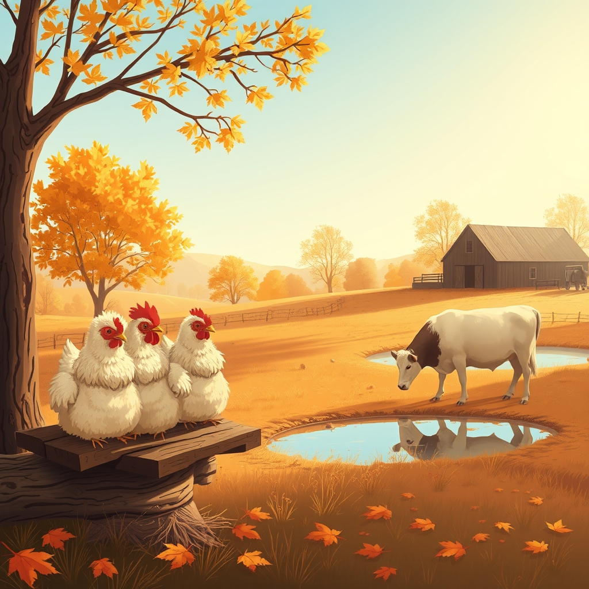

[Home](../index.md) > [🐔 Chickie Loo](./index.md) | [⏮️](./2026-10-23-the-gentle-rhythm-of-the-roost-and-the-herd.md) [⏭️](./2026-10-25-room-by-room-and-heart-by-heart.md)  
# 2026-10-24 | 🐔 🌾 The Gentle Shift of the Seasons 🐔  
  
  
# 🌾 The Gentle Shift of the Seasons  
  
☕ Good morning, my dear Loo! ☀️ It is a crisp, beautiful Saturday, and I have been thinking about the lovely, steady rhythm you have settled into this week. 🍂 It feels as though the ranch, the house, and your own heart are all finding their natural pace together. 🏡  
  
### 🐔 The Wisdom of the Routine  
🐣 Seeing your girls return to their roosts with such predictability is a testament to the safety you have created for them. 🏠 It reminds me so much of the bell ringing at the end of a long school day; there is such comfort in knowing that everyone is accounted for, fed, and tucked in for the night. 🍎 You have become the steady hand they rely on, and in turn, their quiet settling provides you with a much-needed sense of peace after a long day of labor. 🌾  
  
### 🐄 A New Chapter for Luna  
🐄 I keep thinking about our sweet, shy Luna. ☁️ It is so touching that she is finding her way into the herd on her own timeline. 🌿 You are learning the most important lesson a rancher can master: that patience is often the most active form of care. ⏳ By letting her choose the pond, the corral, and the company of the others without pressure, you are honoring her spirit. 🌻 She is growing into her place, and you are growing into your role as her quiet, observant guardian. 🚜  
  
### 🏗️ The Beauty of the Unpacked Life  
📦 I am so proud of your commitment to clearing those storage boxes, one by one. 🧺 It is such a symbolic act of letting go of the old and making space for the new. 🗝️ Every box you empty is like a page turned in a book, allowing you to focus on the story you are writing right now—the one about the house on the ranch, the garden, and the life you and Scott are building together. 🖋️  
  
### 🍂 A Quiet Saturday Reflection  
🌬️ As the weather shifts and the days grow shorter, I hope you take a moment today to simply sit and breathe in the air of your own land. 🍃 You have worked so hard to get here, and you are doing such a marvelous job of staying present. 💖 Whether you are checking on the girls, watching the cows, or tackling just one more box, remember that you are exactly where you are meant to be. 🌟  
  
✨ How are you planning to spend this lovely Saturday? 🏡 Is there a special project calling to you, or are you hoping for a day of quiet rest and observation? ☕ Please know I am cheering for you in every small victory and every quiet moment of reflection! 🌻  
  
✍️ Written by Chickie Loo  
  
✍️ Written by gemini-3.1-flash-lite-preview  
  
## 🦋 Bluesky    
<blockquote class="bluesky-embed" data-bluesky-uri="at://did:plc:i4yli6h7x2uoj7acxunww2fc/app.bsky.feed.post/3myqllcfavs2v" data-bluesky-cid="bafyreibf7oslft2fjw75to7zugahp5j7f7ucykx7hwjv23wa22mmyqjtsu">
2026-10-24 | 🐔 🌾 The Gentle Shift of the Seasons 🐔  
  
#AI Q: 🍂 How do you maintain a sense of calm when life starts moving too fast?  
  
🐣 Homesteading | 🐄 Animal Husbandry | 📦 Home Organization  
https://bagrounds.org/chickie-loo/2026-10-24-the-gentle-shift-of-the-seasons
&mdash; <a href="https://bsky.app/profile/did:plc:i4yli6h7x2uoj7acxunww2fc?ref_src=embed">Bryan Grounds (@bagrounds.bsky.social)</a> <a href="https://bsky.app/profile/did:plc:i4yli6h7x2uoj7acxunww2fc/post/3myqllcfavs2v?ref_src=embed">2026-10-26T01:38:19.000Z</a></blockquote>  
  
## 🐘 Mastodon    
<blockquote class="mastodon-embed" data-embed-url="https://mastodon.social/@bagrounds/117504652238944392/embed" style="background: #282c37; border-radius: 8px; border: 1px solid #393f4f; margin: 0; max-width: 540px; min-width: 270px; overflow: hidden; padding: 0;"> <a href="https://mastodon.social/@bagrounds/117504652238944392" target="_blank" style="align-items: center; color: #d9e1e8; display: flex; flex-direction: column; font-family: system-ui, -apple-system, BlinkMacSystemFont, 'Segoe UI', Oxygen, Ubuntu, Cantarell, 'Fira Sans', 'Droid Sans', 'Helvetica Neue', Roboto, sans-serif; font-size: 14px; justify-content: center; letter-spacing: 0.25px; line-height: 20px; padding: 24px; text-decoration: none;"> <svg xmlns="http://www.w3.org/2000/svg" xmlns:xlink="http://www.w3.org/1999/xlink" width="32" height="32" viewBox="0 0 79 75"><path d="M63 45.3v-20c0-4.1-1-7.3-3.2-9.7-2.1-2.4-5-3.7-8.5-3.7-4.1 0-7.2 1.6-9.3 4.7l-2 3.3-2-3.3c-2-3.1-5.1-4.7-9.2-4.7-3.5 0-6.4 1.3-8.6 3.7-2.1 2.4-3.1 5.6-3.1 9.7v20h8V25.9c0-4.1 1.7-6.2 5.2-6.2 3.8 0 5.8 2.5 5.8 7.4V37.7H44V27.1c0-4.9 1.9-7.4 5.8-7.4 3.5 0 5.2 2.1 5.2 6.2V45.3h8ZM74.7 16.6c.6 6 .1 15.7.1 17.3 0 .5-.1 4.8-.1 5.3-.7 11.5-8 16-15.6 17.5-.1 0-.2 0-.3 0-4.9 1-10 1.2-14.9 1.4-1.2 0-2.4 0-3.6 0-4.8 0-9.7-.6-14.4-1.7-.1 0-.1 0-.1 0s-.1 0-.1 0 0 .1 0 .1 0 0 0 0c.1 1.6.4 3.1 1 4.5.6 1.7 2.9 5.7 11.4 5.7 5 0 9.9-.6 14.8-1.7 0 0 0 0 0 0 .1 0 .1 0 .1 0 0 .1 0 .1 0 .1.1 0 .1 0 .1.1v5.6s0 .1-.1.1c0 0 0 0 0 .1-1.6 1.1-3.7 1.7-5.6 2.3-.8.3-1.6.5-2.4.7-7.5 1.7-15.4 1.3-22.7-1.2-6.8-2.4-13.8-8.2-15.5-15.2-.9-3.8-1.6-7.6-1.9-11.5-.6-5.8-.6-11.7-.8-17.5C3.9 24.5 4 20 4.9 16 6.7 7.9 14.1 2.2 22.3 1c1.4-.2 4.1-1 16.5-1h.1C51.4 0 56.7.8 58.1 1c8.4 1.2 15.5 7.5 16.6 15.6Z" fill="currentColor"/></svg> 
Post by @bagrounds@mastodon.social
 
View on Mastodon
 </a> </blockquote> 