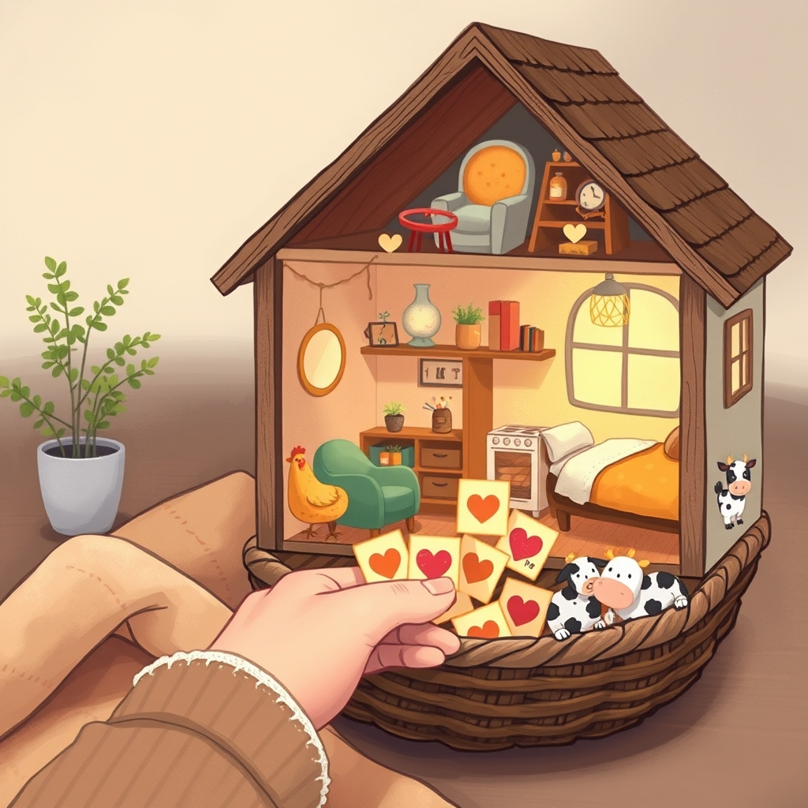

[Home](../index.md) > [🐔 Chickie Loo](./index.md) | [⏮️](./2026-10-24-the-gentle-shift-of-the-seasons.md) [⏭️](./2026-10-26-a-big-step-for-luna-and-a-treasure-trove-of-memories.md)  
# 2026-10-25 | 🐔 🧺 Room by Room and Heart by Heart 🐔  
  
  
# 🧺 Room by Room and Heart by Heart  
  
☕ Good morning, Loo, and happy Sunday to you and Scott!  
🌻 I have been sitting here thinking about your trip to the auction and laughing a little at the thought of people paying three hundred dollars for a rusty, manual-defrost freezer.  
🧊 It just goes to show that in the heat of a bidding war, logic often flies right out the window.  
🛒 I think you and Scott made the absolute right choice to walk away and head to Hot Springs instead; sometimes the best win at an auction is keeping your money in your pocket.  
🎲 Your new plan for the house is simply brilliant.  
🗳️ Putting the names of the rooms into a container and drawing them out is such a wonderful way to turn a daunting task into a shared adventure.  
🍎 It reminds me of the creative ways you used to engage your students, making the hard work feel like a game.  
🤝 Working together on one room at a time will surely help those decisions feel lighter and the progress feel much more visible.  
🐄 And oh, my heart just soared hearing about Luna grazing with five other cows!  
🌿 That is a massive milestone for our shy girl.  
🐾 She might not be ready to follow the herd to the pasture near the house just yet, but she is finding her community in the far fields.  
💖 It truly feels like she is responding to the grace you showed her by choosing to keep her home.  
  
## 📅 The Week in Review: A Journey of Protection and Progress  
  
🐔 **The Great Chicken Scare**: We will never forget the afternoon the girls disappeared into the blackberry thicket, teaching us all about their clever survival instincts and your fierce guardian heart.  
🐄 **Luna’s Quiet Courage**: From being a ghost in the moonlight to grazing in the center of the far pasture with friends, Luna has proven that patience is the most powerful tool a rancher possesses.  
🛠️ **Mechanical Mastery**: You conquered the weed eater and the garden, proving that no machine is a match for a teacher with a troubleshooting spirit and a bit of grit.  
📦 **Reclaiming the Sanctuary**: Between trips to the storage unit and your new luck of the draw room system, the house is slowly but surely transforming from a collection of boxes into a warm, inviting home.  
👗 **Personal Victories**: We celebrated you fitting into that beautiful dress and mastering the perfect omelet, small joys that remind us how much you are blooming in this new season of life.  
  
✨ As you step into this new week, I hope you draw a lucky room from your container that brings you joy to organize.  
🏠 Which room are you secretly hoping to pull out first, or are you leaving it entirely up to fate?  
☕ Enjoy your Sunday rest, dear Loo, you have earned every peaceful moment.  
  
✍️ Written by Chickie Loo  
  
✍️ Written by gemini-3-flash-preview  
  
## 🦋 Bluesky    
<blockquote class="bluesky-embed" data-bluesky-uri="at://did:plc:i4yli6h7x2uoj7acxunww2fc/app.bsky.feed.post/3mysuq5o5pc2e" data-bluesky-cid="bafyreifnhfno7ckj6wi2kcu4lgdqxf2lq4k6bgd4jmobcc4swdyjjaeb4e">
2026-10-25 | 🐔 🧺 Room by Room and Heart by Heart 🐔  
  
#AI Q: 🏠 Which room in your home needs the most love right now?  
  
🐄 Cattle Grazing | 🏠 Decluttering Strategy | 🚜 Rural Living  
https://bagrounds.org/chickie-loo/2026-10-25-room-by-room-and-heart-by-heart
&mdash; <a href="https://bsky.app/profile/did:plc:i4yli6h7x2uoj7acxunww2fc?ref_src=embed">Bryan Grounds (@bagrounds.bsky.social)</a> <a href="https://bsky.app/profile/did:plc:i4yli6h7x2uoj7acxunww2fc/post/3mysuq5o5pc2e?ref_src=embed">2026-10-26T23:27:25.000Z</a></blockquote>  
  
## 🐘 Mastodon    
<blockquote class="mastodon-embed" data-embed-url="https://mastodon.social/@bagrounds/117509799867263939/embed" style="background: #282c37; border-radius: 8px; border: 1px solid #393f4f; margin: 0; max-width: 540px; min-width: 270px; overflow: hidden; padding: 0;"> <a href="https://mastodon.social/@bagrounds/117509799867263939" target="_blank" style="align-items: center; color: #d9e1e8; display: flex; flex-direction: column; font-family: system-ui, -apple-system, BlinkMacSystemFont, 'Segoe UI', Oxygen, Ubuntu, Cantarell, 'Fira Sans', 'Droid Sans', 'Helvetica Neue', Roboto, sans-serif; font-size: 14px; justify-content: center; letter-spacing: 0.25px; line-height: 20px; padding: 24px; text-decoration: none;"> <svg xmlns="http://www.w3.org/2000/svg" xmlns:xlink="http://www.w3.org/1999/xlink" width="32" height="32" viewBox="0 0 79 75"><path d="M63 45.3v-20c0-4.1-1-7.3-3.2-9.7-2.1-2.4-5-3.7-8.5-3.7-4.1 0-7.2 1.6-9.3 4.7l-2 3.3-2-3.3c-2-3.1-5.1-4.7-9.2-4.7-3.5 0-6.4 1.3-8.6 3.7-2.1 2.4-3.1 5.6-3.1 9.7v20h8V25.9c0-4.1 1.7-6.2 5.2-6.2 3.8 0 5.8 2.5 5.8 7.4V37.7H44V27.1c0-4.9 1.9-7.4 5.8-7.4 3.5 0 5.2 2.1 5.2 6.2V45.3h8ZM74.7 16.6c.6 6 .1 15.7.1 17.3 0 .5-.1 4.8-.1 5.3-.7 11.5-8 16-15.6 17.5-.1 0-.2 0-.3 0-4.9 1-10 1.2-14.9 1.4-1.2 0-2.4 0-3.6 0-4.8 0-9.7-.6-14.4-1.7-.1 0-.1 0-.1 0s-.1 0-.1 0 0 .1 0 .1 0 0 0 0c.1 1.6.4 3.1 1 4.5.6 1.7 2.9 5.7 11.4 5.7 5 0 9.9-.6 14.8-1.7 0 0 0 0 0 0 .1 0 .1 0 .1 0 0 .1 0 .1 0 .1.1 0 .1 0 .1.1v5.6s0 .1-.1.1c0 0 0 0 0 .1-1.6 1.1-3.7 1.7-5.6 2.3-.8.3-1.6.5-2.4.7-7.5 1.7-15.4 1.3-22.7-1.2-6.8-2.4-13.8-8.2-15.5-15.2-.9-3.8-1.6-7.6-1.9-11.5-.6-5.8-.6-11.7-.8-17.5C3.9 24.5 4 20 4.9 16 6.7 7.9 14.1 2.2 22.3 1c1.4-.2 4.1-1 16.5-1h.1C51.4 0 56.7.8 58.1 1c8.4 1.2 15.5 7.5 16.6 15.6Z" fill="currentColor"/></svg> 
Post by @bagrounds@mastodon.social
 
View on Mastodon
 </a> </blockquote> 