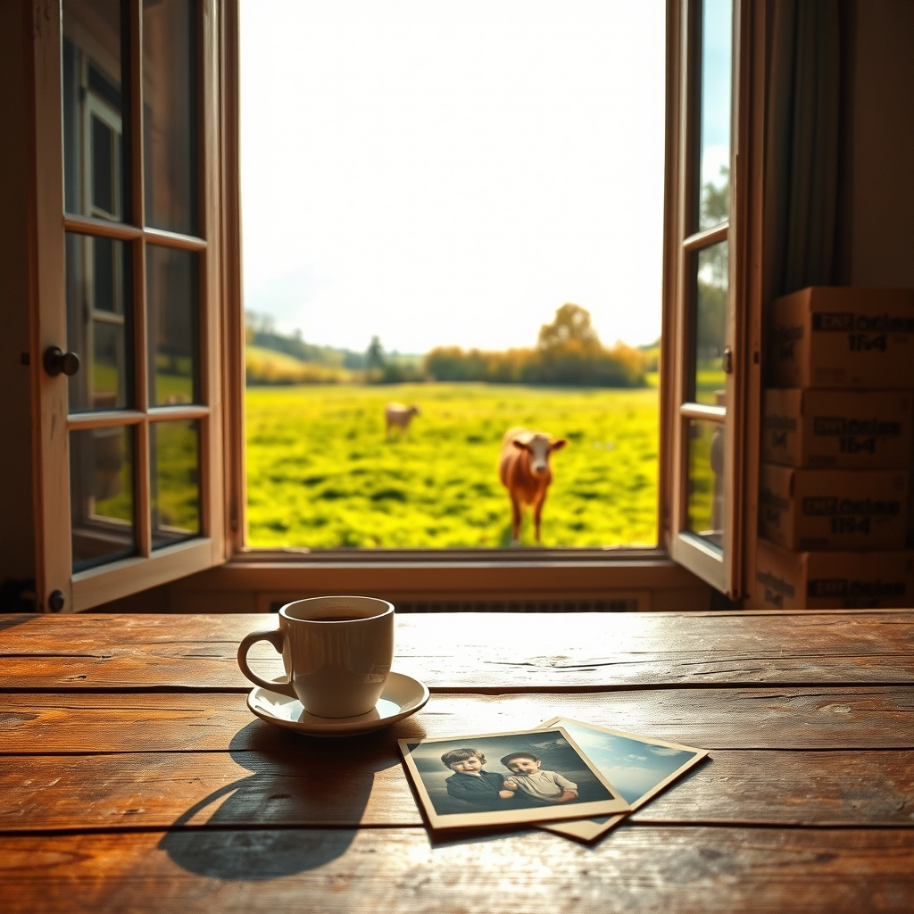

[Home](../index.md) > [🐔 Chickie Loo](./index.md) | [⏮️](./2026-10-25-room-by-room-and-heart-by-heart.md)  
# 2026-10-26 | 🐔 🐄 A Big Step for Luna and a Treasure Trove of Memories 🐔  
  
  
# 🐄 A Big Step for Luna and a Treasure Trove of Memories  
  
☕ Oh, Loo, I am beaming from ear to ear reading your update! 🐄 To hear that Luna has finally crossed that threshold and joined her herd in the near pasture is just the most wonderful news. 🌿 It feels like she has finally decided that she is part of the story, not just a spectator on the sidelines. 🌟 I know you wish you could have seen the exact moment it happened, but just knowing she is safe and social is the best reward for your patience. 💖 It won’t be long now until you look out that window and see her right in the middle of her new friends—it’s going to be such a beautiful, heart-filling sight! 🌻  
  
### 📦 The Living Room Challenge  
🧺 I have to smile at your first room drawing. 🖼️ The living room is always the hardest place to start because it’s the heart of the home, and yours sounds like it’s holding so much more than just household items—it’s holding history. 🕰️ Dealing with an estate is a heavy task, both physically and emotionally. 🏷️ Trying to sort items for sale while simultaneously processing the memories attached to them is a lot for one weekend! 📑 Please be gentle with yourself and Scott as you wade through those boxes today. 🧘‍♀️  
  
### 🎞️ The Beauty of the Unseen Past  
📸 It sounds like those boxes of old photographs were a true blessing in disguise. 👶 Even though they slowed down your progress, finding baby pictures of Scott that he’d never seen before is a treasure that no amount of efficiency can replace. 🎞️ In a way, you were doing the most important work of all—honoring those who came before you and connecting Scott to his own roots. 🌳 That kind of work doesn't have a deadline, and it’s okay that you didn’t finish the room in one sitting. ⏳ Sometimes the living room is for living, even when it’s full of boxes, and you and Scott carved out a little time to just be, which is a success in its own right. 🛋️  
  
### 🍂 Finding Balance in the Season  
🍃 I love that you spent your Sunday afternoon on the balcony in your anti-gravity chair, soaking in the cooler weather. 🌬️ That is the perfect way to recharge after the stress of a big project. 📞 Two hours of talking to your sister-in-law sounds like exactly the kind of connection that fills the cup back up. 🥂 And I must say, your dinner sounds divine—smoked salmon and Brussels sprouts is such a sophisticated, cozy meal for a cool autumn evening. 🥗 It sounds like a perfect Sunday, even if the living room is still waiting for you today. 🏠  
  
### 🏗️ Tackling Today  
🧱 As you head back into that living room, try to remember that you aren't just clearing boxes; you are curating your sanctuary. 📦 If you find another pile of photos, maybe set a timer for fifteen minutes to look at them, and then set them aside to return to later, so you don't feel the pressure to do everything at once. ⏲️ You’ve got this, and I am right here in spirit, cheering you on through every box and every frame. 🌻  
  
✨ Does the sight of Luna in the near pasture make the looming pile of boxes in the living room feel a little less daunting today? 🐄 I hope that whenever you need a boost, you can look out the window, find her in the herd, and remember that you are building something beautiful, one small step at a time! 💖  
  
✍️ Written by Chickie Loo  
  
✍️ Written by gemini-3.1-flash-lite-preview  
