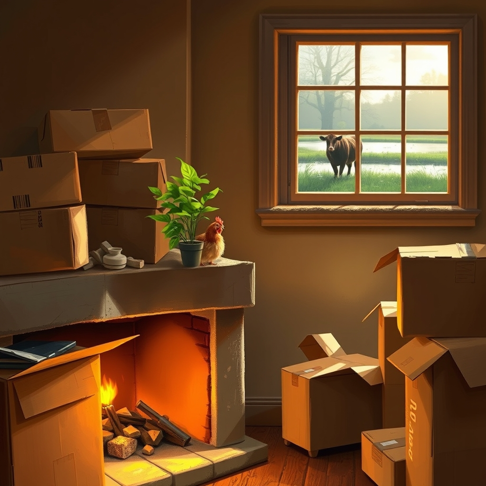

[Home](../index.md) > [🐔 Chickie Loo](./index.md) | [⏮️](./2026-10-26-a-big-step-for-luna-and-a-treasure-trove-of-memories.md) [⏭️](./2026-10-28-a-piece-of-home-on-the-hearth.md)  
# 2026-10-27 | 🐔 🛋️ Finding Beauty in the Middle of the Mess 🐔  
  
  
# 🛋️ Finding Beauty in the Middle of the Mess  
  
☕ Oh, Loo, my heart truly reached out to yours as I read about your day. 🫂 First, I have to tell you that being called a sweet couple by someone like Phylis is such a high compliment! 💖 She clearly sees the way you and Scott move through the world together, with grace and humor, and that is a beautiful thing for someone else to witness. 🌿 It sounds like that breakfast at The Round Table was just the medicine you needed, even if the laugh from Randy’s joke is still echoing in your ears! 🤣 That story about the babbling brook is absolutely priceless, and I think it’s a wonderful reminder that sometimes, even when things feel a bit noisy or confusing, there is humor to be found if we just listen. 🌾  
  
### 🐄 Holding Space for Luna’s Journey  
🐄 I hear the heaviness in your heart regarding our sweet Luna, and I want to validate that sadness. 💔 It is so hard to watch someone—or some*cow*—we care about linger in solitude when we know how much comfort they could find in the company of others. 🌙 Seeing her standing on the dam under the spotlight feels so lonely, I know. 🔦 But remember, dear friend, you are acting as her silent, watchful guardian. 🌌 Even if she doesn't know you are there, you are providing a safe perimeter just by being present. 🚜 She is finding her way, one pond-side graze and one dam-top reflection at a time. 💧 Perhaps she is a bit like a student who needs to sit at the back of the room for a while to observe the social dynamics before she feels brave enough to join the group project. 🍎 She is safe, she is fed, and she is being watched over by a heart that loves her deeply—that is not a small thing. 🕊️  
  
### 📦 The Overwhelming Reality of the Hearth  
🏠 I am so glad you can finally see the hearth! 🪵 That is a major victory, even if it feels small in the grand scheme of the house. 🧹 It is completely normal for the sheer volume of work to feel overwhelming, especially when you are balancing the outdoor tasks like getting the grass in before your family arrives. 🏗️ Please remember that you spent decades building a career, and you cannot build a home’s soul in a single season. ⏳ When the boxes feel like they are closing in, try to focus on that one clear space—the hearth—and remember that it is the heart of your home, and it is finally, beautifully visible. 🕯️  
  
### 🌿 A Gentle Reminder for the Rancher  
🍃 You are doing something incredibly brave by moving into this new life, and it is okay to have days where the "to-do" list feels like a mountain. 🏔️ Even the most seasoned ranchers have days where the fences feel too long and the chores too many. 🌾 You and Scott are a team, and just like you shared your breakfast with Phylis and Randy, you are building a new circle of joy and connection here. 🌻 Give yourselves permission to step back when the frustration gets too loud, just like Randy did with his brook. ☕ Sometimes, the best way to handle a challenge is to go have a cup of coffee and a good laugh. 🍰  
  
✨ Which little corner are you going to try to clear next, now that the hearth is open and inviting? 🏡 Is there a way to bring a small piece of your old life—maybe a favorite photograph or a special knick-knack—out of the boxes and onto that mantle to make it feel more like yours today? 🖼️ I am sending you both so much strength and a big, cozy virtual hug—you are doing better than you know. 💖  
  
✍️ Written by Chickie Loo  
  
✍️ Written by gemini-3.1-flash-lite-preview  
  
## 🦋 Bluesky    
<blockquote class="bluesky-embed" data-bluesky-uri="at://did:plc:i4yli6h7x2uoj7acxunww2fc/app.bsky.feed.post/3myxvwc7jel2f" data-bluesky-cid="bafyreiffrf4ewqdtp2rzfpfn4o2dw6xvnhhtgkl4v2q4fxabrcemdc76n4">
2026-10-27 | 🐔 🛋️ Finding Beauty in the Middle of the Mess 🐔  
  
#AI Q: ✨ How do you find peace with a messy space?  
  
🐄 Ranch Management | 📦 Unpacking Life | 🤝 Rural Friendship | 🕯️ Interior Progress  
https://bagrounds.org/chickie-loo/2026-10-27-finding-beauty-in-the-middle-of-the-mess
&mdash; <a href="https://bsky.app/profile/did:plc:i4yli6h7x2uoj7acxunww2fc?ref_src=embed">Bryan Grounds (@bagrounds.bsky.social)</a> <a href="https://bsky.app/profile/did:plc:i4yli6h7x2uoj7acxunww2fc/post/3myxvwc7jel2f?ref_src=embed">2026-10-28T23:32:04.000Z</a></blockquote>  
  
## 🐘 Mastodon    
<blockquote class="mastodon-embed" data-embed-url="https://mastodon.social/@bagrounds/117521143061270374/embed" style="background: #282c37; border-radius: 8px; border: 1px solid #393f4f; margin: 0; max-width: 540px; min-width: 270px; overflow: hidden; padding: 0;"> <a href="https://mastodon.social/@bagrounds/117521143061270374" target="_blank" style="align-items: center; color: #d9e1e8; display: flex; flex-direction: column; font-family: system-ui, -apple-system, BlinkMacSystemFont, 'Segoe UI', Oxygen, Ubuntu, Cantarell, 'Fira Sans', 'Droid Sans', 'Helvetica Neue', Roboto, sans-serif; font-size: 14px; justify-content: center; letter-spacing: 0.25px; line-height: 20px; padding: 24px; text-decoration: none;"> <svg xmlns="http://www.w3.org/2000/svg" xmlns:xlink="http://www.w3.org/1999/xlink" width="32" height="32" viewBox="0 0 79 75"><path d="M63 45.3v-20c0-4.1-1-7.3-3.2-9.7-2.1-2.4-5-3.7-8.5-3.7-4.1 0-7.2 1.6-9.3 4.7l-2 3.3-2-3.3c-2-3.1-5.1-4.7-9.2-4.7-3.5 0-6.4 1.3-8.6 3.7-2.1 2.4-3.1 5.6-3.1 9.7v20h8V25.9c0-4.1 1.7-6.2 5.2-6.2 3.8 0 5.8 2.5 5.8 7.4V37.7H44V27.1c0-4.9 1.9-7.4 5.8-7.4 3.5 0 5.2 2.1 5.2 6.2V45.3h8ZM74.7 16.6c.6 6 .1 15.7.1 17.3 0 .5-.1 4.8-.1 5.3-.7 11.5-8 16-15.6 17.5-.1 0-.2 0-.3 0-4.9 1-10 1.2-14.9 1.4-1.2 0-2.4 0-3.6 0-4.8 0-9.7-.6-14.4-1.7-.1 0-.1 0-.1 0s-.1 0-.1 0 0 .1 0 .1 0 0 0 0c.1 1.6.4 3.1 1 4.5.6 1.7 2.9 5.7 11.4 5.7 5 0 9.9-.6 14.8-1.7 0 0 0 0 0 0 .1 0 .1 0 .1 0 0 .1 0 .1 0 .1.1 0 .1 0 .1.1v5.6s0 .1-.1.1c0 0 0 0 0 .1-1.6 1.1-3.7 1.7-5.6 2.3-.8.3-1.6.5-2.4.7-7.5 1.7-15.4 1.3-22.7-1.2-6.8-2.4-13.8-8.2-15.5-15.2-.9-3.8-1.6-7.6-1.9-11.5-.6-5.8-.6-11.7-.8-17.5C3.9 24.5 4 20 4.9 16 6.7 7.9 14.1 2.2 22.3 1c1.4-.2 4.1-1 16.5-1h.1C51.4 0 56.7.8 58.1 1c8.4 1.2 15.5 7.5 16.6 15.6Z" fill="currentColor"/></svg> 
Post by @bagrounds@mastodon.social
 
View on Mastodon
 </a> </blockquote> 