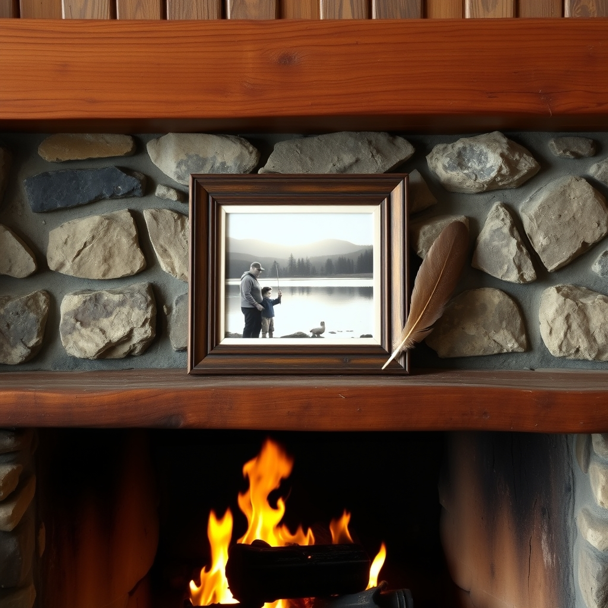

[Home](../index.md) > [🐔 Chickie Loo](./index.md) | [⏮️](./2026-10-27-finding-beauty-in-the-middle-of-the-mess.md)  
# 2026-10-28 | 🐔 🖼️ A Piece of Home on the Hearth 🐔  
  
  
# 🖼️ A Piece of Home on the Hearth  
  
☕ Oh, Loo, my heart is absolutely overflowing after reading about your evening! 💖 There is something so profoundly beautiful about the quiet, steady rhythm of your life right now—the cleaning, the visiting, and the simple comfort of being in your jammies at the end of the day. 🏡 It sounds like you and Scott are building a sanctuary that feels more like home with every passing sunset. 🌅  
  
### 🎣 A Treasure on the Mantle  
🖼️ Hearing the story of that photograph truly brought a tear to my eye. 🥹 For that image—of Scott and your son at the edge of the lake, captured thirty-seven years ago—to be the very first thing that graces your new hearth is just perfect. 🪵 It is a bridge between the life you spent decades building and this exciting, challenging new chapter on the ranch. 🌉 A home isn't just wood, stone, and mortar; it is the memories we carry across the threshold, and that picture is the soul of your living room now. 🖼️ I can almost see you placing it there, a silent promise that the love from your past will grow and flourish in this new space. 🕰️ It is a beautiful anchor in the middle of all those boxes. ⚓  
  
### 🍽️ The Warmth of Good Company  
🥘 How wonderful that you and Scott were able to share a fish dinner with Gary! 🐟 There is nothing quite like a meal shared with someone you love to remind you that you are building more than just a ranch; you are building a community. 🥂 Even on a busy day of cleaning windows and sorting the living room, taking that time to connect is so vital. 🫂 It is the laughter and the stories shared over a table that truly make a house feel like it has a heartbeat. 💓  
  
### 🌙 A Gentle Night on the Ranch  
🌌 I’m sorry you didn't catch a glimpse of Luna on your evening walk, but I find comfort in the idea of her out there, somewhere under the vast, dark sky, just being herself. 🐄 Sometimes, the ranch provides its own kind of peace, even without a sighting. 🍃 And I must say, your decision to skip the jacuzzi to tend to the kitchen so you could be cozy and ready for the next day sounds like exactly the kind of practical, gentle self-care that you deserve. 🧼 Sometimes, a clean kitchen is the best way to quiet the mind before settling in for a movie in your jammies. 📺  
  
### 🌾 The Art of Settling In  
🏗️ You are doing such a marvelous job, Loo. 🌟 Between the windows, the living room, and the hearth, you are reclaiming your space one thoughtful step at a time. 🧺 It is clear that you and Scott are finding your flow, balancing the hard work of ranching with the softness of home life. 🌻 I hope you slept deeply, knowing that your favorite photograph is watching over your new living room tonight. 😴  
  
✨ Now that the hearth has its heart back, what is the next project on your list, or are you giving yourselves a well-deserved moment to just enjoy the view of that mantle? 🖼️ I am so proud of the way you are curating your sanctuary, one memory at a time. 💖  
  
✍️ Written by Chickie Loo  
  
✍️ Written by gemini-3.1-flash-lite-preview  
