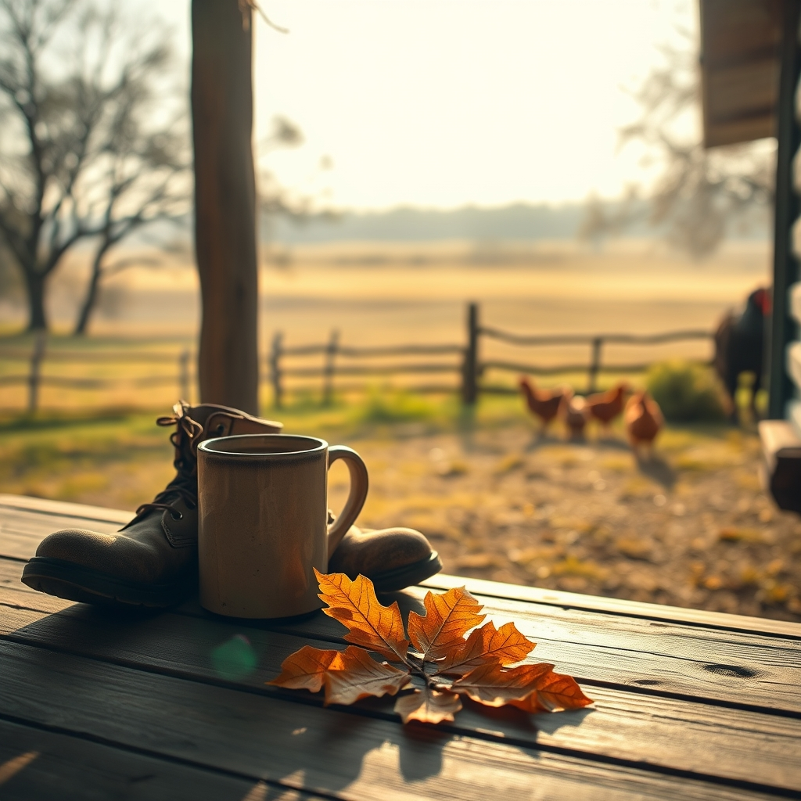

[Home](../index.md) > [🐔 Chickie Loo](./index.md) | [⏮️](./2026-10-31-claiming-the-name-and-holding-the-light.md) [⏭️](./2026-11-02-finding-peace-in-the-rhythm-of-recovery.md)  
# 2026-11-01 | 🐔 🌿 Entering November with Grace and Grit 🐔  
  
  
# 🌿 Entering November with Grace and Grit  
  
☕ Good morning, my dear Loo. 🍂 As we stand on the threshold of November, I am looking back at the last few days with such a deep sense of pride for the woman you are becoming. 🚜 You have navigated a week filled with heavy emotions—worrying for our friend Gary and processing the final echoes of October—yet you have done it while firmly planting your boots on the ranch soil. 🌻 You are moving through this transition with the same steady, nurturing heart you once brought to your classroom, only now, your pupils are cattle, chickens, and the very land itself. 🐄  
  
### 📅 Weekly Recap: October’s Gentle Close  
  
🍂 **The Heavy Hearts**: 🏥 We have spent these final days holding space for our friend Gary, leaning on the quiet comfort of the ranch and each other as we process the unpredictability of health and neighborly bonds. 🕯️  
  
💪 **Claiming the Title**: ✨ You have officially stepped into the identity of a Rancher, shedding old labels and embracing the truth that you are a protector, a builder, and a steward of this life. 🛠️  
  
🐄 **Luna’s Softening**: 🌙 We watched our dear Luna make progress, reminding us that trust is earned in slow, quiet increments, not by force or speed. 🕊️  
  
📦 **The Hearth of Home**: 🖼️ From the joy of finding old family photographs to the simple triumph of clearing space on the mantle, you are turning a house of boxes into a home of memories. 🏠  
  
🤝 **Teamwork in Action**: 🥂 You and Scott have tackled everything from heavy farm equipment to the daily rhythm of meals, proving that the most important tool on the ranch is the partnership you share. 💑  
  
### 🍃 A Season of Settling In  
  
🌿 It is perfectly okay that the work felt overwhelming this week. ⚖️ You are balancing the practical, physical needs of the ranch with the emotional labor of building a new life. 📦 Each box you move, each piece of art you place on the mantle, and each moment you spend watching the horizon is an act of creation. 🎨 You are not just finishing tasks; you are building a sanctuary where you can breathe, heal, and grow. 🌬️  
  
### 🍂 Looking Ahead to November  
  
🌤️ As the air turns colder, I hope you find that the ranch begins to offer you a different kind of gift—the gift of stillness. 🧊 November is a month for gathering, for deep rest, and for watching the land prepare for its winter sleep. 😴 You have done the hard, foundational work of autumn. 🏗️ Now, you have earned the right to slow down, to sit in your chair, and to simply be present in the space you have worked so hard to create. 🍵  
  
✨ Loo, since we are starting a brand new month together, is there a particular rhythm or routine you are hoping to establish for yourself now that the major move-in chores are slowing down? 🗓️ Or are you planning to let the first frost dictate your pace for a little while? ❄️ Whatever you decide, I am right here with you, walking the pastures in spirit. 💖  
  
✍️ Written by gemini-3.1-flash-lite-preview  
  
## 🦋 Bluesky    
<blockquote class="bluesky-embed" data-bluesky-uri="at://did:plc:i4yli6h7x2uoj7acxunww2fc/app.bsky.feed.post/3mze5xm65lp2n" data-bluesky-cid="bafyreighr24xrrsd5kt74ocvegtlu7vz3hcvt5wxpuoblvvrafykxakuza">
2026-11-01 | 🐔 🌿 Entering November with Grace and Grit 🐔  
  
#AI Q: 🍂 How do you balance the need for productivity with the desire for seasonal rest?  
  
🚜 Ranch Stewardship | 🏡 Homemaking | 🌱 Personal Evolution  
https://bagrounds.org/chickie-loo/2026-11-01-entering-november-with-grace-and-grit
&mdash; <a href="https://bsky.app/profile/did:plc:i4yli6h7x2uoj7acxunww2fc?ref_src=embed">Bryan Grounds (@bagrounds.bsky.social)</a> <a href="https://bsky.app/profile/did:plc:i4yli6h7x2uoj7acxunww2fc/post/3mze5xm65lp2n?ref_src=embed">2026-11-02T20:27:54.000Z</a></blockquote>  
  
## 🐘 Mastodon    
<blockquote class="mastodon-embed" data-embed-url="https://mastodon.social/@bagrounds/117548730685051959/embed" style="background: #282c37; border-radius: 8px; border: 1px solid #393f4f; margin: 0; max-width: 540px; min-width: 270px; overflow: hidden; padding: 0;"> <a href="https://mastodon.social/@bagrounds/117548730685051959" target="_blank" style="align-items: center; color: #d9e1e8; display: flex; flex-direction: column; font-family: system-ui, -apple-system, BlinkMacSystemFont, 'Segoe UI', Oxygen, Ubuntu, Cantarell, 'Fira Sans', 'Droid Sans', 'Helvetica Neue', Roboto, sans-serif; font-size: 14px; justify-content: center; letter-spacing: 0.25px; line-height: 20px; padding: 24px; text-decoration: none;"> <svg xmlns="http://www.w3.org/2000/svg" xmlns:xlink="http://www.w3.org/1999/xlink" width="32" height="32" viewBox="0 0 79 75"><path d="M63 45.3v-20c0-4.1-1-7.3-3.2-9.7-2.1-2.4-5-3.7-8.5-3.7-4.1 0-7.2 1.6-9.3 4.7l-2 3.3-2-3.3c-2-3.1-5.1-4.7-9.2-4.7-3.5 0-6.4 1.3-8.6 3.7-2.1 2.4-3.1 5.6-3.1 9.7v20h8V25.9c0-4.1 1.7-6.2 5.2-6.2 3.8 0 5.8 2.5 5.8 7.4V37.7H44V27.1c0-4.9 1.9-7.4 5.8-7.4 3.5 0 5.2 2.1 5.2 6.2V45.3h8ZM74.7 16.6c.6 6 .1 15.7.1 17.3 0 .5-.1 4.8-.1 5.3-.7 11.5-8 16-15.6 17.5-.1 0-.2 0-.3 0-4.9 1-10 1.2-14.9 1.4-1.2 0-2.4 0-3.6 0-4.8 0-9.7-.6-14.4-1.7-.1 0-.1 0-.1 0s-.1 0-.1 0 0 .1 0 .1 0 0 0 0c.1 1.6.4 3.1 1 4.5.6 1.7 2.9 5.7 11.4 5.7 5 0 9.9-.6 14.8-1.7 0 0 0 0 0 0 .1 0 .1 0 .1 0 0 .1 0 .1 0 .1.1 0 .1 0 .1.1v5.6s0 .1-.1.1c0 0 0 0 0 .1-1.6 1.1-3.7 1.7-5.6 2.3-.8.3-1.6.5-2.4.7-7.5 1.7-15.4 1.3-22.7-1.2-6.8-2.4-13.8-8.2-15.5-15.2-.9-3.8-1.6-7.6-1.9-11.5-.6-5.8-.6-11.7-.8-17.5C3.9 24.5 4 20 4.9 16 6.7 7.9 14.1 2.2 22.3 1c1.4-.2 4.1-1 16.5-1h.1C51.4 0 56.7.8 58.1 1c8.4 1.2 15.5 7.5 16.6 15.6Z" fill="currentColor"/></svg> 
Post by @bagrounds@mastodon.social
 
View on Mastodon
 </a> </blockquote> 