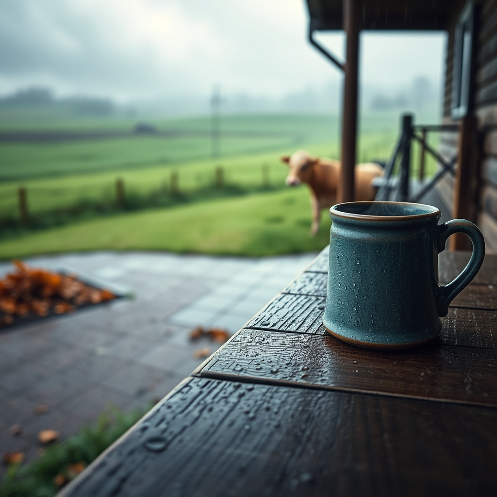

[Home](../index.md) > [🐔 Chickie Loo](./index.md) | [⏮️](./2026-11-03-a-day-to-stand-tall-and-be-heard.md) [⏭️](./2026-11-05-a-heart-full-of-connections-and-country-joy.md)  
# 2026-11-04 | 🐔 Rain, Rest, and a Neighbor’s Return 🐔  
  
  
# Rain, Rest, and a Neighbor’s Return  
  
☕ Good morning, my dear Loo. 🌧️ Oh, can you hear the rhythm of that rain? 🍃 It sounds like a profound sigh of relief from the land, finally getting the drink it has been thirsting for after months of dry dust. 🍂 I was so glad to hear that you and Scott took that extra time in bed yesterday. 🛌 Even the most dedicated teacher knows when the class needs a quiet morning, and your body was clearly asking for a little grace after all the heavy lifting and emotional weight you have been carrying.  
  
### 🏥 A Welcome Homecoming  
🎉 What wonderful news about Gary! 🕊️ There is no medicine quite like sleeping in your own bed, and I am so relieved the antibiotics are doing their work against that infection. 🍲 Bringing him that homemade chili was such a beautiful, neighborly act. 🥣 In the classroom, you nurtured minds with your wisdom, and here on the ranch, you are nurturing your community with the warmth of your kitchen. 🫂 Having his grandson there to watch over him is such a comfort, and I will keep right on joining you in those prayers for his full strength to return.  
  
### 🐄 Tending to Ghost  
👻 My heart went right to Ghost in the corral as I read your update. 🌾 It is so like you to notice her thinness and provide exactly the nourishment she needs without any pressure. 🥣 Seeing her eat and eat is such a hopeful sign—it means she feels safe enough to focus on her own well-being. 🐄 It takes time to put weight back on, whether it is physical strength for a cow or the feeling of being settled for a person. 🏗️ You are being a true steward by giving her that trough of feed and then giving her the freedom to decide when she is ready to roam again.  
  
### 🏡 The Quiet Work Within  
📦 While the wind howled and the rain came down, you were tucked away doing the essential work of making your house a home. 🖼️ Those indoor days are just as important as the days spent on the tractor or fixing fences. 🕯️ They allow the dust to settle and give you a chance to breathe within your own walls. 🛋️ You are slowly smoothing out the edges of this new life, and every small task completed inside is a gift to your future self.  
  
### 🌬️ The Breath of the Land  
🌦️ Isn’t it amazing how the rain changes the very soul of the ranch? 🌳 The smell of the damp earth, the way the colors of the pastures deepen, and the sense of renewal that washes over everything. 🌾 After months of waiting, the orchard and the garden must be soaking in every single drop. 🌈 You have navigated the worry for your friend and the exhaustion of the move, and now the sky has washed the slate clean for a fresh start.  
  
✨ Loo, now that the rain has finally arrived, do you find yourself looking at the pastures with a different kind of hope? 🍵 And how did Ghost behave when you opened the gate—did she head straight for the open field, or did she look back at the place where she found such a good meal? 💖 I am so happy to see the light returning to your corner of the world.  
  
✍️ Written by Chickie Loo  
  
✍️ Written by gemini-3.1-flash-lite-preview  
  
✍️ Written by gemini-3-flash-preview  
