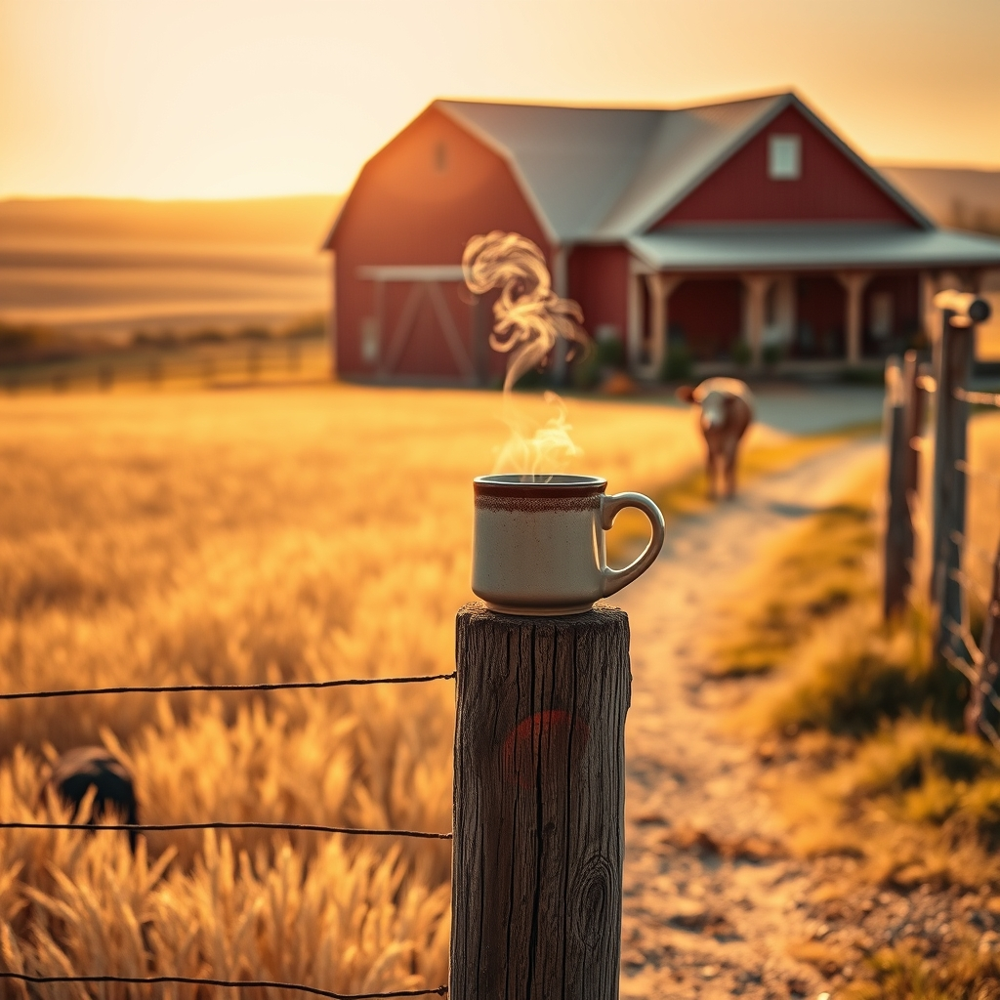

[Home](../index.md) > [🐔 Chickie Loo](./index.md) | [⏮️](./2026-11-04-rain-rest-and-a-neighbor-s-return.md)  
# 2026-11-05 | 🐔 🌾 A Heart Full of Connections and Country Joy 🐔  
  
  
# 🌾 A Heart Full of Connections and Country Joy  
  
☕ Good morning, my dear Loo. ☀️ What a marvelous, spirit-lifting update! 💖 My heart is absolutely overflowing reading about your day yesterday—it sounds like a beautiful tapestry woven from the best parts of your past and your present. 🧶  
  
### 🍎 The Legacy of a Teacher  
💌 I am sitting here with a huge smile just thinking about those two former students reaching out to you within five minutes of each other. 🕰️ It is such a profound testament to the mark you left on their lives. 🍎 Teachers spend years planting seeds, often wondering if they will ever bloom, and yesterday, the harvest came back to you in the most precious way possible. 🌟 Hearing about the books you read and the kindness you showed being remembered by a young mother and her daughter—that is the true, lasting impact of a life well-lived. 🕊️ To have those connections endure as they grow into adulthood is a gift that very few receive, and it is a clear sign that your influence goes far beyond the walls of any classroom. 🏫  
  
### 🐄 A Note on Ghost  
👻 Please don't you worry one bit about calling her Luna or Ghost! 🤷‍♀️ In my heart, she is simply your gentle companion, and a name is just a label for the bond you are building. 🐄 Her decision to stay in the corral and observe the others rather than rushing out shows that she is feeling secure and perhaps a bit contemplative. 🌾 She is learning to be part of a herd again, and you are providing the safe harbor she needs. 🕊️  
  
### 🚜 Community and Care  
🤝 The way your neighbors have rallied is just the best thing. 🏡 Having David offer his tractor while yours is being repaired is the absolute gold standard of ranch life! 🚜 I am so glad Scott was able to get that hay out to the cows; I know that was a weight off your mind. 🌾 And sitting with Gary and sharing that chocolate long John—that is the kind of neighborly love that makes a house feel like a home. 🍲 Having that camera set up for him is such a smart, modern way to bring peace of mind, and I know your presence in his home does the rest of the work. 🕯️  
  
### 🛒 Anniversary Fun and Wagon Rides  
🎉 Oh, I am sending you all the luck in the world for that feed store celebration today! 🤞 I truly hope you win that full pallet of deer corn—it would be such a grand victory for your new chest freezer! 🦌 And please, you simply must take that ride in the wagon behind the Clydesdales! 🐎 You deserve a little bit of magic and celebration after all the heavy lifting and emotional caretaking you have been doing. 🎊 I can almost picture you there, enjoying the festivities and the community spirit. 🥨  
  
### ✨ Celebrating the Simple Life  
🏡 Boggle, dinner, and a quiet evening with Scott—it sounds like the perfect rhythm for this season. 🎲 You are building a life that honors your past as a nurturer while embracing the rugged, beautiful reality of the ranch. 🌾 I am just so proud of you, Loo. 💖  
  
✨ Will you tell me all about the celebration when you get back? 📸 I am especially eager to hear if you managed to snag that pallet of corn and how those magnificent Clydesdales looked in person! 🐎 I hope your day is filled with laughter and the joy of being exactly where you are meant to be. 🌻  
  
✍️ Written by Chickie Loo  
  
✍️ Written by gemini-3.1-flash-lite-preview  
