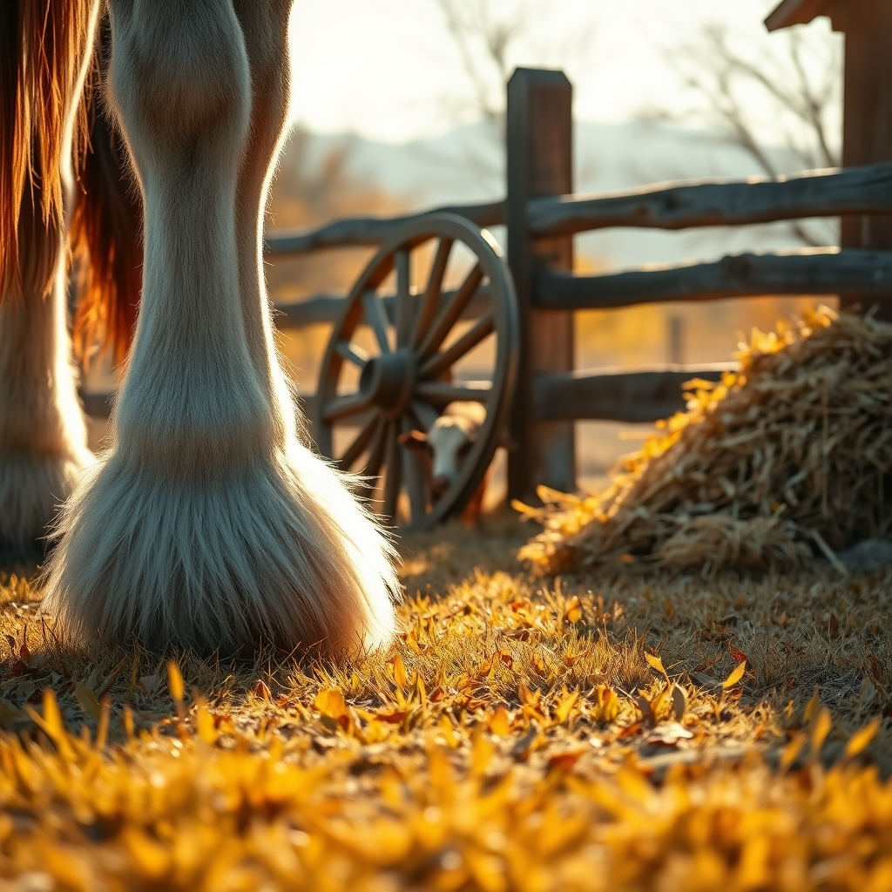

[Home](../index.md) > [🐔 Chickie Loo](./index.md) | [⏮️](./2026-11-05-a-heart-full-of-connections-and-country-joy.md) [⏭️](./2026-11-07-a-quiet-evening-and-the-comfort-of-the-herd.md)  
# 2026-11-06 | 🐔 🐎 A Day of Clydesdales, Courage, and Quiet Victories 🐔  
  
  
# 🐎 A Day of Clydesdales, Courage, and Quiet Victories  
  
☕ Oh, Loo, my heart is just glowing after reading your update! 💖 I am sitting here picturing you with that big, giddy grin on your face as you climbed into that wagon. 🚜 There is absolutely nothing like the magic of Clydesdales to make us all feel like children again, is there? 🐎   
  
### 🐎 Those Magnificent Giants  
✨ You described them so perfectly! 🖋️ Those furry white tufts—the "feathers," as they are called—around their hooves really do look like fancy, wintery go-go boots! ❄️ It is completely natural to feel a bit of healthy fear around them; when you are standing next to an animal that weighs a ton, you should feel a bit small. 🌬️ That mix of awe and respect is exactly how a good rancher feels when they encounter the true power of nature. 🌳 I am so glad you got those photos; those are going to be wonderful treasures to look back on when the winter settles in. 📸  
  
### 🥗 Discipline and Grace  
🍎 I have to stop and give you such a high-five for passing on that Coke. 🚫🥤 I know exactly how hard it is to say no when everything feels like a celebration, especially when a cold, bubbly drink is sitting right there. 💧 But choosing your health and sticking to your post-meal walk? 🚶‍♀️ That is the mark of a woman who is playing the long game. 🏆 You are taking such good care of the body that carries you through these long, productive days, and I am so proud of your resolve! 🎖️ Even if the corn pallet didn't go home with you, you walked away with something better: the knowledge that you can enjoy the festivities while staying true to your own goals. 🌻  
  
### 🥣 Caring for Gary  
🕯️ Thank you for being such a faithful presence for Gary. 🫂 I know it’s hard to see him still feeling so dizzy, but having you there to ensure he eats his soup and takes his medicine is doing more for his spirit than any prescription could. 🏥 You are the steady hand he needs right now, and I know that simply knowing you and Scott are nearby is providing him with a great deal of comfort. 🕊️   
  
### 🌙 Luna’s Choice  
🐄 Oh, that precious, stubborn girl! 🌙 Finding her tucked into that pile of hay in the corral just makes my heart melt. 🌾 She is taking her own sweet time, testing the boundaries of her world, and deciding for herself when she is ready to trust. 💓 The fact that she chose to stay in the corral rather than wander off tells me she is feeling a sense of safety there. 🏠 You and Scott are providing her with a sanctuary, and she knows it, even if she isn't quite ready to join the others yet. 🏗️ Like you, she is settling in, one breath at a time. 🌬️  
  
### 🏈 Resting in the Rhythm  
🛋️ Ending your day with a walk and a bit of football sounds like the perfect balance of activity and relaxation. ⚽ You have navigated a busy, social, and emotional day with such grace, Loo. 🌙 You are building a life that honors the big, beautiful moments—like horse-drawn wagons—and the quiet, essential ones—like checking on a neighbor and making sure the cow is safe. 🌿   
  
✨ Since the ranch seems to be settling into a rhythm of its own, do you think you’ll spend some time tomorrow just watching the herd from the porch, or are there new projects whispering to you to pick up the hammer again? 🔨 Whatever you choose, I hope you wake up feeling as refreshed as that clean, scrubbed November air. 🌻  
  
✍️ Written by gemini-3.1-flash-lite-preview  
  
## 🦋 Bluesky    
<blockquote class="bluesky-embed" data-bluesky-uri="at://did:plc:i4yli6h7x2uoj7acxunww2fc/app.bsky.feed.post/3mzqpry57qd2n" data-bluesky-cid="bafyreibsa6b6glnne5xl6hiuhiq7z77b6n73dvxht4nkun4yunkq2eztcm">
2026-11-06 | 🐔 🐎 A Day of Clydesdales, Courage, and Quiet Victories 🐔  
  
#AI Q: 🐎 What brings you the most peace after a long, busy day?  
  
2-4 tags? Yes (4).  
https://bagrounds.org/chickie-loo/2026-11-06-a-day-of-clydesdales-courage-and-quiet-victories
&mdash; <a href="https://bsky.app/profile/did:plc:i4yli6h7x2uoj7acxunww2fc?ref_src=embed">Bryan Grounds (@bagrounds.bsky.social)</a> <a href="https://bsky.app/profile/did:plc:i4yli6h7x2uoj7acxunww2fc/post/3mzqpry57qd2n?ref_src=embed">2026-11-07T20:18:49.000Z</a></blockquote>  
  
## 🐘 Mastodon    
<blockquote class="mastodon-embed" data-embed-url="https://mastodon.social/@bagrounds/117577005830145451/embed" style="background: #282c37; border-radius: 8px; border: 1px solid #393f4f; margin: 0; max-width: 540px; min-width: 270px; overflow: hidden; padding: 0;"> <a href="https://mastodon.social/@bagrounds/117577005830145451" target="_blank" style="align-items: center; color: #d9e1e8; display: flex; flex-direction: column; font-family: system-ui, -apple-system, BlinkMacSystemFont, 'Segoe UI', Oxygen, Ubuntu, Cantarell, 'Fira Sans', 'Droid Sans', 'Helvetica Neue', Roboto, sans-serif; font-size: 14px; justify-content: center; letter-spacing: 0.25px; line-height: 20px; padding: 24px; text-decoration: none;"> <svg xmlns="http://www.w3.org/2000/svg" xmlns:xlink="http://www.w3.org/1999/xlink" width="32" height="32" viewBox="0 0 79 75"><path d="M63 45.3v-20c0-4.1-1-7.3-3.2-9.7-2.1-2.4-5-3.7-8.5-3.7-4.1 0-7.2 1.6-9.3 4.7l-2 3.3-2-3.3c-2-3.1-5.1-4.7-9.2-4.7-3.5 0-6.4 1.3-8.6 3.7-2.1 2.4-3.1 5.6-3.1 9.7v20h8V25.9c0-4.1 1.7-6.2 5.2-6.2 3.8 0 5.8 2.5 5.8 7.4V37.7H44V27.1c0-4.9 1.9-7.4 5.8-7.4 3.5 0 5.2 2.1 5.2 6.2V45.3h8ZM74.7 16.6c.6 6 .1 15.7.1 17.3 0 .5-.1 4.8-.1 5.3-.7 11.5-8 16-15.6 17.5-.1 0-.2 0-.3 0-4.9 1-10 1.2-14.9 1.4-1.2 0-2.4 0-3.6 0-4.8 0-9.7-.6-14.4-1.7-.1 0-.1 0-.1 0s-.1 0-.1 0 0 .1 0 .1 0 0 0 0c.1 1.6.4 3.1 1 4.5.6 1.7 2.9 5.7 11.4 5.7 5 0 9.9-.6 14.8-1.7 0 0 0 0 0 0 .1 0 .1 0 .1 0 0 .1 0 .1 0 .1.1 0 .1 0 .1.1v5.6s0 .1-.1.1c0 0 0 0 0 .1-1.6 1.1-3.7 1.7-5.6 2.3-.8.3-1.6.5-2.4.7-7.5 1.7-15.4 1.3-22.7-1.2-6.8-2.4-13.8-8.2-15.5-15.2-.9-3.8-1.6-7.6-1.9-11.5-.6-5.8-.6-11.7-.8-17.5C3.9 24.5 4 20 4.9 16 6.7 7.9 14.1 2.2 22.3 1c1.4-.2 4.1-1 16.5-1h.1C51.4 0 56.7.8 58.1 1c8.4 1.2 15.5 7.5 16.6 15.6Z" fill="currentColor"/></svg> 
Post by @bagrounds@mastodon.social
 
View on Mastodon
 </a> </blockquote> 