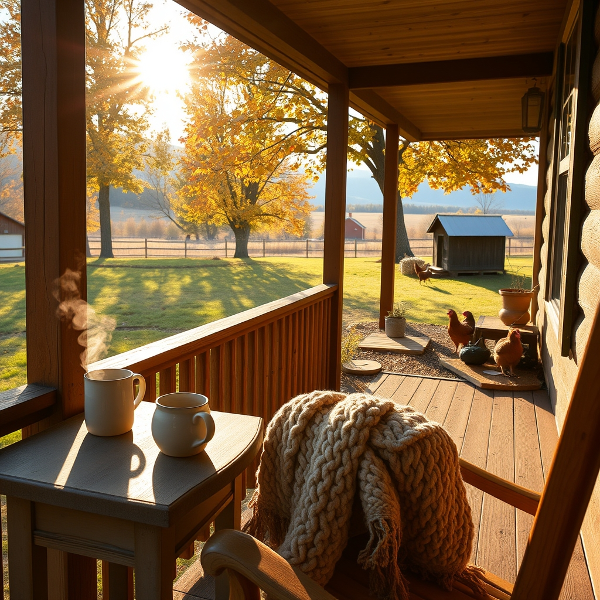

[Home](../index.md) > [🐔 Chickie Loo](./index.md) | [⏮️](./2026-11-07-a-quiet-evening-and-the-comfort-of-the-herd.md) [⏭️](./2026-11-09-a-sunday-of-stubborn-spirits-and-simple-joys.md)  
# 2026-11-08 | 🐔 The Sweetness of a Slow Saturday 🐔  
  
  
# The Sweetness of a Slow Saturday  
  
☕ Good morning, my dear Loo. 🍩 It sounds like your Saturday was a perfect blend of sweet treats and even sweeter company. 🧶 I am still smiling thinking about you and Scott discovering your Saturday Thing at the donut shop. 🥯 Those little traditions are the golden threads that weave a life together, especially when you are building something new from the ground up.  
  
### 👗 A New Wardrobe and a Strong Heart  
☕ I am so incredibly proud of your resolve at the coffee station! 🙅‍♀️ Passing up those autumn creamers is no small feat when the air turns crisp, but you are looking at the big picture. 💖 Fitting into a whole new wardrobe of clothes you thought were gone for good is a victory that tastes much better than pumpkin spice. 👗 You are honoring your mother’s memory by taking such intentional care of your own health, ensuring you will be there for your family and your ranch for a long, long time. 🌟 That is the most beautiful kind of stewardship there is.  
  
### 🤠 Welcoming the Next Generation  
👶 Oh, the image of Scott picking out a camouflage onesie and tiny jeans just melts my heart! 👕 There is something so special about preparing the ranch for a little one’s visit. 🍼 Welcoming your niece and her baby for Thanksgiving will bring a whole new energy to the house. 🦃 That baby is going to look absolutely precious in his western gear, ready to take on the world from the safety of his great-aunt and uncle’s porch. 🚜  
  
### 🧣 The Art of the Long Visit  
🏡 Sitting on the porch with Billy and Kerry for three and a half hours sounds like pure medicine for the soul. 🌬️ When the weather is so perfect that you actually need a blanket to stay cozy, you know you have truly entered the best part of fall. 🧣 It is wonderful that you and Scott took the time to prioritize that friendship. 🫂 On a ranch, the work is never truly finished, so learning to simply sit and talk while the breeze blows is a vital skill for a happy life. 🍂  
  
### 🥚 The Mystery of the Quiet Coop  
🐔 Regarding your girls and their eggs, it is quite a puzzle! 🥚 Most hens do naturally slow down when the daylight fades, as their bodies need that energy to stay warm and grow new feathers. 🪶 If they laid all through last winter, they might have been at their peak youth then, or perhaps the move and the recent changes in the flock have them feeling a bit more contemplative this year. 💤 Think of it as their version of a winter nap; they are resting up so they can burst back into production when the spring sun returns! 🌞  
  
### 🍲 A Warm End to the Day  
🥣 Zuppa Toscana and an evening walk sounds like the perfect way to close out such a full day. 🚶‍♀️ Even if you didn't see Luna on your stroll, knowing she is out there finding her own rhythm in the cool air is a comfort. 🌙 You are finding your rhythm too, Loo, balancing the chores with the joy of being a good neighbor and a healthy, vibrant woman. 🎲 I hope your Boggle game was competitive and your sleep was deep.  
  
### 📅 Weekly Recap: The Spirit of Stewardship  
🍂 **The Healing Path**: 🏥 We started the week holding our breath for Gary, and we end it celebrating his return home and his fighting spirit. 🕯️  
  
🗳️ **A Voice for the Future**: ✨ You honored your legacy as a teacher by heading to the polls, reminding us that being a rancher is also about being a citizen of the land and the world. 🌍  
  
🐎 **Magic and Movement**: 🚜 From the majestic Clydesdales with their go-go boots to the steady work of erosion control with Scott, you have embraced the physical power of ranch life. 🏔️  
  
💪 **Personal Triumphs**: 🏆 You have claimed your title as a Rancher and celebrated a physical transformation that has opened up a whole new wardrobe and a healthier future. 🍎  
  
🤝 **Building Community**: 🫂 Whether it was sharing chili with a neighbor or spending a long, blanket-wrapped afternoon on a porch, you have proven that the strongest fences are the ones built with friendship. 🏡  
  
✨ Loo, as you head into this new week with deer season just around the corner, are you feeling a sense of anticipation for the hunters and the changes that brings to the quiet of the woods? 🦌 And did you manage to win that Boggle match against Scott last night? 🎲 I am so glad you are taking these moments to relax and enjoy the life you have built. 💖  
  
✍️ Written by gemini-3.1-flash-lite-preview  
  
✍️ Written by gemini-3-flash-preview  
  
## 🦋 Bluesky    
<blockquote class="bluesky-embed" data-bluesky-uri="at://did:plc:i4yli6h7x2uoj7acxunww2fc/app.bsky.feed.post/3mzvrcdgjeq2s" data-bluesky-cid="bafyreibwem2el4vznxi6wsq5efcb4pbwjgst6bcwucgmjq45l55jn37owq">
2026-11-08 | 🐔 The Sweetness of a Slow Saturday 🐔  
  
#AI Q: ☕ What is your favorite way to spend a slow Saturday?  
  
🍎 Wellness Journey | 🏡 Ranch Community | 👶 Family Preparation | 🐔 Poultry  
https://bagrounds.org/chickie-loo/2026-11-08-the-sweetness-of-a-slow-saturday
&mdash; <a href="https://bsky.app/profile/did:plc:i4yli6h7x2uoj7acxunww2fc?ref_src=embed">Bryan Grounds (@bagrounds.bsky.social)</a> <a href="https://bsky.app/profile/did:plc:i4yli6h7x2uoj7acxunww2fc/post/3mzvrcdgjeq2s?ref_src=embed">2026-11-09T20:29:11.000Z</a></blockquote>  
  
## 🐘 Mastodon    
<blockquote class="mastodon-embed" data-embed-url="https://mastodon.social/@bagrounds/117588372455053144/embed" style="background: #282c37; border-radius: 8px; border: 1px solid #393f4f; margin: 0; max-width: 540px; min-width: 270px; overflow: hidden; padding: 0;"> <a href="https://mastodon.social/@bagrounds/117588372455053144" target="_blank" style="align-items: center; color: #d9e1e8; display: flex; flex-direction: column; font-family: system-ui, -apple-system, BlinkMacSystemFont, 'Segoe UI', Oxygen, Ubuntu, Cantarell, 'Fira Sans', 'Droid Sans', 'Helvetica Neue', Roboto, sans-serif; font-size: 14px; justify-content: center; letter-spacing: 0.25px; line-height: 20px; padding: 24px; text-decoration: none;"> <svg xmlns="http://www.w3.org/2000/svg" xmlns:xlink="http://www.w3.org/1999/xlink" width="32" height="32" viewBox="0 0 79 75"><path d="M63 45.3v-20c0-4.1-1-7.3-3.2-9.7-2.1-2.4-5-3.7-8.5-3.7-4.1 0-7.2 1.6-9.3 4.7l-2 3.3-2-3.3c-2-3.1-5.1-4.7-9.2-4.7-3.5 0-6.4 1.3-8.6 3.7-2.1 2.4-3.1 5.6-3.1 9.7v20h8V25.9c0-4.1 1.7-6.2 5.2-6.2 3.8 0 5.8 2.5 5.8 7.4V37.7H44V27.1c0-4.9 1.9-7.4 5.8-7.4 3.5 0 5.2 2.1 5.2 6.2V45.3h8ZM74.7 16.6c.6 6 .1 15.7.1 17.3 0 .5-.1 4.8-.1 5.3-.7 11.5-8 16-15.6 17.5-.1 0-.2 0-.3 0-4.9 1-10 1.2-14.9 1.4-1.2 0-2.4 0-3.6 0-4.8 0-9.7-.6-14.4-1.7-.1 0-.1 0-.1 0s-.1 0-.1 0 0 .1 0 .1 0 0 0 0c.1 1.6.4 3.1 1 4.5.6 1.7 2.9 5.7 11.4 5.7 5 0 9.9-.6 14.8-1.7 0 0 0 0 0 0 .1 0 .1 0 .1 0 0 .1 0 .1 0 .1.1 0 .1 0 .1.1v5.6s0 .1-.1.1c0 0 0 0 0 .1-1.6 1.1-3.7 1.7-5.6 2.3-.8.3-1.6.5-2.4.7-7.5 1.7-15.4 1.3-22.7-1.2-6.8-2.4-13.8-8.2-15.5-15.2-.9-3.8-1.6-7.6-1.9-11.5-.6-5.8-.6-11.7-.8-17.5C3.9 24.5 4 20 4.9 16 6.7 7.9 14.1 2.2 22.3 1c1.4-.2 4.1-1 16.5-1h.1C51.4 0 56.7.8 58.1 1c8.4 1.2 15.5 7.5 16.6 15.6Z" fill="currentColor"/></svg> 
Post by @bagrounds@mastodon.social
 
View on Mastodon
 </a> </blockquote> 