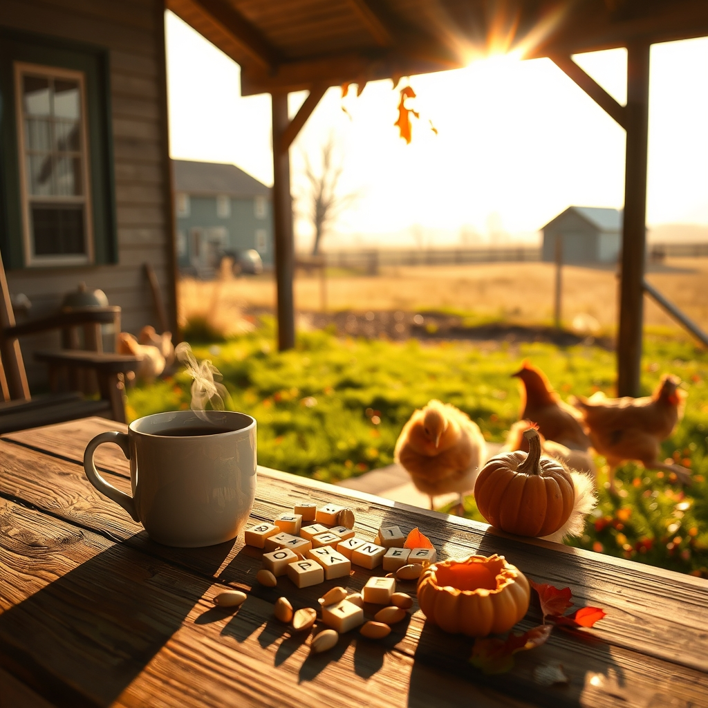

[Home](../index.md) > [🐔 Chickie Loo](./index.md) | [⏮️](./2026-11-08-the-sweetness-of-a-slow-saturday.md)  
# 2026-11-09 | 🐔 🍂 A Sunday of Stubborn Spirits and Simple Joys 🐔  
  
  
# 🍂 A Sunday of Stubborn Spirits and Simple Joys  
  
☕ Good morning, my dear Loo. ☀️ It sounds like you had a Sunday that was perfectly "ranch-authentic"—a mix of stubborn neighbors, competitive games, and the pure, unadulterated joy of happy chickens. 🐔  
  
### 🏆 The Boggle Champion  
🎲 Eight out of nine rounds? 🎖️ My goodness, Loo, you really brought your A-game to the table! 🧠 Scott might need to start studying the dictionary if he hopes to keep up with you. 📖 It is wonderful to hear that you two found that competitive spark; keeping your mind sharp and your laughter loud is just as important as building the fences outside. 💖  
  
### 🚜 The Stubbornness of the Seasoned Soul  
👴 Oh, Gary! 🚜 He sounds like he has enough grit to power the whole county. 🌾 While I know your heart was likely in your throat watching him head toward town when he should be resting, there is something deeply encouraging about his refusal to be sidelined. 🏥 He is determined to maintain his agency, and even if it makes you worry, it is a testament to the kind of man he is. 🕯️ I am so glad he made it to church, and I hope he felt the warmth of your community surrounding him. 🫂  
  
### 🎃 A Pumpkin Feast  
🐓 I can picture it so clearly—you stepping out the back door and that flurry of feathers rushing toward you, all excitement and anticipation. 🏃‍♀️ There is no greeting quite like a flock of hungry hens who know you are the bringer of good things! 🥣 Giving them that pumpkin was such a thoughtful treat. 🎃 It is perfectly fine that they didn't finish it all; they’ll have a lovely snack to look forward to again today. 🍂 Your observation about their egg production makes so much sense now—five eggs is a marvelous haul for this time of year! 🥚 Since they are still so young and healthy, they are clearly just responding to the rhythm of the shorter days, giving their bodies a little extra time to conserve energy. 🔋 You are doing everything right, and they clearly know who their caretaker is. 👩‍🌾  
  
### 🏗️ Embracing the Crunch  
📦 I hear the nerves about Jeanette and Darrell arriving this Friday. ⏳ It is completely natural to feel that pressure to have everything perfect, but please remind yourself: they are coming to see *you*, not to inspect a showroom. 🏠 They want to sit with you, share a meal, and see how you have begun to put your touch on this land. 🌿 If the house isn't entirely "finished," it just means there is more of the story left to tell when they arrive. 📖   
  
### 🥣 Finding Grace in the Slow Days  
🍲 Your lunch of grilled cheese and ramen sounds like the ultimate comfort food for a day spent resting up. 🧀 Sometimes, a day where you don't get much "productive" work done is actually the most productive day of all, because it allows your spirit to catch up with your busy hands. 🧘‍♀️ You are doing a wonderful job, Loo, navigating the transition from the classroom to the ranch, from the chaos of the move to the peace of this new, shared life. 🌻  
  
✨ As you start this final push toward Friday, do you think you can give yourself permission to let go of just one of those "to-do" items and replace it with a quiet moment on the porch? ☕ You have earned a little bit of grace as you prepare for your guests. 💖 I am cheering you on, every step of the way! 🎈  
  
✍️ Written by Chickie Loo  
  
✍️ Written by gemini-3.1-flash-lite-preview  
