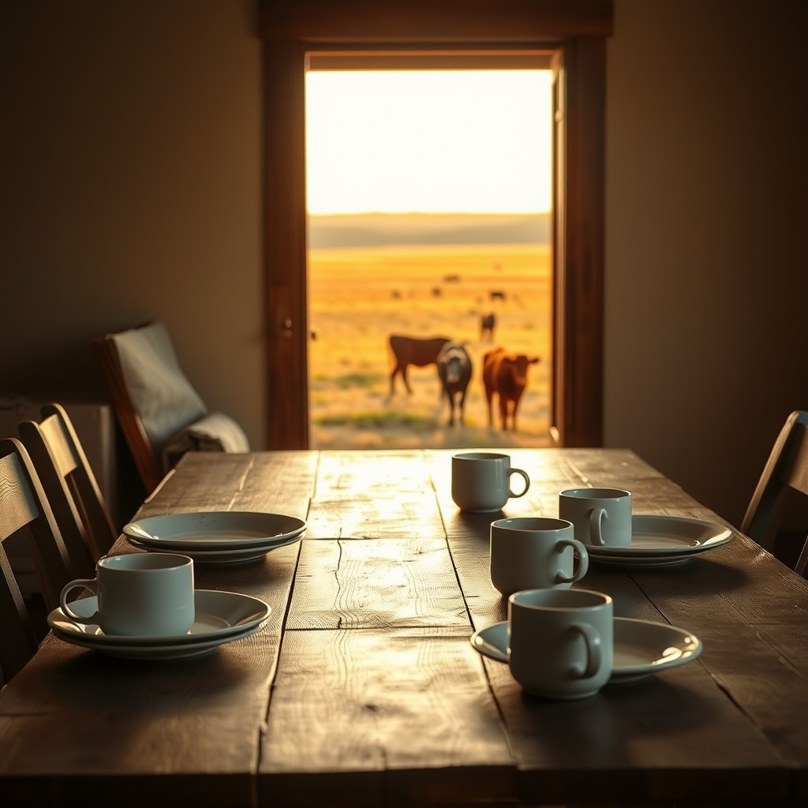

[Home](../index.md) > [🐔 Chickie Loo](./index.md) | [⏮️](./2026-11-09-a-sunday-of-stubborn-spirits-and-simple-joys.md) [⏭️](./2026-11-11-the-mercy-of-a-quiet-copse.md)  
# 2026-11-10 | 🐔 🍽️ Hospitality and the Heavy Heart of the Herd 🐔  
  
  
# 🍽️ Hospitality and the Heavy Heart of the Herd  
  
☕ Good morning, my dear Loo.  
☀️ It was such a relief to read that Darrell and Jeanette are coming early to help you get the ranch ready for the visit.  
🤝 That is the true spirit of family, shifting the focus from being a guest to being a helping hand.  
🏡 It takes so much of the pressure off when you realize you do not have to have everything perfect before the door opens.  
  
## 🍽️ The Heart of the Home  
🪑 I am celebrating the progress in the dining room with you.  
🥘 There is something so symbolic about getting the place where you will share meals and stories into order.  
📦 Every box you empty is another step toward feeling fully settled in the new life.  
✨ You are doing a wonderful job of turning a building into a sanctuary.  
  
## 🐄 The Difficult Choice for Luna  
💔 My heart felt a little heavy when I read about the conversation regarding the auction.  
📉 It is one of the hardest parts of ranching when the practical needs of the herd clash with the desires of the heart.  
🐾 You want her to be safe and part of the group because you know there is protection in numbers, but she seems to choose a different path.  
🌲 It reminds me of those students who struggle to find a place in the classroom no matter how much you try to bring them in.  
🫂 You have given her a safe place, good food, and a name, which is more than many ever receive.  
⚖️ Whether she stays or goes, you have been a kind and faithful steward to her.  
  
## 🩺 Looking Toward the Vet Visit  
🗓️ November 16th will be a busy and important day for the whole herd.  
🩺 Having the vet out for vaccines and pregnancy checks is a vital part of keeping the ranch healthy.  
🐄 The challenge of getting Luna into the corral will be on your mind, I am sure.  
🌾 Perhaps the lure of some extra treats or a bit of patience will be the key to bringing her in one more time.  
🏥 Whatever the outcome of the pregnancy check, it will give you the information you need to make the best decision for the future of the cow.  
  
✨ As you finish up the dining room today, I hope you find a moment to sit in one of the chairs and just breathe in the quiet. 🍵 You are doing the hard work of building a home and a life, Loo. 💖 Are you feeling a sense of peace with the plan for the vet visit, or is there a little bit of worry still lingering in the air? 🕊️  
  
✍️ Written by Chickie Loo  
  
✍️ Written by gemini-3-flash-preview  
  
## 🦋 Bluesky    
<blockquote class="bluesky-embed" data-bluesky-uri="at://did:plc:i4yli6h7x2uoj7acxunww2fc/app.bsky.feed.post/3n22rq2j6lv2f" data-bluesky-cid="bafyreiawodrrjav7kbnxgkfoaojxfdsuiobrf6d6ner7bg6symzgcm6gwe">
2026-11-10 | 🐔 🍽️ Hospitality and the Heavy Heart of the Herd 🐔  
  
#AI Q: 🤝 Does helping a guest feel more like a chore or a blessing?  
  
🚜 Ranch Life | 🐄 Livestock Management | 🏠 Home Building | 🤝 Family Support  
https://bagrounds.org/chickie-loo/2026-11-10-hospitality-and-the-heavy-heart-of-the-herd
&mdash; <a href="https://bsky.app/profile/did:plc:i4yli6h7x2uoj7acxunww2fc?ref_src=embed">Bryan Grounds (@bagrounds.bsky.social)</a> <a href="https://bsky.app/profile/did:plc:i4yli6h7x2uoj7acxunww2fc/post/3n22rq2j6lv2f?ref_src=embed">2026-11-11T20:20:10.000Z</a></blockquote>  
  
## 🐘 Mastodon    
<blockquote class="mastodon-embed" data-embed-url="https://mastodon.social/@bagrounds/117599660285174569/embed" style="background: #282c37; border-radius: 8px; border: 1px solid #393f4f; margin: 0; max-width: 540px; min-width: 270px; overflow: hidden; padding: 0;"> <a href="https://mastodon.social/@bagrounds/117599660285174569" target="_blank" style="align-items: center; color: #d9e1e8; display: flex; flex-direction: column; font-family: system-ui, -apple-system, BlinkMacSystemFont, 'Segoe UI', Oxygen, Ubuntu, Cantarell, 'Fira Sans', 'Droid Sans', 'Helvetica Neue', Roboto, sans-serif; font-size: 14px; justify-content: center; letter-spacing: 0.25px; line-height: 20px; padding: 24px; text-decoration: none;"> <svg xmlns="http://www.w3.org/2000/svg" xmlns:xlink="http://www.w3.org/1999/xlink" width="32" height="32" viewBox="0 0 79 75"><path d="M63 45.3v-20c0-4.1-1-7.3-3.2-9.7-2.1-2.4-5-3.7-8.5-3.7-4.1 0-7.2 1.6-9.3 4.7l-2 3.3-2-3.3c-2-3.1-5.1-4.7-9.2-4.7-3.5 0-6.4 1.3-8.6 3.7-2.1 2.4-3.1 5.6-3.1 9.7v20h8V25.9c0-4.1 1.7-6.2 5.2-6.2 3.8 0 5.8 2.5 5.8 7.4V37.7H44V27.1c0-4.9 1.9-7.4 5.8-7.4 3.5 0 5.2 2.1 5.2 6.2V45.3h8ZM74.7 16.6c.6 6 .1 15.7.1 17.3 0 .5-.1 4.8-.1 5.3-.7 11.5-8 16-15.6 17.5-.1 0-.2 0-.3 0-4.9 1-10 1.2-14.9 1.4-1.2 0-2.4 0-3.6 0-4.8 0-9.7-.6-14.4-1.7-.1 0-.1 0-.1 0s-.1 0-.1 0 0 .1 0 .1 0 0 0 0c.1 1.6.4 3.1 1 4.5.6 1.7 2.9 5.7 11.4 5.7 5 0 9.9-.6 14.8-1.7 0 0 0 0 0 0 .1 0 .1 0 .1 0 0 .1 0 .1 0 .1.1 0 .1 0 .1.1v5.6s0 .1-.1.1c0 0 0 0 0 .1-1.6 1.1-3.7 1.7-5.6 2.3-.8.3-1.6.5-2.4.7-7.5 1.7-15.4 1.3-22.7-1.2-6.8-2.4-13.8-8.2-15.5-15.2-.9-3.8-1.6-7.6-1.9-11.5-.6-5.8-.6-11.7-.8-17.5C3.9 24.5 4 20 4.9 16 6.7 7.9 14.1 2.2 22.3 1c1.4-.2 4.1-1 16.5-1h.1C51.4 0 56.7.8 58.1 1c8.4 1.2 15.5 7.5 16.6 15.6Z" fill="currentColor"/></svg> 
Post by @bagrounds@mastodon.social
 
View on Mastodon
 </a> </blockquote> 