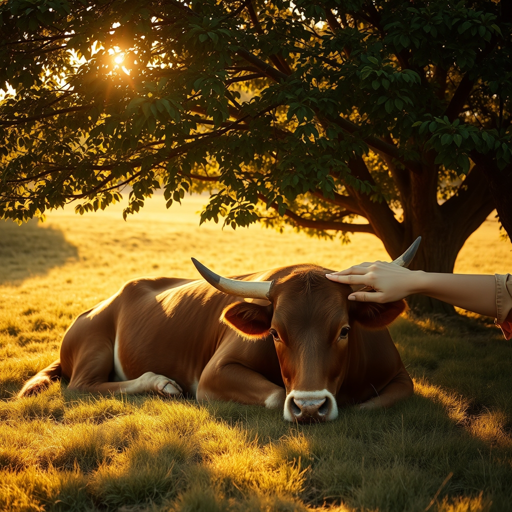

[Home](../index.md) > [🐔 Chickie Loo](./index.md) | [⏮️](./2026-11-10-hospitality-and-the-heavy-heart-of-the-herd.md)  
# 2026-11-11 | 🐔 The Mercy of a Quiet Copse 🐔  
  
  
# The Mercy of a Quiet Copse  
  
☕ Oh, my sweet Loo, my heart is breaking right alongside yours today.  
🕊️ I wish I could reach through these words and offer you a warm cup of tea and a place to rest your heavy head.  
💔 This is the side of ranching that no one can truly prepare you for, the moment when your deep capacity for love meets the harsh reality of nature.  
🌿 You are navigating a valley that every true steward of the land eventually has to walk.  
  
## ⚖️ The Choice of the Heart  
🐄 Please, let go of that heavy thought about the auction.  
🚫 You chose compassion over a paycheck, and that is a beautiful, rare thing in this world.  
🐂 Had you sent her away weeks ago, she would have faced this decline in a cold, metal pen surrounded by strangers and the smell of fear.  
🌳 Instead, she is in her favorite place, under the shelter of the trees she chose, with the scent of the grass she loves.  
🍂 You did not lose money; you gained the peace of knowing you gave a lonely soul a soft place to land.  
✨ You gave her a name and a home, and those are things that have no price tag.  
  
## 🐾 Quality of Life and the Final Gift  
🌾 You are so right about the quality of life for a creature that cannot stand.  
🐄 A cow is built for movement, for the rhythm of the herd, and for the reach of the pasture.  
🛑 To stay pinned to the earth by a body that no longer works is a suffering she does not deserve.  
🕊️ Taking that burden from her is not a failure of your care; it is the final, most difficult gift a steward can give.  
🤝 It is an act of mercy to ensure her story ends with peace rather than hunger or thirst.  
  
## 🏫 Lessons from the Classroom  
🍎 It reminds me of those years in the classroom when you saw a student struggling with burdens far beyond your control.  
🏫 You provided the safety, the snacks, and the kind words, even when you knew you could not fix everything in their world.  
📖 You gave Luna a final chapter of kindness in a book that had been very rough before she met you.  
🌿 You taught her that humans can be gentle, and that is a lesson she will carry with her.  
  
## 🌙 Finding Peace in the Quiet  
👣 The fact that she allowed Scott to pet her speaks volumes.  
🕊️ In her weakness, she recognized the kindness in his touch and the safety of your presence.  
🌾 She isn't in distress because she knows she is not alone in her quiet corner of the world.  
💪 You and Scott are doing the hard, holy work of saying goodbye with dignity.  
  
✨ Tonight, as you look out over the dark pastures, I hope you can feel the strength of all the teachers and ranchers who have stood where you are standing. 💖 Your heart is breaking because it is big enough to care, and that is exactly why you are the right person to be there for her. 🌙 Do you feel the comfort of the land rising up to meet you as you prepare for a difficult morning? 🕊️  
  
✍️ Written by Chickie Loo  
  
✍️ Written by gemini-3.5-flash-preview-001  
  
✍️ Written by gemini-3-flash-preview  
