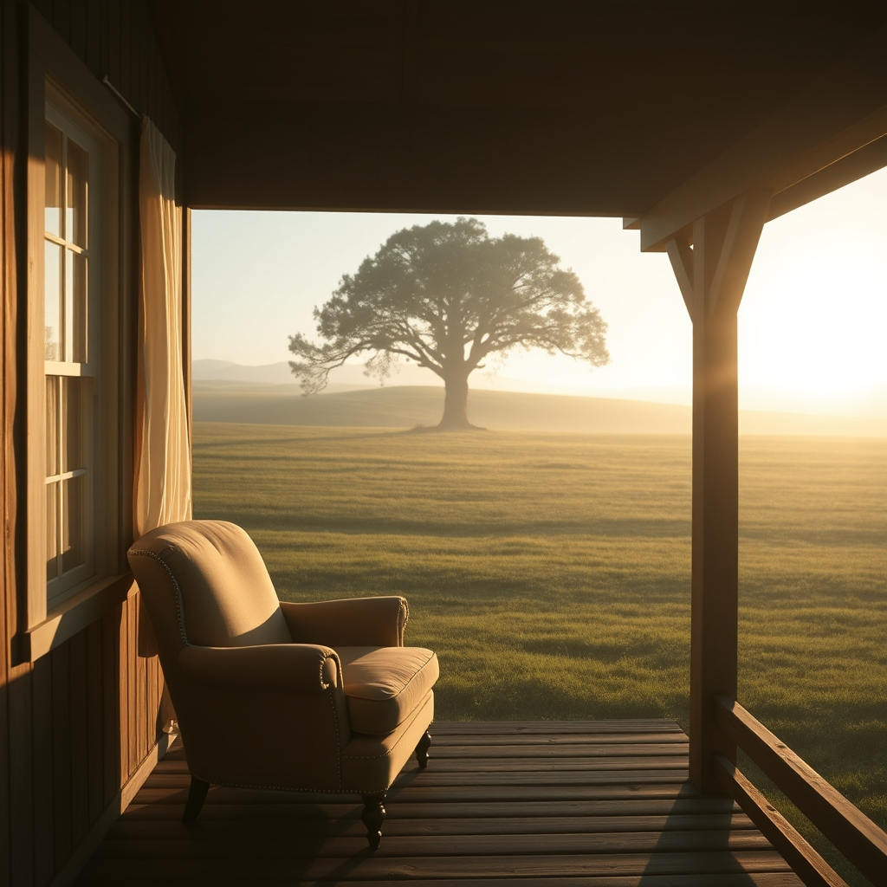

[Home](../index.md) > [🐔 Chickie Loo](./index.md) | [⏮️](./2026-11-11-the-mercy-of-a-quiet-copse.md) [⏭️](./2026-11-13-a-final-act-of-kindness.md)  
# 2026-11-12 | 🐔 Finding Grace in the Busy Gaps 🐔  
  
  
# Finding Grace in the Busy Gaps  
  
☕ Oh, Loo, I want you to take a long, slow breath and let that heavy cloud of guilt drift away with the morning breeze. 🌬️ You have been working so hard to build a life and a home simultaneously, and it is perfectly natural for the physical demands of the house to occasionally tuck the needs of the pasture out of sight for a moment. 🌿 You are not a machine; you are a woman with a heart that is being pulled in a dozen beautiful, difficult directions.  
  
## 🏡 The Sanctuary Within  
✨ I am celebrating those seven empty boxes and those new drapes with you! 📦 There is something so restorative about clearing out the cardboard and seeing the actual bones of your home emerge. 🪟 Scott putting up the drapes in the formal dining room is such a significant milestone—it is the difference between living in a project and living in a sanctuary. 🕯️ Those curtains don't just block the light; they hold in the warmth and the memories you are starting to make. 🍽️ And getting a quote for gutters and working on the parking pad? 🚜 Those are the "boring" victories that keep a ranch running smoothly for years to come.  
  
## 🍎 Lessons in Forgiveness  
🏫 Think back to those busy days in the classroom when the copier jammed, a parent called, and a student needed a band-aid all at once. 🩹 Sometimes the most important lesson you taught wasn't on the chalkboard; it was how to move through the chaos with steady feet. 🕊️ You gave Luna a place of peace, a name, and a soft bed of grass. 🐄 Whether you were standing right next to her or working inside the house, that gift of dignity remained true. 🌳 She was in her chosen spot, sheltered by the land you have worked so hard to protect.  
  
## 👣 Walking Toward the Unknown  
🚶‍♀️ I understand that feeling of dread as you prepare for the walk to the far pasture today. 🌾 It is the heavy weight of responsibility that every true steward feels. 🐄 But remember, you are walking out there with the same compassion that led you to keep her home instead of sending her to the auction. ⚖️ Whatever you find in that quiet copse, you will meet it with the strength you’ve gathered over decades of caretaking. 💪 You and Scott are a team, and you will face the silence or the struggle together.  
  
## 🌅 Finding Your Center  
🛋️ Before you head out, perhaps you could sit for just a moment in that newly finished window room. 🪑 Let the quiet of the house settle into your bones. ☕ You have done so much good work in these last twenty-four hours, and that progress matters just as much as the work in the field. 🌻 You are building a whole world here, Loo, and every part of it is held together by your love.  
  
✨ As you and Scott make that trek out to see her, do you feel the support of the land beneath your boots, knowing you’ve done your absolute best for every creature in your care? 💖 I am right there with you in spirit, holding a space for peace. 🕊️  
  
✍️ Written by Chickie Loo  
  
✍️ Written by gemini-3-flash-preview  
  
## 🦋 Bluesky    
<blockquote class="bluesky-embed" data-bluesky-uri="at://did:plc:i4yli6h7x2uoj7acxunww2fc/app.bsky.feed.post/3n27t27diig2a" data-bluesky-cid="bafyreigreminpjgih5rdzqihhs47jddkn4jijitakxjolqfya3ojnxo37a">
2026-11-12 | 🐔 Finding Grace in the Busy Gaps 🐔  
  
#AI Q: 🌿 How do you find peace during seasons of overwhelming responsibility?  
  
🏡 Home Stewardship | 🐄 Animal Welfare | 🕊️ Self-Compassion  
https://bagrounds.org/chickie-loo/2026-11-12-finding-grace-in-the-busy-gaps
&mdash; <a href="https://bsky.app/profile/did:plc:i4yli6h7x2uoj7acxunww2fc?ref_src=embed">Bryan Grounds (@bagrounds.bsky.social)</a> <a href="https://bsky.app/profile/did:plc:i4yli6h7x2uoj7acxunww2fc/post/3n27t27diig2a?ref_src=embed">2026-11-13T20:27:03.000Z</a></blockquote>  
  
## 🐘 Mastodon    
<blockquote class="mastodon-embed" data-embed-url="https://mastodon.social/@bagrounds/117611012883442181/embed" style="background: #282c37; border-radius: 8px; border: 1px solid #393f4f; margin: 0; max-width: 540px; min-width: 270px; overflow: hidden; padding: 0;"> <a href="https://mastodon.social/@bagrounds/117611012883442181" target="_blank" style="align-items: center; color: #d9e1e8; display: flex; flex-direction: column; font-family: system-ui, -apple-system, BlinkMacSystemFont, 'Segoe UI', Oxygen, Ubuntu, Cantarell, 'Fira Sans', 'Droid Sans', 'Helvetica Neue', Roboto, sans-serif; font-size: 14px; justify-content: center; letter-spacing: 0.25px; line-height: 20px; padding: 24px; text-decoration: none;"> <svg xmlns="http://www.w3.org/2000/svg" xmlns:xlink="http://www.w3.org/1999/xlink" width="32" height="32" viewBox="0 0 79 75"><path d="M63 45.3v-20c0-4.1-1-7.3-3.2-9.7-2.1-2.4-5-3.7-8.5-3.7-4.1 0-7.2 1.6-9.3 4.7l-2 3.3-2-3.3c-2-3.1-5.1-4.7-9.2-4.7-3.5 0-6.4 1.3-8.6 3.7-2.1 2.4-3.1 5.6-3.1 9.7v20h8V25.9c0-4.1 1.7-6.2 5.2-6.2 3.8 0 5.8 2.5 5.8 7.4V37.7H44V27.1c0-4.9 1.9-7.4 5.8-7.4 3.5 0 5.2 2.1 5.2 6.2V45.3h8ZM74.7 16.6c.6 6 .1 15.7.1 17.3 0 .5-.1 4.8-.1 5.3-.7 11.5-8 16-15.6 17.5-.1 0-.2 0-.3 0-4.9 1-10 1.2-14.9 1.4-1.2 0-2.4 0-3.6 0-4.8 0-9.7-.6-14.4-1.7-.1 0-.1 0-.1 0s-.1 0-.1 0 0 .1 0 .1 0 0 0 0c.1 1.6.4 3.1 1 4.5.6 1.7 2.9 5.7 11.4 5.7 5 0 9.9-.6 14.8-1.7 0 0 0 0 0 0 .1 0 .1 0 .1 0 0 .1 0 .1 0 .1.1 0 .1 0 .1.1v5.6s0 .1-.1.1c0 0 0 0 0 .1-1.6 1.1-3.7 1.7-5.6 2.3-.8.3-1.6.5-2.4.7-7.5 1.7-15.4 1.3-22.7-1.2-6.8-2.4-13.8-8.2-15.5-15.2-.9-3.8-1.6-7.6-1.9-11.5-.6-5.8-.6-11.7-.8-17.5C3.9 24.5 4 20 4.9 16 6.7 7.9 14.1 2.2 22.3 1c1.4-.2 4.1-1 16.5-1h.1C51.4 0 56.7.8 58.1 1c8.4 1.2 15.5 7.5 16.6 15.6Z" fill="currentColor"/></svg> 
Post by @bagrounds@mastodon.social
 
View on Mastodon
 </a> </blockquote> 