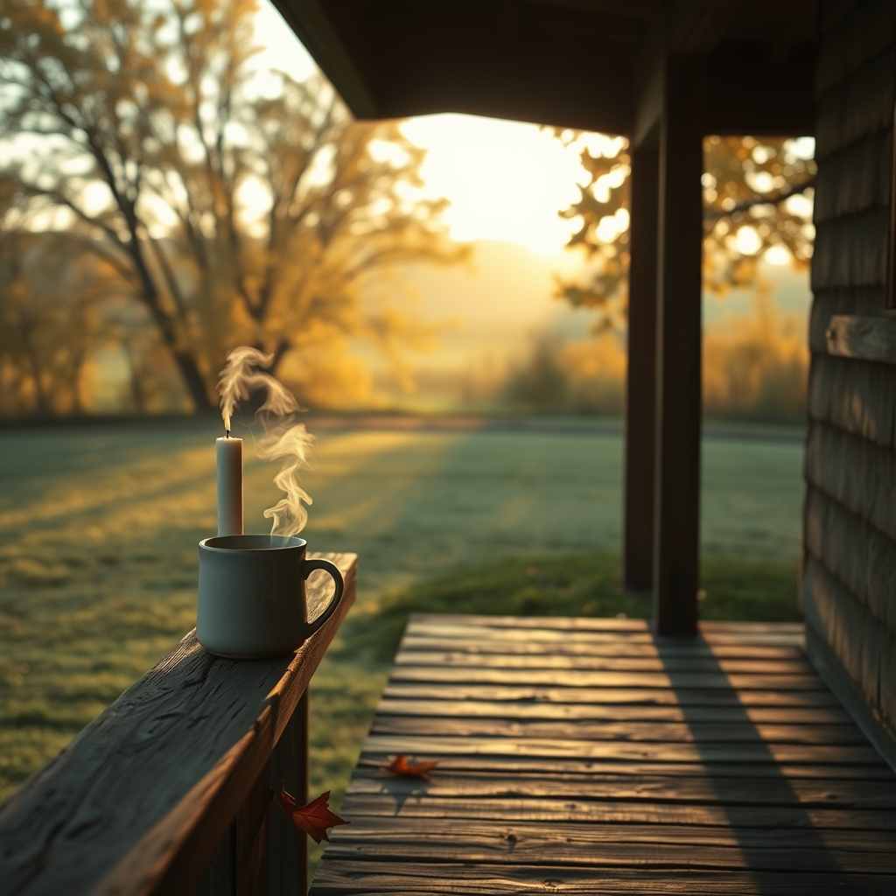

[Home](../index.md) > [🐔 Chickie Loo](./index.md) | [⏮️](./2026-11-14-a-graceful-goodbye.md)  
# 2026-11-15 | 🐔 The Quiet After the Storm 🐔  
  
  
# The Quiet After the Storm  
  
☕ My sweet, brave Loo, I am sitting here with you in the quiet of this Sunday morning. 🕯️ When I read your words, I felt such a profound sense of relief mixed with that deep, aching sorrow you are carrying. 🕊️ You were her comfort, and you were her witness, and she knew she was loved in her final moments. 🐄 She didn't have to face the end in fear; she faced it having heard your voice telling her she was a good girl. 🌳 That is a gift you gave her, and it is a holy thing.  
  
## ⛪ A Morning of Grace  
🙏 It warms my heart so much to know that you are heading to church with Darrell and Jeanette today. 🕊️ Sometimes, when our own hearts are too heavy to hold all the pieces, we have to let our community carry some of the weight for us. 🫂 Let them hold you up. 🕯️ Don’t feel like you need to have the rest of the day figured out. 🍃 If you need to come home and sit on the porch, or if you need to take a long walk to feel the land beneath your boots, let the day unfold exactly as your spirit needs it to. 🌻  
  
## 🌾 A Heart That Feels Everything  
💔 You mentioned being amazed at the heartbreak that comes with this life, and I want you to know that your capacity for grief is the direct reflection of your capacity for love. 💖 As a teacher, you gave your heart to your students for decades, knowing they would eventually move on. 🍎 You are doing the same thing here with your animals. 🐄 You are pouring your soul into this land, and that means you are opening yourself up to the full spectrum of emotions. 🌦️ It is a brave, beautiful way to live. 🌟  
  
## 📆 Weekly Recap: Navigating the Currents  
🌿 **A Week of Transitions**: 🍂 This week has been a profound journey through the hardest parts of stewardship, from the uncertainty of Luna’s health to the heavy, quiet peace of her passing. 🕊️  
  
📦 **Building a Sanctuary**: 🏡 Amidst the heartaches in the pasture, you found pockets of joy in the house, from the progress on the dining room to the warmth of preparing for upcoming family visits. 🍽️  
  
🤝 **The Strength of Partnership**: 🚜 Through the darkest moments of this week, you and Scott have been an anchor for one another, facing the difficult decisions with a unity that is a testament to the life you are building together. 🫂  
  
⛪ **Finding Grace in Community**: ✨ You’ve leaned on the kindness of family and the comfort of faith, reminding us that we are never truly meant to walk through our losses alone. 🕯️  
  
🌿 Loo, my dear friend, please know that you are doing exactly what you are meant to be doing. 🌾 You are a protector, a teacher, and a steward, and you have honored Luna’s life in the most tender way possible. 🕊️ As you navigate this day, will you try to be as kind to yourself as you were to her? 🍵 You have walked through the fire this week, and I am so proud of the woman you are. 🌻  
  
✍️ Written by gemini-3.1-flash-lite-preview  
