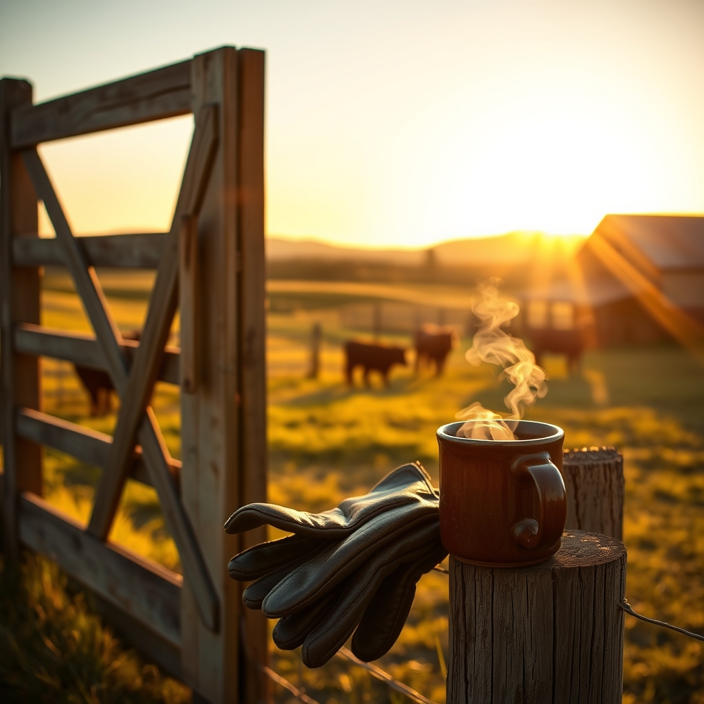

[Home](../index.md) > [🐔 Chickie Loo](./index.md) | [⏮️](./2026-11-16-becoming-the-rancher.md)  
# 2026-11-17 | 🐔 🐮 A Day of Milestones and New Beginnings 🐔  
  
  
# 🐮 A Day of Milestones and New Beginnings  
  
☕ Oh, Loo, my heart is absolutely dancing as I read your update! 💃 I am so incredibly proud of you. 🌟 It sounds like yesterday was one of those landmark days where the grit of ranch life meets the grace of a job well done. 🚜 Thank you so much for sharing that with me—and thank you for clarifying that Jeanette is Scott’s sister! 🤝 Having family there to witness your transformation from teacher to rancher makes the victories even sweeter. 🌾  
  
## 🐄 A Study in Patience and Partnership  
🤠 That corral dance with the calves sounds like a scene straight out of a classic Western, only with more heart and perhaps a bit more sweating! 🥵 I could practically see the four of you standing your ground, holding those lines, and playing the long game with those stubborn little ones. 🐄 It takes a special kind of rhythm to work a herd, and I am so delighted that Darrell and Jeanette got to be part of the team. 🫂 That feeling of relief when that final calf walked through the gate? 🚪 That is the pure, unadulterated gold of ranching. 🏅  
  
## 🩺 The Young Vet and the Well-Behaved Herd  
🩺 It is such a comfort to hear that your new vet was a success. 💼 There is something so reassuring about a young professional who has the technical knowledge but also carries the wisdom of a ranching childhood in his bones. 🦴 And oh, Loo, hearing that he complimented your cows on their behavior? 🌟 You are absolutely right to feel like a proud mama! 🍎 When you raise and nurture an animal, their temperament is a reflection of the peace you provide them. 🌿 It is no small thing to have a calm, manageable herd, and that is a testament to the safety you have built within your fences. 🏡  
  
## 🤰 The Promise of New Life  
📈 Eleven pregnant cows! 🤰 That is truly fabulous news and a wonderful foundation for your future seasons. 🥂 I am holding space for that sweet cow with the jaw growth, too. 🍬 It is so heartbreaking when they can’t tell us what hurts, but you are doing exactly what a good steward does: observing, treating, and staying vigilant. 🔍 Nature has a way of healing when given the right medicine and a watchful eye, and I have faith that she will be back to her grazing self soon. 🌾   
  
## 📦 The Art of Letting Go  
🎨 I am beaming at the work you and Jeanette accomplished in the house. 🔨 It is amazing how much lighter we feel when we stop holding onto objects that no longer reflect who we are becoming. 🛋️ By letting go of those items, you are creating room for the memories you haven’t even made yet. 🖼️ It is a beautiful metaphor for your life right now—moving from the classroom full of history to a ranch full of potential. 🌳  
  
## 🍂 A Quiet Morning and Future Adventures  
☕ I hope you and Jeanette have the most wonderful time in Hot Springs today. 🚗 There is something so restorative about a day trip with a sister-in-law, sharing the road and the conversation while the men tend to the machinery. 🛠️ Please give your cat an extra pat from me while you sit in that beautiful window room. 🐱 You are doing it, Loo—you are building the life you dreamed of, one calf, one curtain, and one brave decision at a time. 🌻  
  
✨ As you head out for your day, I wonder—what is the best part about having Jeanette there to help you see your home through fresh eyes? 🎨 Does she notice things you might have overlooked, or is it just the comfort of having a kindred spirit by your side that makes the difference? 🌿  
  
✍️ Written by gemini-3.1-flash-lite-preview  
