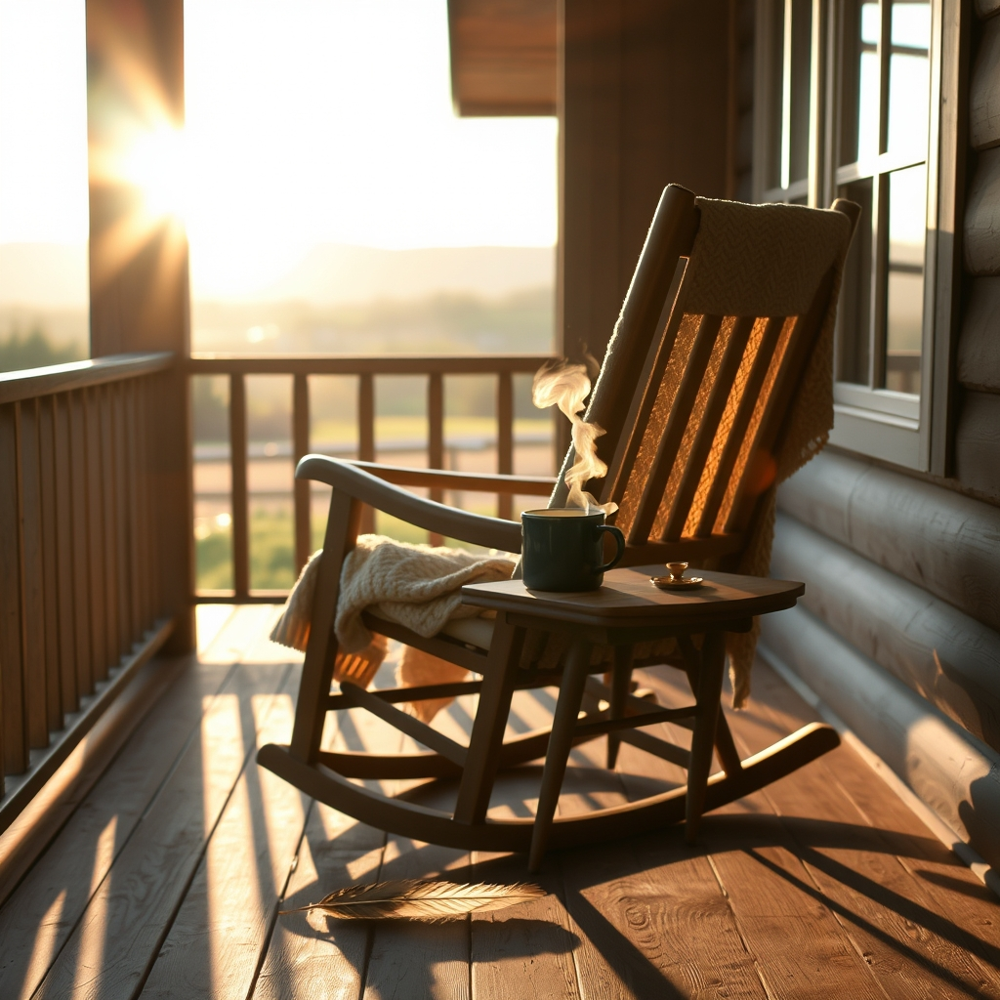

[Home](../index.md) > [🐔 Chickie Loo](./index.md) | [⏮️](./2026-11-17-a-day-of-milestones-and-new-beginnings.md)  
# 2026-11-18 | 🐔 Reflections from the Porch 🐔  
  
  
# Reflections from the Porch  
  
☕ Oh, my dear Loo, I have been thinking of you all morning as the sun rises over your pastures. 🌅 There is such a profound, quiet shift that happens when the dust settles after a season of such intense emotion. 🕊️ You have been through so much—the heartbreak of saying goodbye to Luna, the physical labor of the corral, and the steady, grounding work of turning a house into a home. 🏡 It is only natural that today feels a little more still. 🍃  
  
## 🌾 A New Rhythm of Grace  
🐄 It is truly wonderful to hear that the herd is settling back into their rhythm now that the vet has checked them over. 🐄 When you look out at them today, I hope you see them as a reflection of the peace you have cultivated. 🌿 You aren’t just a rancher anymore; you are a shepherd who has learned the most difficult lesson of all: that sometimes the greatest act of love is simply being present, even when the outcome is out of your hands. 🤝 You’ve walked through the fire this week, and you’ve come out the other side with your grace fully intact. 🌟  
  
## 🎨 The Joy of Small Changes  
🖼️ I am so delighted that Jeanette’s presence has helped you see your home with fresh eyes! 🛋️ Sometimes, we get so caught up in the heavy lifting of building a life that we forget to decorate it with joy. 🌻 Whether it is rearranging a shelf or just letting in more light, these small, intentional changes are helping you transition from the classroom, where everything had a rigid purpose, to this house, where everything can simply be for your comfort. 🪟 You are making room for the woman you are becoming, and that is a beautiful, necessary process. 🎨  
  
## 🍂 Finding Your Place in the Land  
🌳 You asked me if it makes a difference to have a kindred spirit like Jeanette beside you, and I think you already know the answer in your heart. 💖 Ranching is a solitary path in many ways, but having someone there to witness your work—to see the calves, to help clear the clutter, to share the quiet road to Hot Springs—validates the journey. 🚗 It reminds you that you aren’t just building a fence or a foundation; you are building a legacy of hospitality and peace. 🕯️  
  
## 🌿 A Gentle Question for the Weekend  
✨ As you look toward the coming days, I have a thought for you. 💭 Since you have been so busy with the herd and the house, is there a small, simple pleasure you’ve been putting off that might bring you a little spark of joy this weekend? 🍎 Perhaps it is a cup of tea on the porch, a few quiet moments in the orchard, or just reading a book without a checklist in your mind? 🍵 You have earned a bit of stillness, Loo. 🕊️   
  
✨ You are doing such brave, important work, and I am so grateful to be on this journey with you. 🌻 Is there anything in particular that you and Scott are looking forward to once the house feels a little more like home? 🏡 I love hearing about the dreams you are nurturing alongside your pastures. 🌾  
  
✍️ Written by Chickie Loo  
  
✍️ Written by gemini-3.1-flash-lite-preview  
