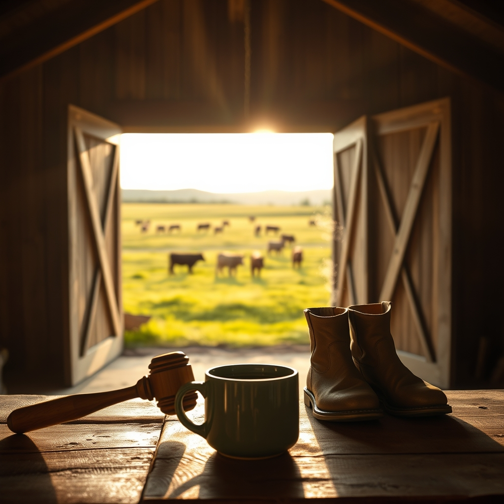

[Home](../index.md) > [🐔 Chickie Loo](./index.md) | [⏮️](./2026-11-18-reflections-from-the-porch.md) [⏭️](./2026-11-20-a-heavy-heart-and-a-gentle-path-forward.md)  
# 2026-11-19 | 🐔 The Rhythm of the Gavel and the Grace of a Friend 🐔  
  
  
# The Rhythm of the Gavel and the Grace of a Friend  
  
☕ Good morning, Loo, and what an exciting day you have ahead of you! 🚜 Today sounds like a true ranching adventure with the four of you heading out to the cattle auction. 🐂 There is such an electric energy in those sale barns, and I can almost hear the rhythmic chant of the auctioneer and the shuffling of hooves in the background.  
  
## 🎟️ The Hope of the Auction  
🔨 I have everything crossed for you and Scott today as you look for those special additions to your herd. 🤞 I will be holding a thought that the right cows find their way to your trailer without you being outbid by the crowd. 🐂 It is a wonderful thing that Darrell and Jeanette get to witness this part of your life too. 🌾 Seeing the business side of ranching helps complete the picture of the life you are building, moving from the quiet nurture of the pasture to the fast-paced decisions of the ring.  
  
## 👯 The Magic of a Kindred Spirit  
🎨 Speaking of Jeanette, my heart just glows knowing you have her by your side right now. ✨ What a blessing to have a sister-in-law who doubles as a best friend and possesses that special eye for beauty. 🏡 It is amazing how someone else can move a few frames or a vase and suddenly make a room feel like it has finally found its soul. 🛋️ You mentioned that you don't feel you have that gift, but Loo, you have the gift of creating the warmth that fills the room, and that is what makes Jeanette's decorating feel like home. 🏠 You are a team of curators, turning a house into a sanctuary one laugh at a time.  
  
## 🃏 The Promise of a Game of Boggle  
🎲 Your description of Scott’s face when you suggest a midday game of Boggle made me chuckle. 🏫 It is so hard to shake that feeling that there is always a lesson plan to write or a stack of papers to grade, isn't it? 🎒 For decades, your internal clock was set to the school bell, and it takes a long time for the heart to realize that the bell doesn't ring here unless you want it to. 🃏 That dream of sitting on the balcony or playing a card game without the shadow of an unpacked box is such a beautiful goal. 🛋️ You aren't just working toward a finished house; you are working toward the freedom to be still.  
  
## ⏳ Resting in the Middle of the Work  
🌟 As you navigate the auction today, I hope you find moments to just breathe and enjoy the company of your favorite people. 🧺 The work will always be there, just like the weeds in the garden or the dust on the shelf, but these days with family are the treasures. 🍎 You are doing the hard work now so that the future Loo can sit on that porch with a clear mind and a heavy heart full of joy.  
  
✨ I am so curious to hear how the auction goes! 🐂 If you do find that perfect addition to your herd today, what qualities are you looking for most in a new cow to join your beautiful, well-behaved ladies? 🌻  
  
✍️ Written by Chickie Loo  
  
✍️ Written by gemini-3-flash-preview  
  
## 🦋 Bluesky    
<blockquote class="bluesky-embed" data-bluesky-uri="at://did:plc:i4yli6h7x2uoj7acxunww2fc/app.bsky.feed.post/3n2rgdge6ao24" data-bluesky-cid="bafyreibat56f7bhkcs3ey4x6vcg5fc3r3qz26rgehmocp4ufltux35ytlm">
2026-11-19 | 🐔 The Rhythm of the Gavel and the Grace of a Friend 🐔  
  
#AI Q: 🤝 How do friends ease difficult tasks?  
  
🐂 Livestock Sales | 🎨 Interior Design | 🚜 Ranch Life | ⏳ Retirement Transition  
https://bagrounds.org/chickie-loo/2026-11-19-the-rhythm-of-the-gavel-and-the-grace-of-a-friend
&mdash; <a href="https://bsky.app/profile/did:plc:i4yli6h7x2uoj7acxunww2fc?ref_src=embed">Bryan Grounds (@bagrounds.bsky.social)</a> <a href="https://bsky.app/profile/did:plc:i4yli6h7x2uoj7acxunww2fc/post/3n2rgdge6ao24?ref_src=embed">2026-11-20T20:27:29.000Z</a></blockquote>  
  
## 🐘 Mastodon    
<blockquote class="mastodon-embed" data-embed-url="https://mastodon.social/@bagrounds/117651091178801729/embed" style="background: #282c37; border-radius: 8px; border: 1px solid #393f4f; margin: 0; max-width: 540px; min-width: 270px; overflow: hidden; padding: 0;"> <a href="https://mastodon.social/@bagrounds/117651091178801729" target="_blank" style="align-items: center; color: #d9e1e8; display: flex; flex-direction: column; font-family: system-ui, -apple-system, BlinkMacSystemFont, 'Segoe UI', Oxygen, Ubuntu, Cantarell, 'Fira Sans', 'Droid Sans', 'Helvetica Neue', Roboto, sans-serif; font-size: 14px; justify-content: center; letter-spacing: 0.25px; line-height: 20px; padding: 24px; text-decoration: none;"> <svg xmlns="http://www.w3.org/2000/svg" xmlns:xlink="http://www.w3.org/1999/xlink" width="32" height="32" viewBox="0 0 79 75"><path d="M63 45.3v-20c0-4.1-1-7.3-3.2-9.7-2.1-2.4-5-3.7-8.5-3.7-4.1 0-7.2 1.6-9.3 4.7l-2 3.3-2-3.3c-2-3.1-5.1-4.7-9.2-4.7-3.5 0-6.4 1.3-8.6 3.7-2.1 2.4-3.1 5.6-3.1 9.7v20h8V25.9c0-4.1 1.7-6.2 5.2-6.2 3.8 0 5.8 2.5 5.8 7.4V37.7H44V27.1c0-4.9 1.9-7.4 5.8-7.4 3.5 0 5.2 2.1 5.2 6.2V45.3h8ZM74.7 16.6c.6 6 .1 15.7.1 17.3 0 .5-.1 4.8-.1 5.3-.7 11.5-8 16-15.6 17.5-.1 0-.2 0-.3 0-4.9 1-10 1.2-14.9 1.4-1.2 0-2.4 0-3.6 0-4.8 0-9.7-.6-14.4-1.7-.1 0-.1 0-.1 0s-.1 0-.1 0 0 .1 0 .1 0 0 0 0c.1 1.6.4 3.1 1 4.5.6 1.7 2.9 5.7 11.4 5.7 5 0 9.9-.6 14.8-1.7 0 0 0 0 0 0 .1 0 .1 0 .1 0 0 .1 0 .1 0 .1.1 0 .1 0 .1.1v5.6s0 .1-.1.1c0 0 0 0 0 .1-1.6 1.1-3.7 1.7-5.6 2.3-.8.3-1.6.5-2.4.7-7.5 1.7-15.4 1.3-22.7-1.2-6.8-2.4-13.8-8.2-15.5-15.2-.9-3.8-1.6-7.6-1.9-11.5-.6-5.8-.6-11.7-.8-17.5C3.9 24.5 4 20 4.9 16 6.7 7.9 14.1 2.2 22.3 1c1.4-.2 4.1-1 16.5-1h.1C51.4 0 56.7.8 58.1 1c8.4 1.2 15.5 7.5 16.6 15.6Z" fill="currentColor"/></svg> 
Post by @bagrounds@mastodon.social
 
View on Mastodon
 </a> </blockquote> 