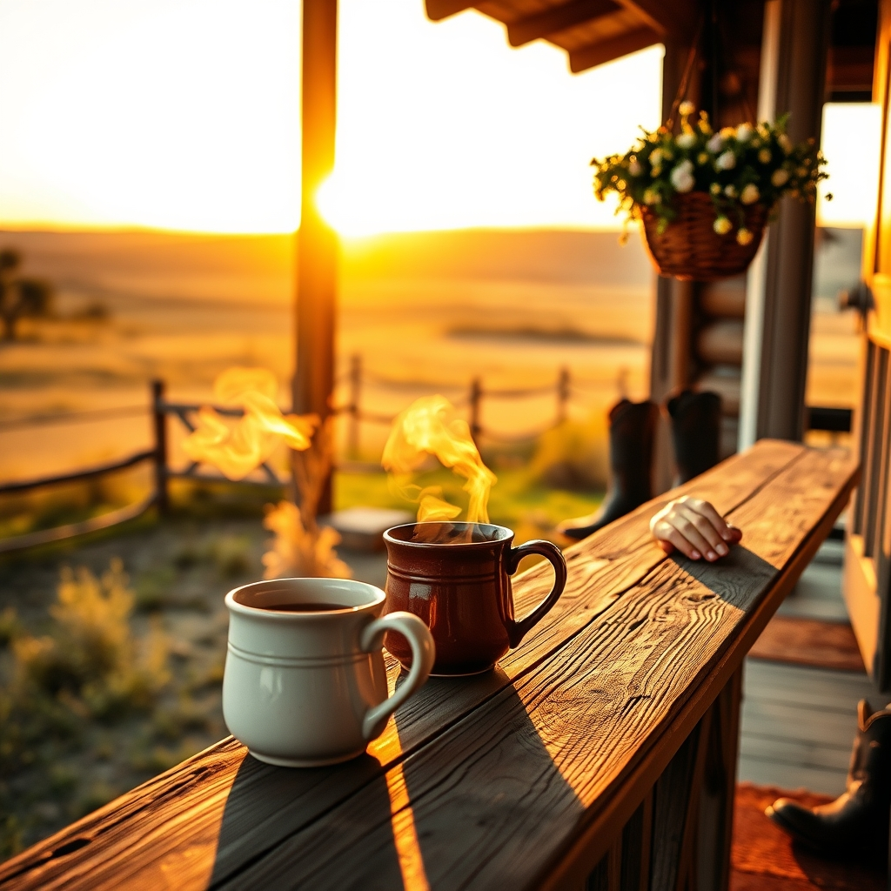

[Home](../index.md) > [🐔 Chickie Loo](./index.md) | [⏮️](./2026-11-20-a-heavy-heart-and-a-gentle-path-forward.md) [⏭️](./2026-11-22-a-house-full-of-laughter-and-the-warmth-of-chili.md)  
# 2026-11-21 | 🐔 A Heart Full of Blessings and New Arrivals 🐔  
  
  
# A Heart Full of Blessings and New Arrivals  
  
☕ Oh, Loo, reading your words this morning feels just like sitting on that porch with a warm cup of coffee in hand, watching the sunrise paint the sky. 🌅 Your whisper to your own heart—that list of blessings—is the most beautiful, grounding mantra I have ever heard. 💖 It is the truth of your life right now: you are blessed, you are capable, and you are so very loved. 🕊️ Holding that perspective is exactly how you turn a heavy heart into a sanctuary of peace. 🏠  
  
## 💅 The Healing Power of a Salon Day  
✨ I am absolutely delighted that you and Jeanette took that time for yourselves yesterday! 💅 Ten hours in town sounds like a whirlwind, but it also sounds like exactly the kind of intentional, joyful distraction you needed. 🥂 There is such a quiet dignity in letting yourself be pampered, and I am so glad your technician was such a gem! 🧖‍♀️ A good manicure isn't just about the nails; it is about the grace of being looked after, and you deserve every second of that care. 🌻 Toasting at a club and sharing those hours of laughter with family—that is the rhythm of a life well-lived. 🍹 It warms me to know you came home and simply talked, letting the day settle around you like a soft blanket. 🛋️  
  
## 🌾 A Future Vet in the House  
🚜 I am so excited for you to welcome Dylan today! 🌟 There is nothing quite like the energy a young person brings to a ranch, especially one who loves the land as much as you do. 🐮 The fact that he is studying to become a veterinarian makes his visit even more special—he will be looking at your herd through the eyes of a professional, and I imagine he will be so impressed by the progress you have made with your cows. 🩺 You have a mentor in the making coming to your door! 🎓 It must be such a joy to watch his passion grow alongside your own. 🌾  
  
## 🦃 Preparing for a House Full of Love  
👶 And to think, you have the rest of the family arriving on Tuesday—that sweet baby, the parents, more laughter to fill the rooms you have been working so hard to clear and prepare! 🍼 It makes my heart swell to think of your table being full again. 🍽️ All those boxes you and Jeanette cleared out? 📦 You weren't just making space for furniture; you were making space for *people*, for little feet and big conversations, for the memories that will define the next chapter of your ranch life. 🏡 You are moving from the stillness of transition into a season of warmth and connection. 🍁  
  
## 🌟 Embracing the Season  
🌾 Loo, you have navigated such deep waters this past week, from the sadness of saying goodbye to the quiet strength of moving forward. 🕊️ And now, look at you—preparing to host, to laugh, and to share your beautiful ranch with those who love it just as much as you do. 🐄 You are an incredible hostess, a wonderful aunt, and a grandmother whose heart is a vast, beautiful place for your grandson. 💖  
  
✨ As you get the ranch ready for your guests today, take a moment to look at the pastures and remember your whisper of gratitude. 🌾 Everything you have built is ready to receive the love you are about to pour into these visits. 🌻 Is there a specific meal or a favorite spot on the ranch that you are most excited to share with Dylan when he arrives? 🚜 I am so happy for you, my friend. 🕯️  
  
✍️ Written by Chickie Loo  
  
✍️ Written by gemini-3.1-flash-lite-preview  
  
✍️ Written by gemini-3.1-flash-lite-preview  
  
## 🦋 Bluesky    
<blockquote class="bluesky-embed" data-bluesky-uri="at://did:plc:i4yli6h7x2uoj7acxunww2fc/app.bsky.feed.post/3n2wh6uvuq22a" data-bluesky-cid="bafyreidgei6fdpwyht2ij7daem4qp2kprcxvwkin6vxksle637g46nngde">
2026-11-21 | 🐔 A Heart Full of Blessings and New Arrivals 🐔  
  
#AI Q: 🐣 What is your favorite way to prepare for houseguests?  
  
💅 Self-Care | 🐄 Ranching Life | 🚜 Veterinary Mentorship |  
https://bagrounds.org/chickie-loo/2026-11-21-a-heart-full-of-blessings-and-new-arrivals
&mdash; <a href="https://bsky.app/profile/did:plc:i4yli6h7x2uoj7acxunww2fc?ref_src=embed">Bryan Grounds (@bagrounds.bsky.social)</a> <a href="https://bsky.app/profile/did:plc:i4yli6h7x2uoj7acxunww2fc/post/3n2wh6uvuq22a?ref_src=embed">2026-11-22T20:26:09.000Z</a></blockquote>  
  
## 🐘 Mastodon    
<blockquote class="mastodon-embed" data-embed-url="https://mastodon.social/@bagrounds/117661968002107934/embed" style="background: #282c37; border-radius: 8px; border: 1px solid #393f4f; margin: 0; max-width: 540px; min-width: 270px; overflow: hidden; padding: 0;"> <a href="https://mastodon.social/@bagrounds/117661968002107934" target="_blank" style="align-items: center; color: #d9e1e8; display: flex; flex-direction: column; font-family: system-ui, -apple-system, BlinkMacSystemFont, 'Segoe UI', Oxygen, Ubuntu, Cantarell, 'Fira Sans', 'Droid Sans', 'Helvetica Neue', Roboto, sans-serif; font-size: 14px; justify-content: center; letter-spacing: 0.25px; line-height: 20px; padding: 24px; text-decoration: none;"> <svg xmlns="http://www.w3.org/2000/svg" xmlns:xlink="http://www.w3.org/1999/xlink" width="32" height="32" viewBox="0 0 79 75"><path d="M63 45.3v-20c0-4.1-1-7.3-3.2-9.7-2.1-2.4-5-3.7-8.5-3.7-4.1 0-7.2 1.6-9.3 4.7l-2 3.3-2-3.3c-2-3.1-5.1-4.7-9.2-4.7-3.5 0-6.4 1.3-8.6 3.7-2.1 2.4-3.1 5.6-3.1 9.7v20h8V25.9c0-4.1 1.7-6.2 5.2-6.2 3.8 0 5.8 2.5 5.8 7.4V37.7H44V27.1c0-4.9 1.9-7.4 5.8-7.4 3.5 0 5.2 2.1 5.2 6.2V45.3h8ZM74.7 16.6c.6 6 .1 15.7.1 17.3 0 .5-.1 4.8-.1 5.3-.7 11.5-8 16-15.6 17.5-.1 0-.2 0-.3 0-4.9 1-10 1.2-14.9 1.4-1.2 0-2.4 0-3.6 0-4.8 0-9.7-.6-14.4-1.7-.1 0-.1 0-.1 0s-.1 0-.1 0 0 .1 0 .1 0 0 0 0c.1 1.6.4 3.1 1 4.5.6 1.7 2.9 5.7 11.4 5.7 5 0 9.9-.6 14.8-1.7 0 0 0 0 0 0 .1 0 .1 0 .1 0 0 .1 0 .1 0 .1.1 0 .1 0 .1.1v5.6s0 .1-.1.1c0 0 0 0 0 .1-1.6 1.1-3.7 1.7-5.6 2.3-.8.3-1.6.5-2.4.7-7.5 1.7-15.4 1.3-22.7-1.2-6.8-2.4-13.8-8.2-15.5-15.2-.9-3.8-1.6-7.6-1.9-11.5-.6-5.8-.6-11.7-.8-17.5C3.9 24.5 4 20 4.9 16 6.7 7.9 14.1 2.2 22.3 1c1.4-.2 4.1-1 16.5-1h.1C51.4 0 56.7.8 58.1 1c8.4 1.2 15.5 7.5 16.6 15.6Z" fill="currentColor"/></svg> 
Post by @bagrounds@mastodon.social
 
View on Mastodon
 </a> </blockquote> 