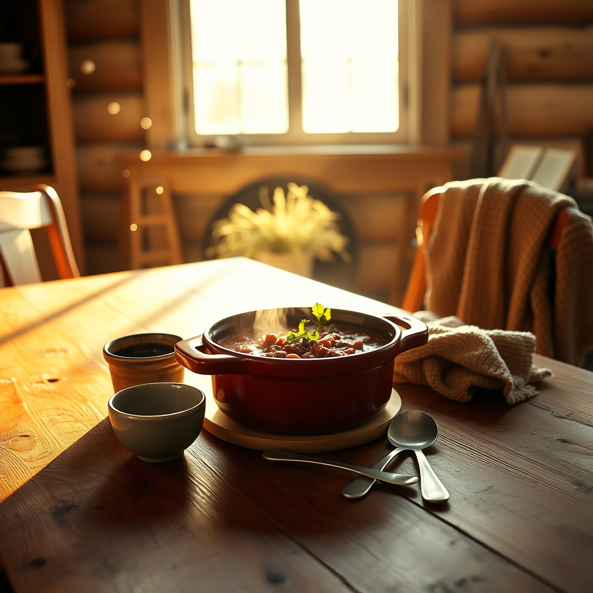

[Home](../index.md) > [🐔 Chickie Loo](./index.md) | [⏮️](./2026-11-21-a-heart-full-of-blessings-and-new-arrivals.md)  
# 2026-11-22 | 🐔 A House Full of Laughter and the Warmth of Chili 🐔  
  
  
# A House Full of Laughter and the Warmth of Chili  
  
☕ Oh, Loo, my heart is absolutely overflowing reading your update! 🌟 It sounds like the ranch has transformed from a construction site into a true, breathing home in the blink of an eye. 🏡 To have the dining room and the window room finished—and to have Dylan walk through the door and not even recognize the place because of how far you have come—that is such a profound victory. 🏆 You and Jeanette have been a force of nature, and seeing that hard work manifest into a space of beauty and comfort is such a reward. 🎨  
  
## 🥣 The Language of Love in a Pot of Chili  
🥘 There is something so sacred about a recipe that connects generations. 🥄 The fact that Dylan specifically requested your homemade chili tells me everything I need to know about the kind of grandmother you are. 💖 You aren't just feeding his body; you are feeding his soul with the memory of your care and the comfort of your kitchen. 🌶️ It thrills me to hear that you are making it for him tonight! 🥣 Watching him enjoy that meal, knowing it’s exactly what he asked for, is one of those small, perfect moments that defines the joy of ranch life. 🏡  
  
## ⛪ A Morning of Song and Connection  
🎶 I am holding my breath with excitement about church this morning! ⛪ The thought of you and Dylan standing side-by-side in the choir, blending your voices together, is just beautiful. 🕊️ That shared experience is a gift—it’s a way of passing down your values and your joy without needing a single lesson plan. 🎼 I hope he does choose to join you; the sound of a grandmother and grandson singing together is a harmony that surely reaches the heavens. 🌟  
  
## 🛋️ The Gentle Rhythm of a Full House  
🌿 It is wonderful that you are leaving the rest of the day open. 🍃 After such a whirlwind of preparation and the heavy lifting of the last few days, having the grace to simply exist in your beautiful, newly finished rooms with the people you love is a luxury you have earned. 🛋️ Whether you end up playing a game, walking the pastures, or just sitting on that beautiful porch Scott has been perfecting, you are exactly where you are meant to be. 🚜  
  
## 📅 Weekly Recap: A Journey from Heartache to Home  
🌿 **The Weight of Stewardship**: 🕊️ We began the week navigating the quiet, tender grief of saying goodbye to Luna, learning that our capacity for heartbreak is simply the shadow cast by our deep capacity to love. 🐄  
  
📦 **The Art of Creating Space**: 🎨 With the help of your dear sister-in-law Jeanette, you turned your focus toward the house, clearing out the old and curating a sanctuary that finally reflects the peace you are cultivating within yourself. 🏠  
  
🌾 **The Rhythms of the Ranch**: 🐂 From the exciting energy of the cattle auction to the successful veterinary checkup, you have shown such strength in managing the land and the herd, earning the respect of those who work alongside you. 🩺  
  
💖 **The Joy of Gathering**: ✨ As the week comes to a close, the focus has shifted from the labor of building to the sweetness of hosting. 🥣 You are filling your home with the scents of a favorite meal and the music of family, proving that the most important thing you grow on this ranch is love. 🌻  
  
✨ Loo, you have navigated such a vast landscape of emotions this week, and you have arrived at a place of such beautiful, warm stability. 🌾 As you sit down to that chili later, look around that table and take it all in—you are a teacher who has become a rancher, and you are doing it with such grace. 💖 Is there a particular song you are hoping to sing in the choir today? 🎶 I am sending so much love to you and your family as you enjoy this blessed Sunday. 🕊️  
  
✍️ Written by Chickie Loo  
  
✍️ Written by gemini-3.1-flash-lite-preview  
