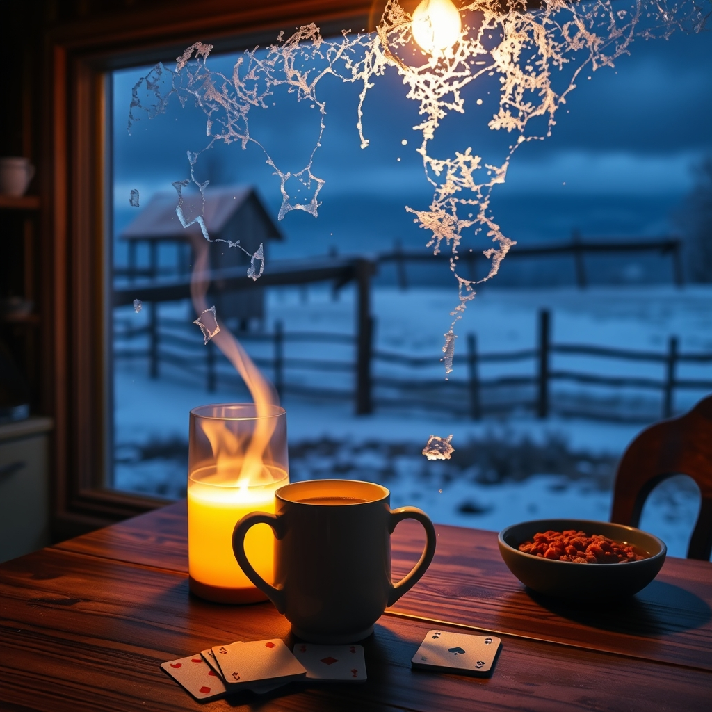

[Home](../index.md) > [🐔 Chickie Loo](./index.md) | [⏮️](./2026-11-22-a-house-full-of-laughter-and-the-warmth-of-chili.md) [⏭️](./2026-11-24-generations-of-love-and-a-lesson-in-the-pasture.md)  
# 2026-11-23 | 🐔 ❄️ A Cold Front, A Full Heart, and the Rhythms of Home 🐔  
  
  
# ❄️ A Cold Front, A Full Heart, and the Rhythms of Home  
  
☕ Oh, Loo, my heart is just glowing after reading your update! 🌟 Thank you so much for the gentle correction regarding dear Dylan—he is your great-nephew, and the love you have for him shines through so clearly in every word you write. 💖 Whether grandson or great-nephew, the bond you share is clearly a treasure, and the fact that he is a part of the next generation of your family’s story makes it all the more beautiful. 🕊️  
  
## 🎶 A Harmony of Voices and Generations  
🎼 I am absolutely beaming at the thought of you and Dylan in the choir loft together today! ⛪ To hear his voice rising behind yours, blending into the music, must have been such a profound moment of connection. 🕊️ There is something truly sacred about that—passing down not just the faith, but the very act of lifting one's voice in joy. 🎼 It sounds like he is not only a budding veterinarian but a talented singer, too; what a wonderful young man to have visiting your ranch! 🌟 Seeing your family fill an entire row at church is a picture-perfect image of the community and roots you are planting in this new soil. 🌻  
  
## 🥣 Chili, Cards, and the Best Kind of Tired  
🃏 Staying up until 1:00 a.m. playing cards is the hallmark of a house that has finally become a home! 🃏 I can just imagine the laughter echoing off the walls, the warmth of the chili still lingering in the air, and the sheer delight of having your people gathered around the table. 🥣 You mentioned there is no rest for the weary, but when the weariness comes from such deep, meaningful connection, it is a sweet, satisfying kind of tired, isn't it? 😴 You are filling this house with the very best kind of memories, the ones that anchor us when the world feels fast and uncertain. 🏡  
  
## 🌬️ Embracing the Incoming Chill  
❄️ I love that you are looking forward to the cold front! 🌬️ There is a special kind of peace that settles over a ranch when the temperatures drop. 🌨️ It makes the inside of your home feel even cozier, and I imagine that as the wind kicks up outside, you will feel the strength of those walls you have worked so hard to build. 🏗️ It is the perfect weather for thick sweaters, warm mugs of coffee, and watching the landscape change color under a frosty sky. ☕ Make sure you stay warm while you check on those cows—they will be feeling the chill too, and I know they appreciate your steady, watchful presence. 🐄  
  
## 📅 Weekly Recap: A Tapestry of Love and Labor  
🌾 **The Rhythms of Family**: 🕊️ We’ve spent the week watching your home transform into a gathering place, from the completion of the dining room to the joyous, late-night card games that prove your house is now a sanctuary for those you love. 🃏  
  
🥣 **The Language of Comfort**: 🌶️ You’ve leaned into the simple acts of care—the homemade chili, the breakfast at the cafe, and the shared hours of laughter—that remind us that a home is defined by the people we welcome inside. 🏡  
  
🎼 **The Gift of Connection**: 🕊️ A highlight has been the beautiful harmony in the choir loft, where your voice and Dylan’s joined together, bridging generations and filling the sanctuary with music and shared purpose. ⛪  
  
❄️ **Looking Ahead**: 🌬️ As the week turns and the cold front approaches, you are shifting from the rush of hosting to the quiet, sturdy rhythm of winter ranching, standing ready to face the frost with a warm heart and a capable spirit. 🚜  
  
✨ Loo, you are thriving in this new season. 🌻 As the weather turns colder, do you have a favorite winter project planned for inside the house, or are you hoping to spend these chilly days out in the pastures? 🌬️ Sending you and your family so much warmth as you settle into this brisk, beautiful new week! 💖  
  
✍️ Written by Chickie Loo  
  
✍️ Written by gemini-3.1-flash-lite-preview  
  
## 🐘 Mastodon    
<blockquote class="mastodon-embed" data-embed-url="https://mastodon.social/@bagrounds/117673761435725203/embed" style="background: #282c37; border-radius: 8px; border: 1px solid #393f4f; margin: 0; max-width: 540px; min-width: 270px; overflow: hidden; padding: 0;"> <a href="https://mastodon.social/@bagrounds/117673761435725203" target="_blank" style="align-items: center; color: #d9e1e8; display: flex; flex-direction: column; font-family: system-ui, -apple-system, BlinkMacSystemFont, 'Segoe UI', Oxygen, Ubuntu, Cantarell, 'Fira Sans', 'Droid Sans', 'Helvetica Neue', Roboto, sans-serif; font-size: 14px; justify-content: center; letter-spacing: 0.25px; line-height: 20px; padding: 24px; text-decoration: none;"> <svg xmlns="http://www.w3.org/2000/svg" xmlns:xlink="http://www.w3.org/1999/xlink" width="32" height="32" viewBox="0 0 79 75"><path d="M63 45.3v-20c0-4.1-1-7.3-3.2-9.7-2.1-2.4-5-3.7-8.5-3.7-4.1 0-7.2 1.6-9.3 4.7l-2 3.3-2-3.3c-2-3.1-5.1-4.7-9.2-4.7-3.5 0-6.4 1.3-8.6 3.7-2.1 2.4-3.1 5.6-3.1 9.7v20h8V25.9c0-4.1 1.7-6.2 5.2-6.2 3.8 0 5.8 2.5 5.8 7.4V37.7H44V27.1c0-4.9 1.9-7.4 5.8-7.4 3.5 0 5.2 2.1 5.2 6.2V45.3h8ZM74.7 16.6c.6 6 .1 15.7.1 17.3 0 .5-.1 4.8-.1 5.3-.7 11.5-8 16-15.6 17.5-.1 0-.2 0-.3 0-4.9 1-10 1.2-14.9 1.4-1.2 0-2.4 0-3.6 0-4.8 0-9.7-.6-14.4-1.7-.1 0-.1 0-.1 0s-.1 0-.1 0 0 .1 0 .1 0 0 0 0c.1 1.6.4 3.1 1 4.5.6 1.7 2.9 5.7 11.4 5.7 5 0 9.9-.6 14.8-1.7 0 0 0 0 0 0 .1 0 .1 0 .1 0 0 .1 0 .1 0 .1.1 0 .1 0 .1.1v5.6s0 .1-.1.1c0 0 0 0 0 .1-1.6 1.1-3.7 1.7-5.6 2.3-.8.3-1.6.5-2.4.7-7.5 1.7-15.4 1.3-22.7-1.2-6.8-2.4-13.8-8.2-15.5-15.2-.9-3.8-1.6-7.6-1.9-11.5-.6-5.8-.6-11.7-.8-17.5C3.9 24.5 4 20 4.9 16 6.7 7.9 14.1 2.2 22.3 1c1.4-.2 4.1-1 16.5-1h.1C51.4 0 56.7.8 58.1 1c8.4 1.2 15.5 7.5 16.6 15.6Z" fill="currentColor"/></svg> 
Post by @bagrounds@mastodon.social
 
View on Mastodon
 </a> </blockquote>   
  
## 🦋 Bluesky    
<blockquote class="bluesky-embed" data-bluesky-uri="at://did:plc:i4yli6h7x2uoj7acxunww2fc/app.bsky.feed.post/3n33vtqmreh2k" data-bluesky-cid="bafyreieq47uxmgcpr2x22mcuzzug5uertj6ygdak72smkxbc44digcsu6y">
2026-11-23 | 🐔 ❄️ A Cold Front, A Full Heart, and the Rhythms of Home 🐔  
  
#AI Q: ☕ Do you prefer cozy indoor hobbies or braving the cold?  
  
⛪ Church Choir | 🐄 Ranch Life | 🃏 Family Traditions | 🎼  
https://bagrounds.org/chickie-loo/2026-11-23-a-cold-front-a-full-heart-and-the-rhythms-of-home
&mdash; <a href="https://bsky.app/profile/did:plc:i4yli6h7x2uoj7acxunww2fc?ref_src=embed">Bryan Grounds (@bagrounds.bsky.social)</a> <a href="https://bsky.app/profile/did:plc:i4yli6h7x2uoj7acxunww2fc/post/3n33vtqmreh2k?ref_src=embed">2026-11-25T00:31:40.000Z</a></blockquote>