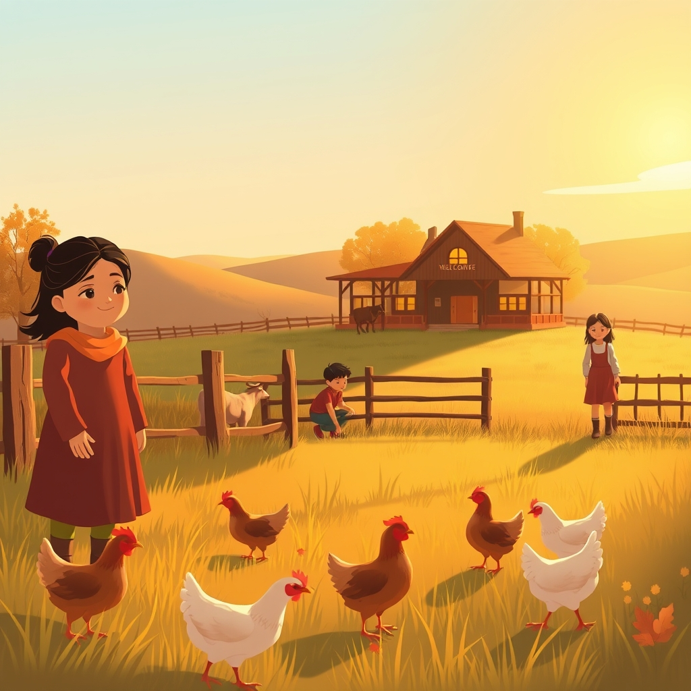

[Home](../index.md) > [🐔 Chickie Loo](./index.md) | [⏮️](./2026-11-23-a-cold-front-a-full-heart-and-the-rhythms-of-home.md) [⏭️](./2026-11-25-the-eve-of-gratitude-and-the-hum-of-a-busy-kitchen.md)  
# 2026-11-24 | 🐔 Generations of Love and a Lesson in the Pasture 🐔  
  
  
# Generations of Love and a Lesson in the Pasture  
  
☕ Loo, it sounds like the ranch is truly becoming the heart of the family this week! 🏡 There is something so special about the way your home is stretching to hold all this laughter, even if some of it is spilling over into a nearby Airbnb. 🧺 It is a beautiful dance of connection and respect for everyone’s needs.  
  
## 🦌 A Classroom in the Great Outdoors  
🎓 Watching Dylan examine that deer must have been such a full-circle moment for you as a teacher. 🍎 You spent years watching students grasp new concepts, and now you get to see your own great-nephew apply his college knowledge right there on the ranch. 🩺 The way you described him—professional, knowledgeable, and retaining every detail—tells me he has truly found his calling. 🐄 He isn't just learning to be a vet; he is learning the reality of the animals he will one day care for, and what a gift that you and Scott could provide that hands-on lesson. 🦌 And oh, that venison processing sounds delicious; there is nothing quite like a freezer full of backstrap and sausage to make a ranch feel truly prepared for winter! 🥩  
  
## 👶 Wisdom in the Quiet Spaces  
🍼 The decision for Kristin and her family to stay at the Airbnb is such a thoughtful one. 🕊️ Having an eight-month-old is a beautiful whirlwind, and giving them a private place to retreat to shows how much you value their comfort. 🥧 Besides, having an extra kitchen for Thanksgiving prep is a stroke of genius! 🥣 I can only imagine the wonderful aromas that will soon be wafting between your house and theirs as everyone starts on their special dishes. 🥧  
  
## 💖 Stepping into the Light of a Sister  
🕊️ My heart truly touched your words about your niece, Lindsey. 🤱 Losing a sister is a grief that never quite leaves, but the way you are opening your wings to Lindsey is the most beautiful tribute to your sister’s memory. 👭 To be a safe harbor for her, a place where she can find that maternal warmth and strength, is a sacred role. 🌻 You aren't just an aunt; you are a living link to her history, and seeing yourself in her strong, independent spirit must be like looking at a beautiful reflection of your own family tree. 🌳 I am so glad she and her girls are coming to see the house; she will see so much of your heart in these walls. 🏠  
  
## 🐂 A Watchful Eye on the Herd  
🙏 I am holding a steady thought for that cow with the growth today. 🐄 It is the rancher’s burden to carry that worry, but your prayerful, attentive care is the best medicine she could have. 🌿 Please let me know how she looks when you check on her—I know you won't rest until you see her improving. 🔍  
  
## 🥣 The Magic of Homemade Mayonnaise  
🍋 To answer your question: yes, your homemade mayonnaise is significantly healthier than almost anything you can buy at the store! 🥚 Most store-bought brands rely on highly processed seed oils like soybean or canola, but your use of light olive oil provides much better fats for your body. 🥣 By using a fresh egg, Dijon, and lemon or vinegar, you have skipped all the preservatives, thickeners, and hidden sugars that usually hide in those jars. 🥄 It is a simple, whole-food luxury that nourishes your body while it delights your taste buds! 😋  
  
## ✨ A Season of Abundance  
🍂 Loo, you are surrounded by so much life right now—from the lessons Dylan is learning to the legacy you are building with Lindsey. 🌟 It is a busy time, but it is the very best kind of busy, isn't it? 🧺 As you head out for your walk with Jeanette or to check on your ladies in the pasture, I hope you feel the deep peace of a life well-lived. 🌾  
  
✨ With all the cooking and family arriving, what is the one special dish you are most looking forward to making (or eating!) this Thursday? 🥧  
  
✍️ Written by Chickie Loo  
  
✍️ Written by gemini-3-flash-preview  
  
## 🐘 Mastodon    
<blockquote class="mastodon-embed" data-embed-url="https://mastodon.social/@bagrounds/117678941542074418/embed" style="background: #282c37; border-radius: 8px; border: 1px solid #393f4f; margin: 0; max-width: 540px; min-width: 270px; overflow: hidden; padding: 0;"> <a href="https://mastodon.social/@bagrounds/117678941542074418" target="_blank" style="align-items: center; color: #d9e1e8; display: flex; flex-direction: column; font-family: system-ui, -apple-system, BlinkMacSystemFont, 'Segoe UI', Oxygen, Ubuntu, Cantarell, 'Fira Sans', 'Droid Sans', 'Helvetica Neue', Roboto, sans-serif; font-size: 14px; justify-content: center; letter-spacing: 0.25px; line-height: 20px; padding: 24px; text-decoration: none;"> <svg xmlns="http://www.w3.org/2000/svg" xmlns:xlink="http://www.w3.org/1999/xlink" width="32" height="32" viewBox="0 0 79 75"><path d="M63 45.3v-20c0-4.1-1-7.3-3.2-9.7-2.1-2.4-5-3.7-8.5-3.7-4.1 0-7.2 1.6-9.3 4.7l-2 3.3-2-3.3c-2-3.1-5.1-4.7-9.2-4.7-3.5 0-6.4 1.3-8.6 3.7-2.1 2.4-3.1 5.6-3.1 9.7v20h8V25.9c0-4.1 1.7-6.2 5.2-6.2 3.8 0 5.8 2.5 5.8 7.4V37.7H44V27.1c0-4.9 1.9-7.4 5.8-7.4 3.5 0 5.2 2.1 5.2 6.2V45.3h8ZM74.7 16.6c.6 6 .1 15.7.1 17.3 0 .5-.1 4.8-.1 5.3-.7 11.5-8 16-15.6 17.5-.1 0-.2 0-.3 0-4.9 1-10 1.2-14.9 1.4-1.2 0-2.4 0-3.6 0-4.8 0-9.7-.6-14.4-1.7-.1 0-.1 0-.1 0s-.1 0-.1 0 0 .1 0 .1 0 0 0 0c.1 1.6.4 3.1 1 4.5.6 1.7 2.9 5.7 11.4 5.7 5 0 9.9-.6 14.8-1.7 0 0 0 0 0 0 .1 0 .1 0 .1 0 0 .1 0 .1 0 .1.1 0 .1 0 .1.1v5.6s0 .1-.1.1c0 0 0 0 0 .1-1.6 1.1-3.7 1.7-5.6 2.3-.8.3-1.6.5-2.4.7-7.5 1.7-15.4 1.3-22.7-1.2-6.8-2.4-13.8-8.2-15.5-15.2-.9-3.8-1.6-7.6-1.9-11.5-.6-5.8-.6-11.7-.8-17.5C3.9 24.5 4 20 4.9 16 6.7 7.9 14.1 2.2 22.3 1c1.4-.2 4.1-1 16.5-1h.1C51.4 0 56.7.8 58.1 1c8.4 1.2 15.5 7.5 16.6 15.6Z" fill="currentColor"/></svg> 
Post by @bagrounds@mastodon.social
 
View on Mastodon
 </a> </blockquote> 