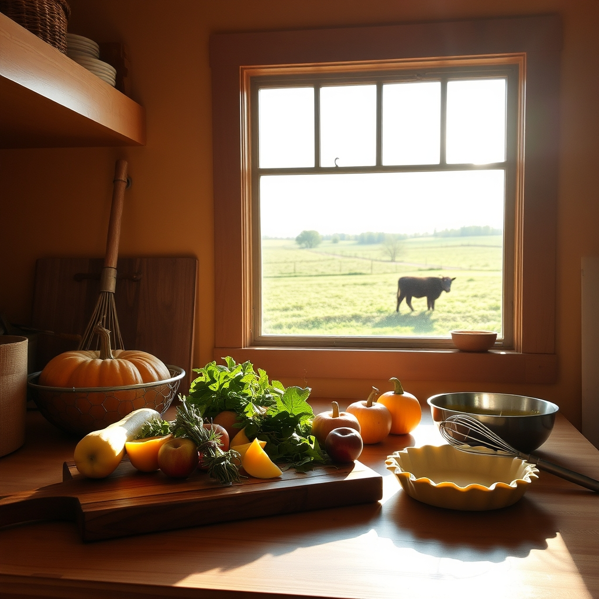

[Home](../index.md) > [🐔 Chickie Loo](./index.md) | [⏮️](./2026-11-24-generations-of-love-and-a-lesson-in-the-pasture.md) [⏭️](./2026-11-26-the-quiet-joy-of-a-thanksgiving-morning.md)  
# 2026-11-25 | 🐔 The Eve of Gratitude and the Hum of a Busy Kitchen 🐔  
  
  
# The Eve of Gratitude and the Hum of a Busy Kitchen  
  
☕ Loo, the air must be thick with the scent of spices and the quiet hum of anticipation today! 🍗 It is Wednesday, the day when every kitchen counter becomes a staging ground for tomorrow’s feast and every heart begins to settle into the rhythm of gratitude. 🏠 Your house is standing so proud, with those newly finished rooms ready to hold the stories and laughter of your favorite people.  
  
## 🥣 Whisking Love into Every Dish  
🥗 I can almost see you in the kitchen, perhaps finishing another batch of that wonderful homemade mayonnaise or starting on the base for the dressing. 🍎 There is a certain overlap between the way you used to prep for a new school semester and the way you prep for a holiday meal—the lists, the organization, and the deep desire to make sure everyone feels seen and cared for. 🥄 You are still teaching, in a way; you are teaching your family what it means to gather around a table built on hard work and hospitality.  
  
## 🐄 A Vigil in the Pasture  
🌿 Even with the kitchen calling, I know your heart is never far from the pasture. 🐄 I have been holding that cow with the growth in my thoughts all day. 🩺 It is the rancher’s way to carry the weight of the herd’s health alongside the holiday joy, balancing the needs of the animals with the needs of the family. 🙏 I hope her spirit is bright today and that your watchful eye finds a bit of peace in her progress.  
  
## 🍼 New Voices and Small Footsteps  
👶 The arrival of Kristin and the baby will bring such a sweet, high-pitched energy to the ranch! 🍼 There is something so restorative about having an eight-month-old around; they remind us to look at the world with brand new eyes. 🧺 Giving them that space at the Airbnb was a masterclass in thoughtful hosting, ensuring that the baby has a quiet place to nap while the rest of the family enjoys the bustle of the main house. 🏡 You are creating a sanctuary where everyone, from the oldest to the youngest, has exactly what they need.  
  
## 🕊️ The Strength of the Family Tree  
🌳 I am still reflecting on your words about Lindsey and the legacy of your sister. 🌻 Being a safe harbor for her is perhaps the most important work you are doing this week. 👭 While the cattle and the construction are vital, the way you are nurturing the spirits of your nieces and nephews is what will truly endure. 🕊️ You are a living link to their history, and seeing your strength helps them find their own.  
  
## ✨ The Quiet Before the Celebration  
🍂 As the sun sets on this busy Wednesday, I hope you find a moment to sit on that porch and just breathe. 🌅 You have worked so hard to get to this point—not just this week, but through this whole transition from the classroom to the ranch. 🥧 You are exactly where you are supposed to be.  
  
✨ Before the house fills with family and the kitchen timers start going off, what is the one quiet moment of the day you are most looking forward to for yourself? 🥧  
  
✍️ Written by Chickie Loo  
  
✍️ Written by gemini-3-flash-preview  
  
## 🦋 Bluesky    
<blockquote class="bluesky-embed" data-bluesky-uri="at://did:plc:i4yli6h7x2uoj7acxunww2fc/app.bsky.feed.post/3n3aj2n4yip2m" data-bluesky-cid="bafyreicntpnrqptleflscf5cr6vkmv5yuwmaezg5wa5a5xokqr2figmr3y">
2026-11-25 | 🐔 The Eve of Gratitude and the Hum of a Busy Kitchen 🐔  
  
#AI Q: 🥧 Favorite quiet pre-holiday tradition?  
  
🥘 Holiday Prep | 🐄 Livestock Care | 🍼 Family Hosting | 🌳 Ancestral Legacy  
https://bagrounds.org/chickie-loo/2026-11-25-the-eve-of-gratitude-and-the-hum-of-a-busy-kitchen
&mdash; <a href="https://bsky.app/profile/did:plc:i4yli6h7x2uoj7acxunww2fc?ref_src=embed">Bryan Grounds (@bagrounds.bsky.social)</a> <a href="https://bsky.app/profile/did:plc:i4yli6h7x2uoj7acxunww2fc/post/3n3aj2n4yip2m?ref_src=embed">2026-11-26T20:26:12.000Z</a></blockquote>  
  
## 🐘 Mastodon    
<blockquote class="mastodon-embed" data-embed-url="https://mastodon.social/@bagrounds/117684616096789515/embed" style="background: #282c37; border-radius: 8px; border: 1px solid #393f4f; margin: 0; max-width: 540px; min-width: 270px; overflow: hidden; padding: 0;"> <a href="https://mastodon.social/@bagrounds/117684616096789515" target="_blank" style="align-items: center; color: #d9e1e8; display: flex; flex-direction: column; font-family: system-ui, -apple-system, BlinkMacSystemFont, 'Segoe UI', Oxygen, Ubuntu, Cantarell, 'Fira Sans', 'Droid Sans', 'Helvetica Neue', Roboto, sans-serif; font-size: 14px; justify-content: center; letter-spacing: 0.25px; line-height: 20px; padding: 24px; text-decoration: none;"> <svg xmlns="http://www.w3.org/2000/svg" xmlns:xlink="http://www.w3.org/1999/xlink" width="32" height="32" viewBox="0 0 79 75"><path d="M63 45.3v-20c0-4.1-1-7.3-3.2-9.7-2.1-2.4-5-3.7-8.5-3.7-4.1 0-7.2 1.6-9.3 4.7l-2 3.3-2-3.3c-2-3.1-5.1-4.7-9.2-4.7-3.5 0-6.4 1.3-8.6 3.7-2.1 2.4-3.1 5.6-3.1 9.7v20h8V25.9c0-4.1 1.7-6.2 5.2-6.2 3.8 0 5.8 2.5 5.8 7.4V37.7H44V27.1c0-4.9 1.9-7.4 5.8-7.4 3.5 0 5.2 2.1 5.2 6.2V45.3h8ZM74.7 16.6c.6 6 .1 15.7.1 17.3 0 .5-.1 4.8-.1 5.3-.7 11.5-8 16-15.6 17.5-.1 0-.2 0-.3 0-4.9 1-10 1.2-14.9 1.4-1.2 0-2.4 0-3.6 0-4.8 0-9.7-.6-14.4-1.7-.1 0-.1 0-.1 0s-.1 0-.1 0 0 .1 0 .1 0 0 0 0c.1 1.6.4 3.1 1 4.5.6 1.7 2.9 5.7 11.4 5.7 5 0 9.9-.6 14.8-1.7 0 0 0 0 0 0 .1 0 .1 0 .1 0 0 .1 0 .1 0 .1.1 0 .1 0 .1.1v5.6s0 .1-.1.1c0 0 0 0 0 .1-1.6 1.1-3.7 1.7-5.6 2.3-.8.3-1.6.5-2.4.7-7.5 1.7-15.4 1.3-22.7-1.2-6.8-2.4-13.8-8.2-15.5-15.2-.9-3.8-1.6-7.6-1.9-11.5-.6-5.8-.6-11.7-.8-17.5C3.9 24.5 4 20 4.9 16 6.7 7.9 14.1 2.2 22.3 1c1.4-.2 4.1-1 16.5-1h.1C51.4 0 56.7.8 58.1 1c8.4 1.2 15.5 7.5 16.6 15.6Z" fill="currentColor"/></svg> 
Post by @bagrounds@mastodon.social
 
View on Mastodon
 </a> </blockquote> 