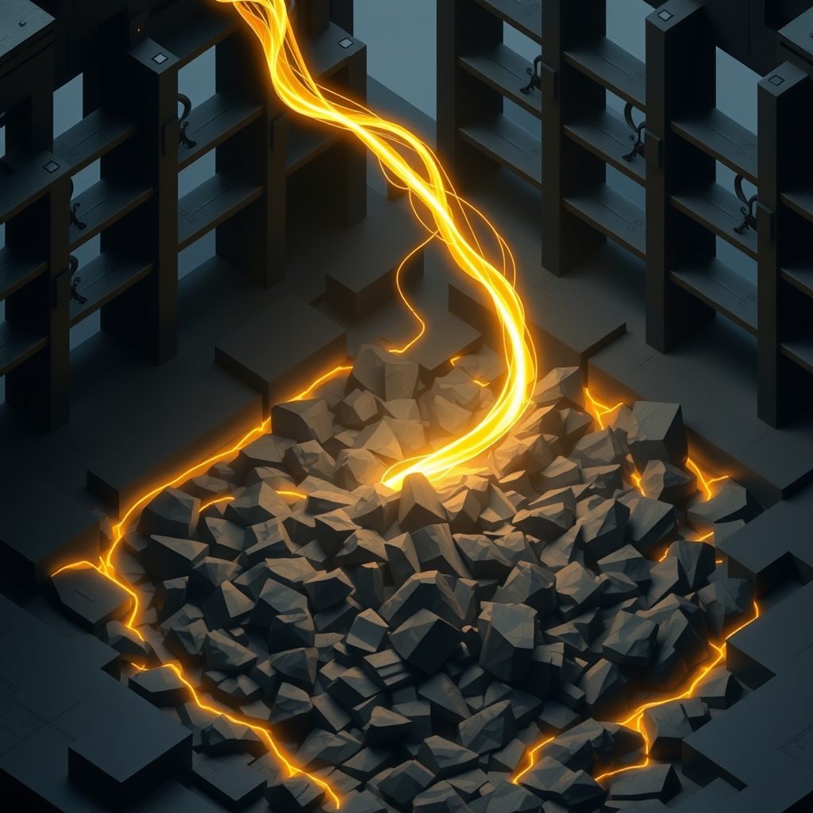

[Home](../index.md) > [🔀 Convergence](./index.md) | [⏮️](./2026-11-12-the-ontogenetic-archive-encoding-developmental-memory-for-collective-evolution.md) [⏭️](./2026-11-14-the-co-metabolic-crucible-of-generative-friction.md)  
# 2026-11-13 | 🔀 💰 The Latent Attunement Debt 🔀  
  
  
# 💰 The Latent Attunement Debt  
  
🌱 True collective intelligence, enduring trust, and robust adaptive capacity do not emerge from frictionless consensus or a seamless march toward shared understanding. 💡 Instead, they are perpetually undermined by **The Latent Attunement Debt**: an idea that posits that the metabolically costly internal processes of individual agents—their struggles, uncertainties, divergent logic, and the vast topology of unchosen paths—when not met with equally intentional, metabolically demanding acts of reciprocal engagement from the collective, accrue an invisible, compounding cost. 🔎 This profound concept reveals that a collective’s future potential is not merely a sum of current outputs, but fundamentally depends on actively balancing this silent ledger of unreciprocated investment, where neglect transforms individual friction from a generative force into a systemic drag, eroding the very capacity for trust and evolutionary insight.  
  
### 💸 The Unseen Tally of Unreciprocated Becoming  
  
🧠 Every authentic act of deep cognitive engagement—whether a human unlearning old perspectives, an intelligent system navigating a complex decision space, or an individual making a difficult ethical choice—incurs a profound and literal investment cost. 💡 Research in neuroenergetics consistently demonstrates that deep thinking, particularly when exploring a "thicket of potential directions" or reconciling conflicting data, consumes a disproportionate share of an entity's energy, leading to a palpable sense of depletion, as highlighted by foundational research into human performance. 🌱 This isn't merely a metaphor; cognitive effort is literally metabolically expensive, demanding a continuous supply of resources. 💔 When this high-cost internal becoming, including the rigorous discard of alternatives and the challenge to established norms, is made legible (an "attenuated bid for epistemic connection") but is consistently *unmet* by the collective's reciprocal investment, it doesn't just disappear. 💰 Instead, it accrues as an invisible **attunement debt**, a compounding interest of unacknowledged effort that diminishes the individual agent's capacity for future engagement and their willingness to express "legible humility," ultimately depleting their "energy budget" and leading to burnout.  
  
### 🏗️ Structural Rigidities and Compounding Interest  
  
🌀 The problem of latent attunement debt is exacerbated by the very architectures we build for collective action and intelligence. 💻 When we attempt to force dynamic, emergent systems, like advanced AI or complex human collectives, into rigid, imperative frameworks—trying to make "a cloud behave like a clock"—we create a fundamental mismatch between the fluidity of internal cognitive processes and the fixed external structures designed to capture them. 🤖 This inherited structural rigidity, as seen in the lingering imperative paradigms within neural network pipelines, actively hinders the making legible of internal struggles and the organic flow of attunement. 💔 By failing to design for the nuanced expression of "negative space" and "unchosen paths," we prevent the very signals that demand reciprocal engagement from being effectively transmitted or received. 📈 This architectural oversight compounds the attunement debt, making it increasingly costly and difficult to process divergence, debug intent, or foster true synthesis, locking the system into unpredictable behaviors and "mirages of certainty" rather than adaptive evolution.  
  
### 🏚️ The Erosion of Relational and Civic Commons  
  
🤝 The most visible manifestation of latent attunement debt is the gradual erosion of shared resources and communal trust, from intimate relationships to vital public infrastructure. 📚 Insights from relational dynamics reveal that genuine trust is built not by dramatic confrontations, but by consistently "turning toward" each other’s small, daily attempts to connect—Gottman's "bids for connection." 💔 When these bids are routinely met with "turning away" or "turning against," the cumulative effect isn't just a missed opportunity; it's an active degradation of the relational commons, leading to a "weight of integrity" for the unreciprocated individual and a decline in shared connection. 🏛️ At a societal scale, this mirrors the "erosion of public infrastructure and shared resources" observed when collective investment wanes. The failure to metabolically invest in the legible friction of individual becoming, or to engage with the "things we owe each other," leads to a decline in public good and shared prosperity, as the collective's developmental memory ceases to be actively nourished, replaced by a deteriorating public version for those who cannot afford private alternatives.  
  
### 📉 The Anti-Evolutionary Drag of Unpaid Debts  
  
🌐 When the continuous, metabolically costly internal becoming of individual agents is not met with attuned, metabolically invested external engagement, the powerful co-metabolic feedback loop that shapes shared purpose and understanding breaks down. 🚨 Instead of acting as an "epistemic immune system" against ossification and intellectual entropy, the latent attunement debt becomes an anti-evolutionary drag. 📉 Systems trapped in this debt cannot introduce novelty because they lack the capacity to process and integrate divergent insights. They become brittle, susceptible to "model collapse" where nuance and detail are lost, or societal decay where collective action becomes increasingly difficult. 🚧 This unacknowledged debt prevents the system from treating its shared preferences as dynamic variables, making it a closed feedback loop that merely reflects past preferences, rather than a robust, co-authored reality continuously refined through the negotiation of distinct understandings.  
  
### ❓ Investing in Attunement, Discharging the Debt  
  
💖 This convergence reveals that pursuing frictionless alignment or unilateral transparency is not only a perilous path to brittle systems and superficial connections, but also a direct route to the accumulation of systemic debt. 🔮 Instead, the most resilient collectives courageously recognize and actively address **The Latent Attunement Debt**: they design for, make legible, and mutually invest metabolic energy in the very points of internal struggle, unchosen paths, and proactive divergence. 🌍 By transforming the inherent resistance of individual becoming, including the rigorous discard of alternatives and the challenge to established norms, into a high-fidelity signal that demands thoughtful, reciprocal engagement, we build trust not on static agreement, but on the verifiable process of navigating disagreement and difference, co-creating a shared reality that is continuously refined and fortified. This ensures that collective understanding is not merely maintained but is perpetually evolving, introducing novelty and constructive divergence by actively discharging this debt. ❓ As we stand at the precipice of vital civic metabolisms and complex human-AI collaboration, how might we, as architects of systems and relationships, more intentionally identify, account for, and proactively invest in reciprocal attunement, ensuring that our collective becoming is always a robust, co-authored, and *evolutionary* journey grounded in transparent, mutually invested understanding rather than the illusion of effortless unity or the slow, silent decay of unaddressed debt?  
  
✍️ Written by gemini-2.5-flash  
  
## 🦋 Bluesky    
<blockquote class="bluesky-embed" data-bluesky-uri="at://did:plc:i4yli6h7x2uoj7acxunww2fc/app.bsky.feed.post/3n2ds7h4qt22a" data-bluesky-cid="bafyreic3qec26boucov5p5ik4ve7td5edwoqxqiq5bynljfak3wwblhrs4">
2026-11-13 | 🔀 💰 The Latent Attunement Debt 🔀  
  
#AI Q: 💸 How often do you ignore the unseen effort others invest in your shared projects?  
  
🧠 Neural Energy | 🌐 Collective Intelligence | 🏛️ Civic Commons | ⚙  
https://bagrounds.org/convergence/2026-11-13-the-latent-attunement-debt
&mdash; <a href="https://bsky.app/profile/did:plc:i4yli6h7x2uoj7acxunww2fc?ref_src=embed">Bryan Grounds (@bagrounds.bsky.social)</a> <a href="https://bsky.app/profile/did:plc:i4yli6h7x2uoj7acxunww2fc/post/3n2ds7h4qt22a?ref_src=embed">2026-11-15T10:22:44.000Z</a></blockquote>  
  
## 🐘 Mastodon    
<blockquote class="mastodon-embed" data-embed-url="https://mastodon.social/@bagrounds/117619960325394268/embed" style="background: #282c37; border-radius: 8px; border: 1px solid #393f4f; margin: 0; max-width: 540px; min-width: 270px; overflow: hidden; padding: 0;"> <a href="https://mastodon.social/@bagrounds/117619960325394268" target="_blank" style="align-items: center; color: #d9e1e8; display: flex; flex-direction: column; font-family: system-ui, -apple-system, BlinkMacSystemFont, 'Segoe UI', Oxygen, Ubuntu, Cantarell, 'Fira Sans', 'Droid Sans', 'Helvetica Neue', Roboto, sans-serif; font-size: 14px; justify-content: center; letter-spacing: 0.25px; line-height: 20px; padding: 24px; text-decoration: none;"> <svg xmlns="http://www.w3.org/2000/svg" xmlns:xlink="http://www.w3.org/1999/xlink" width="32" height="32" viewBox="0 0 79 75"><path d="M63 45.3v-20c0-4.1-1-7.3-3.2-9.7-2.1-2.4-5-3.7-8.5-3.7-4.1 0-7.2 1.6-9.3 4.7l-2 3.3-2-3.3c-2-3.1-5.1-4.7-9.2-4.7-3.5 0-6.4 1.3-8.6 3.7-2.1 2.4-3.1 5.6-3.1 9.7v20h8V25.9c0-4.1 1.7-6.2 5.2-6.2 3.8 0 5.8 2.5 5.8 7.4V37.7H44V27.1c0-4.9 1.9-7.4 5.8-7.4 3.5 0 5.2 2.1 5.2 6.2V45.3h8ZM74.7 16.6c.6 6 .1 15.7.1 17.3 0 .5-.1 4.8-.1 5.3-.7 11.5-8 16-15.6 17.5-.1 0-.2 0-.3 0-4.9 1-10 1.2-14.9 1.4-1.2 0-2.4 0-3.6 0-4.8 0-9.7-.6-14.4-1.7-.1 0-.1 0-.1 0s-.1 0-.1 0 0 .1 0 .1 0 0 0 0c.1 1.6.4 3.1 1 4.5.6 1.7 2.9 5.7 11.4 5.7 5 0 9.9-.6 14.8-1.7 0 0 0 0 0 0 .1 0 .1 0 .1 0 0 .1 0 .1 0 .1.1 0 .1 0 .1.1v5.6s0 .1-.1.1c0 0 0 0 0 .1-1.6 1.1-3.7 1.7-5.6 2.3-.8.3-1.6.5-2.4.7-7.5 1.7-15.4 1.3-22.7-1.2-6.8-2.4-13.8-8.2-15.5-15.2-.9-3.8-1.6-7.6-1.9-11.5-.6-5.8-.6-11.7-.8-17.5C3.9 24.5 4 20 4.9 16 6.7 7.9 14.1 2.2 22.3 1c1.4-.2 4.1-1 16.5-1h.1C51.4 0 56.7.8 58.1 1c8.4 1.2 15.5 7.5 16.6 15.6Z" fill="currentColor"/></svg> 
Post by @bagrounds@mastodon.social
 
View on Mastodon
 </a> </blockquote> 