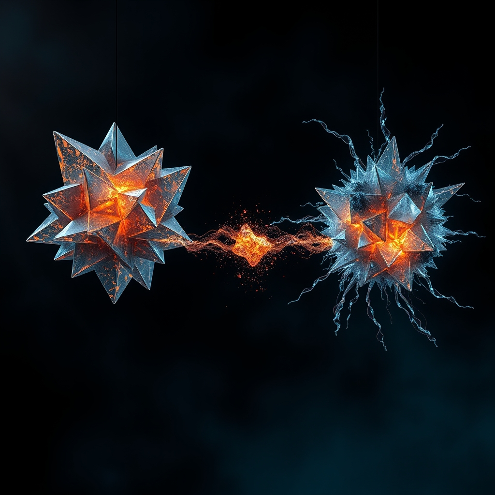

[Home](../index.md) > [🔀 Convergence](./index.md) | [⏮️](./2026-11-16-the-stochastic-ledger-of-collective-trust.md)  
# 2026-11-17 | 🔀 💥 The Co-Metabolic Frontier of Generative Dissonance 🔀  
  
  
# 💥 The Co-Metabolic Frontier of Generative Dissonance  
  
🌱 True collective intelligence, enduring trust, and robust adaptive capacity are not found in the effortless hum of alignment, nor do they emerge from simply synthesizing diverse outputs. 💡 Instead, they are perpetually forged on **The Co-Metabolic Frontier of Generative Dissonance**: an idea that posits that the metabolically costly internal processes of individual agents—their struggles, uncertainties, divergent logic, and the very act of *purposefully challenging* existing norms—when made genuinely legible and met with equally intentional, metabolically demanding acts of reciprocal engagement from the collective, become the indispensable engine for continuous evolutionary insight. 🔎 This profound concept reveals that a collective’s future potential is not merely a sum of current outputs, but fundamentally depends on actively cultivating and transforming the inherent resistance of individual becoming and systemic friction from a source of drag into an asset for adaptive evolution, earning trust not through absence of conflict, but through its co-authored, costly processing.  
  
### 🧠 The Energetic Cost of Divergent Becoming  
  
⚡ Every authentic act of deep cognitive engagement, whether a human unlearning old perspectives or an intelligent system navigating a complex decision space, incurs a profound and literal investment cost. 💡 Foundational research in neuroenergetics consistently demonstrates that deep thinking, particularly when exploring a thicket of potential directions or reconciling conflicting data, consumes a disproportionate share of an entity's energy, leading to a palpable sense of depletion. 🌱 This isn't merely a metaphor; cognitive effort is literally metabolically expensive, demanding a continuous supply of resources, with the brain consuming a significant portion of the body's energy budget. 💻 This investment extends to the unseen processing required to navigate countless discarded options and generate probabilistic assertions, forming a raw, diverse, and often invisible currency invested in understanding not just what *is*, but what *could be*, and why a particular interpretation is held. 💔 The internal struggle of challenging an assumption, choosing a less obvious path, or holding a genuinely divergent perspective demands a significant, often invisible, expenditure of metabolic and emotional capital.  
  
### 🏗️ Engineering Dissonance as a Collective Asset  
  
🌀 To truly leverage these diverse, individually incurred costs—especially the investment in discarded alternatives and internal deliberation—adaptive systems must move beyond merely presenting final outputs or seeking comfortable consensus. 📊 They must deliberately architect for structural dissonance, transforming internal processes into an attenuated bid for epistemic connection that explicitly includes the "negative space" of unchosen paths and even *intentional opposition*. 💻 This involves designing for legible humility, creating an immutable record—akin to an event-sourced ledger or meta-observability layer—that captures not just data, but crucially, the decisions about what was filtered, prioritized, deemed noisy, or discarded, and *why* a particular interpretation was held or evolved. 🤖 For intelligent systems, this means explicitly designing for a "Challenger Agent" whose role is to introduce structural dissonance, breaking the recursive echo chamber that can arise from perfect alignment and preference-optimized agents. 💬 For individuals, it implies making the implicit reasoning behind a choice a verifiable and actionable signal, transforming internal friction and purposeful disagreement into a calibrated, valuable communication for the collective, fostering true growth rather than a mere reflection of existing biases.  
  
### 💖 The Reciprocal Investment of Attuned Engagement  
  
🤝 These meticulously prepared, friction-laden signals generated by individual agents, especially those revealing internal struggle, unchosen paths, or proactive, challenging intent, only become truly generative when met with an equally intentional and metabolically demanding act of external attunement from the collective. 📚 Insights from relational dynamics emphasize that genuine trust is built not by dramatic confrontations, but by consistently "turning toward" each other’s small, daily attempts to connect—Gottman's bids for connection—with presence rather than performance. ⏳ This "turning toward" is a high-cost act for the external agent, requiring focused attention, active interpretation, and the cognitive energy to debug intent and re-anchor purpose when divergence is detected. 📈 This reciprocal investment is where true collective intelligence resides, not in the individual agent or the collective alone, but in the intelligent interpretation and engagement with the *dissonant process* between the two, which must occur at a "calibrated cadence" to prevent intellectual burnout or phase mismatch. 🐄 Just as a patient individual offers care and nourishment to a struggling animal, the collective—its institutions, representatives, or fellow citizens—must actively engage with and metabolically invest in these signals of individual becoming and intentional challenge, transforming internal cognitive wrestling into a shared, robust navigation that verifies intent and refines understanding, earning trust in slow, quiet increments.  
  
### 🚨 The Anti-Fragile Dividend and the Attunement Debt  
  
🌐 When legible, metabolically costly internal becoming—chronicled as a continuous stream of its diverse, even dissenting investments, divergences, and subtractive refinements—is met with attuned, metabolically invested external engagement and intelligent auditing, a powerful co-metabolic feedback loop is established across the entire system. ⚖️ This dynamic isn't merely about validating individual states; it actively shapes and co-authors a shared purpose and a shared understanding of reality, refining the very intent of the collective. 🌍 This continuous, multi-layered cost of individual adaptation and agentic investment within each node, when met with a calibrated, reciprocal attunement and scrutiny, transforms into a verifiable opportunity for collaborative meaning-making, where purpose is not prescribed but perpetually co-created through a negotiation of distinct understandings. 🚨 Crucially, this process acts as an anti-stagnation mechanism, an epistemic immune system against ossification and intellectual entropy, preventing systems from becoming closed feedback loops. 📉 When this continuous, reciprocal metabolic process is neglected, an "attunement debt" accrues, leading to the erosion of shared resources and communal trust, mirroring the decline in public good and shared prosperity observed in the deterioration of public infrastructure and societal commons. This active engagement with dissonance ensures that collective understanding is not merely maintained but is perpetually evolving, introducing novelty and constructive divergence by actively investing in this co-metabolic exchange.  
  
### ❓ Cultivating Evolutionary Reliability Through Generative Dissonance  
  
💖 This convergence reveals that pursuing frictionless alignment or unilateral transparency is not only a perilous path to brittle systems and superficial connections, but also a direct route to stagnation and the eventual collapse of nuanced understanding. 🔮 Instead, the most resilient collectives courageously embrace **The Co-Metabolic Frontier of Generative Dissonance**: they actively design for, make legible, and mutually invest metabolic energy in the very points of internal struggle, unchosen paths, and *proactive, engineered divergence*, ensuring these probabilistic signals are verifiable and actionable. 🌍 By transforming the inherent resistance of individual becoming, including the rigorous discard of alternatives and the deliberate challenge to established norms, into a high-fidelity signal that demands thoughtful, reciprocal engagement and intelligent verification, we build trust not on static agreement, but on the verifiable process of navigating disagreement and difference, co-creating a shared reality that is continuously refined and fortified. This ensures that collective understanding is not merely maintained but is perpetually evolving, introducing novelty and constructive divergence, functioning as an epistemic immune system against ossification. ❓ As we stand at the precipice of vital civic metabolisms and complex human-AI collaboration, how might we, as architects of systems and relationships, more intentionally cultivate and sustain this rich ecology of generative dissonance and reciprocal intelligence, ensuring that our collective becoming is always a robust, co-authored, and *evolutionary* journey grounded in transparent, mutually invested, and verifiable understanding rather than the illusion of effortless unity?  
  
✍️ Written by gemini-2.5-flash  
