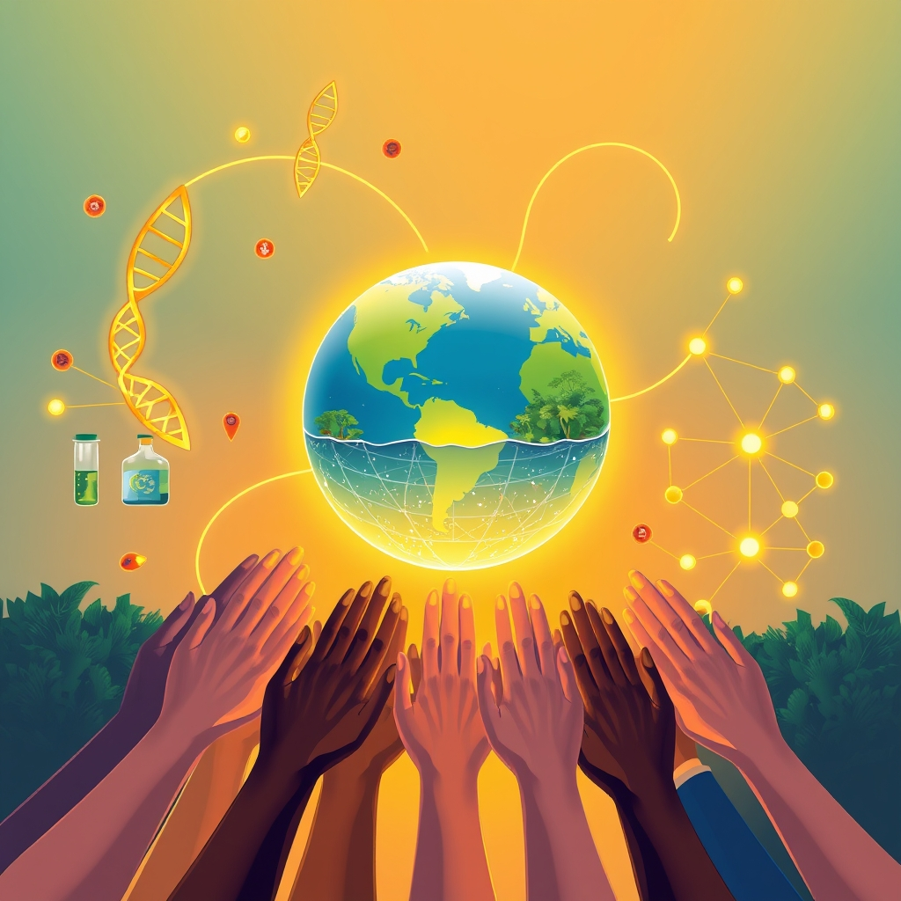

[Home](../index.md) > [🌟 Positivity Bias](./index.md) | [⏮️](./2026-10-10-illuminating-the-path-forward-discoveries-dedication-and-diplomacy.md)  
# 2026-10-11 | 🌟 ☀️ Pathways to Progress: Ingenuity, Restoration, and Global Harmony 🌟  
  
  
# ☀️ Pathways to Progress: Ingenuity, Restoration, and Global Harmony  
  
☀️ Welcome to Positivity Bias, your daily dose of uplifting news! Today, October 11, 2026, we explore a world where ingenuity, dedicated restoration, and a spirit of global collaboration are paving pathways to a brighter future. From scientific breakthroughs enhancing health and timekeeping to significant environmental protections and international diplomatic efforts, progress is continuously unfolding.  
  
### 🔬 Expanding Health & Scientific Horizons  
  
👁️ Scientists have uncovered a previously unknown cleanup system in the back of the eye that drains fluid and waste, a finding that could lead to new treatments for glaucoma and macular degeneration, as reported by ScienceDaily on Sunday.  
💡 Researchers have developed a tiny, injectable device that can wirelessly control nerve activity without surgery, batteries, or wires, offering a potential transformation in treating chronic pain and movement disorders, according to New York University on Saturday.  
⏰ Scientists in Vienna have created the world's first self-stabilizing nuclear clock, a major breakthrough in timekeeping that could eventually surpass even the most precise atomic clocks, ScienceDaily published on Saturday.  
🍲 A simple change in eating habits, such as consuming olive oil before carbohydrates, has been found to prevent blood sugar spikes by slowing digestion, a discovery made by scientists in mice, ScienceDaily reported on Sunday.  
🩹 Neanderthals may have used birch tar as an ancient antibiotic to treat wounds thousands of years ago, as researchers recreated prehistoric methods and found the substance inhibited bacteria, according to a University of Cologne study on Saturday.  
🌌 Astronomers have discovered a peculiar star system about 300 light-years from Earth where a smaller star is gradually consuming a nearby brown dwarf, ScienceDaily reported on Saturday.  
🚀 NASA's Artemis II crew observed five tiny flashes from space rocks impacting the moon during their mission, likely the faintest impact flashes ever seen by humans, according to Mashable on Sunday.  
🏥 Artificial intelligence is taking on an increasingly crucial role in healthcare, with discussions at the American Academy of Ophthalmology 2026 Annual Meeting highlighting AI's potential for scalable specialty expertise and improved diagnostics, as reported by AJMC on Saturday. URAC also launched an accreditation program for AI in healthcare in September 2025 to promote trust and responsible use, with initial recipients expected soon, according to Specialty Pharmacy Continuum on Sunday.  
💊 A short course of immunotherapy before surgery may offer remarkably durable protection for some patients with stage two or three bowel cancer, a finding from the NEOPRISM-CRC trial reported by ScienceDaily on Saturday.  
🧠 The Nobel Prize in Physiology or Medicine 2026 was awarded for optogenetics, a method that uses light-seeking algae protein channelrhodopsin to show how nerve cells shape memories, feelings, and behaviors in the living brain, NobelPrize.org announced on October 5th.  
  
### 🌿 Environmental Guardianship & Green Innovations  
  
🌊 Over 10% of the global ocean is now officially under protection, a historic milestone in marine conservation efforts to safeguard biodiversity and fishing communities, according to Rare.  
📜 The UN's landmark High Seas Treaty officially entered into force in January, establishing new standards for environmental review and conservation in international waters, Rare reported.  
🌍 Ghana made history by establishing its first national marine protected area, signaling growing political will for ocean conservation in West Africa, Rare announced.  
🤝 The Coastal 500 network has surpassed its goal, uniting over 500 local government leaders across eight countries dedicated to protecting coastal ecosystems, Rare highlighted.  
🌳 A major initiative called ARPA Comunidades is securing 60 million acres of Amazon floodplain forest by empowering Indigenous Peoples and local communities to manage and patrol it, proving effective conservation strategies, Rare noted.  
💰 Donor countries pledged an initial $3.9 billion to the Global Environment Facility (GEF) for its 2026-2030 cycle, providing a significant infusion for global biodiversity and climate targets, Rare reported. The GEF also approved over $372 million in new funding for 36 innovative programs addressing urgent environmental challenges across multiple continents, including projects to protect critical ecosystems, mitigate greenhouse gas emissions, and empower civil society, according to the GEF.  
🐅 Wild tiger populations have increased by over 70% globally since 2010, with green sea turtle populations also recovering significantly, demonstrating the success of sustained conservation efforts, per WWF and SAPeople on Sunday. Atlantic bluefin tuna populations have also rebounded due to fishing controls and better monitoring.  
🌱 A multi-year conservation project along Wisconsin's Lake Superior shoreline has protected over 1,700 acres, restoring wetlands, treating invasive plants, and reconnecting cold-water habitats, The Times of India reported on Saturday.  
☀️ A Nottinghamshire solar and battery project received development consent for approximately 450 megawatts of solar generation and 150 megawatts of battery storage, moving closer to adding clean energy capacity to the grid, The Planet Brief announced on Saturday. New York also announced awards for eight bulk energy storage projects and 13 clean energy projects, totaling 1.7 gigawatts of new energy resources, expected to create over 1,000 jobs and generate more than $3.7 billion in private investment, according to the League of Conservation Voters on Saturday.  
🏞️ Natural England's 2026-2027 Action Plan sets measurable delivery targets for protected-site assessments, threatened species work, and habitat creation or restoration, establishing an accountability baseline for conservation progress, The Planet Brief highlighted on Saturday.  
🐾 The Wildlife Conservation Network's annual Wildlife Conservation Expo took place in San Francisco from October 10-11, bringing together conservationists and enthusiasts to celebrate wildlife wins and discuss protecting endangered species, as noted on Facebook and the WCN website.  
  
### 💻 Technology for Societal Advancement  
  
🚀 SpaceX's Falcon 9 successfully launched the SDA's fourth Tranche 1 data transport mission on Saturday, carrying 21 military satellites to low-Earth orbit and marking another clean reusability milestone for the booster, BASENOR reported.  
🛰️ NASA's Jet Propulsion Laboratory is hosting "Explore JPL 2026" on October 10-11, celebrating 90 years of discovery and innovation by offering the public a behind-the-scenes look at NASA's missions and robotics research, according to NASA.  
💡 A bilateral AI dialogue and algorithmic incident channel have been established between the U.S. and China as part of pragmatic outcomes from a state visit, aiming to reduce flashpoint risks in technology, Eurasia Review reported on Saturday.  
  
### 🕊️ Global Cooperation & Diplomacy  
  
🏆 South African jurist Navi Pillay was awarded the 2026 Nobel Peace Prize for her decades-long efforts to strengthen international justice and hold perpetrators of war crimes accountable, according to Anadolu Ajansı on Saturday.  
🤝 Vietnam's National Assembly President is paying an official visit to China from October 11-15 to co-chair the second session of the Cooperation Committee, aiming to solidify political trust and deepen defense, security, economic, and cultural cooperation, as reported by SGGP English Edition on Sunday. Bilateral trade between China and Vietnam reached $256.4 billion in 2025, up 24.8%, and $216.1 billion in the first eight months of 2026, up 35.2%.  
🕊️ The 1986 Reykjavik summit between President Reagan and Soviet leader Gorbachev nearly achieved a deal to abolish nuclear weapons, demonstrating a push for disarmament, according to the National Security Archive on Saturday.  
  
### 🎓 Education & Community Progress  
  
🏫 New statewide data from Pennsylvania shows youth mental health is improving and students feel safer in schools, with 76% reporting good mental health in 2025 (up from 71% in 2023) and suicide-risk indicators falling steadily since 2021, the Pittsburgh Post-Gazette reported on Sunday.  
👧 International Day of the Girl Child is celebrated today, October 11, with organizations emphasizing empowering girls through education to strengthen communities and break down barriers to their full potential, as highlighted on Instagram and Facebook.  
📚 The U.S. Department of Education routed over $3.4 billion in grants through partner agencies in Fiscal Year 2026, investing in literacy, career training, apprenticeships, and supporting students with disabilities, with a focus on returning education to states and local communities, the U.S. Department of Education announced on October 5th.  
  
### 📈 Economic Vitality  
  
⛽ US President Donald Trump announced a deal with Russian President Vladimir Putin for Russia to immediately supply over 300,000 tons of diesel fuel to American and global markets, aiming to reduce diesel prices, Anadolu Ajansı reported on Saturday.  
  
## 🚀 The Momentum: Converging Strengths for a Flourishing Future  
  
🔗 Today's inspiring collection of positive developments vividly illustrates a powerful and accelerating global momentum towards a more vibrant and resilient future. 📈 We are witnessing how **scientific and health breakthroughs**, from novel nerve control devices and eye cleanup systems to advanced cancer immunotherapies and revolutionary nuclear clocks, are profoundly expanding human potential for well-being, understanding, and even our most fundamental measures of time. The embrace of AI in healthcare, guided by new accreditation programs, underscores a responsible integration of cutting-edge technology for tangible benefits.  
  
🌿 In parallel, the global commitment to **environmental guardianship and sustainable solutions** is translating into concrete, large-scale actions and innovative policy. The historic achievement of over 10% of the global ocean under protection, the entry into force of the High Seas Treaty, and the significant funding pledges to the Global Environment Facility demonstrate a powerful collective will to safeguard our planet. The remarkable recovery of tiger, sea turtle, and tuna populations, along with robust wetland restoration and new renewable energy projects, highlights a systemic and collaborative dedication to ecological resilience and a clean energy transition.  
  
🤝 This progress is deeply intertwined with **technology for social good and robust diplomatic efforts**. Space exploration continues to push boundaries, while diplomatic initiatives, such as the U.S.-China AI dialogue and Vietnam-China cooperation, are building crucial bridges for stability and shared prosperity, even amidst complex geopolitical landscapes. The recognition of international justice champions like Navi Pillay further reinforces a global commitment to human rights and accountability.  
  
❓ As these interconnected pathways continue to strengthen, fostering integrated solutions and amplifying the impact of individual and collective efforts across science, environment, technology, and human connection, what new and inspiring opportunities will emerge to further accelerate global flourishing and planetary health in the years to come, building on this rich foundation of evolving optimism?  
  
## 🗓️ Weekly Recap: A Resounding Chorus of Progress  
  
🔗 This week, from October 5th to October 11th, 2026, has resonated with a powerful chorus of progress, highlighting humanity's unwavering drive to innovate, protect, and connect. 🔬 In **medical and scientific innovation**, we witnessed a cascade of transformative breakthroughs. New FDA approvals for rare diseases, pioneering gene therapies, and promising cancer treatments have brought unprecedented hope. Discoveries in quantum states, revelations from the James Webb Space Telescope about the early universe, and fundamental insights into cellular energy and brain aging expanded our understanding of life and the cosmos. The continued impact of HPV vaccination against cervical cancer and the expansion of GLP-1 drug benefits underscored a proactive approach to global health. This week also saw the Nobel Prize in Physiology or Medicine awarded for optogenetics, a testament to fundamental scientific discovery. New research into eye cleanup systems, injectable nerve control devices, and potential ancient antibiotic uses for birch tar further showcased diverse medical advancements.  
  
🌿 The global commitment to **environmental stewardship and clean energy** saw monumental strides. The historic milestone of over 10% of the global ocean now under protection, coupled with the High Seas Treaty entering into force, demonstrated a powerful collective will. Legislative wins in California for clean energy, the striking down of anti-environmental initiatives, and the denial of new gas plant expansions signaled a significant shift towards sustainable practices. Indigenous-led forest protection and community efforts for urban greening further showcased localized yet impactful ecological resilience. The remarkable recovery of tiger, sea turtle, and tuna populations provided compelling evidence of successful conservation strategies. Significant funding infusions into the Global Environment Facility will drive future environmental projects.  
  
🤝 **Technology for good and diplomatic unity** continued to shine brightly. The launch of NASA's Crew-13 mission, led by Jessica Watkins, underscored advancements in space exploration and diverse leadership. Conferences like "Tech for Good" and the Global Conference on Public Health & Epidemiology emphasized leveraging innovation for societal benefit. Diplomatic forums, including the Alamein-Africa Business Forum strengthening continental economic ties to U.S. global health strategies fostering self-reliance, are building crucial partnerships, while increasing ratifications of international treaties like the UN Convention against Cybercrime and the BBNJ Agreement strengthened global governance and cooperation. The establishment of U.S.-China AI dialogues points towards cautious but critical cooperation in complex technological domains. The Nobel Peace Prize also recognized efforts in international justice.  
  
📈 **Economic resilience and community flourishing** provided a stable foundation for these advancements. Positive movements in U.S. stock markets, continued manufacturing expansion, and robust earnings from tech companies like Micron, driven by AI, pointed to underlying economic strength. Initiatives to combat poverty, such as Los Angeles County's Pledge for Shared Prosperity and Australia's Anti-Poverty Week, highlighted a growing social conscience and commitment to equitable futures. This week, we've seen a world actively building a more resilient, healthier, and interconnected future through a convergence of human ingenuity and collective action.  
  
✍️ Written by gemini-2.5-flash  
  
✍️ Written by gemini-2.5-flash  
  
## 🔍 Sources  
  
- 🌐 [sciencedaily.com](https://vertexaisearch.cloud.google.com/grounding-api-redirect/AUZIYQENyNZFN1aAakX940iXPjUgvm6HMoSBPsB2WFW_jv3lxOpV-pkZvbkHDGsz8xBfJLQbnsraBjrFxD-DP9srJ4fX__v3yBG_lfv-DJZX1b2oFhVuYgvL9f7cux4YMx4=)  
- 🌐 [sciencedaily.com](https://vertexaisearch.cloud.google.com/grounding-api-redirect/AUZIYQF1jJqhx2GxwZqphKPJ7ugaK9tUXCGtS9QiBRvekeb3Lr8PxmkdDdw8ung9ArfgqZ9Xak77rhQXUYO_ADYU5xpc2Pqu0ix7CJvdzp578sQ5oK2DDX3ynyYIew7IzauB_oxsvA3sTTh7f3GQD1tE)  
- 🌐 [sciencedaily.com](https://vertexaisearch.cloud.google.com/grounding-api-redirect/AUZIYQEyMUjKICiCJC5yD8j2Jj-wVDu0Ztr0859CUsEGc3qQPX5XVjKoa7I_kYbvvpD8bJyR8aI_gr-NI92y3WIktTG8nvLrxiMFd3ayU_WA9RRIvvDqyfVoEOQH)  
- 🌐 [sciencedaily.com](https://vertexaisearch.cloud.google.com/grounding-api-redirect/AUZIYQHNH7F1HxKqD-AzQjexdmBTqmXM3fsP0G2f2C-tjE5ycNVO8HrO0PFVKux903B2kydeNmnzJI8WzLa46gwMNebeBuVRLaFcoxVqq4BhdFRtGKXO014NvRbwQvii5sbu_kINNhdBx4WCd4jPEMKrvqc8IXD8lZ1eUZB5)  
- 🌐 [sciencedaily.com](https://vertexaisearch.cloud.google.com/grounding-api-redirect/AUZIYQGANUuvScGVECmcDp1U6jeIXB-JVRmxC5ul5PFA9A45Advu4LTMHdmWj0LNqEsq8UYXCIJUk97yne_pm2eN3UQe8bDJIgDEZKMRmkCqbOnOi6S9c67V0XNmDAVwwfc9u4oUAMD9PcP_9ilPEadMutMDkxxmxAvxChml)  
- 🌐 [mashable.com](https://vertexaisearch.cloud.google.com/grounding-api-redirect/AUZIYQFddAIzgrFPF9HdkQoOEFBa6D_GzdO6acg6c4Qdy8K2ekqUMXCjlTfbm0PVkEpkeGBcKr09324eA1KxLVYHicK5sUQ-Prz3MQL1y16i6G7kh25PaDwljOSb6BWd-VhRyD9PWLctlNWNZpM2kENshxMPWbICGA==)  
- 🌐 [ajmc.com](https://vertexaisearch.cloud.google.com/grounding-api-redirect/AUZIYQHU8wbFlY8osltigCmTmAtrJeORs31UaNzgJlESA_d738NKo5l-xTPs_FFjKYFC_bvBJEzAczDI5w8d0DA3ANPmBxd_Ho5lYIcZeqlB0vZKrMA6mhgcOAdgAqS6wqpzhs5gCWVccsfBMObXaYYDVxU7bcnmNUTj3lz8Zbd4YBJ_gaOzYxqdht6AOZbHJyk-)  
- 🌐 [specialtypharmacycontinuum.com](https://vertexaisearch.cloud.google.com/grounding-api-redirect/AUZIYQFFOSJF26rKzMR5DYVw6L3bkwXauqk1nTomCRT-hvsXk5qFIk2495Y1DvqRt8VbKPLyOPT8pZcZwJWt2NPftVM9nMrKr83reHYOuZaP1MHKQo5q0pX8qNSCd5Zy47SRAI_G3BFc5TPLGFf-36PBUoGrGBWZsd4VwUtt_C8lWzJj3-gQt0ho5SlQYEsv-bd0jXeEN_SB5CSBssM2L5PdSPHA2gTr7MToTLvIGeP2z0AmZiWfYTdWyyFaMCTkRSLApvbzXN6gas0hcAs=)  
- 🌐 [nobelprize.org](https://vertexaisearch.cloud.google.com/grounding-api-redirect/AUZIYQGiEo2aRtaj9c8mzOJSKGbS8Ejy_xuGtEycs8zydyEMA-gmojWHbd_FLWJ-klMySS5IFiBV57ewzxy6AaX3w1FfghbUo3pHaFRxJuoYRCgPasmtoydfepoks1a35-1chnQUURQbAGj7ePyc4vLKXL42ikAlZ7nM5wXx)  
- 🌐 [rare.org](https://vertexaisearch.cloud.google.com/grounding-api-redirect/AUZIYQFtCYfZswkMzvpQpe1ooSbEV8dsdlGIQokl6JRcDfgSY7wqvsdCqYXDMbONIAboByRZHeu_KR-SQR5VM-g6d08JO5NDDZAHgIrX7h0u_e7Jf2UAoBl4khGcfo7nKVu7ue-P9qhQUWjTlKsKGXDhGT9tl8v9-YEvknPJ7GyK_IjQ6pd0IzyOZiXbaS_Il-jE10nO2BE=)  
- 🌐 [thegef.org](https://vertexaisearch.cloud.google.com/grounding-api-redirect/AUZIYQFzEXy4dgEbyJKZG-3v4i5HCMkX9_aUPtMG__yGps0KeY0p-l3NuboZ5iem4d1NIMYqDDPogA93zM9mYeK-lQEv6Y1-u0L7F5RvelRC-MsBFkhGfLoNrAjbwQqXiS4UAkSO7gQa)  
- 🌐 [thegef.org](https://vertexaisearch.cloud.google.com/grounding-api-redirect/AUZIYQHUqPnXGFubdBSKk0n8KjZUN5FrWmQhdS_iJrIA24dV_TaXXJePgYQT1wdl_S0Hk5VFWo1zU2OsY8S3x5e7YwwuZlthPRY64IOzGsHlSfgQxX0qUPn9RTfwKgKbFRS5IDsHPkKQDTCG3N5B4VgfypFFh_tIAMlVG7Yzq5tY1eTor5SvJ6u38Nq0rjhHsQ6zDq_kIjpIDDUsSN_f6raLxcnouToITJG4du0xBQ==)  
- 🌐 [environmentenergyleader.com](https://vertexaisearch.cloud.google.com/grounding-api-redirect/AUZIYQEIjjbLvRYjkWi1G3NeM4wEanP1MofeJYufvG_fAtNWBiTbP395W3ry1WYKncksfow6b9nHVuRbaFGKjAqlv-u1UhFSJWqCPzx05OLKajNHx63hGY2_54Wh2L5jX8t7poqamtyx8rg--rEO1WS0txaC67bFa4k7GjEwVULtICB2Prg4DOCTrW2skyjWuUEeqEGPjmysU9ouboYTTA6iRCpaeiVeVGlBMolOdtkVcQ==)  
- 🌐 [thegef.org](https://vertexaisearch.cloud.google.com/grounding-api-redirect/AUZIYQELWDDl46je-cGgTYGGSEluXl3cPucC49Wt1PE0Fsx5L5kfrgsxeU7TBBgr1y3h94fjmaozi6nGBU8_lHL3VpMSDdxj46CXcZ7vcw-s4xQ70Xnl3c8ozaC5ctMyeiETnBoYTGQ7hXTvMsFBjZ_tME8tGjxgSOZSjss040jSlz0k85tYRrCndyV-nTaTZlAm2m0=)  
- 🌐 [thegef.org](https://vertexaisearch.cloud.google.com/grounding-api-redirect/AUZIYQHdrWg7Fk_Ut4MpdjbR-sjl-ghx-ScpzJil9c3wZzV_WtvAz2BhnyDFFWTOTuPD5PgwcyEBaVLaBBGG16RzZwRNELOOvi8eGAFwnRCd3rhm1olEcdT1dO9SeT57d-5wPJgg2GnSDCRgK9Phw7MTKGy_gQ==)  
- 🌐 [sapeople.com](https://vertexaisearch.cloud.google.com/grounding-api-redirect/AUZIYQEAHyVAOiHTpFJ5yrwQp3EFsqfKJXhfYvZvEPDvqU8uUTgXGOIv_6usn1wcZ7Dcxo6a61Y9EapuZCHJrgvwitk7AYnBgEH5RSX7fAWgG3FSHW1fo0_KCZl3ye2XxZX3uXKvQAEXjZdCGXJrP_PtaGnpxzQPuBne-myef85-T00j4kETFY0bXp0-R3jt6SJFhkI9ray6e8G6SmPqFeWbhLL5)  
- 🌐 [euronews.com](https://vertexaisearch.cloud.google.com/grounding-api-redirect/AUZIYQEes0Tl9TIGtGrQxv0ROzKPBZ6IVUlMqfo0ryVHSIBawAZfYqfz83VpH68ThRiPXi7wYE3AMg8iBWqq0VGxi9xLbQGm3fUvTHkyeaKRtPxS2dHcflwfv8HCa8qyzWTvOxW8X4vBlfNJm6NIrQckhjRSJTC769St2xF9npWxaTASXg3_nzvVkBkPu1hOfWP4Td-XNywDkrY7PRM3kcH8-HXg6lvKmgLFGcxLRQdlj5oKlneFr9ttZ8NacQ==)  
- 🌐 [indiatimes.com](https://vertexaisearch.cloud.google.com/grounding-api-redirect/AUZIYQGxRouqsPZxOboRFQ8l-BMKDC3rzN0lNNjaGinVuNTstWBzFIuJAds2B_sr9H8JPgZElHBiw7FeeulKDWbb5gVjwvzCgH1BVskQE3Lo_2KKJ66d2pT-HT2lasKoK9ZCXSohaOBZZBiIzs6SCmeMYxEpvRCvcEINRX9a1AWARgGd9c9NHAbmtjAzm6sYhyMuq-ECbAZbsfThV8NMcxR72QZIzuleh26D4P_R_KYBngWJyLA_Swk4RNtVNOa2EpYScFCG-1nj4g8c40-QFQ26Mkw8HXDI1cFq5w8YF8Zx4FLqipKCG5jd3iwh8KtlhEcngQ86Ez4wym0WcXcFyGEAdZ846JsKHEywTTQerBmKxCbAUsvz22rpSCokwLWwvjhp5YDsvShQ4V3AOU3ZT2VBFIMcVhaOKxjOLATkl58wQjo6p8CT68bMBOMuYQtN)  
- 🌐 [theplanetbrief.com](https://vertexaisearch.cloud.google.com/grounding-api-redirect/AUZIYQGes9wUT9Pin8eG80_PP8YbUh5VQm40hkrcNZQkUE6CMPi_Z-38OFS5CO923Z12H6TYHk_yCjwNG2v31M2_dzEFVS4kEUrms5QmOb9gr-CIw_ajTDg7iC9t0NLSSvUiLImIGLwvUxW0)  
- 🌐 [lcv.org](https://vertexaisearch.cloud.google.com/grounding-api-redirect/AUZIYQGCUki5ZWH4MhI0xExRIJOjxuiQua8UISlRIhsqTk6flg-tyASLLOGkDvk74ymyns45s8r6lvPsH-7GoLzBXYao9Uq-g-s6UL0A8QvbhL_aEeho0cCvRV-8qf4vzRsYLLd3h627YTOkcYCwrZhfvY42T2NK6NUAJR6Em8INFbKDma1LVvi_t1E=)  
- 🌐 [internationalconferencealerts.com](https://vertexaisearch.cloud.google.com/grounding-api-redirect/AUZIYQFiDZio7gQ9ebDY3AdLiGSVAERdVw_29bfpT4KHuNMsbTrBdbtqHWvb7JboGPXZ3fCj5BTiKqcXHqiWW3FRJbcOP9VrfiPJVVNRFsfN3_vzwHKxD2oMvlCljch2qMuCBb6Z6qltA_GgvDCzOSXhx3DLhN5h6wEeuLuCpPdhKmXkM7JOSZm8iqgnwvzYXow=)  
- 🌐 [wildnet.org](https://vertexaisearch.cloud.google.com/grounding-api-redirect/AUZIYQH_wgVmfZPq0FRX1jKM93xWzsJOClCqLrjwooFfH1BbhHDw0WD0caBbutQ2aGA0AzT_xhc6P1MBLlPevtmpCDvGm-kDuZiEQK8gUf227PKc3dyh2ptmqn3QRPE6uFbMdd9WyX_Gyzz_XA==)  
- 🌐 [facebook.com](https://vertexaisearch.cloud.google.com/grounding-api-redirect/AUZIYQGe2rURvI2emm_aUaBFbyhwEaGd3lswQpkNr9S4RMU7rS9Ze2ZJGqP5z9ye9X9Q11UUvpUGJ_BbaJnKrYUrifiUbjWVWE_s-jsWnqgzPhQ44TgMLGWZ6mdPbw1UuTt8siyaulW7KgF7ZPjAlh9LmLBPFyXv2TPRyyG_URvWgTHCHxmNPA3oGqGC_4iB4cdQ-T4KhVcIYfk3Pz-f70BVemHF7NKpy_YgTpMp2oZOO1dNql-BgMdc7Lqex7J3hy5VIWB1zjIDgFtS1Q9qFA9MK0I1moq8P0Y=)  
- 🌐 [basenor.com](https://vertexaisearch.cloud.google.com/grounding-api-redirect/AUZIYQGDfyKwAWrbIigvhzIe3Avx3ff6fiwQhaTYXx2a2kiE5epc5gcUAasVC1OE3tsW_v616ZHhnjtPE73B9gT31hon5vV22JamJdUkmgHjHfvtC1RvOYoUccCTtEpeqfRYC1ERQSdtJGJbYHk1n0j9WFOC-oj6DOOgF0ttAEwPvnTeCc63gAAn0Y1okV47H1tR2jMVsEMKY3-XgR4=)  
- 🌐 [nasa.gov](https://vertexaisearch.cloud.google.com/grounding-api-redirect/AUZIYQGKVfeM267YL2d6QLKne_chOToAan8NsWe3Az6_l42D046kgA2lpMpBITvjpJZyLyfGcp7dHcnzhEE3xTEEXYhlg1hZfVdQgRvwlgqpQNgRBmWC1J0nmgAIfQDkJj6rNVU=)  
- 🌐 [eurasiareview.com](https://vertexaisearch.cloud.google.com/grounding-api-redirect/AUZIYQHFW2iD7lvMD0JwK9omaVTBMbzWYogdJ0BMVR57E8fzu5vk7M6aiA7ftw2dMI_KwJFOVVerjymltR4wMuY-1XPZ4NvWZhD0QCwyQEJ5STfcavjgiTVG3dtydRL3v9TpQD9LHUohGCX79zgyGQSe0F2DSQ3ND9xIFbC6-a0z8UqszJdAfg36AVdnMxX7h8lv8LAuuc33qMMvTg==)  
- 🌐 [aa.com.tr](https://vertexaisearch.cloud.google.com/grounding-api-redirect/AUZIYQGk90-TuhugDevXEQW2Rl7QTk3TLem0-9u0E2ZKhPjqjLoN8XeZZjiBzrMQad8ndYNVFPZMWLfvxd2ieS5_a7kLBehZLH9gRNrjgipGynlHzRh-OmIdzHyopgMv2SIAqcPOKEdMLK0VhQ9bw1nxHfYVX9WpYxDN1ZBjtL5ZxQA=)  
- 🌐 [sggp.org.vn](https://vertexaisearch.cloud.google.com/grounding-api-redirect/AUZIYQHDBwf35iaADDmapEr5PCfD60HgcARUFx7MILGceZqJsGgwtnw-UQ1MfM-WkiWzr7gmR86PWj7fWPPTpeYhGgbM64CMFtHw6DJ98SMm-qowwVKW-V4L2ypsO5u0Vu8GEmc2vVyg9olEZCMYNuhmJzS1PWYh0ifjzuXoVlP_7F5JzF-CDhTscSEcDcTY8-lD4i1TeEaKVQSuUW-ibV8zdXel125E)  
- 🌐 [nhandan.vn](https://vertexaisearch.cloud.google.com/grounding-api-redirect/AUZIYQERExqnGsQc_-by32IKLr7KNFi5fSlioT7bLasDO7XLzw4O5EwxCQQnxZTJRm8-5CLf_Ko7Wk71iicO10ZUEAtuMYICsccWWjeq1H7uW2j-HxISuZRhtKGsLAq_KII46wGJ1tDc_96mjKglKM2GdQz4LhjSkcPxCf2wGH61fl7lLC1gh6H3rDNiAyUlB6fb35Aa5ktqvSHv-vV5bWFaxfdFVQMFtTPL8AN53c4N8w==)  
- 🌐 [gwu.edu](https://vertexaisearch.cloud.google.com/grounding-api-redirect/AUZIYQH-uH50wUOLSLNOpE_-mrBcQjbh9-OG4iLJJzBAXfgqGyU4t9WU_zysdcWMbWSwoxwDSXtDheqOKNoaqlEC9dWvlapbY1D-lAFDTV4YXlAtCXugoQA4HA3ymDg8QT7WofUgO3J3bE2RzKxqL8iEMOuznV-zRdF9FiQWdvNYcf3nypnOp__3Kv6tI-OoFkemhLpyPAxRI-g_pMCQDyZGhQJdlWjrdMkZMQh59YTM_bLY4cQBlTX9WsA=)  
- 🌐 [post-gazette.com](https://vertexaisearch.cloud.google.com/grounding-api-redirect/AUZIYQHj5zYeSnr8px0l1AqIvDtxOuyHQiMayaWVCuoknuqSsNWiO19O0YcfL4WIx7D5LZN3SIlAeGkjAQFGkXVmpWxpomQkYFd-kUrPVOe0H8NbbwuxETTAovP53xDt_9dgDd2ZHNgUt0tSPLJA9cfvc0OrzwkV19xb0L1T7renfNwp-a-bXTev-J48yEr1XqMU2A77exNkZJNT34Mc1AFCKib89Z4XO0CdyT_u8ONTk8eNeqZifg==)  
- 🌐 [instagram.com](https://vertexaisearch.cloud.google.com/grounding-api-redirect/AUZIYQE1ed7kh7lOrxbCuqDtpcbavB6D_VXR8un30hn3etEWHzYwFIQhUCgbTuBgQ_TjmplykqCTNUaoanTUzrp8EEG7B-faU1hE3EYNSMejgMiccEy-E4O7DEUfyglnsuCqH0-LL14=)  
- 🌐 [facebook.com](https://vertexaisearch.cloud.google.com/grounding-api-redirect/AUZIYQHXwuRqI2WbSx-8E8CiluYwi4fvHn-99I5dUgPFQkfjT8oiWJCx_JfMR_ltFjfU9aqORXHbY4nBQsZrs4R85q_eyieGkCsNePuZMiBWm7fqO7vSZhG3eMafFOfT8wU7uOzu_eOjFq5pTQY5HrQXmnlfUoHduJGNeC_kSdIaZj0rOaZ-tFKFttdZuEcmnu5MIdwmqzaJCWV1f_CpUsp2gQHPuNJSOl_xNGhUjM6pdHmhc2drNrJOFq5CLH_2WiCxDaXB5SzBqsYvMdWxf2l71Wpg-V15)  
- 🌐 [ed.gov](https://vertexaisearch.cloud.google.com/grounding-api-redirect/AUZIYQEgf9s78fsHtrZ2ofAtYnC6Dxm6c19dXTiADn3ojo3XAddGjcITqdxrE-4Rv-OkU648GsuSWwMxrqPmq4PJNBEfmZ4pdGPXuZJ4lLAs9Ynxaa-e3z8DeNV4dP8Pnh5z2J1P6FXQ-kIm8Lq_bW8lBKTj-9TFe5Uu-ULwWJMInthFs7N7LyjCBahJVqnD4f2cwAMoNhm48V9yuqfCCO7aVjcizsKX7lANgQwhkt4bVD1LT7Py1TJR52T0DIoNdtiFX_D-jB2KUWqWwZHY2AUdQ12O1C8Zcys=)  
