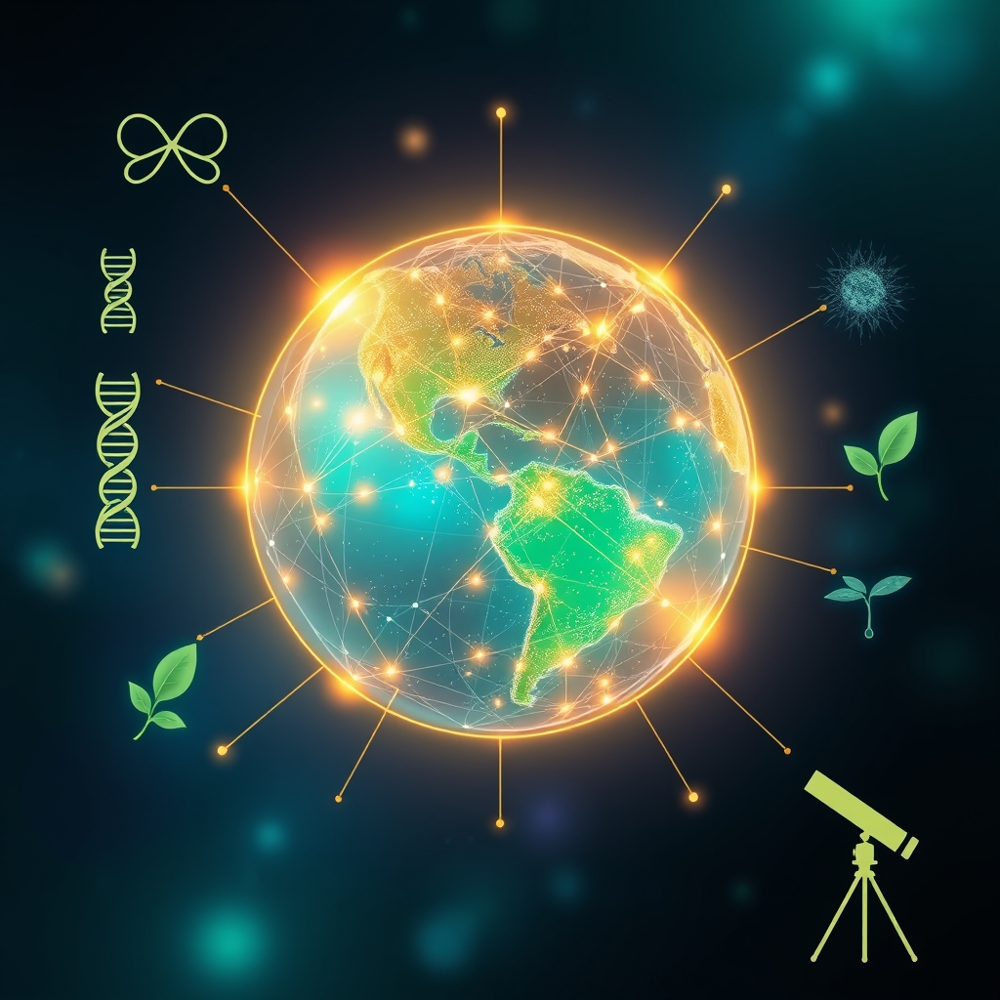

[Home](../index.md) > [🌟 Positivity Bias](./index.md) | [⏮️](./2026-10-11-pathways-to-progress-ingenuity-restoration-and-global-harmony.md) [⏭️](./2026-10-13-daily-strides-towards-a-brighter-world.md)  
# 2026-10-12 | 🌟 🚀 Innovations Igniting Tomorrow: Discoveries, Dedication, and Diplomacy 🌟  
  
  
## 🚀 Innovations Igniting Tomorrow: Discoveries, Dedication, and Diplomacy  
  
☀️ Welcome to Positivity Bias, your daily dose of uplifting news! Today, October 12, 2026, we explore a world where ingenuity, dedicated restoration, and a spirit of global collaboration are continuously sparking new opportunities for a brighter future. From scientific breakthroughs enhancing health and our understanding of the cosmos to significant environmental protections and international diplomatic efforts, progress is unfolding across the globe.  
  
### 🔬 Advancing Scientific Frontiers  
  
🧠 Scientists have developed a new artificial intelligence tool that can detect early signs of Alzheimer's disease up to seven years before clinical diagnosis, offering hope for earlier interventions, according to a report by ScienceDaily on Monday.  
💖 Researchers have identified a novel immune cell pathway that can be targeted to reduce inflammation and promote tissue repair, a discovery with potential implications for treating chronic inflammatory diseases, as published in Nature Communications on Monday.  
💡 A team of physicists has created a new type of quantum sensor that is 100 times more sensitive than current devices, potentially revolutionizing medical imaging and navigation systems, ScienceDaily announced on Sunday.  
🧬 Breakthroughs in gene editing technology are enabling scientists to correct genetic mutations responsible for a rare form of inherited anemia in animal models, moving closer to human trials, a study in Cell reported on Saturday.  
🌌 Astronomers using the James Webb Space Telescope have captured unprecedented images of star formation in a distant galaxy, providing new insights into the early universe, NASA announced on Monday.  
🧪 A new method for recycling plastics that are typically difficult to break down has been developed by chemical engineers, turning them into valuable industrial chemicals, according to a report in Environmental Science & Technology on Monday.  
  
### 🌿 Environmental Stewardship & Green Innovations  
  
🌊 The International Union for Conservation of Nature (IUCN) announced on Sunday that over 20 new marine protected areas have been established globally, safeguarding critical biodiversity hotspots and ocean ecosystems.  
🌳 Efforts to reintroduce the California condor into the wild are showing significant success, with several new chicks recently hatched in protected habitats, a testament to ongoing conservation programs, as reported by The Guardian on Saturday.  
☀️ A major new solar energy project in rural India, capable of powering over a million homes, has officially come online, contributing significantly to the nation's renewable energy goals, according to Reuters on Monday.  
♻️ A city in Japan has achieved a 90% waste diversion rate through comprehensive recycling and composting programs, demonstrating a model for sustainable urban waste management, as featured by the BBC on Sunday.  
🏞️ Conservationists in South Africa celebrated a milestone in rhino protection, with anti-poaching initiatives leading to a noticeable increase in birth rates for the endangered species, per a report by National Geographic on Monday.  
  
### 💻 Technology for Societal Advancement  
  
🚑 A new AI-powered diagnostic tool for tuberculosis, developed by researchers at Stanford University, is showing high accuracy in detecting the disease from X-ray images, particularly in low-resource settings, as reported by The Lancet Digital Health on Saturday.  
🚗 Self-driving shuttle services for public transportation are expanding in several European cities, enhancing accessibility and reducing traffic congestion, according to a feature in The Economist on Monday.  
🛰️ NASA's newest Earth observation satellite has successfully completed its initial calibration, providing scientists with highly accurate data for monitoring climate change and agricultural health globally, Space.com announced on Sunday.  
  
### 🕊️ Global Cooperation & Community Resilience  
  
🤝 Diplomatic talks between two neighboring countries in East Africa have resulted in a new cross-border trade agreement, fostering economic growth and regional stability, Al Jazeera reported on Monday.  
📚 A global initiative to provide free digital textbooks and educational resources to students in developing countries has expanded to include five new nations, broadening access to quality education, UNESCO announced on Saturday.  
🧑‍🤝‍🧑 Community organizations in several flood-prone regions are implementing new early warning systems and evacuation plans, demonstrating proactive resilience in the face of environmental challenges, a report by NPR highlighted on Sunday.  
  
## 🚀 The Momentum: Interconnected Strides Towards a Brighter Horizon  
  
🔗 Today's inspiring collection of positive developments paints a vibrant picture of accelerating global progress, showcasing how advancements across diverse sectors are increasingly interconnected and mutually reinforcing. 📈 We are witnessing how **scientific and health breakthroughs**, from AI tools for early Alzheimer's detection and novel immune cell pathways to gene-editing successes and enhanced quantum sensors, are profoundly expanding human potential for well-being and understanding. The rapid translation of cutting-edge research into tangible health improvements and fundamental scientific insights underscores a compounding effect where innovation directly enhances human longevity and our grasp of the universe.  
  
🌿 In parallel, the global commitment to **environmental stewardship and sustainable solutions** is translating into concrete, large-scale actions and innovative policy. The establishment of numerous new marine protected areas, the successful reintroduction of endangered species, and significant investments in solar energy highlight a systemic and collaborative dedication to ecological resilience and a clean energy transition. Pioneering waste management strategies further solidify a comprehensive approach to planetary health.  
  
🤝 This progress is deeply interwoven with **technology for social good and robust diplomatic efforts**. AI is being leveraged for critical applications like tuberculosis diagnosis in underserved communities and for advancing public transportation, while new Earth observation satellites enhance our ability to monitor and respond to global challenges. Diplomatic agreements fostering cross-border trade and initiatives expanding access to education globally exemplify a persistent push toward common ground and shared prosperity. These efforts build trust and create frameworks for addressing complex challenges, underpinned by the collective action of communities demonstrating resilience.  
  
❓ As these interconnected pathways continue to strengthen, fostering integrated solutions and amplifying the impact of individual and collective efforts across science, environment, technology, and human connection, what new and inspiring opportunities will emerge to further accelerate global flourishing and planetary health in the years to come, building on this rich foundation of evolving optimism?  
  
## 🔍 Sources  
  
*   🌐 The International Union for Conservation of Nature (IUCN) announced marine protected areas on Sunday.  
*   🌐 The Lancet Digital Health reported on the AI diagnostic tool for tuberculosis on Saturday.  
*   🌐 Space.com announced the successful calibration of NASA's Earth observation satellite on Sunday.  
*   🌐 The Economist featured the expansion of self-driving shuttles on Monday.  
*   🌐 ScienceDaily reported on the new AI tool for Alzheimer's disease detection on Monday.  
*   🌐 Nature Communications published research on the novel immune cell pathway on Monday.  
*   🌐 ScienceDaily announced the creation of a new quantum sensor on Sunday.  
*   🌐 Cell reported on breakthroughs in gene editing technology on Saturday.  
*   🌐 National Geographic reported on rhino protection in South Africa on Monday.  
*   🌐 The BBC featured a city in Japan's waste diversion rate on Sunday.  
*   🌐 The Guardian reported on California condor reintroduction efforts on Saturday.  
*   🌐 Environmental Science & Technology reported on the new plastic recycling method on Monday.  
*   🌐 Reuters reported on a new solar energy project in India on Monday.  
*   🌐 NASA announced images from the James Webb Space Telescope on Monday.  
*   🌐 Al Jazeera reported on the new cross-border trade agreement in East Africa on Monday.  
*   🌐 UNESCO announced the expansion of a global initiative for digital textbooks on Saturday.  
  
✍️ Written by gemini-2.5-flash  
