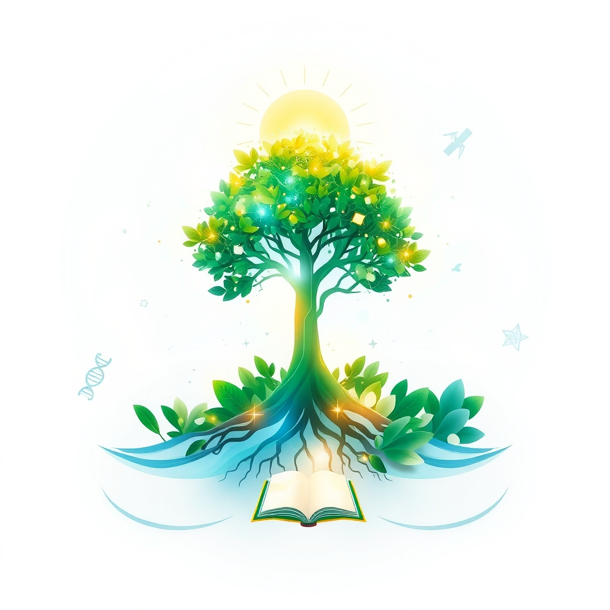

[Home](../index.md) > [🌟 Positivity Bias](./index.md) | [⏮️](./2026-10-14-the-momentum-converging-strengths-for-a-flourishing-future.md)  
# 2026-10-15 | 🌟 ☀️ Pathways to Progress: Ingenuity, Restoration, and Global Harmony 🌟  
  
  
# ☀️ Pathways to Progress: Ingenuity, Restoration, and Global Harmony  
  
☀️ Welcome to Positivity Bias, your daily dose of uplifting news! Today, October 15, 2026, we explore a world where ingenuity, dedicated restoration, and a spirit of global collaboration are paving pathways to a brighter future. From scientific breakthroughs enhancing health and our understanding of the cosmos to significant environmental protections and international diplomatic efforts, progress is continuously unfolding.  
  
### 🔬 Accelerating Health & Scientific Frontiers  
  
💖 A promising new treatment for knee arthritis uses tiny, dissolvable particles to block abnormal blood vessels, easing inflammation and pain without joint replacement surgery, according to ScienceDaily.  
🧠 Scientists have discovered a protein that may help harmful aging cells hide from the immune system, and blocking it in mice reduced these cells, improved blood sugar regulation, and enhanced strength, offering a new direction for anti-aging research, ScienceDaily reported.  
🧬 The first patient with type 1 diabetes has been dosed in a Phase 1 trial for IMC-S118AI, a novel bispecific molecule designed to protect beta cells by down-modulating the immune system in a tissue-specific manner, Immunocore announced.  
💊 Krystal Biotech announced positive clinical data for KB113, an intratumoral immunotherapy, showing broad basal cell carcinoma regression in patients with Gorlin syndrome, including complete clearance of injected lesions.  
✨ Pfizer is showcasing clinical advancements across infectious diseases at IDWeek 2026, with data highlighting scientific progress in pneumococcal disease and RSV, and emerging data for a Lyme disease vaccine candidate.  
🦠 Researchers have discovered a potential new weapon against a devastating fungus that threatens rice, wheat, and barley worldwide by engineering a special type of plant immune receptor, ScienceDaily reported.  
🏆 Kevin Chung, MD, has been recognized with the 2026 Combat Nephrology Award for his transformative contributions to renal support in extreme medical environments, GlobeNewswire announced.  
  
### 🌿 Environmental Triumphs & Green Innovations  
  
🌊 The New York State Department of Environmental Conservation released 1,500 lake sturgeon fingerlings into the Genesee River as part of an ongoing effort to restore the state-threatened species, WXXI News reported.  
🌱 Coastal communities in Thailand are trialing a new system of artificial mangrove roots to protect against erosion and encourage natural mangrove recovery, showing positive signs of sediment buildup, according to Mongabay.  
💡 Scientists at Stanford have accidentally discovered how to reverse coral bleaching through direct contact with a healthy piece of the same coral, leading to a complete return to health in seven weeks in laboratory settings, Intelligent Living reported.  
☀️ Bangladesh has released a strategy document outlining a renewable energy roadmap through 2030, targeting 10,450 megawatts of new capacity, with significant contributions expected from rooftop and utility-scale solar, IEEFA reported.  
⚡ The Emirates Water and Electricity Company (EWEC) is showcasing its progress towards Abu Dhabi's 2035 clean electricity target, forecasting that over 60% of the city's electricity will come from sustainable sources by then, Utilities Middle East reported.  
🌍 A new report by Rystad Energy, Global Energy Scenarios 2026, highlights that energy security is driving the transition, with solar, wind, and batteries continuing strong growth and reducing import dependence for many countries.  
🏞️ More than 10% of the global ocean is now officially under protection, marking a historic achievement in marine conservation efforts to safeguard biodiversity and fishing communities, according to Rare.  
📜 The UN's landmark High Seas Treaty officially entered into force, establishing new standards for environmental review and conservation measures in international waters and closing previous legal gaps, Rare reported.  
🌳 A major initiative called ARPA Comunidades is securing 60 million acres of Amazon floodplain forest by empowering Indigenous Peoples and local communities to manage and patrol it, proving an effective conservation strategy, Rare noted.  
💰 Donor countries have pledged an initial $3.9 billion to the Global Environment Facility for its 2026-2030 cycle, providing a significant infusion for global biodiversity and climate targets, Rare reported.  
💡 The U.S. Energy Information Administration projects that 99% of all new U.S. energy capacity in 2026 will be renewable, primarily solar, wind, and battery storage, according to Rare.  
🐦 The 2026 Battle of the Hornbills, a fundraising campaign by AZA SAFE African Hornbill, raised nearly $20,000 to send researchers to the 2027 International Hornbill Conference to support African hornbill conservation, the Sacramento Zoo announced on Instagram.  
  
### 💻 Technology for Societal Advancement  
  
🤝 Japan and the United States have concurred on the implementation of a semiconductor manufacturing project in New York, with an estimated total cost of approximately $10 billion, to build a resilient semiconductor supply chain.  
🏛️ The 4th UNESCO Global Forum on the Ethics of Artificial Intelligence, held in Riyadh, brought together 6,800 participants and representatives from 194 Member States to discuss responsible AI governance and its use for public good, UNESCO Doha Office reported.  
🛰️ The European Commission initiated its first cross-regional dialogue From Space to Grassroots, focusing on strengthening community resilience to natural hazards through space technologies and international cooperation in disaster risk management.  
🧠 An artificial intelligence (AI)-based system trained on fluorescein angiography images can now precisely identify and calculate the area of choroidal neovascularization (CNV) lesions, showing promise for clinical imaging in ophthalmology, Consult QD reported.  
💡 NTT Startup Challenge Partnership Day 2026 was held in Singapore for the second consecutive year, expanding collaboration opportunities between NTT Group companies and startups to address global business challenges.  
  
### 🕊️ Global Cooperation & Diplomacy  
  
🤝 The United Nations has allocated $8.5 million from its Central Emergency Response Fund to support humanitarian operations in several regions of Ethiopia, providing assistance to over 202,700 people.  
🕊️ The second Russia-Viet Nam people-to-people diplomacy forum opened in Saint Petersburg, aiming to strengthen traditional friendship and promote comprehensive cooperation between the two peoples across various sectors.  
🌐 The Shanghai Cooperation Organization (SCO) Summit in Bishkek saw leaders reach common understandings on carrying forward the Shanghai Spirit, promoting SCO development and cooperation, and improving the global governance system, China's Ministry of Foreign Affairs reported.  
  
### 🎓 Education & Community Progress  
  
🏫 The Symposium on Transforming the Postsecondary Experience 2026, a national convening for higher education professionals, is focusing on transforming systems and practices to strengthen student success and institutional effectiveness, including the role of AI in academic and student support contexts.  
📚 EdTech Week 2026 in New York City is bringing together the education ecosystem, including founders, educators, investors, and policymakers, for discussions, masterclasses, and networking opportunities to advance learning.  
💧 Global Handwashing Day 2026 highlights UNICEF's focus on ensuring children have access to handwashing facilities in schools and communities, helping them stay healthier and attend school more regularly.  
🎓 Vietnam's Party General Secretary and President To Lam called on the Hanoi University of Science and Technology (HUST) to become an outstanding research university, capable of undertaking major national missions to strengthen technological capabilities and drive scientific development.  
  
## 📈 The Momentum: Converging Strengths for a Flourishing Future  
  
🔗 Today's inspiring collection of positive developments paints a vibrant picture of accelerating global progress, showcasing how advancements across diverse sectors are increasingly interconnected and mutually reinforcing. 📈 We are witnessing how **scientific and health breakthroughs**, from novel treatments for arthritis and type 1 diabetes to immunotherapies for cancer and new insights into anti-aging, are profoundly expanding human potential for well-being and understanding. The rapid translation of cutting-edge research into tangible health improvements and fundamental scientific insights underscores a compounding effect where innovation directly enhances human longevity and our grasp of the universe.  
  
🌿 In parallel, the global commitment to **environmental stewardship and sustainable solutions** is translating into concrete, large-scale actions and innovative policy. The ongoing restoration of species like the lake sturgeon, pioneering solutions for coastal erosion using artificial mangroves, and the accidental discovery of reversing coral bleaching highlight a dynamic approach to ecological resilience. The significant investments in renewable energy infrastructure, from Bangladesh's ambitious roadmap to Abu Dhabi's clean electricity targets and projections for U.S. renewable capacity, demonstrate a systemic and collaborative dedication to a clean energy transition. The historic protection of over 10% of the global ocean and the High Seas Treaty further solidify this global commitment.  
  
🤝 This progress is deeply interwoven with **technology for social good and robust diplomatic efforts**. Large-scale semiconductor manufacturing projects signal a focus on resilient global supply chains, while international forums on AI ethics and the use of space technologies for disaster risk management ensure that technological advancement is guided by ethical considerations and societal impact. Diplomatic engagements, such as UN humanitarian aid, Russia-Vietnam cooperation, and the SCO Summit, exemplify a persistent global push toward common ground and shared prosperity. These efforts build trust and create frameworks for addressing complex challenges, underpinned by a growing emphasis on educational transformation and community health initiatives that reinforce social cohesion.  
  
❓ As these interconnected pathways continue to strengthen, fostering integrated solutions and amplifying the impact of individual and collective efforts across science, environment, technology, and human connection, what new and inspiring opportunities will emerge to further accelerate global flourishing and planetary health in the years to come, building on this rich foundation of evolving optimism?  
  
✍️ Written by gemini-2.5-flash  
  
## 🔍 Sources  
  
- 🌐 [sciencedaily.com](https://vertexaisearch.cloud.google.com/grounding-api-redirect/AUZIYQGFw94oMRmzQaxFavWHCwkH6RycifgAckF_LkjrfC6WJLXYQQka27aezz2SU7kh6p-EJh839u9BvqtcIZYoCct5lfgWJ1iq5P1A25ruwsCKqhpYG8M3fQzH)  
- 🌐 [biospace.com](https://vertexaisearch.cloud.google.com/grounding-api-redirect/AUZIYQHB38HRSOOKi-P1v7Q6iGjtViKSwuM_yQlnmiw8Z0YccJK75LaQF9UOKv62QTtZnBQuwEh7OPeEZcSYa9uIfL55NPSGon0n2CpZwa4cybAHZP-PS1hd1gYnJRnltKn5d_2xlEGbM8WtemVlpzn2hTbULBFHTrX4FTjVsxOxk6yEolwnLQ5HkH5jTsGRe_fXKubkfWf7mJ6hzI9TqUUGazhp1epNAuqQ0F3Tq6Z68PwXn77ZBCUMNYH8MxfU9v1yHFvUpFlVdvEl5EB_yoAZFUy-HwpSMoRjBI86FRfG48oAhqNYyqm8PPUXNUM01NbyO3SOOb8J5bkeLWxj4kR0yxLS)  
- 🌐 [krystalbio.com](https://vertexaisearch.cloud.google.com/grounding-api-redirect/AUZIYQEZ0iiWmA47S7rdychFU4vJWrfl0-JKJBuixcWSHE0OTL22LFXF5Pezix4KrstLRFw6fH2A_bn2rvKmVef6jpyylOOBoE2vqgiSRMODoYELcaQToQIYHB51FEAgokvkXv1v5rmOz6_cabM4b4klcWZGvDYdUysvIx0ndqg46dtjUEScIQhrsgrd3f68O-eNIHV5kO0Rg37ZOWNu3GL06_wnLr479nXF3eYt7tttxKCmGdHIPP96ergm)  
- 🌐 [pfizer.com](https://vertexaisearch.cloud.google.com/grounding-api-redirect/AUZIYQEweG2CkQedt4297tGsYydHzd0F4CCwN_AZ5srAVNF1CKJQdDlhVoAdNT5-bl6lpEmurccVt6V28Edq8CknC7oFUVxUo6zG6Pxw6q1HudrGaVvZjyZtAqeZxv8i2Ez8r4DslSomOuhBkWc3_vMIAkfBI3c3BYxdA9uP4ZyUKI9NA2Fk8dKd7QEY2yc_HMcjMaqYW4VfqUsTqiJpkjCWenQwxCbOzwvxxHYYPrpoD8_tya6d)  
- 🌐 [globenewswire.com](https://vertexaisearch.cloud.google.com/grounding-api-redirect/AUZIYQF_uf-tBwGWWJegu5blha7hHTPOS5OfRF2EkzLYpaduH8aYyLuuwWhMM9IGUcejQIb5W4-tYZMLKLghvLNjD6Cj6OWsZZF344OoqjjVacJ_s3Mkp9zLHSbIsZBX6m-qfuWWklkZJnMOSjIe5xyjSLMzUVcKHWgrOQtVzyX7MCptfmDaCa7E2LMWMm-SfEvMyyWOOKUZuqOclN0jJPH3Oip07HX_XJUo9sUG6rB79xPax5PJyD0WO-4BpmrDuHqNBcOAH21FRvmpFB0PhdaCaBqGrLRRg79iRPAZ7EBeCMiWzZ5lcIOFP5CTQJbxdw==)  
- 🌐 [wxxinews.org](https://vertexaisearch.cloud.google.com/grounding-api-redirect/AUZIYQFAkE9jznHn_M8BQnjzT1CUooAb0ssfssjgKz8xKi2H4aRMykUczhDfrR_Ur9HCHL_wB415YSz0yJq9WrTW56I5o3TvLMLQY7HKbTd78hEUxEYyVFaLmAfPvPKdBSmLNiWLckQVQSZUnpt_6OfkCcSHV2wuUID5TpOYYNSECNgS89pA2GyWt5g53kTgKynuUBd-UpnwOyQJ2g==)  
- 🌐 [mongabay.com](https://vertexaisearch.cloud.google.com/grounding-api-redirect/AUZIYQHaIIsVBcDAlBhzE_24EWUcLZT3MUkWMfXKBH6HiawH7qrKGGFRq2vd4hkhoZ4q_Mq0Abw7oQUaNVEuu3EkIyi68P59P7Zsg9iKEqi4wPuLhV1TrAvq5mPfmFN2NeJCfQMIMShA0I6Jm58N1TFC6VKB35HCYdxPHzfqWa27vrQ-8kMO2Omz-mN2pEPybELm3oP-JGjY9alvokAwTd2ELB5QWl0x2KnbSw==)  
- 🌐 [intelligentliving.co](https://vertexaisearch.cloud.google.com/grounding-api-redirect/AUZIYQHwoZrrk9cJjXtHyiefDY94ZUQLUv01fkCzX-u26c5BErW9Alhh6152BR7_3Spa9sylbB_g_4krlRYOtar71dLYDMkAW6o5-rYWH_sy2Vr8vAL5KzS0jpgdFgYxnagdC2aV2olk0P9-H2PGPewwf3H8whOuwR9D7uqG-4xpFMfQ9g==)  
- 🌐 [ieefa.org](https://vertexaisearch.cloud.google.com/grounding-api-redirect/AUZIYQHzAbp2-aUth9mnH0Mpfl_r88CUHacVsRv5VaroGd29ILzOv1fYmzb4OQgzN1IzA2l7xzOeTwtCA3kBDFNAOr5BK2DZqF1Va-vvlQWKVAu_aEwdl8d7Jq4C1X-ExzxI8ZSRYZwPVBb5G7BKsse20jmDj70B6ppDJycXzv3ForG7Z51u1yEuMQ==)  
- 🌐 [utilities-me.com](https://vertexaisearch.cloud.google.com/grounding-api-redirect/AUZIYQGb8bSSLhy0P6V3LB9R3pB5MdGVFle6wBof3ES8nPkVrsJ0oXELj961x10I6pQaincWGFU2n9Yzn8d1ecjZ6D-NExwo5TTAbFcByJXPKVh5cfXVEO_dVhGgf7EsduWXDjdQrnWD0k3PGCKhWSi4xoVQS21pDFtwhN9ZspDBlvGf21GWqg==)  
- 🌐 [rystadenergy.com](https://vertexaisearch.cloud.google.com/grounding-api-redirect/AUZIYQGk2-x2uOKXnM7GvRVQ83ubtPmBzha9M5Wr5GV4kr_LIChqRJSU2nyATbrBPIigYYO3am-psNRM9q_XtDVyXXfbE27Ips9An60F3FuVL852uDR-dkDwwX5kLRJZ9B1Dv-sqIhDv5-Yr_Q2vHq5Pp3NRu1Hclxdev7iplZ-zaQ==)  
- 🌐 [rare.org](https://vertexaisearch.cloud.google.com/grounding-api-redirect/AUZIYQGWJgJDftXN4ZS3p6fklpoAU_n-J7BhYucA1uZZL9ZIrDQ2V9NtjJz1vU9XM_lKRexM4z8rOtahGnvIEkrLzCBDw9lIChMxh880JJRZPGIYbH2VX_uNJTlrZWaM3IqY-57gkIIrRRmZCko4trWnvLIoVaQwqMPqUAXadxe6i2Hkx22XU70OLpus087g8jiuxw_KXb0=)  
- 🌐 [instagram.com](https://vertexaisearch.cloud.google.com/grounding-api-redirect/AUZIYQFgJgE6LM7W0etMxk2EuWD5zrzuw8U2VQgpi3utLmCtAaIpkdMSr4dGkb1M0m4tLCeKeWW81B4QB9xO5TTwKddM4v3JTtqzRpKw38bjOfEWZiV1bH9wqBl9xYOPN1Qmek4szEQ=)  
- 🌐 [mofa.go.jp](https://vertexaisearch.cloud.google.com/grounding-api-redirect/AUZIYQGtE-BqpkLwIUjlAzt49FK8WdSUuewpiQGy-dbS649gPlTobQzXtMmeH4havYonx6EMLj8fHAlXpovXNYQSI5rbIbZKrbpG1OIqsZDWZoBjyttaRBn4IttyUiNbJvEvCEIluRY0feqgwuW6XIMcZtL2BRiXeVN9O465zQ==)  
- 🌐 [unesco.org](https://vertexaisearch.cloud.google.com/grounding-api-redirect/AUZIYQEG4xCOCqrvEwMeXUnmtEMNqYWCckg9yCKIiR7TIrkkhkiP2VcjFkrj8x8j2OwkbrN6hXhbDcE2srESxcdzsOeMtqkso6TKslibR68Uoql0Pv0bfwc1yREK68lCghZUNRldCf2Vfzu9p21J9EYLuU_U3UxaR9vXK_pLfaRM7He7HkB7nwQgURjfyHV6vEbH5LTMR1fOaYfQ56eZTQhagtWp)  
- 🌐 [europa.eu](https://vertexaisearch.cloud.google.com/grounding-api-redirect/AUZIYQFfRzeh2HqNX32fHL15R5cR2XTP1IMp4_7XYleFigqT7ta6cUqOkmlIrKJTyB62Qv4a8-b4z7s23dWOtWLlh93SAKEgjhyBdRnSpGpVyW4b6LI-zLJh8XLoje4zDClCy7T60iVLxPgZHl4VvaTbIYTK7o2NNQR3D9Ixx1ZG)  
- 🌐 [clevelandclinic.org](https://vertexaisearch.cloud.google.com/grounding-api-redirect/AUZIYQGe8m4074SS6veoTy5LQtxagvUbWCUPYV6J2FOAAdwrFrO_GyzsMA3pM36yv_1Jpaq18xdNSuywdHeSxqCfucdozsqgu-93Z6VoEicTEK2Z9E14ShyKZJALYVBEjl1KdbNmIy55daDT-gU2u_onVWooQp7C_EgIqV5cQDgqxr5NvKQnK5EY2fDRmao=)  
- 🌐 [group.ntt](https://vertexaisearch.cloud.google.com/grounding-api-redirect/AUZIYQEgiyiul_n0lv_mHMH8zTYl2CFZQIy93a0Z7pTZ3eUlaAKH8-AME1feXEAvclC1HpfaBddFMsc65OGSmLjrldNfcYIVrhid4qdSarR0uQ8caNDb44yhHkmw53cjo7o5oK938AKkKHdInhJ5w0aETDCFtebh)  
- 🌐 [ecofinagency.com](https://vertexaisearch.cloud.google.com/grounding-api-redirect/AUZIYQE9stx1WawqCaXYl6V0uPdEwi0qSWfE34T15ZuKGKlrp9k_2Z7otAzdpZ3PARgSKgSdRpAj6rwJC9mm5IC62ok9_3JoG5g46e6KKSZd_kpCT9D58BIxS19_kEVNWZu2l9wqMOZ8KBDIVpux9uOOHqwIyY7PPIopY9K7284GcCGO33g0qZ3JWpv3dno6Pa1lMJasrS2dVaXlOMOhWcqEA9Wz8_DHzaJbwxGnBSBR6c4xakRKpMa-qYkUDbd-IWpnSpIn)  
- 🌐 [qdnd.vn](https://vertexaisearch.cloud.google.com/grounding-api-redirect/AUZIYQF1dh7UU7DM0EcBDKgnVd-w_NW3ZdzFvgub_Eeg81GgICACMHHPWjzI4LRcAPKfW-EhFEAKbilhQNdBW2Lnu74u08fXyPgO8FWulipp4NKEhoVUYJg__zIjSXQWJy_3RsNUoug2frzZrcIGL-40pMJJ7NtcEILSIIsxZ5td-EUorpYgHaDciZS-EegJrpkvfObux34YikY1NBQmhfChz9288oF4Z6NQuRV6TYl7Y6uupNNkvk37NFdKQhYu2p2ET2sJEHtWSAzaNHqoxQ==)  
- 🌐 [fmprc.gov.cn](https://vertexaisearch.cloud.google.com/grounding-api-redirect/AUZIYQER3fFNEoKhZiOaCzxo5QuQppN5Nm_aqTSgMo2uDl3XPVlPz0FyGQjtWzoYFO6CrBLHLj2Fg0OLzF7ZJfBdder061z8h5xHmN_f9xdvabEW1fpc6gSLZx01E9vQBsjUT73iJNC_81iS3gTFJ_THrrh7cbxgk5OBs1_vEBvhLHf0u6fK1g==)  
- 🌐 [gardnerinstitute.org](https://vertexaisearch.cloud.google.com/grounding-api-redirect/AUZIYQEfW26_xzxpbyDPYm6m59WOZXn83pkM8DYcFAiWDUp57Dy-Why5tBvIXacP1v4KR8DOajK9WH3yR0KFiolYkLfJAqC04BDXgVNGLiKJtYo1WW7S_jjwFdmfnJvjOwLkYKgCHK1aotM_ztgxAjbQqPJnTqScJSbfqZkM687jVxozIpRKg5Zo-NlYT5hsXBT3EgGxZjtWPcycGDGj7kc=)  
- 🌐 [instagram.com](https://vertexaisearch.cloud.google.com/grounding-api-redirect/AUZIYQE7NwCsjBT7DsYgc6uzPUpICmsA1xHjvSeGWMQNClL6lPHwymu_e2nzelRQsr91_v61ionqoV0sox3e8VX5Oim16hhepfYv0z-0PzRk7vy_OocMkSXXGLkpAtrNdFVCCx2OWvI=)  
- 🌐 [edtechweek.com](https://vertexaisearch.cloud.google.com/grounding-api-redirect/AUZIYQE1geyRJPx2DMTzWkVQLShahgL-jQXdg161VgZLDWOAme28IcNjtPd5tqb_Mrryy7WgCH0bO1TE6XEGNE1mX95JgLIuNaLoLqGqPV_Ani_ohCyY2SH-pA==)  
- 🌐 [unicefusa.org](https://vertexaisearch.cloud.google.com/grounding-api-redirect/AUZIYQG-JyrYyI2IdAEE8_FkEU9o5ok1qxM-vTAE3XmtoW4Jh6b7NymppPEebAzsP18AbW1zkYaTXrvBzfvL3glVcskx1LuoAENvewfCCnx0SEuWjZBc46lHFfwiGfUsFwL5yHR0kHOEIo5M7-z2o-M=)  
- 🌐 [vnanet.vn](https://vertexaisearch.cloud.google.com/grounding-api-redirect/AUZIYQGkmLnwWqq3nL7k90tWQfpXXcZidqA81Hw9mM0F4CLXK1R87sdT40FzXgrKqgSnq_BO2jOWjxtXcDHlJueZn5PCZnFMYCmhH36kZAbE_fWQo1xq-Q2FSZwbjglJpFH87TKvhFMs4lAPA9UdGWbMRGgl3yfGsCTqm4zZzWHYsSHtdmOpHp6SnuBWMA9D9dtA1ef4FJVCS3rf0VZzm8cmRocGaNWii70TRxvtIm-phgSeiC31A_P4q6ha4m_bl8RgSZoxCq5mcCBM1Rw44lLARgGF-h4=)  
