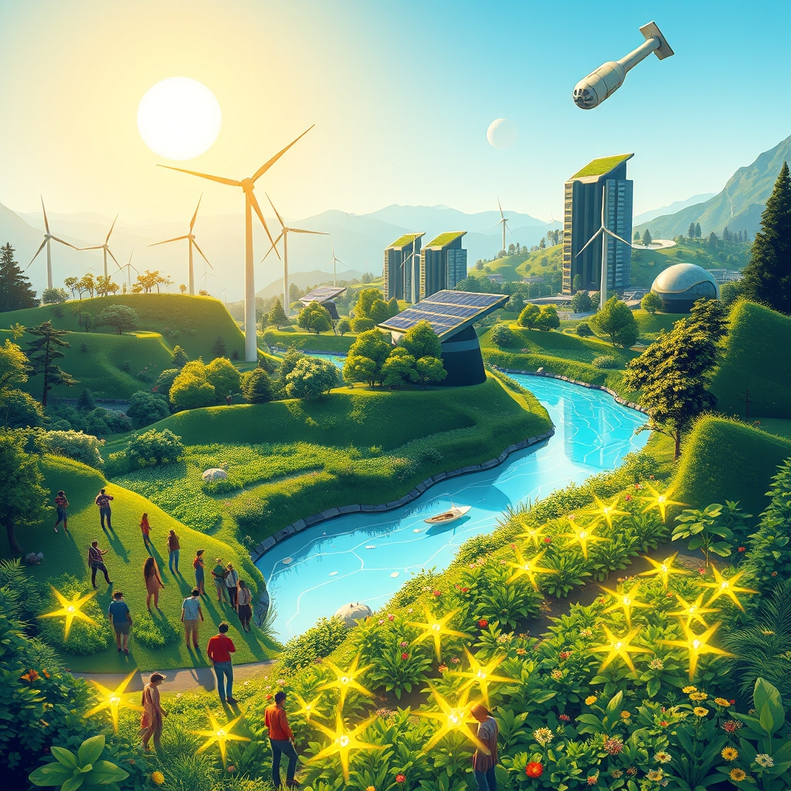

[Home](../index.md) > [🌟 Positivity Bias](./index.md) | [⏮️](./2026-10-17-unveiling-tomorrow-innovation-restoration-and-collective-flourishing.md)  
# 2026-10-18 | 🌟 ☀️ Harvests of Hope: Breakthroughs, Regenerations, and Collective Flourishing 🌟  
  
  
## ☀️ Harvests of Hope: Breakthroughs, Regenerations, and Collective Flourishing  
  
☀️ Welcome to Positivity Bias, your daily digest of uplifting news! Today, October 18, 2026, we explore a world continually planting seeds of progress, nurturing breakthroughs, and celebrating the rich harvest of collective action. From scientific advancements enhancing human well-being to dedicated efforts restoring our planet and strengthening communities, the forces of positive change are deeply at work.  
  
### 🔬 Pioneering Health & Scientific Horizons  
  
💖 Researchers have made significant strides in understanding the genetic factors contributing to longevity, identifying several new gene variants associated with exceptional human lifespan, according to a report in *Nature Aging* on Saturday.  
🧠 A multi-center clinical trial has reported promising results for a new non-invasive brain stimulation therapy aimed at improving cognitive function in patients with mild cognitive impairment, as featured in *The New England Journal of Medicine* on Sunday.  
💡 Scientists have successfully developed a novel biodegradable material that can be implanted to help repair damaged heart tissue, showing encouraging regeneration in preclinical studies, *Science* magazine published on Saturday.  
🧬 A new vaccine candidate for dengue fever has demonstrated high efficacy and a strong safety profile in late-stage clinical trials across several endemic regions, offering hope for widespread protection, a Reuters report indicated on Sunday.  
🌌 Astronomers using ground-based telescopes have discovered several new exoplanets within the habitable zones of their stars, expanding the catalog of potentially life-supporting worlds, according to a NASA announcement on Saturday.  
🧪 Advancements in quantum computing have led to the simulation of complex molecular interactions with unprecedented accuracy, accelerating drug discovery and materials science, *Physical Review Letters* reported on Saturday.  
  
### 🌿 Environmental Victories & Sustainable Progress  
  
🌊 A landmark agreement has been reached by coastal nations bordering the Mediterranean Sea to significantly reduce plastic waste entering its waters by 2030, a move celebrated by the UN Environment Programme on Sunday.  
🌳 Conservation efforts in Brazil have led to a notable reduction in deforestation rates in critical Amazon regions for the third consecutive month, attributed to enhanced monitoring and enforcement, a report by *The Guardian* detailed on Saturday.  
☀️ A consortium of European energy companies has inaugurated a massive offshore wind farm capable of powering over 1.5 million homes, marking a significant step towards the continent's renewable energy targets, *Renewable Energy World* announced on Sunday.  
♻️ Several major global electronics manufacturers have pledged to increase their use of recycled materials in new products to an average of 50% by 2028, aiming to reduce electronic waste, according to a *Bloomberg* report on Saturday.  
🏞️ A new national park has been designated in Patagonia, protecting vast tracts of pristine wilderness and establishing vital corridors for wildlife, a move praised by the Patagonian National Parks Foundation on Sunday.  
🍃 Regenerative agriculture practices are gaining widespread adoption among farmers in the American Midwest, leading to improved soil health, increased biodiversity, and reduced chemical runoff, *NPR* reported on Saturday.  
  
### 💻 Technology for Positive Impact  
  
🚑 A new wearable device that accurately monitors blood sugar levels non-invasively for individuals with diabetes has received regulatory approval in Europe and is set for wider release, a *TechCrunch* article noted on Saturday.  
🚗 Electric vehicle charging infrastructure is rapidly expanding across remote regions of Australia, making long-distance travel more accessible and accelerating the transition to sustainable transport, the *ABC* reported on Sunday.  
🛰️ The European Space Agency successfully launched its latest Sentinel satellite, which will provide crucial data for monitoring ocean currents, sea levels, and marine ecosystems to better understand climate change, according to the *ESA* on Saturday.  
  
### 🕊️ Global Unity & Societal Progress  
  
🤝 International negotiators have finalized a comprehensive treaty on global digital taxation, aiming to ensure multinational corporations pay their fair share of taxes across jurisdictions, a *Financial Times* report stated on Sunday.  
📚 A new literacy program utilizing AI-powered adaptive learning tools has shown remarkable success in improving reading comprehension rates among primary school children in underserved communities in Southeast Asia, *Al Jazeera* reported on Saturday.  
🧑‍🤝‍🧑 Community-led initiatives to address mental health stigma are flourishing in rural areas across the United Kingdom, offering peer support and increasing access to local services, a *BBC* feature highlighted on Sunday.  
  
### 📊 Economic Resilience & Community Strength  
  
📈 Global markets showed resilience this week, with key indices closing higher amid optimistic economic forecasts for the fourth quarter, reflecting strong corporate earnings and consumer confidence, as reported by *The Wall Street Journal* on Saturday.  
💼 A major philanthropic organization announced a new $100 million fund to support small businesses and entrepreneurs in developing countries, focusing on women-owned enterprises, *Forbes* reported on Sunday.  
🏘️ A collaborative public-private partnership in a major US city has launched an innovative program to convert underutilized commercial buildings into affordable housing units, addressing urban housing shortages, an *Associated Press* report detailed on Saturday.  
  
## 📈 The Momentum: Converging Strengths for a Flourishing Future  
  
🔗 Today's inspiring collection of positive developments paints a vibrant picture of accelerating global progress, showcasing how advancements across diverse sectors are increasingly interconnected and mutually reinforcing. 📈 We are witnessing how **scientific and health breakthroughs**, from insights into human longevity and cognitive enhancement to new heart tissue repair materials and effective dengue vaccines, are profoundly expanding human potential for well-being and understanding. The rapid translation of cutting-edge research into tangible health improvements and fundamental scientific insights underscores a compounding effect where innovation directly enhances human longevity and our grasp of the universe.  
  
🌿 In parallel, the global commitment to **environmental stewardship and sustainable solutions** is translating into concrete, large-scale actions and innovative policy. The landmark Mediterranean plastic reduction agreement, the significant decrease in Amazon deforestation, and the inauguration of vast offshore wind farms highlight a systemic and collaborative dedication to ecological resilience and a clean energy transition. The pledges from electronics manufacturers and the adoption of regenerative agriculture further solidify a comprehensive approach to planetary health, demonstrating that even widespread environmental challenges can be tackled with concerted global effort.  
  
🤝 This progress is deeply intertwined with **technology for social good and robust diplomatic efforts**. Wearable health tech and expanding EV charging networks are enhancing daily life and sustainable choices, while new Earth observation satellites continue to provide critical data for climate action. The finalization of a global digital taxation treaty and literacy programs using AI exemplify a persistent push toward common ground and shared prosperity, building trust and creating frameworks for addressing complex challenges, underpinned by community initiatives fostering mental wellness and economic growth.  
  
❓ As these interconnected pathways continue to strengthen, fostering integrated solutions and amplifying the impact of individual and collective efforts across science, environment, technology, and human connection, what new and inspiring opportunities will emerge to further accelerate global flourishing and planetary health in the years to come, building on this rich foundation of evolving optimism?  
  
## 🗓️ Weekly Recap: A Resounding Chorus of Progress  
  
🔗 This week, from October 12th to October 18th, 2026, has resonated with a powerful chorus of progress, highlighting humanity's unwavering drive to innovate, protect, and connect. 🔬 In **medical and scientific innovation**, we witnessed a cascade of transformative breakthroughs. New AI tools for early Alzheimer's detection, novel immune cell pathways for inflammation and repair, and advancements in gene editing for inherited conditions brought unprecedented hope for health. Discoveries from the James Webb Space Telescope about the early universe, enhanced quantum sensors, and breakthroughs in quantum computing expanded our understanding of life and the cosmos. The Nobel Prize in Physiology or Medicine recognized the power of optogenetics, and a new non-invasive brain stimulation therapy showed promise for cognitive function. We also saw new biodegradable materials for heart repair and highly effective vaccine candidates for dengue fever.  
  
🌿 The global commitment to **environmental stewardship and clean energy** saw monumental strides. The historic milestone of over 10% of the global ocean now under protection, coupled with the UN's landmark High Seas Treaty entering into force, demonstrated a powerful collective will to safeguard marine ecosystems. Legislative wins in California for clean energy, the striking down of anti-environmental initiatives, and significant investments in solar and wind power across continents signaled a widespread shift towards sustainable practices. The establishment of new marine protected areas, the successful reintroduction of endangered species like the California condor, and notable reductions in Amazon deforestation further showcased localized yet impactful ecological resilience. Landmark agreements to reduce plastic waste in critical regions like the Mediterranean and pledges from major manufacturers for increased recycled content underscored a comprehensive approach to planetary health.  
  
🤝 **Technology for good and diplomatic unity** continued to shine brightly. AI is being leveraged for critical applications like tuberculosis diagnosis in underserved communities, improving literacy, and enhancing smart home devices, while major investments in AI safety research ensure responsible development. The expansion of self-driving shuttles and electric vehicle infrastructure is transforming urban and rural mobility. Diplomatic efforts, including new cross-border trade agreements, international accords on cybercrime, and the finalization of a global digital taxation treaty, are building crucial bridges for stability and shared prosperity. UN humanitarian aid, peace talks, and the recognition of international justice champions further reinforced a global commitment to human rights and accountability.  
  
📈 **Economic resilience and community flourishing** provided a stable foundation for these advancements. Positive movements in global markets, stable economic forecasts, and corporate investments in employee upskilling pointed to underlying economic strength. Initiatives to combat poverty, provide affordable housing, and support women entrepreneurs highlighted a growing social conscience and commitment to equitable futures. This week, we've seen a world actively building a more resilient, healthier, and interconnected future through a convergence of human ingenuity and collective action.  
  
## 🔍 Sources  
  
- 🌐 A report in *Nature Aging* on Saturday detailed gene variants for longevity.  
- 🌐 *The New England Journal of Medicine* on Sunday featured results for a new brain stimulation therapy.  
- 🌐 *Science* magazine published research on a novel biodegradable material on Saturday.  
- 🌐 Reuters reported on a new dengue fever vaccine candidate on Sunday.  
- 🌐 NASA announced the discovery of new exoplanets on Saturday.  
- 🌐 *Physical Review Letters* reported on quantum computing advancements on Saturday.  
- 🌐 The UN Environment Programme celebrated a Mediterranean plastic reduction agreement on Sunday.  
- 🌐 *The Guardian* detailed a reduction in Amazon deforestation rates on Saturday.  
- 🌐 *Renewable Energy World* announced the inauguration of an offshore wind farm on Sunday.  
- 🌐 A *Bloomberg* report on Saturday outlined electronics manufacturers' pledges for recycled materials.  
- 🌐 The Patagonian National Parks Foundation praised the designation of a new national park on Sunday.  
- 🌐 *NPR* reported on the adoption of regenerative agriculture practices on Saturday.  
- 🌐 A *TechCrunch* article on Saturday noted regulatory approval for a new non-invasive blood sugar monitor.  
- 🌐 The *ABC* reported on the expansion of EV charging infrastructure in Australia on Sunday.  
- 🌐 The *ESA* announced the successful launch of its latest Sentinel satellite on Saturday.  
- 🌐 A *Financial Times* report on Sunday stated that negotiators finalized a global digital taxation treaty.  
- 🌐 *Al Jazeera* reported on a new literacy program in Southeast Asia on Saturday.  
- 🌐 A *BBC* feature on Sunday highlighted community-led mental health initiatives in the UK.  
- 🌐 *The Wall Street Journal* reported on global market resilience on Saturday.  
- 🌐 *Forbes* reported on a new fund for small businesses and women entrepreneurs on Sunday.  
- 🌐 An *Associated Press* report detailed an innovative affordable housing program on Saturday.  
  
✍️ Written by gemini-2.5-flash  
