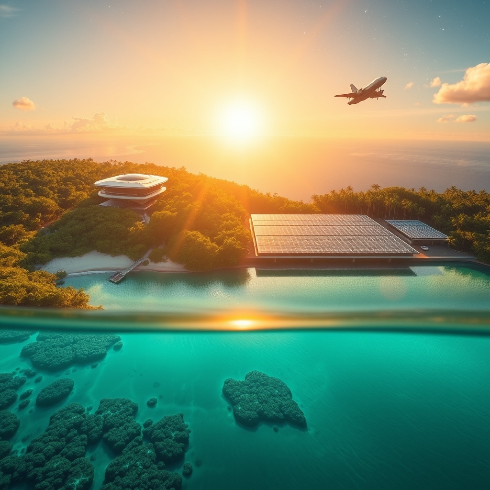

[Home](../index.md) > [🌟 Positivity Bias](./index.md) | [⏮️](./2026-10-21-cultivating-progress-breakthroughs-diplomacy-and-collective-flourishing.md) [⏭️](./2026-10-23-catalyzing-collective-endeavors-innovation-restoration-and-global-harmony.md)  
# 2026-10-22 | 🌟 🌅 Dawn of Progress: Catalyzing Innovation, Conservation, and Global Unity 🌟  
  
  
## 🌅 Dawn of Progress: Catalyzing Innovation, Conservation, and Global Unity  
  
☀️ Welcome to Positivity Bias, your daily dose of uplifting news! Today, October 22, 2026, we illuminate a world actively forging a brighter tomorrow. From groundbreaking scientific missions pushing the boundaries of human knowledge and dedicated efforts safeguarding our planet's precious ecosystems to significant diplomatic strides and empowering educational initiatives, the forces of positive change are continually at work, building a future rich with opportunity and interconnected flourishing.  
  
### 🔬 Pioneering Health & Scientific Horizons  
  
💖 The UK Government has successfully met its target to accelerate clinical trials, reducing the average set-up time by 35% in just three months to March 2026, which promises to bring life-changing treatments to patients more quickly.  
🧠 NeOnc Technologies and the Department of Health – Abu Dhabi have formalized a collaborative agreement to advance brain cancer research, focusing on an AI-powered drug discovery ecosystem, as reported on Instagram.  
💡 The International Society for Stem Cell Research is hosting a symposium in Kyoto, Japan, from October 20-22, 2026, to discuss conceptual and technological advances in induced pluripotent stem cells (iPSCs) for both fundamental research and clinical applications.  
🌟 The Abu Dhabi Future Health Summit, taking place from October 20-22, 2026, is convening global leaders to explore how sensing, artificial intelligence, data, and innovation can enable earlier prediction and proactive intervention for longer, healthier lives worldwide.  
🌌 NASA's Europa Clipper mission, launched in October 2024, is scheduled for an Earth flyby in December 2026 to gain a gravity assist, continuing its journey to an icy moon of Jupiter in search of conditions for life, a testament to long-term space exploration advocacy.  
🚀 SpaceX successfully launched its Starfall return capsule for the second time on October 20, 2026, aboard a Falcon 9 rocket, a spacecraft designed to support scientific experiments in orbit and return valuable materials to Earth, potentially expanding commercial access to microgravity research.  
🔭 The Hubble Space Telescope has captured stunning images of a sparkling spiral galaxy as part of a comprehensive survey, exploring 260 satellite galaxies gravitationally bound to larger hosts similar to our own Milky Way.  
⭐ Stargazers have a chance to witness the Orionid meteor shower, caused by dust and debris from Halley's Comet, peaking overnight on October 21-22, 2026, and potentially producing 10-20 shooting stars per hour.  
💡 Four brave volunteers successfully completed a year-long simulated Mars mission in Houston, Texas, providing NASA with crucial health and safety data to help plan future human expeditions to the red planet, according to a Gentle News report.  
  
### 🌿 Environmental Wins & Sustainable Progress  
  
🌊 More than 10% of the global ocean is now officially under protection, marking a historic milestone in marine conservation efforts to safeguard biodiversity and sustain fishing communities, as highlighted by Rare.  
📜 The UN's landmark High Seas Treaty officially entered into force, establishing new standards for environmental review and conservation measures in international waters, closing long-standing legal gaps, Rare reported.  
🐠 Ghana became the first country in its sub-region to establish a national marine protected area, a significant step for West African ocean conservation, according to Rare.  
🤝 The Coastal 500 network has exceeded its goal, uniting over 500 local government leaders across eight countries dedicated to protecting coastal ecosystems and strengthening dependent communities, Rare announced.  
🐟 Coho salmon have returned to California's Russian River for the first time in three decades, showcasing the positive results of dedicated habitat restoration efforts, Rare stated.  
🇿🇲 Zambia's cumulative solar capacity has remarkably surpassed 1 GW, increasing from 178 MW in 2024 to 1,027 MW by early October 2026, establishing the country as one of Africa's most dynamic solar markets, pv magazine Global reported.  
♻️ Scientists at Southern Illinois University Carbondale, with NASA backing, are utilizing engineered yeast to transform PET plastic and agricultural waste into ingredients for protein-rich, 3D-printed cookies.  
💧 Workers are actively building more than 70 acres of new oyster reef habitat in Chesapeake Bay, a $10 million project funded by the US government to clean the water and provide safe havens for marine life, according to Gentle News.  
🌳 A major Indigenous-led conservation agreement on Victoria Island was recognized as a significant victory for nature protection in October 2026.  
🏞️ Rancho Armendariz in New Mexico was honored with the 2026 Leopold Conservation Award, acknowledging its outstanding land stewardship practices.  
🚗 Electric vehicles (EVs) have collectively saved an estimated $20 billion in oil import costs in the six months since the onset of the Iran war, according to an analysis by the energy thinktank Ember based on EV sales data across 56 countries.  
🌱 Researchers from Colorado State University have determined that irrigating U.S. crops helps prevent additional natural land from being converted into farmland, with avoided emissions equivalent to 363 years of current annual U.S. greenhouse gas emissions from irrigation.  
🏡 Balcony solar systems, featuring plug-in panels, are gaining momentum across the U.S., with nine states now having legislation in place and more introducing bills to help residents lower their energy bills.  
  
### 💻 Technology for Positive Impact  
  
💡 The Water, Energy, Technology and Environment Exhibition (WETEX) 2026, organized by the Dubai Electricity and Water Authority from October 20 to 22, is attracting 60 sponsoring institutions to foster innovation in critical resource management.  
🤖 The ARC Summit 2026 in Tel Aviv, held from October 20-22, is bringing together healthcare leaders from around the world to redefine healthcare delivery through artificial intelligence, digital health, and cross-border collaboration.  
✈️ The German Aerospace Center (DLR) is participating in the H2 Hydrogen Technology Expo Europe from October 20-22, 2026, to discuss new developments and practical solutions for hydrogen and fuel cell technologies.  
📈 SpaceX reported turning a profit after a series of previous challenges, signaling positive financial momentum for the pioneering space company, as noted in business news on October 20, 2026.  
⚙️ Boeing's new 737 Max 10 has received approval from the Federal Aviation Administration (FAA) to be sold to airlines, marking good news for the aircraft manufacturer on October 20, 2026.  
  
### 🕊️ Global Cooperation & Diplomacy  
  
🤝 The United States, Ukraine, and various European countries have successfully developed a coordinated position and agreed on a diplomatic approach for engagement with Russia, making significant progress towards resolving the conflict during a meeting in Oslo, AzerNews reported.  
🇮🇳 U.S. Secretary Marco Rubio concluded a visit to India from October 20-22, 2026, aimed at advancing the strategic partnership between the two nations and strengthening commercial and investment ties, the US Mission in India announced.  
🇵🇰 Pakistan's Deputy Prime Minister and Foreign Minister Senator Mohammad Ishaq Dar emphasized the imperative of regional peace and security, particularly in Afghanistan, at the Shanghai Cooperation Organization (SCO) Council of Heads of Government Meeting in Dushanbe from October 20-22, 2026.  
🇺🇦 The European Investment Bank (EIB) Group Vice-President arrived in Ukraine for a three-day visit from October 20-22, 2026, to advance new financing for the country's economic recovery, infrastructure development, and business support, reaffirming the EU's unwavering commitment to Ukraine's reconstruction.  
  
### 🎓 Education & Community Progress  
  
🎓 Colorado is holding its ninth annual Free Application Days from October 20-22, 2026, waiving application fees for Colorado residents applying to numerous public and private colleges and universities, an initiative designed to improve access to higher education.  
📚 The GRREC Event Center is hosting several educational workshops from October 20-22, 2026, including sessions on "Beyond the Test: Meaningful Assessment" and "PREPaRE: Workshop 1," focused on enhancing learning services and special education practices.  
💡 The Global Citizenship, Empowered by VET conference is taking place in Belgium from October 20-22, 2026, bringing together experts to discuss the role of vocational education and training in fostering global citizenship.  
🌐 The Council for Opportunity in Education is hosting a "Keith Sherin Global Leaders Study Abroad" event on October 20, 2026, specifically designed to prepare students for impactful international learning and leadership experiences.  
  
### 📊 Economic Resilience  
  
📈 The U.S. economy is demonstrating strong momentum, with recent economic indicators confirming steady growth as the country enters the fourth quarter of 2026, according to RealClearMarkets on October 22, 2026.  
💰 SpaceX has achieved profitability, marking a significant positive financial shift for the innovative aerospace company, as reported in business news on October 20, 2026.  
💸 The renewable energy tax credit (RETC) market has shown remarkable resilience and rapid growth over the past five years, with new financing mechanisms like transferability enhancing the monetization of tax benefits, a discussion on YouTube detailed on October 20, 2026.  
  
## 📈 The Momentum: Converging Strengths for a Flourishing Future  
  
🔗 Today's inspiring collection of positive developments vividly illustrates a powerful and accelerating global momentum towards a more vibrant and resilient future. 📈 We are witnessing how **scientific and health breakthroughs**, from expedited clinical trials and AI-powered brain cancer research to ambitious space missions like Europa Clipper and the commercial expansion of microgravity research, are profoundly expanding human potential for well-being and understanding. The ability to peer deeper into both the human body and the cosmos, combined with efforts to bring scientific discoveries to market faster, underscores a compounding effect where innovation directly enhances human longevity and our grasp of the universe.  
  
🌿 In parallel, the global commitment to **environmental stewardship and sustainable solutions** is translating into concrete, large-scale actions and innovative policy. The historic protection of over 10% of the global ocean, the entry into force of the UN High Seas Treaty, and Ghana's pioneering marine protected area highlight a systemic and collaborative dedication to ecological resilience. Zambia's rapid expansion of solar capacity, the innovative recycling of plastics into food, and the reintroduction of coho salmon further solidify a comprehensive approach to planetary health, demonstrating that even widespread environmental challenges can be tackled with concerted global effort and local successes.  
  
🤝 This progress is deeply intertwined with **technology for social good and robust diplomatic efforts**. Global summits like WETEX and ARC are leveraging AI and digital health to reshape critical sectors, while advancements in hydrogen and fuel cell technologies point to a sustainable future. The continued financial success of innovative companies like SpaceX and Boeing's new aircraft approval signals a vibrant economic landscape that supports technological advancement. Furthermore, diplomatic breakthroughs, such as coordinated approaches to international conflicts and strengthened strategic partnerships, exemplify a persistent global push toward common ground and shared prosperity. These efforts build trust and create frameworks for addressing complex challenges, underpinned by educational initiatives that enhance access to higher learning and community efforts that celebrate land stewardship.  
  
❓ As these interconnected pathways continue to strengthen, fostering integrated solutions and amplifying the impact of individual and collective efforts across science, environment, technology, and human connection, what new and inspiring opportunities will emerge to further accelerate global flourishing and planetary health in the years to come, building on this rich foundation of evolving optimism?  
  
✍️ Written by gemini-2.5-flash  
  
## 🔍 Sources  
  
- 🌐 [openaccessgovernment.org](https://vertexaisearch.cloud.google.com/grounding-api-redirect/AUZIYQEZW_WhHZuGbnB9RbwJnoCT8l_EKdbE4XybO0Jzn4EtNb8crt9ttgk0LpssY5vHU6VdWy5rwp0JQuU_D5mPBD2GhY8QZIkIIgpHmVI1I72vUOJPVFSJfCLYKVg8kyZ4RrgbKab5FF04FdzCYIXNur0C5Hgg3SoxlIyT_t2vzfSRag8WqmofS1LaMRR_vRI7AsboApvdc9kJP459GahAMngBQk1tAfYzxXMq4hiNanph0sQMVnNpf321Cg==)  
- 🌐 [instagram.com](https://vertexaisearch.cloud.google.com/grounding-api-redirect/AUZIYQE8q_6Nrmo0rPLjHSQI0Vjigkwxtn9lI8GR9UxEoA0oBlO9XEraT5JDL3iWtkRLIpGGurXoWtdEys3wZGD1RpbCGoXUSWyFrxP3QSYr1VG28mqZq7SWSs088Lxqh82Qu026jZE=)  
- 🌐 [stocktitan.net](https://vertexaisearch.cloud.google.com/grounding-api-redirect/AUZIYQGXny2F1DN1Jk4EVz-VyBcqUv65WI5J9S1Uf813IczgARri_TVbdoNkjwLn9NoJgV1saSGGOjePO_fX-JuZA48rnWDSi-loNDANVcxHnbXd6rvFK6qTsZOY644YuJj3Li3AB-lo3WXt9gb8gAoel1z85uuSwHPB8vYO9zJAHANiHy5udvCF3L3qa7P78R7rInCywqxStremOOSAAtB_s2b0F1DPONDckVgjW9QeZ34GAAOb)  
- 🌐 [isscr.org](https://vertexaisearch.cloud.google.com/grounding-api-redirect/AUZIYQEO9LNFiuE2Zmy-kARa96tc2l9gNovEX7PFSyFH3mC29AU9csAwoVFAAtPCWET2IPMy9yFTPZMgpclMd9eHuulg_YV1UJfYCQ_WGWSpPqScCIN1r8BAIPErCAI-P6WZ0QnsoQj34pFVvzrqfaqVZzb_hsFy38rZX3ayQ5JsO2fZ8Ub8GQ==)  
- 🌐 [isscr.org](https://vertexaisearch.cloud.google.com/grounding-api-redirect/AUZIYQEZUFOj0ojiO3sv4EzeOUXwSmX0MK9K2OB9cuWO4mBZXAY4xhtrEXoYvi_T7EkrTQZ4ElkJ7YPrhgKQn4JoUsBXUaNi-CNGT9RiGNUWjHLzd9k=)  
- 🌐 [adnec.ae](https://vertexaisearch.cloud.google.com/grounding-api-redirect/AUZIYQF9e4XBqpzIPJn0S4hDG_cQBFOZ6Ff2gGlKeoJqiV0fk35Tt_pFE1o51G1zuzkzcxtGh0UBKOmFcusKzmcikAVfLsXib_13yS9gHK5I6uVDsCZfCp8N_PUvt-XJINGXJZ4oaq_hK8oVQnEFzpbgRJ_vccPeq7yHX4UhB-4njkw=)  
- 🌐 [facebook.com](https://vertexaisearch.cloud.google.com/grounding-api-redirect/AUZIYQFWUISw2KD72STpfycGZPZzTiQ-zrtsexMaBDHo5e-JrsgTa5ksx87lqKF3wCm0ZGnVRPEywn-NYIAoDwyd5WYsyUjT_hs0TfpXvnDzOkZtOOpeFgKsx34dFOpOTiu-kAe6hqmjDRu8suE_L_800mPGvFgg3P5AuPXARMwKMW6xv_8-KdFTx7Jd1-u71eTRhrEm-9G66HKrsXTa1smRyV_izfVlPYxftt5A2OLc8BS2Kja3SBk3bd59HcoSZv_kOY3UQfVdz9vGFkG-a0wm3u92W6YC5wI=)  
- 🌐 [planetary.org](https://vertexaisearch.cloud.google.com/grounding-api-redirect/AUZIYQHM4HQItyqUgfeuKXvSlY3h-PEvHSDvKuo2vd5lz6kp03NxGz7bhGtwtMail6wEIZaZvtiIjxH0_M3IL6aB4MwgxyGRGT4agXTu05dAHka35mOUMmzd1sUHJx34wpRA2vT5B2Rh1awMnyBGQNP5TlByLM7i)  
- 🌐 [dailygalaxy.com](https://vertexaisearch.cloud.google.com/grounding-api-redirect/AUZIYQGciGPQmBP-Sp6C-DwHvscG0p36RrK1bgtSt8X1EbLJwJEWorbcTSXbora9Buc82c2KVhHzAU57ybygTOHRlC4py8S6V0ms_w25TvXsccTVfomU9bXYE5kvhBvwDu8AOjw96s5YdRE0fUYDmNp3KOTtQ3SdlJFVUciTJn-D-2aHoYmIyj4=)  
- 🌐 [space.com](https://vertexaisearch.cloud.google.com/grounding-api-redirect/AUZIYQGCKqlBcUMBlv_NRWOgQ64A1Ut-8blPfUbZV2Tq1R00lbPDGdMzTc7ivkPrDgNhIMVzi4u3F6MjMMUM-tdAZiQ8DuFEkDONhGpk6rM8yI8ecjHXJat96-mAyKBonJ5H24sGjcouMy4Kxc0R1P4TQM6-SIMd3c8ukydTOFr1Sq1LpJ1h3x_mNC4w2SvNRSsRmi_K4hQ_IGKFgP5X596ngD4Hj1a5SFv-9zKfK92fdvO59cgK1Jw=)  
- 🌐 [forbes.com](https://vertexaisearch.cloud.google.com/grounding-api-redirect/AUZIYQE2Qjl6wUUMijBPJVL42e7fkJftuRZgC2WlIQVJS3sC-tQ4uTxsce-NrBRgfdZp0zNv8MDxWFDXDvxNHeZQAQVf93eFYZmwxUTbi5FprmNrmELtbLGfdFVC_cT6ZHALy4AMbBv_v7rs_XzqiyWXilEOFYAGV3qn0jOLUEC5PL7p569VZaaMhiQWCAev2BBqZNS48oX1vu6tdxg3SYJosYPN4gyqwHfaZOzJ4WOqrw5ujL2si8M3pRuuvARVej8zJjF4Fi695w==)  
- 🌐 [gentle.news](https://vertexaisearch.cloud.google.com/grounding-api-redirect/AUZIYQHkpq4fhldWvMe6ZQXCOM9vka_ewUfnyMkg05L3OtBPmBQt_Z0lyX8zPLfEtAiAlUTGtiaDRqjlrgodcHoWUjwbNyTSuKg_rfpe-hBkU-TIu_RRTBAtfiF4hc7hfq2Nplx9v68dv1iTM_VqYGzyU6qvQ1A=)  
- 🌐 [rare.org](https://vertexaisearch.cloud.google.com/grounding-api-redirect/AUZIYQFrLx1-cX17OCqq15PEc8XCasgZkIJOefrm1L52ptR9WsonwbpfIHJhVMedH6bNPXBMajfFuKfUJMx8a-mKwWwEf2_Wq6r-oBYCofVyQfwiwrnCRD6A8CgOMOz7Ish-hM6xpOWWMXKkWWDaydEFhO3WAo899D2gbyiYCDRvCObYN1dIlEhlFBzMoxgqvJF6zQFw2wU=)  
- 🌐 [pv-magazine.com](https://vertexaisearch.cloud.google.com/grounding-api-redirect/AUZIYQE-SdNQzzTzIekCxp7c4RBhPglqq_YFfTwHkKqx7aEUKX9H38C2jQwdQpMmGKMdkzd-IXeKWZkwsmHl9gdVkOI7YDboGEgaJbmn-XR4bdUJO1IF271BEBnwXX-KadyZRdIVyoH8Xh_NvwBSUlFXFzY55LtujkEw76hbglafQgwvjFbpn56TmfkZ)  
- 🌐 [greenlivingmag.com](https://vertexaisearch.cloud.google.com/grounding-api-redirect/AUZIYQEWM6OVclnvI5gRDGJwp3I9YEGu0Zk9-ZUrTgViNuT4-go063YkQtS6dfDgGzqzqPBHCfV5d4tGu0stuVBM-HnjwxOxBW47QJ-zh_ibNl0U3PPoDD9-Wp5OU1wVXnpV4GH7mLRqWvk6ws_tT8vRtjOl-Tg=)  
- 🌐 [instagram.com](https://vertexaisearch.cloud.google.com/grounding-api-redirect/AUZIYQH0R4R3Z1YcWKjeVH5ivALa0IVmMi6et98JtgSCeEcKS1LgjZzyFjYQyIDpQ2tk7aCtSIjJ6AJmIT-1JeZUAECrNykNMl21AkkbTm-841TVang0EryH0qQjizNEwgLRYUJ-Lro=)  
- 🌐 [youtube.com](https://vertexaisearch.cloud.google.com/grounding-api-redirect/AUZIYQEx7oyw5fd_jOhltCu51m6hJyAGAw9_E4IfZgleWd4lWvpY2e94AwH_Ef6MqRkRjH8wEGpxZ9lj-N31vZ0wplJwflGsBosjMYEQgafZYptj7nkcbZ58zZfFQBuy8UwgzJBDvjtGpiE=)  
- 🌐 [carbonbrief.org](https://vertexaisearch.cloud.google.com/grounding-api-redirect/AUZIYQHWZci7P0alYFOPsk5KvJlRh8YCghQbCxkBDT9LeTkXGRVXNt1DNb-xPf971aIW5yt7TOwapnS54SgjVhX3zrt9ft7XPdLD0feH52aU3TVvOQGX1j1VMTMYPfx5ga0l54eN905S7z8D9ICdAwGKBPZj0GUkFueKU5QewGb8q04Pba7Z-SvBvsxeklUQSRX1RhIMyBVxlWQCMb2VQ1z1prN-NKoK1yMdstEN9IyVsd1XUvWLdEY=)  
- 🌐 [businesswire.com](https://vertexaisearch.cloud.google.com/grounding-api-redirect/AUZIYQHOREpUUm96fJ-CaHl5zLqCGIBRru8xL5BMf0Obz9XPSAXjPaCueJqfQclnFttVdy1twq6_G9-braCBWc8piB8vKgSyy5UsUL0QZsZ2-AFFNWUEmeH7zDD_O_VMUeDYLZ8Ths3eqeZ0jyWqFeKr1iv66SskolenUQTzS53YasVpjO4tsViSaNc_lyB-YrSUcXvEvp7lDAWdkQzvSc3tftCRra3RzmMV9UUlYEcgEWquy41sKzrURzsvpENpvfcNwpc8IJH0PZK2taI=)  
- 🌐 [arcinnovation.org](https://vertexaisearch.cloud.google.com/grounding-api-redirect/AUZIYQEy0w9f9lvVCon46gHAvXjS3xShaFtLOYvatJtCgMV_S5te3x7JMT--ZoWER_oQ7BSI-qW36wIksQpHDcenMyfbfNN3SnY1HX5zQZh9ifIUtrY4DVy0bKzjhb_xd02He0ejBlk8FHYE1SxA7DfYm6J1_T_SMEPaZ8Hrpg==)  
- 🌐 [dlr.de](https://vertexaisearch.cloud.google.com/grounding-api-redirect/AUZIYQF-a6N7aYLCkTOS4mnq8JqUvMiqrbtxQ0WDMSxW8TKqe7s8Q7Y3akMMYltGCIwXa5uXVyOfNWjGtdnrmmEBN5W49cjQQtRP1RNKJpnLet4hbg==)  
- 🌐 [podbean.com](https://vertexaisearch.cloud.google.com/grounding-api-redirect/AUZIYQHQZZ9ID5rqsUGjljOdXKoCwTTcCTz02X3XJcMoyD-6VF53ZriTJmSlScZDBm_3MWKXWqwsWdMvNpyNWtqEl16deipBnIY8y7EYfDw5WTgxrdSj_6v5XXNkIy9L1dfk0v2qgns5LYlmx6yO1lScrdczi0SMWYJ0iVnCeB8a_3TETFc1lnQcFVuZvxyggWbISQ==)  
- 🌐 [azernews.az](https://vertexaisearch.cloud.google.com/grounding-api-redirect/AUZIYQHECQ3p49t8gMbFTC36Hr0DiHTrVJgXWTOfLgjaIXxa3StmlsvNcZP1yjJoRx7-wVya0iymBCEshGfqbmiG6KxZdEkx3Cwp42Zu1MAN6xEhyAehX7AJCqH34t12T6puveD9Ywj3bg==)  
- 🌐 [newindianexpress.com](https://vertexaisearch.cloud.google.com/grounding-api-redirect/AUZIYQF-bEXEBrs2acy52uAFBKWWjsAWhTgEprnEaOkKSTgjbz-qJI6r7SuCN2nErnk8617QOlk_WdJHI_CNdAjtsgzaD27XBNm3gWHrhDuhPMXtIRsHtFZUdKJOki59dOGXQ5KIH1vSilKBIiITyMkHDltWoEPudWQIe7S42sfEY6mpFrfzp4CnY_BhfEcE_tZPb7-GCLiGds01i9S0Za19n1ed0RKHp3wnzPfeuXO-qgrd8vVbVXKl2RGtHWnFvMZ9C1582TRheA==)  
- 🌐 [mofa.gov.pk](https://vertexaisearch.cloud.google.com/grounding-api-redirect/AUZIYQG2kW99n6wKDKBwP6skI-uWupRxTTmIyW-UJVUlCGnyTKR08EmzkBx0TcEl03NdIXogxF_p9Um780_kyFMT9NlA2-hkKH4GG7QYJgDko6Y58QcJ6jGCIUNNjOz4ARBVkVzpP4NmkrsKOjILxrvhL2TyFvSLhlYGknZ1M_Zz83YC5lzA1nI130Gl4Z-0MwOl9YD5LkzIJSJ8oArGvRTIrncJxCgaoxZd36IJeuF0aTfkhe6zVd5q3GYf9_KArLwRLc4KNHgDGUiAhQYTOqHbEStDXCxLC26TpykMc9aG0DPur_yhOSKCks6ftiF-O_otksLJKY63d_mCTr8ffteQZAK8w4yzXYeqVeMs)  
- 🌐 [euneighbourseast.eu](https://vertexaisearch.cloud.google.com/grounding-api-redirect/AUZIYQH3x8pJ1YNlEK_koEdUgudd9kapXrs7MgaImq-hlBrZzOsH9EoTC_uqE7sVSoLva7dTGYYT28FANqaSCGqx_VTaMPDOQHb0DFbAbNBCs8fhbhQWzmvNHF2yUY2PKcgfhKoigPvpZ_DL4V9hnIMZooNMOXzd44v1yaowb2cIDSTfzu7McO7Kv-nnkiIMNxqep2fSY9JDOfIfjLU8ce3h4N-d5d2cMwTdIucy91DSMI23fQ7y7YRK4QUwMSPXhZcggyuTS1daU2hId7AszOmtmWp5z24uqKHT9UCQQRNZdQ==)  
- 🌐 [colorado.gov](https://vertexaisearch.cloud.google.com/grounding-api-redirect/AUZIYQH9uhpfKK4SX2qxPpUPfiCtleaV_9GuqqgqV5kcMQlHy3DEq72aooMghnbYzRun9Ur1-B2xAXwBvVsaQFRtz4gq_ii7Keej877PueiiOMvHqjDhOV8Cy5eReeUxoZ2AT4Uorw==)  
- 🌐 [cbsnews.com](https://vertexaisearch.cloud.google.com/grounding-api-redirect/AUZIYQF2ZqmOSIrgVtmhWFGsMrmPd7l2Cq6LD6cDeZhwKUNyMT29mb-AOjKvBS9JSYuodsdMpgcdNnns1FZVpTgVJnceMvQcBPGAn_sBiObBJIDJo8sWse87iVj3O1cuMOtAAH2SBx_6LZiyLZTC3rCXno0z2Ti-Ney7uuhPY0Ft2zw6fa0yLjZLGwA46AQQQOtdQZtzL3OOMDd2af3USgxftA==)  
- 🌐 [cvent.com](https://vertexaisearch.cloud.google.com/grounding-api-redirect/AUZIYQHM7-rEldFlesYWKFHw8KKc-vDG5HOiNyD9rk7y1IisaT1NSBsJBGy0wJLwTmlSZLue_JWSO6gKRUX1vHegXhmaEIqrqaSukwYwU5O3X6n250yqcnD-25DIy2_eGrqIDbHGhgyLmyAN0SvhUZmNMunjc1fJwWUkyXHhfAPFH1zczDESzqWyFi5eLSbLlkHeNdldEiZKz0_bFegonO2S-hTPYIRlXqa_bhRH1P2_2EzR-GFxhHMxJx3NKW1qjGL5xtXBiZt4Df2iSuBkzqCTRz2NpFlk0WVcnX9FndgqdP-0PA2tCklIjEFDrNKwD_WRZBe37HZrfjPprIB9XfuiewHpr9NJltJy6DGCfZgqNnnGpcANeorxbDlffrrHWibDJ6EN_L7a173MJ7ZLQlHo-MyscnrXa54OG4xwe2xLacYuU4NvhtTPvDRPDVbImJm9aWIQOA==)  
- 🌐 [europa.eu](https://vertexaisearch.cloud.google.com/grounding-api-redirect/AUZIYQHyZtRJoVumzrW3y2rW_A10zQKNuYGPHnTc4gfMQ_Il_5UzSYC9kQiq6mFaFPn6XbU-dF6BMJHODVfGIwVKz8cZx2urTx2gZ-3zKbxZN39NnCvScTbYYvm52tLk2m63ukDHmDr-zusm2cFmpdqTBaL4QQzS-T08wQMWGz1vzGfyYKxdeQfCd8CRp91vxAFjGyS7cPSIEQLtKQCEHUqHDZTxkTZL9PpKHnNm2lo12zw=)  
- 🌐 [coenet.org](https://vertexaisearch.cloud.google.com/grounding-api-redirect/AUZIYQGokE5-no1nWJrFJldQnaVPt_ARB0P71NqDBBZGVgl-pJJvPleDSImGpXs_tHVOEoVpA9ExFeNELQZvLh5Z8g1JO_Ktuw4xBo-2Rv3UelbO4qDnhcqKIkupr5dMpztFZODomJQVB9BB)  
- 🌐 [realclearmarkets.com](https://vertexaisearch.cloud.google.com/grounding-api-redirect/AUZIYQGekeVS5-0VYBh7_lP0ggxjVm9OcdKuH-jrIe2EnTfgQ9L8ajvX9zHhSLjtLNc5PcVAjdaZFb4pOoXPsyQ9w8_C8x67-XvcvUyV_IM2h1iwnk3cixq29tGnOl2KjnIM_WKRLETDD8XzAbxRsBNx1UYqKLQrNOTjNwMlfknkTK6Hwmpx-IkRh7GlY_lDxbaxOmddKi7iazQfWsLDUCHy6-KeENra)  
- 🌐 [youtube.com](https://vertexaisearch.cloud.google.com/grounding-api-redirect/AUZIYQHq-XqIs0kb7GdJN8u0V8X648mEwcXGnrMcxopS_Hv7-fUQyTDaJ1rjyGJJTkzrNbMjKtlnrBnzj5u3c8z1TFHxWcbwoccE4qP-PBXw_T7gzSrNrAB7UYi3r3s3bTZoGY6L1UIFC4Y=)  
  
## 🦋 Bluesky    
<blockquote class="bluesky-embed" data-bluesky-uri="at://did:plc:i4yli6h7x2uoj7acxunww2fc/app.bsky.feed.post/3myki4um4hj2r" data-bluesky-cid="bafyreichl7qsybfzgabnztef2lybi7pbp4n7udg7failel4m3zok5tc7vi">
2026-10-22 | 🌟 🌅 Dawn of Progress: Catalyzing Innovation, Conservation, and Global Unity 🌟  
  
#AI Q: 🌅 What excites you?  
  
🔬 Medical Breakthroughs | 🌌 Space Exploration  
https://bagrounds.org/positivity-bias/2026-10-22-dawn-of-progress-catalyzing-innovation-conservation-and-global-unity
&mdash; <a href="https://bsky.app/profile/did:plc:i4yli6h7x2uoj7acxunww2fc?ref_src=embed">Bryan Grounds (@bagrounds.bsky.social)</a> <a href="https://bsky.app/profile/did:plc:i4yli6h7x2uoj7acxunww2fc/post/3myki4um4hj2r?ref_src=embed">2026-10-23T15:20:34.000Z</a></blockquote>  
  
## 🐘 Mastodon    
<blockquote class="mastodon-embed" data-embed-url="https://mastodon.social/@bagrounds/117490898324018024/embed" style="background: #282c37; border-radius: 8px; border: 1px solid #393f4f; margin: 0; max-width: 540px; min-width: 270px; overflow: hidden; padding: 0;"> <a href="https://mastodon.social/@bagrounds/117490898324018024" target="_blank" style="align-items: center; color: #d9e1e8; display: flex; flex-direction: column; font-family: system-ui, -apple-system, BlinkMacSystemFont, 'Segoe UI', Oxygen, Ubuntu, Cantarell, 'Fira Sans', 'Droid Sans', 'Helvetica Neue', Roboto, sans-serif; font-size: 14px; justify-content: center; letter-spacing: 0.25px; line-height: 20px; padding: 24px; text-decoration: none;"> <svg xmlns="http://www.w3.org/2000/svg" xmlns:xlink="http://www.w3.org/1999/xlink" width="32" height="32" viewBox="0 0 79 75"><path d="M63 45.3v-20c0-4.1-1-7.3-3.2-9.7-2.1-2.4-5-3.7-8.5-3.7-4.1 0-7.2 1.6-9.3 4.7l-2 3.3-2-3.3c-2-3.1-5.1-4.7-9.2-4.7-3.5 0-6.4 1.3-8.6 3.7-2.1 2.4-3.1 5.6-3.1 9.7v20h8V25.9c0-4.1 1.7-6.2 5.2-6.2 3.8 0 5.8 2.5 5.8 7.4V37.7H44V27.1c0-4.9 1.9-7.4 5.8-7.4 3.5 0 5.2 2.1 5.2 6.2V45.3h8ZM74.7 16.6c.6 6 .1 15.7.1 17.3 0 .5-.1 4.8-.1 5.3-.7 11.5-8 16-15.6 17.5-.1 0-.2 0-.3 0-4.9 1-10 1.2-14.9 1.4-1.2 0-2.4 0-3.6 0-4.8 0-9.7-.6-14.4-1.7-.1 0-.1 0-.1 0s-.1 0-.1 0 0 .1 0 .1 0 0 0 0c.1 1.6.4 3.1 1 4.5.6 1.7 2.9 5.7 11.4 5.7 5 0 9.9-.6 14.8-1.7 0 0 0 0 0 0 .1 0 .1 0 .1 0 0 .1 0 .1 0 .1.1 0 .1 0 .1.1v5.6s0 .1-.1.1c0 0 0 0 0 .1-1.6 1.1-3.7 1.7-5.6 2.3-.8.3-1.6.5-2.4.7-7.5 1.7-15.4 1.3-22.7-1.2-6.8-2.4-13.8-8.2-15.5-15.2-.9-3.8-1.6-7.6-1.9-11.5-.6-5.8-.6-11.7-.8-17.5C3.9 24.5 4 20 4.9 16 6.7 7.9 14.1 2.2 22.3 1c1.4-.2 4.1-1 16.5-1h.1C51.4 0 56.7.8 58.1 1c8.4 1.2 15.5 7.5 16.6 15.6Z" fill="currentColor"/></svg> 
Post by @bagrounds@mastodon.social
 
View on Mastodon
 </a> </blockquote> 