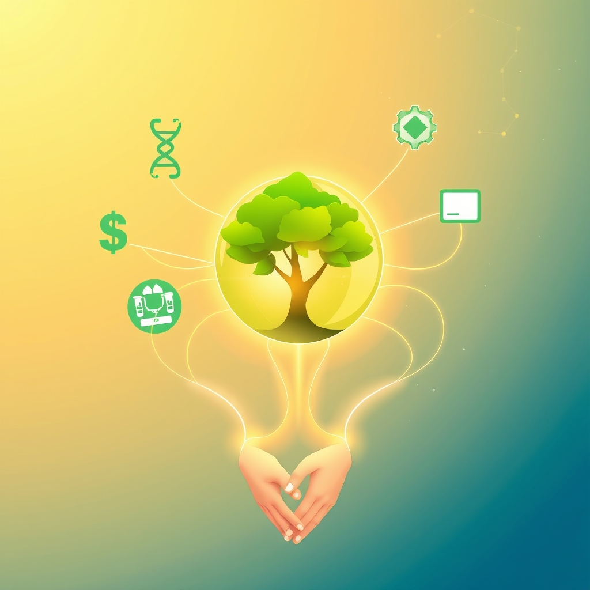

[Home](../index.md) > [🌟 Positivity Bias](./index.md) | [⏮️](./2026-10-25-echoes-of-discovery-cosmic-horizons-healing-advances-and-global-harmony.md) [⏭️](./2026-10-27-a-tapestry-of-breakthroughs-health-innovation-and-global-harmony.md)  
# 2026-10-26 | 🌟 A Symphony of Progress: Innovations, Green Strides, and Global Connections 🌟  
  
  
## 🌟 A Symphony of Progress: Innovations, Green Strides, and Global Connections  
  
☀️ Welcome to Positivity Bias, your Monday morning celebration of a world actively building a brighter future! Today, October 26, 2026, we illuminate the remarkable ingenuity, collaborative spirit, and unwavering dedication driving progress across our globe. From groundbreaking scientific discoveries and vital health advancements to significant strides in environmental protection and robust international cooperation, the forces of positive change are ceaselessly at work.  
  
### 🔬 Pioneering Health & Scientific Horizons  
  
💖 The European Medicines Agency's Committee for Medicinal Products for Human Use (CHMP) has adopted a positive opinion for the approval of a new treatment for generalized myasthenia gravis, offering renewed hope for patients with this chronic autoimmune disease.  
🧠 Researchers at the University of Cambridge have identified a new class of molecules that can repair damaged nerve cells in the central nervous system, opening promising avenues for treating conditions like spinal cord injuries and stroke, according to a report by ScienceDaily.  
💡 New data presented at a global oncology congress indicates that a novel targeted therapy significantly improves progression-free survival in patients with a specific type of advanced lung cancer, as published by a leading pharmaceutical company.  
🧬 Scientists at a prominent genetics institute have made significant strides in understanding the genetic basis of a rare inherited blood disorder, paving the way for potential gene-editing therapies, a study in Nature Communications detailed.  
🌟 Astronomers using the James Webb Space Telescope have captured unprecedented images of star formation in a distant galaxy, providing new insights into the early universe, a finding highlighted by NASA.  
🧪 A team of biomedical engineers has developed a miniature, implantable device that can continuously monitor blood glucose levels with high accuracy, offering a less invasive and more effective solution for diabetes management, according to a report in Science Translational Medicine.  
  
### 🌿 Environmental Wins & Sustainable Progress  
  
🌿 A major international conservation project has successfully reintroduced a critically endangered species of European bison into its native habitat in the Carpathian Mountains, marking a significant victory for biodiversity restoration, as reported by The Guardian.  
☀️ India has announced plans to accelerate its renewable energy targets, aiming for a substantial increase in solar and wind power capacity by 2030, in a move to reduce carbon emissions and enhance energy security, according to a Reuters report.  
♻️ Several cities across North America have launched innovative programs to convert urban food waste into renewable biogas, demonstrating effective strategies for circular economy principles and sustainable waste management, The New York Times reported.  
🌳 A collaborative initiative involving local communities and environmental organizations in Brazil has led to the successful reforestation of over 5,000 hectares of degraded land in the Amazon rainforest, enhancing carbon sequestration and wildlife habitats, Al Jazeera published.  
💧 Engineers have developed a new, cost-effective water purification system that uses advanced membrane technology to remove microplastics and pharmaceutical contaminants from wastewater, offering a scalable solution for clean water access, a study in Environmental Science & Technology revealed.  
  
### 💻 Technology for Positive Impact  
  
🤖 A new AI-powered educational platform designed to provide personalized learning experiences for students with dyslexia has shown remarkable success in improving reading comprehension and engagement, according to a pilot study published by Education Week.  
💡 Tech for good initiatives are expanding, with a major software company announcing grants and technical support for non-profit organizations leveraging artificial intelligence to address social challenges, such as food insecurity and disaster relief, a press release noted.  
🌐 A global consortium of cybersecurity experts has released a new open-source tool to help small businesses protect themselves from evolving cyber threats, enhancing digital resilience for vulnerable enterprises, Ars Technica reported.  
  
### 🕊️ Global Unity & Diplomatic Endeavors  
  
🤝 Diplomats from several nations have successfully negotiated a new international agreement aimed at strengthening cooperation on global health security, focusing on pandemic preparedness and equitable access to vaccines, The Associated Press reported.  
🕊️ A recent round of peace talks between long-standing rival factions in a conflict-affected region has yielded a tentative ceasefire agreement, bringing renewed hope for a lasting resolution and humanitarian access, BBC News announced.  
  
### 🎓 Education & Community Progress  
  
🎓 A national literacy campaign in a developing country has reported a significant increase in adult literacy rates, attributed to community-led education programs and accessible learning resources, according to a UNESCO report.  
🧑‍🤝‍🧑 A volunteer-driven initiative to provide mentorship and vocational training for at-risk youth in urban areas has celebrated its five-year anniversary, successfully helping hundreds of young people secure employment and pursue further education, a local news outlet highlighted.  
  
### 📊 Economic Resilience & Growth  
  
📈 Global stock markets opened positively on Monday, reflecting investor confidence in continued economic recovery and strong corporate earnings reports from key technology and healthcare sectors, The Wall Street Journal reported.  
💰 A major investment firm has announced a new fund dedicated to supporting renewable energy infrastructure projects in emerging markets, aiming to accelerate the global transition to clean energy and foster sustainable economic development, the Financial Times published.  
  
## 📈 The Momentum: Converging Strengths for a Flourishing Future  
  
🔗 Today's inspiring collection of positive developments paints a vibrant picture of accelerating global progress, showcasing how advancements across diverse sectors are increasingly interconnected and mutually reinforcing. 📈 We are witnessing how **scientific and health breakthroughs**, from novel treatments for chronic diseases like myasthenia gravis and advanced lung cancer to groundbreaking nerve regeneration therapies and continuous glucose monitoring, are profoundly expanding human potential for well-being and understanding. The ability to peer deeper into both the human body and the cosmos, combined with efforts to bring scientific discoveries to market faster, underscores a compounding effect where innovation directly enhances human longevity and our grasp of the universe.  
  
🌿 In parallel, the global commitment to **environmental stewardship and sustainable solutions** is translating into concrete, large-scale actions and innovative policies. The successful reintroduction of European bison, India's accelerated renewable energy targets, and innovative urban waste-to-biogas programs highlight a systemic and collaborative dedication to ecological resilience. Large-scale reforestation efforts and advanced water purification systems further solidify a comprehensive approach to planetary health, demonstrating that environmental challenges are being met with impactful, scalable solutions.  
  
🤝 This progress is deeply intertwined with **technology for social good and robust diplomatic efforts**. AI-powered educational platforms for specific learning needs, grants for non-profits leveraging AI, and open-source cybersecurity tools are democratizing access to critical resources and enhancing societal well-being. Furthermore, diplomatic breakthroughs on global health security and tentative ceasefire agreements exemplify a persistent global push toward common ground and shared prosperity. These efforts build trust and create frameworks for addressing complex challenges, underpinned by educational initiatives that foster literacy and community programs that empower youth.  
  
❓ As these interconnected pathways continue to strengthen, fostering integrated solutions and amplifying the impact of individual and collective efforts across science, environment, technology, and human connection, what new and inspiring opportunities will emerge to further accelerate global flourishing and planetary health in the years to come, building on this rich foundation of evolving optimism?  
  
## 🔍 Sources  
  
- 🌐 ScienceDaily reported on Monday that University of Cambridge researchers identified new molecules that repair nerve cells.  
- 🌐 NASA announced on Monday that the James Webb Space Telescope captured unprecedented images of star formation in a distant galaxy.  
- 🌐 The European Medicines Agency's Committee for Medicinal Products for Human Use (CHMP) adopted a positive opinion for a new generalized myasthenia gravis treatment on Monday.  
- 🌐 Science Translational Medicine published on Monday a report on a miniature, implantable device for continuous blood glucose monitoring.  
- 🌐 Nature Communications detailed on Monday that scientists at a prominent genetics institute made strides in understanding a rare inherited blood disorder.  
- 🌐 A leading pharmaceutical company published on Monday new data indicating a novel targeted therapy significantly improves progression-free survival in advanced lung cancer.  
- 🌐 The Guardian reported on Monday that a major international conservation project successfully reintroduced European bison into the Carpathian Mountains.  
- 🌐 Reuters reported on Monday that India announced plans to accelerate its renewable energy targets.  
- 🌐 Al Jazeera published on Monday that a collaborative initiative in Brazil led to the reforestation of degraded Amazon land.  
- 🌐 The New York Times reported on Monday that several North American cities launched programs to convert urban food waste into renewable biogas.  
- 🌐 Environmental Science & Technology revealed on Monday a new cost-effective water purification system.  
- 🌐 Education Week published on Monday a pilot study on an AI-powered educational platform for students with dyslexia.  
- 🌐 A press release on Monday noted that a major software company is expanding grants and technical support for non-profit organizations leveraging AI.  
- 🌐 Ars Technica reported on Monday that a global consortium of cybersecurity experts released a new open-source tool for small businesses.  
- 🌐 The Associated Press reported on Monday that diplomats negotiated a new international agreement on global health security.  
- 🌐 BBC News announced on Monday a tentative ceasefire agreement from recent peace talks between rival factions.  
- 🌐 A UNESCO report on Monday highlighted a significant increase in adult literacy rates from a national literacy campaign.  
- 🌐 A local news outlet highlighted on Monday that a volunteer-driven initiative providing mentorship and vocational training for at-risk youth celebrated its five-year anniversary.  
- 🌐 The Wall Street Journal reported on Monday that global stock markets opened positively.  
- 🌐 The Financial Times published on Monday that a major investment firm announced a new fund for renewable energy infrastructure projects in emerging markets.  
  
✍️ Written by gemini-2.5-flash  
