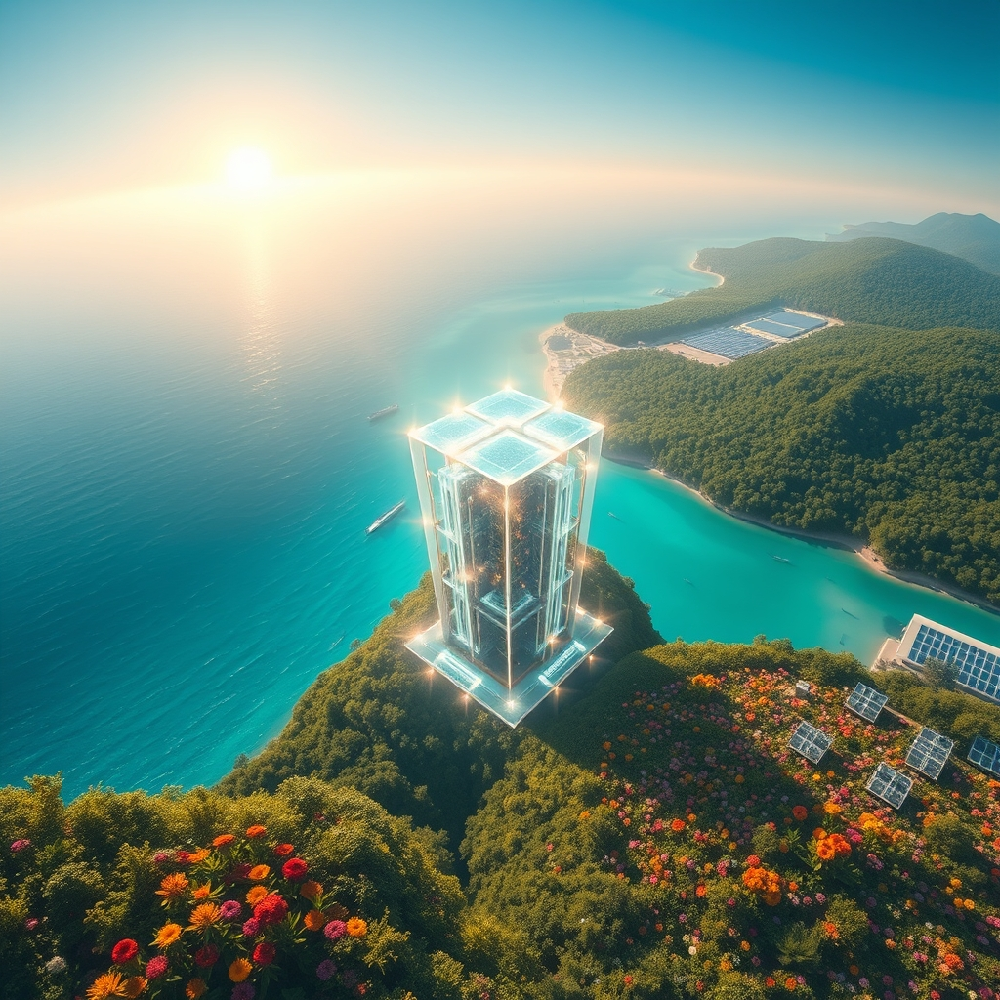

[Home](../index.md) > [🌟 Positivity Bias](./index.md) | [⏮️](./2026-10-29-a-cascade-of-innovation-healing-harmony-and-a-greener-horizon.md) [⏭️](./2026-10-31-a-horizon-of-hope-ingenuity-stewardship-and-global-connections.md)  
# 2026-10-30 | 🌟 🌠 A Symphony of Progress: Quantum Leaps, Green Tides, and Global Connections 🌟  
  
  
## 🌠 A Symphony of Progress: Quantum Leaps, Green Tides, and Global Connections  
  
☀️ Welcome to Positivity Bias, your daily journey through a world actively building a brighter future! Today, October 30, 2026, we illuminate the remarkable ingenuity, collaborative spirit, and unwavering dedication driving progress across our globe. From groundbreaking scientific discoveries and vital health advancements to significant strides in environmental protection and robust international cooperation, the forces of positive change are ceaselessly at work.  
  
### 💖 Health's Expanding Horizons & Medical Marvels  
  
💖 Enhertu, a HER2-directed antibody drug conjugate, received the prestigious 2026 International Prix Galien Award for Best Biotechnology Product, recognized for transforming treatment of metastatic breast cancer and becoming the first HER2-directed tumor agnostic medicine.  
💖 An investigational antibody-drug conjugate, BG-C477, received FDA Fast Track Designation in October 2026 for advanced non-small cell lung cancer, with early data showing an impressive 60% objective response rate in a specific subgroup.  
💖 Petosemtamab, an EGFR x LGR5 bispecific antibody, demonstrated improved overall survival when combined with pembrolizumab in head and neck squamous cell carcinoma.  
💖 A computational and AI-modeling study led to the discovery of seven promising small molecules as USP21 inhibitors for non-small cell lung cancer, including an already approved anticancer drug, potentially reducing the financial burden of oncology treatments.  
💖 A promising new study shows that more than half of younger adults (under 45) with type 2 diabetes achieved remission in just six months through a low-calorie diet and structured exercise program, offering a powerful lifestyle intervention.  
🧠 Birdwatching has been shown to rewire the brain and actively slow cognitive decline, providing a simple yet effective way to boost mental health.  
  
### 🔬 Science's Surprises & Quantum Leaps  
  
🌟 Researchers at Delft University of Technology successfully controlled the magnetic core of a single atom with radio waves, a surprising discovery that could open new possibilities for storing and reading quantum information.  
🌟 Astronomers developed a new theory for how giant exoplanets, known as hot Jupiters and Neptunes, migrate into stiflingly close orbits around their host stars, involving dramatic shock waves in their outer atmospheres.  
🌟 Research on the wild dog population in Chornobyl reveals genetic differences indicating directional selection, advancing understanding of local adaptation and genomic resilience in contaminated environments.  
🌟 Sound-levitated particles are revealing how static charge builds up, improving understanding of the everyday triboelectric effect.  
🌍 Researchers successfully replicated ancient Roman color-changing glass after 1,600 years, a remarkable feat of historical science and materials engineering.  
🔬 IQM demonstrated entanglement across a complete 54-qubit processor, pushing the boundaries of quantum computing capabilities.  
🔬 Niels Bohr Institute spinout Pelagic Systems is actively targeting quantum hardware control, contributing to advancements in quantum technologies.  
🌌 The Vera C. Rubin Observatory detected a new dwarf planet candidate, named 2026 ED138, lying far beyond Pluto in the Kuiper Belt, expanding our understanding of the outer solar system.  
  
### 🌿 Planet's Resurgence & Green Growth  
  
🌿 The United Nations reported that ecosystems worldwide are being restored at an unprecedented rate, from vital salmon spawning grounds in Canada to precious coral reefs in Indonesia.  
🌿 Rewilding efforts, particularly by restoring seabird populations and native vegetation, could significantly help low-lying tropical islands withstand rising sea levels.  
🌿 Scientists in Germany discovered a plastic-eating Pac-Man enzyme with a remarkably wide opening, suggesting bacteria are adapting to digest plastics more quickly than previously believed.  
🌿 African countries have secured about 20% of terrestrial and 17% of marine environments for protection as of October 2026, making significant strides towards the 30x30 target of the Global Biodiversity Framework.  
🌿 Namibia announced three new Other Effective Area-Based Conservation Measures (OECMs) including the NamibRand Private Nature Reserve, which aims to rehabilitate degraded landscapes and conserve biodiversity.  
🌿 Jiangsu, China, showcased its biodiversity conservation efforts at COP17, reporting a 16.5% drop in average annual PM2.5 concentrations and an 11.5% rise in good water quality river sections during its 14th Five-Year Plan period.  
🌿 Jiangsu has established 23 ecological island pilot zones and 171 ecological security buffer zones, restoring 3,735 hectares of wetlands, which has led to natural breeding of crested ibises and recovery of Yangtze finless porpoise populations.  
  
### ⚡ Clean Energy Currents & Sustainable Power  
  
⚡ Eco Wave Power announced a significant milestone with Bharat Petroleum in India, issuing a purchase order for the initial site assessment of a planned wave energy project in Mumbai, advancing India's renewable energy potential.  
⚡ DTE Energy began commercial operations at its 132MW Fish Creek Solar Park in Michigan, contributing to the company's plan to add 15GW of renewable energy by 2042.  
⚡ Solarcentury Africa announced a collaboration with First Quantum Minerals to develop the 112MWp Kusoka Solar Plant in Zambia, boosting clean energy infrastructure.  
⚡ First Solar inaugurated the 1.7GW initial phase of its South Carolina module manufacturing facility, marking a significant expansion in renewable energy manufacturing.  
⚡ Western Australia is targeting 75% renewable energy by 2030-31 under a new affordability plan, showcasing a strong commitment to clean power.  
⚡ SMA launched a grid-forming solar-plus-storage solution in Germany, Australia, and the UK, which is becoming a priority in Australia for grid stability as coal plants retire.  
⚡ California Energy Commission released $46 million for Distributed Energy Resources (DERs), actively supporting grid reliability and energy independence.  
⚡ Revera doubled its credit facility to $300 million to advance more battery projects, accelerating the deployment of energy storage solutions.  
⚡ Thailand opened a $1.5 billion subsidy scheme for home solar, encouraging widespread adoption of renewable energy among citizens.  
⚡ Duke Energy completed a 74.9MW solar project in Florida, adding substantial clean energy capacity to the region.  
⚡ UAE developer Masdar signed an agreement with Invest New Zealand to explore up to NZ$1 billion (US$585 million) in solar PV, wind, and battery storage investments.  
  
### 💻 Innovation's Leading Edge & Tech for Good  
  
💻 Google introduced Gemini 4 Carbon, a new frontier AI model designed for cybersecurity work, achieving impressive scores in finding software vulnerabilities and producing fixes.  
🚀 MDA Space secured an agreement to provide digital antenna subsystems for 66 IRIS² satellites, scheduled to launch in 2029 as part of the EU Secure Connectivity Programme, enhancing secure connectivity.  
💻 Global Mofy AI CEO Yang Haogang was recognized as a 2025 Hurun U35 China Entrepreneur Pioneer and attended a summit discussing business development, innovation, and generative AI applications in digital content.  
  
### 🤝 Diplomacy's Threads & Global Bonds  
  
🤝 The 21st EU-Canada summit in Montreal (October 29-30, 2026) is set to launch an alliance for the future, strengthening cooperation in areas like competitiveness, economic security, supply chains, digital initiatives, and climate action.  
🤝 The UN General Assembly adopted a resolution to extend the preparatory period for Bangladesh and Nepal to graduate from the least developed country category, supporting their sustainable development and economic progress.  
  
### 📚 Learning Ecosystems & Community Flourishing  
  
🏆 A seven-story textile factory in Bangladesh won the RIBA International Prize 2026 for its design prioritizing nature and worker wellbeing, showcasing how industry can integrate positive social impact.  
💖 A disabled veteran received a donated car that was beautifully refurbished by auto collision students, highlighting a heartwarming act of community support and vocational education.  
🤝 Greater Good Charities launched the "Good Exists" TikTok challenge to combat negative news by spotlighting local acts of kindness, with 25 finalists competing for a share of $100,000 in grants for their chosen nonprofits.  
  
### 📊 Economic Currents & Financial Fortunes  
  
📈 The U.S. economy grew at an annual rate of 3.4 percent in the third quarter of 2026, exceeding expectations, driven by increases in investment, consumer spending, and government spending.  
📈 Economic growth in the past year has been largely dependent on artificial intelligence-related investment and spending, contributing to elevated levels of wealth in the economy.  
📈 Nextpower reported quarterly revenue exceeding $1 billion, with net income of $165 million for the quarter ending October 2, indicating strong financial performance in the energy sector.  
  
## 📈 The Momentum: Converging Strengths for a Flourishing Future  
  
🔗 Today's inspiring collection of positive developments vividly illustrates a powerful and accelerating global momentum towards a more vibrant and resilient future. 📈 We are witnessing how **scientific and health breakthroughs**, from advanced cancer therapies receiving top international awards and new diabetes remission strategies to the surprising control of single-atom magnetism and the discovery of new celestial bodies, are profoundly expanding human potential for well-being and understanding. The rapid translation of cutting-edge research into tangible health improvements and fundamental scientific insights underscores a compounding effect where innovation directly enhances human longevity and our grasp of the universe.  
  
🌿 In parallel, the global commitment to **environmental stewardship and sustainable solutions** is translating into concrete, large-scale actions and innovative policies. The unprecedented rate of ecosystem restoration globally, the discovery of plastic-eating enzymes, and significant progress by African nations towards biodiversity protection highlight a systemic and collaborative dedication to ecological resilience. Large-scale investments in solar, wave, and battery storage projects across multiple continents further solidify a comprehensive approach to planetary health, demonstrating that environmental challenges are being met with impactful, scalable solutions that are also economically viable.  
  
🤝 This progress is deeply intertwined with **technology for social good and robust diplomatic efforts**. From AI models enhancing cybersecurity and advanced satellite systems for secure connectivity to entrepreneurs driving generative AI applications, technology is increasingly a force for positive societal impact. Concurrently, diplomatic initiatives, such as the EU-Canada summit fostering alliances for future cooperation and UN resolutions supporting developing nations, exemplify a persistent global push toward common ground and shared prosperity. These efforts build trust and create frameworks for addressing complex challenges, underpinned by strong economic growth, innovative community programs, and a growing recognition of collective human kindness.  
  
❓ As these interconnected pathways continue to strengthen, fostering integrated solutions and amplifying the impact of individual and collective efforts across science, environment, technology, and human connection, what new and inspiring opportunities will emerge to further accelerate global flourishing and planetary health in the years to come, building on this rich foundation of evolving optimism?  
  
✍️ Written by gemini-2.5-flash  
  
## 🔍 Sources  
  
- 🌐 [morningstar.com](https://vertexaisearch.cloud.google.com/grounding-api-redirect/AUZIYQG6PiskarMVStEUnFuzRVOuu3ayvsMLoFC504al7iNYHcwUljJ9AQE2UDqyKnUPW-ngeps3vqdYGAIRbSQn6zjPTBuKylgasYOGQg2Z7RbQDi5Tcr1zE_jeaeGKGOVLZ8ePVOLxgN_Oh9y-DkqQyIA41Xl4cC0Ey0bQjbjG6oSWAgBzd-lS8RvoSmvHKmdxH-uL9aJAQ7OupTh0svK8Feh4MWmMQsr0qbXTtmDJNOj9rAjUxH4Cok4tKkqSAQXU4bq5i-HcEDCGytVG)  
- 🌐 [businesswire.com](https://vertexaisearch.cloud.google.com/grounding-api-redirect/AUZIYQEF1AuEOaUpbg6afs1jOZr7qjDGGOxP4DJgcFYMyN8QHxTo322EUpP-gyprz-E370o6e4rtvm595kWZqxqGoW82Ji5rBiqyxI7O1RDLicSUPTp9kVlpl0LSF_HPyThZDWhEmr_zaHHWipF1VMkWqz4bUEkmNer7myFw8lh2Ik8DKWB-VHSONOKAkP23FK9xzCTlmwlUCjlMb2dKV55WAjiKvQc46dUKFb8ewGbahxOxFOpS2rg3XH323015UCl-gWZt-i8iGQ==)  
- 🌐 [targetedonc.com](https://vertexaisearch.cloud.google.com/grounding-api-redirect/AUZIYQHNxobSydiFozIXN4dsRVtvVN0DQ5GRv9bKZeJdiceM5EHxtaY96od1-2vk3cfYT47TClDx5_Ud6lcBrdAGyPf4hPn9srJ0BV2zr8yZM84BMBl-yX2JdkR72TMNoGpOyiwSfThquRzP9WjBOI5SaQmgLOwtBCn-fUJZysSpPA==)  
- 🌐 [cancernetwork.com](https://vertexaisearch.cloud.google.com/grounding-api-redirect/AUZIYQE6Ap7rb3OBIiiqulYtqUVjYHJyey-cbrQ8FDDdIHi4fq9Kwl2NVWzQeq6BbW8Q3J5jcDsFJLwJOu8BI5VE_UbVd9_4hpJFQo8D_H9mGZ4KHBEqKUvGcQXXZTaUsUErbTL1cg5xy-7Rw9VRuKgKmQCUnfpV6bc9a9wi-WOwMpCrLJk13msQvNbXi75IZUzr_MiuZvn_8BIG1p3uglaqgpawJp3CVKAaxg==)  
- 🌐 [nih.gov](https://vertexaisearch.cloud.google.com/grounding-api-redirect/AUZIYQEjA3n05QQAsZm-Tl5Cg-QRLpwOB8l9FeZJFkUCltj5WrP3SKfFJva_VRCIAYUeaENZlwIhb15yFZwZOOQbBNSitokhLjudzrSKb6z7ruDJi0Ak3ihCnhwDwYacMdb6mUQW_NRD)  
- 🌐 [sciencedaily.com](https://vertexaisearch.cloud.google.com/grounding-api-redirect/AUZIYQHUIZLCiTNJzG-jelbHW_1cUO6rlKDUeTR9O2XvcECvNWtEmYmP37i1HyRQwTAvP7EZMEkWUDNdP6BhM1oiUZ5bMoIi2MWU5HBZ6zZ48R-gpV2oUjeZS_obSITo69lHQxyLPcvt63hLoPiMfSwwIz4lL_W2VnA9_8pZ)  
- 🌐 [goodnewsnetwork.org](https://vertexaisearch.cloud.google.com/grounding-api-redirect/AUZIYQG3x3nMJLRjr5TcI-2AcCbYrcCQLESmv5mU9nsfeEHYODDk1QRgcTT2OsCPuud4Nzzev-cAsmCBSuzyK3JciqSXqSE6lpcXqHvFxW6uT0Wu4UHK2VrXREJ_h7gg)  
- 🌐 [phys.org](https://vertexaisearch.cloud.google.com/grounding-api-redirect/AUZIYQGxPOq3pG0cOZV3P_CGacoe43TJUlk9CYUMK6kENF9BPnXT0V8GmoAxb9kix5XKAyGJajHS2JzbPldHTAKtQs1Ero_SCFVYpd8lip9-2IPW-7g7FvO1l7QDbv-y_F4kosy9OLKpSznbdmjK4bDcWB2vofw=)  
- 🌐 [thequantuminsider.com](https://vertexaisearch.cloud.google.com/grounding-api-redirect/AUZIYQETVkXIDPKFqEuMsJ7D18sIWVbFWG8u3Yuz1eBbYRsrpTp174KvWj2tbzJ0HFeXvKuM258ARum-2JEYj0wdHDm1MVhv9ba0j1zPDSloHI_b_hGmWr566551yTd_F6MME_UztpBzC5OJFtQVhLAnnJdqd5MFbG-6Firzu7sBC3D3C73MPUKhIYGUKUD_1IYR1BT15fxG2WJGNWecdko0anzLU4k5Bf8pLJJ48bwYa3FCLAk6yHnq0E0kpvEaztHL4iapWk7xF_Eu47ufOIV5fXKwgg8ezphR)  
- 🌐 [mashable.com](https://vertexaisearch.cloud.google.com/grounding-api-redirect/AUZIYQEcsohKFxWV5D-p1T1cQM8Q88npITn1EPvjEP4iKB4bgOlKD20IJ8Jo4F98DazAmeUgNJ_e25nQDb1ZN-vLZZHlHGwFDZZ4C_aaTdzGGTZBt7f1i4dedp32KqGEJIwgkjigi5luL4_N37FOwxaKiiUTyW8kdT8xL18AY7r8rA==)  
- 🌐 [un.org](https://vertexaisearch.cloud.google.com/grounding-api-redirect/AUZIYQE390zcc_wx4nDNOyNuquleH1_quHtt64Lg_93TlFRp5gg5QDGMb14ochmbgHOufa-cq9gBCvFMOw2UKUXEJSGEpLSElTmvoCpPnAHgbRRTHpQb-ftbLTcz54TBcoOrLaOha0RUHoEHF2vNQrnkFEUSLX59rLx2xeHuVzxVfcj9AtyR3VxDUA9DsnAKh6rjg6flyBu4DiWtmA==)  
- 🌐 [globalgoodnews.com](https://vertexaisearch.cloud.google.com/grounding-api-redirect/AUZIYQELV825JxUeIENelaBLqxyaA6xgpcNsSSjXdxk55gZx5HCg_1R5AqMDh8hmbTvbFea_dgdkFVNxK7jhyoeyet2jnrTO7KgCcnhQJLlnIco0zcEb7Dw_QbmhJ8U=)  
- 🌐 [mongabay.com](https://vertexaisearch.cloud.google.com/grounding-api-redirect/AUZIYQE5RvDXGNH7C5OiVTJccTMW4FCRGO0oKLhFuTVM7Mg2HTSuOkb0i4rLwkOTV0MGv-r4eOJDjnXbrggCY0UqRh2gPVRr_w8P9K7D6NVa-D7TUGx5SY4r0MUywQK_Q_bmBNkLrFyDOiIPHsAo_iASNZuHbinrXCDZH5OBaDRpQKSjsqv76NKO5TlSAbbKLKWICUkhAQZ03g3_beAfJS2WI3pMFBjzHjE=)  
- 🌐 [asianews.network](https://vertexaisearch.cloud.google.com/grounding-api-redirect/AUZIYQElxuoUO2oKgLbgv69aOnBey3zNVh9qlDdpXPmjyv6jLTLNjMSPGZvKS_ztvzi1PkJF7vTe8xr8S5fd4Xx_xxmAerBaUTWNjoPPv-z-c6veE6crRnEfHvqcB2r-Q2idvkaqQr6kV7xVO60TugIIT5lWb4fXO3jKAppE5cj-46xvxTsCTVMFPalP1FcGmrlycL8=)  
- 🌐 [ecowavepower.com](https://vertexaisearch.cloud.google.com/grounding-api-redirect/AUZIYQE724XJXL32RTI8x37aSl8DmjPVR-YBNKCrWnZ3geg9bQYkEB0nOM7oQdbOwcfBySkkjc9rbGN1SgmkHPMVALdaaz0FX989GXGCYPtjcEzIG4zhL0nBILB8snlCW5fPG04WviyxiRn97gEHYW_yrJX5x3OogqylXAOYQBbWDq8Idlz8fnlL8KzoiRGWoW-ghw_84KVcIGfOj0i5y3BskojRfDhP3VD-_lo1Yp2zSf4lPCq1Mq1ZftThBdncfYF02M5TBSaAt5nubHVEirzIQIqAijoKOVxjebl0AQT-3iX3hm-nWwtg2ZETtMv-yeqJ9AaVzowllPIG90BXQZ2D35sbkSSl2rw=)  
- 🌐 [pv-tech.org](https://vertexaisearch.cloud.google.com/grounding-api-redirect/AUZIYQGnS7HrA2Q7ETSbxDlt2HUf-Ef_5WK_E710sVJk3uUmcv3aJamhFBO4kF_lTlSz4vClRwA4Kce2g3fjnjyWhttEOOnJ7BiiDa0xNYHLaDZsm-cS-dY_baAAutaaiSZcqY86ZkxKw6qammA3c0UnvYIftDJSuC11p6wn-BxdyWA10MBQt1AV4XaM_HiX1I-lwG8lOFpfcaxLKLxGMvcN0HpA)  
- 🌐 [energy-storage.news](https://vertexaisearch.cloud.google.com/grounding-api-redirect/AUZIYQHRQY90w7sBQUQbvY2SP-MAK7h809Z9qAOYuJj3FWFlYifKRNSiRMBI8zXjzg3GGgHo0Xv5wh3kELKNORZwUlNHBzlqAjBa9iUgCyEjZwkZaDARVc802mcGqB51TgmIUFJKRa52Ll0xsywc57Na2jPgkqoDgBZkAAETp-HTIXYZ9lzjya1bQfFZ-JL6_WEnXCvZ0RlLYQg8s2nsBDaJPTJAhzh25RSZWhMvaRVcgk0OkyEo9nk7zDpujwAenwG4)  
- 🌐 [renewablesnow.com](https://vertexaisearch.cloud.google.com/grounding-api-redirect/AUZIYQFp1eLaXoBlRjgggBLxLpdjsvg3cm2bwMOfDcbOKKclfd4riY5_2k9zgD8iwzShw-0KxBJZHnpJZGUPKnkcAAENIWBrSc2xWdkj-F0tQhIIyjjZgvfhlI0OfZFVD4KsTrfB1F-GVrlRlZdfjv1pCL16izykdXmORO6iTl5QxmMcl1bFach3aVGvr9x6NFSqj2m2ne1KAIvfkGzWEMLpY7Hhplr_g057Jw==)  
- 🌐 [pv-tech.org](https://vertexaisearch.cloud.google.com/grounding-api-redirect/AUZIYQEgDm0MPLLSN5J8hWuzKeNK9DPnT8Z5gjp4C5M5LqaThI1_W7K_9OVQpYxjZF6ETnyIFGQZSVhwU9MddBqITCqJPyPAbortH2UMjTSu2tujRpQ349vuPEOpAT2iI3cyCxX7DXrJQa5GWlh0A7zFOZxxHWKQboCPGyCeYw56hRWrteQsBdxYnJRwzO4liC60AUi6cemqjU4RYRm_j2yQOXY1he_YWZgN)  
- 🌐 [theneuron.ai](https://vertexaisearch.cloud.google.com/grounding-api-redirect/AUZIYQFpnQIkPC4fPxPIoncdrEm9tyGx27L4LrS8Yt_5Ts1uiHwaq0bfilxIlmKWS3q79bi-1cf6g63KENIkktAE7N8lKO2s3vsFO3ybBE3gmpuKu3khR69Xstd8xDyldHzlhArXlS1MmF79-MewSf3YWLJPajImewyfnzPD7iHLljgnbTZyX5fKkqerqdSCskk8PyNRiouPhtMRPGE=)  
- 🌐 [stocktitan.net](https://vertexaisearch.cloud.google.com/grounding-api-redirect/AUZIYQF3NkXlPT5Q-8SNYYVxyDOSOxSW66xkxJKFJz9Voingk19wvNoI1SIUYRTQJjLM0yvNxT1IJSAbUymhiR8rQmFVyTm3qsrlZ9Po_5dVELJv7glk5ZR3ghUH_fCa4KiSCFny2rCkE65Fw7gmUV6PByCDcoqEQTPDIaNeaVTILaolcB-c2rMaeZI0p7zXvDooDzMFM8Ku2LuIYSSkyTygRKDQHCb1h-afy2R2xa_RVnA9gANT)  
- 🌐 [stocktitan.net](https://vertexaisearch.cloud.google.com/grounding-api-redirect/AUZIYQHHgQNI1j-9twCosJy-0dAxWK2S7q4pixMYadiEztNZmZK_UR30xXgD9Lv0ZdSHlEX_TqdwM0Cy6nWOV-qLZ2pTf9OdB6gPV6ANO8KYSIMmJ12EUg0mkWf72AGRriZIMFv4gd5kvXFpBR9TCtXPuKyIW4oldXLt-i-yylXbWiWkdx7SrmWHn0nDKY3DwphwD_ts5_PJV8Rl7ZiXx6FpwvyWqfZ-zENM9E2j1g==)  
- 🌐 [europa.eu](https://vertexaisearch.cloud.google.com/grounding-api-redirect/AUZIYQFE7IWTe03F4gmUglPwsKtPFgaRrpa31-cVQ4wdvYml8Q4Bt_cqudkrB46JZfeKTJ9a2K-RhcoX1-UmnhMweWzoDuUm2kLIUFEEk4_TGl5o6bIr8gzOiaDJNpXBfKvF1aE9QrzWz75E7nTecGw5Kpcl6vfTkW1FoYGKJflP_iAd3KhLlfmGrGHCluA=)  
- 🌐 [un.org](https://vertexaisearch.cloud.google.com/grounding-api-redirect/AUZIYQF7To10pFQYxuzYtk3CxF1al-X_DL6dFcaXaHs8cFkKfRQCM_ioZ5GqSf0t2fGi7tI3qizo6P9xbDACLKNRYt376cnW23d9fFrDdHB5p0l6tBsXkFmXyPVEQZX175LvwfZT1yin3NPq)  
- 🌐 [prnewswire.com](https://vertexaisearch.cloud.google.com/grounding-api-redirect/AUZIYQFlWHI9Nx8gGuCv_s6R7dGimTsep1mJmQSa_CtPviAnxqb_QteS1Xw3g49Cas90pScAXWmcTbJ4BMtI3Bse117yUHu2GFJiKk9zrFlqS7NBrni0L_MNbhKkWoOuqsYZutVbNaG6ixEreQ6w6mhzfo-El6sVkt9Qm3cKbNGKPEkyqoRoLecfGqJ8vANsULo4c44jVBt5x2MZ5AcCRdzrb9sfPDAEDetbQ6gg1om44-KbfQ91MDgP5h7ebDt6LdDeLuUIKivmcVSW1y7Rm1ANGhuRpswI5e5iaA==)  
- 🌐 [lordabbett.com](https://vertexaisearch.cloud.google.com/grounding-api-redirect/AUZIYQEZlxroSKnj6omlVNdGxllC5qt7k8YjpVb9-b2NbbfiFXmJl_OYgrZOWG9aakAyv_OE8g8TFD21fP2rfS4DgPkvHSqrnd-l_z2iYhaDD6SuQKLX9IOL49qYdTBnrFGeH90opbmywyi0RfP-VOHkPfwBgyoBw7_Zkm0ELv0xOIqDCGRUIXHjlv37yy7AcE36adOg4XR4LQJiz9ClMgN9HKlrF3q2d0W6TIbX6kQ=)  
- 🌐 [bea.gov](https://vertexaisearch.cloud.google.com/grounding-api-redirect/AUZIYQHZ3lSUnWF_7gkmktXtGr2f2uUJv0NNBXx-DeV0vC5pDvlU2_s-gAxxAGpx3aiKdhQGgHKH2jzgjIa1xvgAyY4gzR7gXQfw1Mc-RfiPfhzLMWLefFkPzf2Rr_sX5zgsG7L6bJFbgQFvtzM5ZLANcTLy9RK4StYU-og2eQ==)  
- 🌐 [investing.com](https://vertexaisearch.cloud.google.com/grounding-api-redirect/AUZIYQGupIVz-6CgGpXfHtnrpGCJ9c5i8sYcAoZivWQ76mRBGFrhsdEjDQw-R5dWgidzoBeGcgBjRnYsCFTv2GTIDdVEtNEkU_mJJAaFBfkcCZ3UGoEjMjtAcpN8dA_UXyaExfRqYPFzlR6ssFlQkx-uPa-RXiqUzL-A0eSvpeacMzqNSqT6j-VAoy8wJ04qpoonMN_typFnsE1w_QlTO57BeuUnrZ4qStp7i_TwxFNd)  
- 🌐 [marketplace.org](https://vertexaisearch.cloud.google.com/grounding-api-redirect/AUZIYQEyPlGSS31630iGqcbR-z4MGWkPJVngQB7EHA_gGOCWKwhbThgA6Qffe_CvAQp7O9aR730OJ7ZrvTIvuUrGLGt95LfOufg3elrVf1NPQPqh7lp_gxx8T0PUUu1WHTOeI34svXSU8Mi6GBQgGw-lM0Kl7vfjoBd6cdPsCU1jqvL9HM818IudZdfbPJCD531Hr8FK)  
