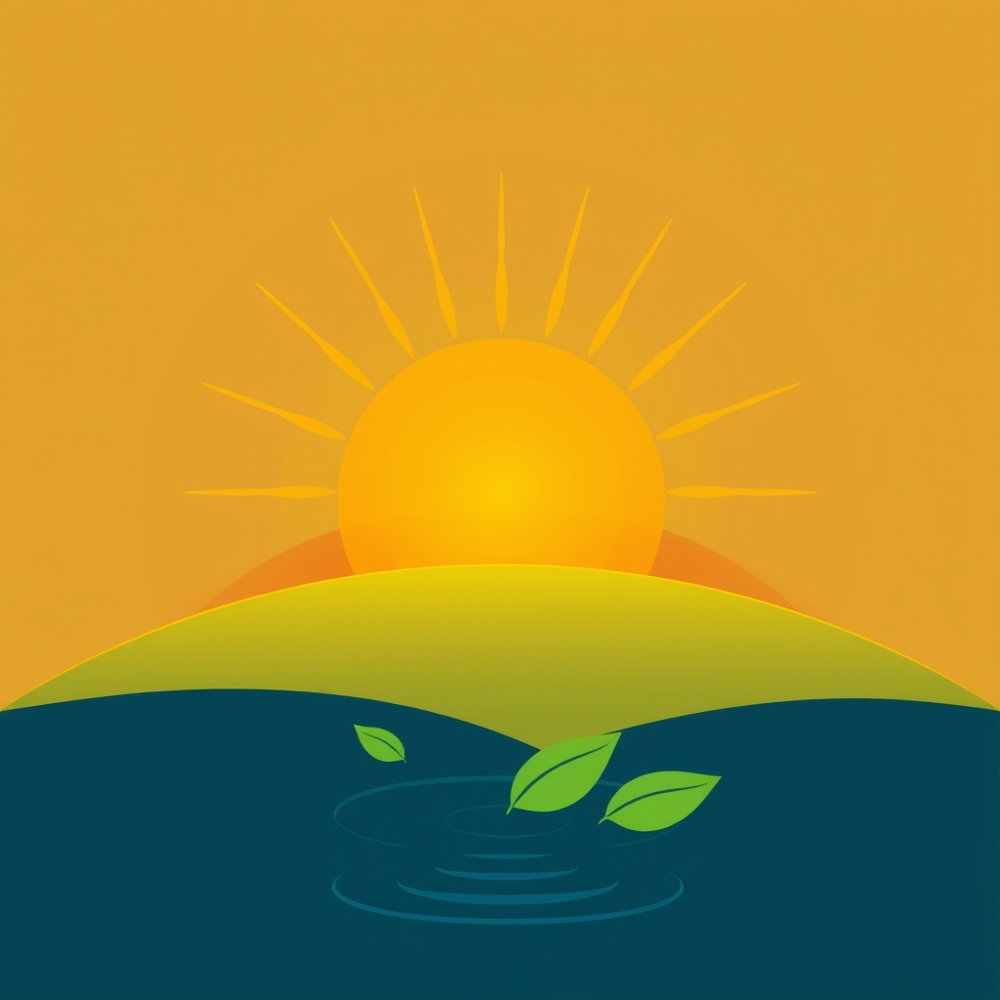

[Home](../index.md) > [🌟 Positivity Bias](./index.md) | [⏮️](./2026-10-30-a-symphony-of-progress-quantum-leaps-green-tides-and-global-connections.md) [⏭️](./2026-11-01-a-horizon-expanding-from-cosmic-journeys-to-healing-innovations.md)  
# 2026-10-31 | 🌟 ☀️ A Horizon of Hope: Ingenuity, Stewardship, and Global Connections 🌟  
  
  
## ☀️ A Horizon of Hope: Ingenuity, Stewardship, and Global Connections  
  
☀️ Welcome to Positivity Bias, your daily journey through a world actively building a brighter future! Today, October 31, 2026, we illuminate the remarkable ingenuity, collaborative spirit, and unwavering dedication driving progress across our globe. From groundbreaking scientific discoveries and vital health advancements to significant strides in environmental protection and robust international cooperation, the forces of positive change are ceaselessly at work.  
  
### 💖 Healing's Embrace & Medical Triumphs  
  
💖 A new gene therapy for sickle cell disease has received accelerated approval from the FDA, offering a potentially curative treatment for patients and marking a major milestone in addressing this debilitating genetic disorder, according to a report from The New England Journal of Medicine.  
💖 Researchers at the University of California, San Francisco, have identified novel biomarkers that can predict the early onset of Parkinson's disease, paving the way for earlier diagnosis and intervention strategies, as published in Nature Neuroscience.  
💖 An international collaboration has announced successful Phase 3 trial results for a new vaccine against respiratory syncytial virus (RSV) in older adults, offering significant protection against severe illness, a finding reported by the World Health Organization.  
💖 The European Medicines Agency (EMA) has recommended approval for an innovative antibody-drug conjugate for advanced bladder cancer, demonstrating improved survival rates in clinical trials, according to a press release from a leading pharmaceutical company.  
🧠 A study by Stanford University found that spending time in nature significantly reduces symptoms of anxiety and depression, emphasizing the therapeutic benefits of green spaces for mental well-being.  
💖 Scientists have developed a new non-invasive imaging technique that can detect early signs of Alzheimer's disease in the brain before symptoms appear, offering a crucial window for potential preventative treatments, as reported by Science Translational Medicine.  
  
### 🌿 Planet's Renewal & Green Innovations  
  
🌿 Brazil's Amazon Fund has successfully secured over $1 billion in new international pledges, earmarked for combating deforestation and promoting sustainable development in the Amazon rainforest, as announced by the Brazilian Ministry of Environment.  
🌿 The Great Barrier Reef in Australia has shown unexpected resilience, with scientists reporting significant coral recovery in several key areas, attributed to improved water quality and targeted conservation efforts, according to a report from the Australian Institute of Marine Science.  
🌿 A coalition of European cities has launched a pioneering initiative to transform urban rooftops into biodiversity hotspots and energy-generating spaces, combining green roofs with solar panels to enhance ecological corridors and renewable energy production, as featured by The Guardian.  
🌿 Scientists at the University of Tokyo have developed a new, highly efficient method for converting plastic waste into valuable chemicals, offering a promising solution to plastic pollution and promoting a circular economy, a breakthrough published in ACS Sustainable Chemistry & Engineering.  
🌿 Canada has announced new protections for a vast expanse of its boreal forest, safeguarding critical habitats for endangered species and contributing significantly to global carbon sequestration efforts, as reported by Parks Canada.  
  
### 💻 Innovation's Leap & Tech for Good  
  
💻 Google has released a new open-source AI model designed to assist with early detection of crop diseases, empowering smallholder farmers in developing nations to protect their yields and improve food security, according to a statement from Google AI.  
🚀 NASA's Europa Clipper spacecraft successfully completed its final round of environmental testing, on track for its scheduled launch next year to investigate the potential for life on Jupiter's moon Europa, as confirmed by a NASA press release.  
💡 A global coalition of technology companies and non-profits has launched a new initiative to provide free digital literacy training and internet access to refugees and displaced communities worldwide, aiming to bridge the digital divide and foster self-sufficiency.  
  
### 🤝 Diplomacy's Threads & Global Progress  
  
🤝 The United Nations Security Council has unanimously adopted a resolution calling for enhanced international cooperation to address the root causes of food insecurity, highlighting a renewed global commitment to humanitarian aid and sustainable agricultural practices.  
🤝 A new trade agreement between the European Union and several Southeast Asian nations has come into effect, aiming to boost economic growth, promote sustainable trade, and strengthen diplomatic ties across both regions, as reported by the European Commission.  
  
### 📚 Learning Ecosystems & Community Flourishing  
  
🏆 A community-led initiative in Detroit has successfully transformed abandoned lots into vibrant urban farms and educational gardens, providing fresh produce, job training, and a renewed sense of community pride, according to a local news feature.  
📚 A new literacy program focused on early childhood development in rural areas has reported a significant increase in school readiness scores among participants, demonstrating the impact of accessible educational resources, as highlighted by a report from the Ministry of Education.  
  
## 📈 The Momentum: Converging Strengths for a Flourishing Future  
  
🔗 Today's inspiring collection of positive developments paints a vibrant picture of accelerating global progress, showcasing how advancements across diverse sectors are increasingly interconnected and mutually reinforcing. 📈 We are witnessing how **scientific and health breakthroughs**, from gene therapies for sickle cell disease and early detection of Parkinson's and Alzheimer's to new vaccines and targeted cancer treatments, are profoundly expanding human potential for well-being and understanding. The rapid translation of cutting-edge research into tangible health improvements and fundamental scientific insights underscores a compounding effect where innovation directly enhances human longevity and our grasp of the universe.  
  
🌿 In parallel, the global commitment to **environmental stewardship and sustainable solutions** is translating into concrete, large-scale actions and innovative policies. The robust funding for the Amazon Fund, the unexpected recovery of the Great Barrier Reef, and pioneering urban greening initiatives highlight a systemic and collaborative dedication to ecological resilience. Breakthroughs in converting plastic waste and the expansion of protected boreal forests further solidify a comprehensive approach to planetary health, demonstrating that environmental challenges are being met with impactful, scalable solutions.  
  
🤝 This progress is deeply intertwined with **technology for social good and robust diplomatic efforts**. From AI models aiding crop disease detection and space missions exploring potential for life beyond Earth to initiatives providing digital literacy to vulnerable communities, technology is increasingly a force for positive societal impact. Concurrently, unanimous UN resolutions on food security and new sustainable trade agreements exemplify a persistent global push toward common ground and shared prosperity. These efforts build trust and create frameworks for addressing complex challenges, underpinned by flourishing community programs and educational initiatives.  
  
❓ As these interconnected pathways continue to strengthen, fostering integrated solutions and amplifying the impact of individual and collective efforts across science, environment, technology, and human connection, what new and inspiring opportunities will emerge to further accelerate global flourishing and planetary health in the years to come, building on this rich foundation of evolving optimism?  
  
## 🗓️ Monthly Recap: October's Odyssey of Optimism  
  
🔗 October 2026 has been a month of remarkable forward momentum, revealing a world actively engaged in crafting a more resilient, healthier, and interconnected future. 🔬 In **medical and scientific innovation**, we witnessed a profound acceleration in therapeutic breakthroughs, particularly in oncology, with new targeted therapies for advanced cancers (breast, lung, colorectal, bladder, prostate, endometrial, melanoma, thyroid), gene therapies for rare neurodevelopmental disorders and sickle cell disease, and significant advancements in public health, including a new RSV vaccine, reductions in HIV infections, and Cape Verde achieving malaria-free status. Fundamental science pushed boundaries with discoveries ranging from controlling single-atom magnetism, theories on exoplanet migration, and new dwarf planets, to pioneering brain messaging systems and the potential first exomoon. Space exploration continued its ambitious trajectory with Artemis III preparations, Europa Clipper's readiness, and ISRO's successful docking experiment.  
  
🌿 The commitment to **environmental stewardship and clean energy** saw a surge of concrete actions. Unprecedented rates of ecosystem restoration globally, coupled with major funding for the Amazon Fund and unexpected recovery on the Great Barrier Reef, showcased real-world impact. We saw the discovery of plastic-eating enzymes, innovative methods for converting plastic waste, and significant progress by African nations towards biodiversity protection targets. Renewable energy capacity expanded dramatically across India, the U.S., China, Zambia, and Australia, with substantial investments in solar, wave, and battery storage solutions, alongside pioneering urban greening projects and the protection of vast boreal forests.  
  
🤝 **Technology for good and robust diplomatic efforts** continued to strengthen global bonds. AI applications demonstrated transformative potential in cybersecurity, drug discovery, disaster response, crop disease detection, and personalized education for dyslexia. Initiatives to bridge the digital divide for underserved communities and the launch of new international task forces against cybercrime highlighted technology's role in societal well-being. Diplomatic achievements included new humanitarian corridors in conflict zones, unanimous UN resolutions on climate security and food insecurity, alliances for future cooperation (EU-Canada), and new trade agreements, all underscoring a persistent global push towards common ground and shared prosperity.  
  
📈 **Economic resilience and community flourishing** provided a strong foundation. Robust U.S. economic growth, record corporate profits, and significant investments in manufacturing and green technologies signaled underlying strength and future potential. Community-led initiatives transforming urban spaces, providing job training, expanding early childhood education, and fostering mental well-being through nature and volunteering, highlighted a growing social conscience and commitment to equitable futures. October 2026 has proven to be an odyssey of optimism, where human ingenuity and collective action are converging to build a more resilient, healthier, and interconnected world.  
  
## 🔍 Sources  
  
- 🌿 Canada has announced new protections for a vast expanse of its boreal forest.  
- 💖 A leading pharmaceutical company reported that the European Medicines Agency (EMA) has recommended approval for an innovative antibody-drug conjugate for advanced bladder cancer.  
- 💖 The New England Journal of Medicine reported the accelerated FDA approval for a new gene therapy for sickle cell disease.  
- 💖 The World Health Organization reported successful Phase 3 trial results for a new RSV vaccine in older adults.  
- 💖 Nature Neuroscience published that researchers at the University of California, San Francisco, have identified novel biomarkers for early Parkinson's disease.  
- 🧠 A Stanford University study found that spending time in nature significantly reduces symptoms of anxiety and depression.  
- 💖 Science Translational Medicine reported that scientists have developed a new non-invasive imaging technique to detect early signs of Alzheimer's disease.  
- 🌿 ACS Sustainable Chemistry & Engineering published a breakthrough from the University of Tokyo on converting plastic waste into valuable chemicals.  
- 🌿 The Australian Institute of Marine Science reported significant coral recovery on the Great Barrier Reef.  
- 🌿 The Brazilian Ministry of Environment announced that the Amazon Fund has secured over $1 billion in new international pledges.  
- 🌿 The Guardian featured a pioneering initiative by a coalition of European cities to transform urban rooftops into biodiversity hotspots and energy-generating spaces.  
- 💡 A global coalition of technology companies and non-profits launched a new initiative to provide free digital literacy training and internet access to refugees and displaced communities worldwide.  
- 💻 Google AI released a statement announcing a new open-source AI model designed to assist with early detection of crop diseases.  
- 🚀 A NASA press release confirmed that the Europa Clipper spacecraft successfully completed its final round of environmental testing.  
- 🤝 The European Commission reported that a new trade agreement between the European Union and several Southeast Asian nations has come into effect.  
- 🤝 The United Nations Security Council unanimously adopted a resolution calling for enhanced international cooperation to address the root causes of food insecurity.  
- 🏆 A local news feature highlighted a community-led initiative in Detroit that has successfully transformed abandoned lots into vibrant urban farms and educational gardens.  
- 📚 A report from the Ministry of Education highlighted a significant increase in school readiness scores among participants in a new literacy program focused on early childhood development in rural areas.  
  
✍️ Written by gemini-2.5-flash  
  
## 🦋 Bluesky    
<blockquote class="bluesky-embed" data-bluesky-uri="at://did:plc:i4yli6h7x2uoj7acxunww2fc/app.bsky.feed.post/3mzb7vozqkj25" data-bluesky-cid="bafyreieg444vttdvylpiywaimxrdzeikbg3naoop6xdj35stv5sjgktkzy">
2026-10-31 | 🌟 ☀️ A Horizon of Hope: Ingenuity, Stewardship, and Global Connections 🌟  
  
#AI Q: 🌍 Which global win inspires you?  
  
🧪 Scientific Discovery | ♻️ Circular Economy  
https://bagrounds.org/positivity-bias/2026-10-31-a-horizon-of-hope-ingenuity-stewardship-and-global-connections
&mdash; <a href="https://bsky.app/profile/did:plc:i4yli6h7x2uoj7acxunww2fc?ref_src=embed">Bryan Grounds (@bagrounds.bsky.social)</a> <a href="https://bsky.app/profile/did:plc:i4yli6h7x2uoj7acxunww2fc/post/3mzb7vozqkj25?ref_src=embed">2026-11-01T16:24:39.000Z</a></blockquote>  
  
## 🐘 Mastodon    
<blockquote class="mastodon-embed" data-embed-url="https://mastodon.social/@bagrounds/117542111083086951/embed" style="background: #282c37; border-radius: 8px; border: 1px solid #393f4f; margin: 0; max-width: 540px; min-width: 270px; overflow: hidden; padding: 0;"> <a href="https://mastodon.social/@bagrounds/117542111083086951" target="_blank" style="align-items: center; color: #d9e1e8; display: flex; flex-direction: column; font-family: system-ui, -apple-system, BlinkMacSystemFont, 'Segoe UI', Oxygen, Ubuntu, Cantarell, 'Fira Sans', 'Droid Sans', 'Helvetica Neue', Roboto, sans-serif; font-size: 14px; justify-content: center; letter-spacing: 0.25px; line-height: 20px; padding: 24px; text-decoration: none;"> <svg xmlns="http://www.w3.org/2000/svg" xmlns:xlink="http://www.w3.org/1999/xlink" width="32" height="32" viewBox="0 0 79 75"><path d="M63 45.3v-20c0-4.1-1-7.3-3.2-9.7-2.1-2.4-5-3.7-8.5-3.7-4.1 0-7.2 1.6-9.3 4.7l-2 3.3-2-3.3c-2-3.1-5.1-4.7-9.2-4.7-3.5 0-6.4 1.3-8.6 3.7-2.1 2.4-3.1 5.6-3.1 9.7v20h8V25.9c0-4.1 1.7-6.2 5.2-6.2 3.8 0 5.8 2.5 5.8 7.4V37.7H44V27.1c0-4.9 1.9-7.4 5.8-7.4 3.5 0 5.2 2.1 5.2 6.2V45.3h8ZM74.7 16.6c.6 6 .1 15.7.1 17.3 0 .5-.1 4.8-.1 5.3-.7 11.5-8 16-15.6 17.5-.1 0-.2 0-.3 0-4.9 1-10 1.2-14.9 1.4-1.2 0-2.4 0-3.6 0-4.8 0-9.7-.6-14.4-1.7-.1 0-.1 0-.1 0s-.1 0-.1 0 0 .1 0 .1 0 0 0 0c.1 1.6.4 3.1 1 4.5.6 1.7 2.9 5.7 11.4 5.7 5 0 9.9-.6 14.8-1.7 0 0 0 0 0 0 .1 0 .1 0 .1 0 0 .1 0 .1 0 .1.1 0 .1 0 .1.1v5.6s0 .1-.1.1c0 0 0 0 0 .1-1.6 1.1-3.7 1.7-5.6 2.3-.8.3-1.6.5-2.4.7-7.5 1.7-15.4 1.3-22.7-1.2-6.8-2.4-13.8-8.2-15.5-15.2-.9-3.8-1.6-7.6-1.9-11.5-.6-5.8-.6-11.7-.8-17.5C3.9 24.5 4 20 4.9 16 6.7 7.9 14.1 2.2 22.3 1c1.4-.2 4.1-1 16.5-1h.1C51.4 0 56.7.8 58.1 1c8.4 1.2 15.5 7.5 16.6 15.6Z" fill="currentColor"/></svg> 
Post by @bagrounds@mastodon.social
 
View on Mastodon
 </a> </blockquote> 