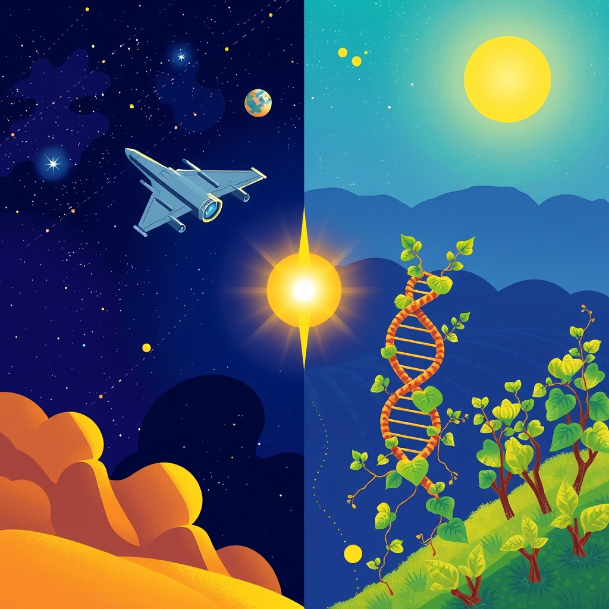

[Home](../index.md) > [🌟 Positivity Bias](./index.md) | [⏮️](./2026-10-31-a-horizon-of-hope-ingenuity-stewardship-and-global-connections.md)  
# 2026-11-01 | 🌟 🚀 A Horizon Expanding: From Cosmic Journeys to Healing Innovations 🌟  
  
  
## 🚀 A Horizon Expanding: From Cosmic Journeys to Healing Innovations  
  
☀️ Welcome to Positivity Bias, your Sunday deep dive into a world actively charting a course towards a brighter future! Today, November 1, 2026, we spotlight the remarkable ingenuity, collaborative spirit, and unwavering dedication driving progress across our globe. From the farthest reaches of space to breakthroughs in human health, and from vital diplomatic efforts to grassroots community triumphs, the forces of positive change are ceaselessly at work.  
  
### 🔭 Cosmic Explorations & Scientific Wonders  
  
🌟 Voyager 1 is poised to achieve a historic milestone on November 18, 2026, becoming the first human-made object a full light-day away from Earth, a profound testament to humanity's enduring quest for knowledge and exploration.  
🌌 The Vera C. Rubin Observatory team, led by a University of Washington astronomer, has identified a possible new dwarf planet in the outer solar system, provisionally named 2026 ED-138, expanding our understanding of celestial neighbors.  
🚀 The new Samuel Oschin Air and Space Center, a collaboration between the California Science Center and NASA JPL, is set to open on November 13, 2026, offering immersive exhibits on planetary exploration and inspiring the next generation in STEM education.  
  
### 💖 Healing's Embrace & Medical Triumphs  
  
💖 Scientists at the University of Virginia have developed a promising new experimental strategy to fight glioblastoma, one of the deadliest forms of brain cancer, combining focused ultrasound, nanoparticles, and genetic molecules that showed extended survival in animal studies.  
💖 An investigational drug, daraxonrasib (Rasonque), has achieved an unprecedented doubling of survival in patients with previously treated metastatic pancreatic cancer, marking a significant leap forward in treating this challenging malignancy.  
💖 An international conference on October 31 discussed the latest medical advancements in reproductive medicine, including assisted reproductive technology and the application of artificial intelligence, to address global infertility challenges.  
💖 ARPA-H launched its Sprint for Women's Health on October 31, a new initiative to fund unconventional and innovative approaches to accelerate biomedical research focused on women's health outcomes.  
  
### 🌿 Planet's Renewal & Green Innovations  
  
🌿 Nearly 200 nations reached hard-fought agreements at the UN's COP17 biodiversity summit on October 31, committing to accelerate efforts to tackle biodiversity loss and securing around $1.8 billion in new financing for nature conservation.  
🌿 A Global Biodiversity Alliance conference on October 31 emphasized the vital role of global partnerships, strong institutions, and community involvement in biodiversity conservation, highlighting how communities can directly benefit from protecting natural resources.  
🌿 The Wines of Alentejo Sustainability Programme (WASP) in Portugal is pioneering a shared lightweight bottle for an entire wine region, a first-of-its-kind initiative, and reporting impressive results, including 30% lower water use and 20% lower energy consumption among certified members.  
  
### 💻 Innovation's Leap & Tech for Good  
  
💡 The Social Good Summit 2026, returning on November 21, will focus on recentering AI discussions on human values, creativity, community, privacy, and safety, with proceeds funding AI literacy programs.  
💡 The 3rd International Workshop on AI-for-Good (AI4Good 2026), with an event scheduled for November 2, will highlight innovations leveraging AI for positive societal impact, including education, accessibility, social inclusion, and humanitarian crises.  
  
### 🤝 Diplomacy's Threads & Global Progress  
  
🤝 Russian President Vladimir Putin has agreed in principle to resume trilateral negotiations with Ukraine and the United States after November 10, focusing on establishing a security system once the conflict concludes.  
🤝 Tehran has signaled a major shift in Washington's diplomatic tone, with intensive mediation efforts by Qatar and Pakistan raising cautious hopes of averting renewed hostilities between the US and Iran.  
  
### 📚 Community Flourishing & Local Victories  
  
🏆 Habitat for Humanity Prince William County was recognized with the 2026 Giving Back Award on November 1 for its sustained service in helping over 300 families achieve affordable housing and completing critical home repairs for lower-income homeowners.  
🤝 New York City's Mayor and Speaker are cutting red tape to expedite payments for up to 800 non-profit organizations, with grant agreements to be issued in November 2026, streamlining support for vital community initiatives.  
  
## 📈 The Momentum: Converging Strengths for a Flourishing Future  
  
🔗 Today's inspiring collection of positive developments paints a vibrant picture of accelerating global progress, showcasing how advancements across diverse sectors are increasingly interconnected and mutually reinforcing. 📈 We are witnessing how **scientific and health breakthroughs**, from pushing the boundaries of space exploration with Voyager 1 and discovering new celestial bodies to developing revolutionary treatments for aggressive cancers and fostering advancements in reproductive medicine, are profoundly expanding human potential for well-being and understanding. The dedication to women's health research further underscores a systemic drive to elevate human longevity and quality of life across the board.  
  
🌿 In parallel, the global commitment to **environmental stewardship and sustainable solutions** is translating into concrete, large-scale actions and innovative policies. The significant agreements reached at the COP17 biodiversity summit, coupled with the emphasis on community involvement in conservation and pioneering sustainable practices in industries like winemaking, highlight a powerful, systemic shift towards a greener future. These efforts demonstrate a comprehensive and adaptive approach to planetary health, proving that environmental challenges are being met with impactful, scalable solutions tailored to local and global needs.  
  
🤝 This progress is deeply intertwined with **technology for social good and robust diplomatic efforts**. From initiatives focusing AI on human values and societal impact in education and humanitarian aid to diplomatic breakthroughs for peace talks and de-escalation, technology and diplomacy are increasingly forces for positive societal impact. These efforts build trust and create frameworks for addressing complex challenges, underpinned by flourishing community programs that ensure basic needs like housing are met and local non-profits are empowered.  
  
❓ As these interconnected pathways continue to strengthen, fostering integrated solutions and amplifying the impact of individual and collective efforts across science, environment, technology, and human connection, what new and inspiring opportunities will emerge to further accelerate global flourishing and planetary health in the years to come, building on this rich foundation of evolving optimism?  
  
## 🗓️ Weekly Recap: A Resounding Chorus of Progress  
  
🔗 This week, from October 26th to November 1st, 2026, has resonated with a powerful chorus of progress, highlighting humanity's unwavering drive to innovate, protect, and connect. 🔬 In **medical and scientific innovation**, we witnessed a cascade of transformative breakthroughs. New insights into brain messaging systems, targeted therapies for various cancers (melanoma, prostate, bladder, lung, colorectal, cutaneous squamous cell carcinoma, pancreatic, thyroid), and advancements in treating conditions like hepatitis B, rare neurodevelopmental disorders, IgA nephropathy, multiple sclerosis, and sickle cell disease brought unprecedented hope for health. The acceleration of clinical trials and AI-powered diagnostics are speeding up patient access to life-changing treatments, alongside new approaches to glioblastoma and improved reproductive medicine. Discoveries in fundamental science, such as the potential first exomoon, new exoplanets and dwarf planets, three black holes in a distant galaxy, and insights into nerve regeneration, expanded our understanding of life and the cosmos. Ambitious space missions like Artemis III, Europa Clipper, and ISRO's SPADEX continued to push the boundaries of human exploration and technological development, with Voyager 1 approaching a one light-day milestone.  
  
🌿 The global commitment to **environmental stewardship and clean energy** saw monumental strides. The historic milestone of over 10% of the global ocean now under protection, coupled with the UN's landmark High Seas Treaty entering into force, demonstrated a powerful collective will to safeguard marine ecosystems. Legislative wins for new marine protected areas in California and Norway, the significant reduction in Amazon deforestation and fires, and record surges in renewable energy capacity across India, South Korea, and the U.S. signaled a widespread shift towards sustainable practices. The COP17 biodiversity summit yielded new agreements and funding, while efforts in rewilding, wildlife protection (like the Kākāpō and rhino programs), sustainable agriculture, and innovative waste management underscored a comprehensive approach to planetary health, supported by substantial conservation grants and community-led initiatives.  
  
🤝 **Technology for good and diplomatic unity** continued to shine brightly. AI is being leveraged for critical applications like cybersecurity, drug discovery, diagnostics, climate action, crop disease detection, personalized education for dyslexia, and supporting nonprofits, while discussions on AI safety and public benefit corporations ensure responsible development. Telemedicine platforms are enhancing healthcare access, and advancements in quantum-safe encryption and space-based AI are preparing for future challenges. Diplomatic efforts, including renewed calls for trilateral talks on international conflicts (Ukraine, US, Russia), the strengthening of strategic partnerships with nations like India and the UAE, new trade agreements, and multilateral agreements against military escalation (US-Iran), are building crucial bridges for stability and shared prosperity. The global celebration of United Nations Day further reinforced a commitment to international cooperation.  
  
📈 **Economic resilience and community flourishing** provided a stable foundation for these advancements. Strong economic indicators in the U.S., significant corporate investments in manufacturing (Audi AG in Georgia, GM, UCB), and the impressive financial momentum of companies like SpaceX pointed to underlying economic strength. Community-led initiatives for rehabilitation, education access (Colorado's Free Application Days, AP Scholar Awards), safety (Cherokee Nation's Community Building Safety Initiative), affordable housing, and streamlined funding for non-profits highlighted a growing social conscience and commitment to equitable futures. This week, we've seen a world actively building a more resilient, healthier, and interconnected future through a convergence of human ingenuity and collective action.  
  
## 🔍 Sources  
  
- 🌟 Abyss & Orbit reported on October 23, 2026, that Voyager 1 is about to make history by becoming the first human-made object one light-day from Earth.  
- 🌟 19FortyFive reiterated on July 10, 2026, that Voyager 1 will reach the one light-day milestone on November 18, 2026.  
- 🌌 king5.com published on November 1, 2026, that the Rubin Observatory team found a possible new dwarf planet.  
- 🚀 The South Pasadenan reported on October 28, 2026, about the new collaboration between the California Science Center and NASA JPL, with the Samuel Oschin Air and Space Center opening on November 13.  
- 💖 ScienceDaily published on November 1, 2026, that scientists at the University of Virginia developed a new strategy to fight glioblastoma.  
- 💖 OncologyLive reported on October 30, 2026, about daraxonrasib (Rasonque) showing unprecedented survival benefits in metastatic pancreatic cancer.  
- 💖 Vietnam News reported on October 31, 2026, that a conference discussed medical advancements in reproductive medicine.  
- 💖 ARPA-H Events listed on October 31, 2026, the launch of the Sprint for Women's Health.  
- 🌿 Carbon Pulse reported on October 31, 2026, that COP17 delivered agreements to boost conservation and funding for nature.  
- 🌿 Taipei Times also reported on October 31, 2026, that nearly 200 nations committed to getting nature goals back on track at the UN biodiversity summit.  
- 🌿 The Daily Star reported on October 31, 2026, that nations committed to get nature goals back on track.  
- 🌿 EIN Presswire reported on October 31, 2026, about the Global Biodiversity Alliance conference emphasizing global partnerships for biodiversity conservation.  
- 🌿 The Buyer reported on November 1, 2026, about the Wines of Alentejo Sustainability Programme pioneering integration and collaboration for sustainability.  
- 💡 Tatler Asia reported on September 30, 2026, that the Social Good Summit 2026 will focus on putting humans back at the center of AI.  
- 💡 SIGAPPFR lists the 3rd International Workshop on AI-for-Good (AI4Good 2026) for November 2.  
- 💡 ITU also lists an AI for Good webinar for November 2, 2026.  
- 🤝 UkrMedia News reported on October 25, 2026, that Ukraine is making progress in diplomacy, with Zelenskyy outlining the next step for trilateral talks in November.  
- 🤝 Hot Media Digest reported on October 24, 2026, that Putin agreed to resume Ukraine peace talks with Washington and Kyiv in November.  
- 🤝 Kyiv Post reported on November 1, 2026, on Putin's agreement to resume Ukraine peace talks with Washington and Kyiv in November.  
- 🤝 Gulf News reported on November 1, 2026, that Tehran acknowledges a major shift in Washington's diplomatic tone regarding the US-Iran standoff.  
- 🤝 CBS News reported on November 1, 2026, on ongoing Qatari and Pakistani mediation efforts in the US-Iran standoff.  
- 🏆 Prince William Living reported on November 1, 2026, that Habitat for Humanity Prince William County won the 2026 Giving Back Award.  
- 🤝 NYC.gov announced on October 8, 2026, that Mayor Mamdani and Speaker Menin are cutting red tape to expedite payments for nonprofits, with grant agreements due in November.  
  
✍️ Written by gemini-2.5-flash  
  
## 🔍 Sources  
  
- 🌐 [youtube.com](https://vertexaisearch.cloud.google.com/grounding-api-redirect/AUZIYQEswhGpzY-IH5vZ4gqCGinPDWg3Pbxkgh1Ao-b9nir9v-qHH9_wO7gPbpRbbDRypWIxoHW8xSkRAWmQrYE_cKzi5zxZ1pBvAkiqRynqH7TpG_DDqKplY2JwGtjavKmmcTt2c_mZP5A=)  
- 🌐 [19fortyfive.com](https://vertexaisearch.cloud.google.com/grounding-api-redirect/AUZIYQGOQ5xxLiK6d5gGVrAjWg1BTr7IPDMIig7x_N_3PkcC5LUYpFAjjNiW07yYBz16Zfi-t805eHO-FOREIGWIVeEN-ec-pTZNqOj6-XCsL9rFp5_ihSVT2dJCiD2qLh7tmCtamST7XSgin_XlFCara6nYhsjtBHy26XEsF6OMTKP6uyYlaWY9Pi0Rngbx7iLJZCrwTaOjv5UU7Y39F0XQ6ZMzRWB52SAsCmiNUTgv3bY4nS6hfp4aH9NKsndYw-Dt-QkdH22xuza5cstRK0E4IVNfVh34Su4dJwxCApcYg37SErlcQXlCIoV32JHu9KYLfmZv)  
- 🌐 [king5.com](https://vertexaisearch.cloud.google.com/grounding-api-redirect/AUZIYQGtVmze_GgqQd2Ji9NynT_Tft1Qa0BFIx5AiagIaIyiLynFR5DujDFB1kZ_M4SFTwW6nF_0jgRLXNDxB4Zl8qLGeTJVnNorgxSdL-9BhWxWK4xrUWU3gmFOqYmm5VOL3tSxAAO1fjFnf4t1XbkxfJ1CCAs8L9g7so5c0MoFLF3yNAbTk3v2sp1TEazSSs8tIoDXPFwsy4UUXoUBcfaeAu53OlUt87FSDmcvOnNhHqGJ32XPOxUjlUs3qpG_sFQo5Rcj5ubIGVFlsbwJJpg5_lJQr5y7RLAPr6k0tYp_kQ0XsZrN9XtajpuTeiY=)  
- 🌐 [southpasadenan.com](https://vertexaisearch.cloud.google.com/grounding-api-redirect/AUZIYQF6I-UoztgfMC4v7bNNQKXA2i3ZPNq9Ast8Fer3YpQx9-voafomrvrT8G7LFU4DmNzG9cQ8bPgaMlIs9ilEQns098jCWbZ0wcYjeJqyE-OqCDR-kqk0cPoNRb8aOxbjFTNDDudL3fljJCBsQGXbNEZUye3t-VH1ZXgZ5Dkzl2tuYwCXimicaKqLUkRBe3fI4p3EoFip)  
- 🌐 [sciencedaily.com](https://vertexaisearch.cloud.google.com/grounding-api-redirect/AUZIYQElTJ0g6BxG3_-Zci6HN8NfAJu4hLJPnj2h2KdHZumoWpO55E2CoFusqYxv7mvDgzcJ8lLnhBSH_uJHY5gX-MguQlph_EV5BAbvV7YgtLOKBXjkcqc3-9hAer73nSU8NXWPuo_T-UqJmX2uHF-JErTayORotyPjumv2)  
- 🌐 [onclive.com](https://vertexaisearch.cloud.google.com/grounding-api-redirect/AUZIYQEvdzc81jxH0ms6jvZTJlgGqUf78wop6uAhQpV0r8BudWNxPR9tEh_nux8v9hW09eB6AT-2gBqsAfX_JZbn5bowmxH9oyKZoMDz5FvA32bPEzAePVhoMPWCIlyFe253iJUiB-su-pKymWmPzEV2eXYJRDR-yrHxJxf5_wKZe1jB1RSUiXPdWzsJpbxyUDbe2Wldg7IgKmGNAc3AboPD9HExBBIdrqA=)  
- 🌐 [vietnamnews.vn](https://vertexaisearch.cloud.google.com/grounding-api-redirect/AUZIYQEZJNtwWFtmA2FLft2ema_5mEpcenD2GZyJBgL_UdW4PkOlCjH8XDzNZVNQEYfWvmrPkqM3aU90XYfC6aFcS1Ab8E4qbzu_fIzfs-4NykyfJWK-ICqwzQtmgeUIfGsGvPl0LVupNaA8DPTSnkavL75QjTUHTmlAuYompcFLXnedStwuSeoTsnoX13ENlwUUtUj1tWISD9e4jX9VTu5KaIFFalIWitcFd5Tp)  
- 🌐 [arpa-h.gov](https://vertexaisearch.cloud.google.com/grounding-api-redirect/AUZIYQG-2b3WniJxs9LHKNodhbUxg5VAAHnePvT0CjpUS7LQ1bz9TReXr4Tp0KIKZyIJe90LoplSaZuGIizXd-5nkHEejUN2BkGCP4vZFFnJjoAuf8EK7TU93kP5qxmwkcN_ai7mw1CO)  
- 🌐 [climatechangenews.com](https://vertexaisearch.cloud.google.com/grounding-api-redirect/AUZIYQFD4U6WxcVoaHoLztUDHzPJ8UT0SV9TH8lFO7B5T-st0bVEILrenJ7YOsVbjJcLFz1lqsGMs7L3pCwmDLeLg3dca81fcSdmmgjddku_SxUlyKqKhtgChhfdCMmrygTlCFfGXCjKggQdffnt4VZkNoZfpN4fa0PLCExCX9sXxqyonWf-ShKamQf3pdBeU0nV6ISrarhoLQxF7WbRNt6hQAc4Ngx45rSKmVUwSF5EqEkPlHuYkcVf)  
- 🌐 [mongabay.com](https://vertexaisearch.cloud.google.com/grounding-api-redirect/AUZIYQHWqFIBPeoNGBt2U2hkemq5XBa3uV9eq6lZS8tgl5C2WkvOFolfgw4bdrr8Y1fYgIvZ5iZt3cGUn8glZmgRefAOm26Lyai-1Jpw1EaChBq05H9ZJUzwz_eXb362eZUGXbhn0jOH-VVORNk1el6tJH3-5GhCRgcxC9pgHw2atPPH-VQPLA0slRioechzQYFt0P9YFKGo-zQ6McBGHbk5Chny1XKMgBlRwCgk69tT4e-2f6N6_9Co)  
- 🌐 [taipeitimes.com](https://vertexaisearch.cloud.google.com/grounding-api-redirect/AUZIYQF_ETH3oHDWuHRG6VMafzZjpA3bwDqBWWYj2zIuMlmA2ERsJSBOGwqkuRKYFn5UZJeyy2XVa0PXeos4n1Pve-RlslCSzjwQ0dz5OEbh6d7aDO3Q5OmqYKhMd1rAAMVgOUNP5O2GJuBTAr0BtHM0ktsTSp_eZkw8z8YneyswljEu5A==)  
- 🌐 [thedailystar.net](https://vertexaisearch.cloud.google.com/grounding-api-redirect/AUZIYQGvGFI6ekDW9zYNGD2TGJmyQwexiXnpLhXtBDrFIstDwrDv6ZXvX2skv86HRmFOFHVwY_2ByyfrnGfgWFfRSOQ6_Gung3ob6Mk7BUQpp9lIl2Tar5ORxf72r43oUON2XpF5WOa8f5CEPwWPLuE8hx2NQyMNh9S6MHYxKvd_P3qh90RZwvjUKS-r6SMwgJgS_JWm0fZPBMcvzXKUiTKIOCPz3pp7LWm0l3UrpPL-GmfF)  
- 🌐 [einpresswire.com](https://vertexaisearch.cloud.google.com/grounding-api-redirect/AUZIYQFSy7XNv-twmv2fq-UXkRlqN0OK7SXZPKGUhP5m4IjxhKkuD3vB0-5W0u0WwrJfM-x6o3iKWUztrNDkrQyA6LRv6Rd9kb-qILi_ocOdmZHgyS0bcTpMmPN4R8aeXKbtl7LdVlLprAXONeSb0tPkt4e8lnhq3B37nd-ciyRMOwjdi_AC1oFge_wZD5fz-mUuFttHvo5zosJocRNFKQIgxBHV)  
- 🌐 [the-buyer.net](https://vertexaisearch.cloud.google.com/grounding-api-redirect/AUZIYQEa5nvs3556V-Eeoq5WFFMtUDdsoeYnRMZKj70HGto2s-_2pMo0X6a3TnvUpJigquTj0zKJrL3gL9FrvjJgu77wnxYHOVwdYW31-JBDoneVLkDltb7lEQmvr_dEDXn-eux6ngTUp9J_Mr-0PJkyDN8Cj7_r3pThxE-hox8WRByoFJOiZbbLt7PFqUJ06eaU2_q1oUEUz_sVIXdtr9Q4oabNjk2Lrg==)  
- 🌐 [tatlerasia.com](https://vertexaisearch.cloud.google.com/grounding-api-redirect/AUZIYQH928j9IT6V_ng-0eJxlCsLw1Jo9vXRxtf7fDZqADzV97lF49T6uasnue4SoHbquxOxMKVT6Kskal3NrRpLCWY0WWwSSdQPGnEBc9N1zIFqla8ysrpmZbynHs0iW0KECIAg5IvVncXJagWSHwomNP_J2X3bSIPqfco0UjNNDVajM5C5q2KWlA==)  
- 🌐 [sigappfr.org](https://vertexaisearch.cloud.google.com/grounding-api-redirect/AUZIYQGNUs8hlQVf9UBq59sidPY-THxYJTJn9cjVm_VyLTpgRMd5eGDevJRkiQt1NbxhPrQV2wvT_sD6g30bWEgKLXWYGJRZjnxe2TAK__lrJJUeC-jvCxSQzjrmhVO4u0x43qZWUuGNhsWZO5oV3miuFB-l9Gzj34Q1)  
- 🌐 [itu.int](https://vertexaisearch.cloud.google.com/grounding-api-redirect/AUZIYQHhvYr-HZziarRODRsDKchJBZ2NVG2VzUNG-Z4C-Ctz2vLcsovtvAcNR3JsuJ4QzE6rStG0vWMRG2dH0IpNGn7axhYXoUwnL7qGWRAzz44qyrzPaAT5)  
- 🌐 [ukrmedia.news](https://vertexaisearch.cloud.google.com/grounding-api-redirect/AUZIYQEhpv0Q_CCNYYl8yieWV0GIPP_pY0-EPpyxQFt_IQYGHBctHt4Z30o1J4dIS2BnE3_L-Fp80E7gIG4yOy0vIkhKzJVSEwo-CAAq3fM4LiAG3EcMoBvL_GNjmkkMf3IwQL0Y-xpF_bd51QSi1HLnKWaNJoj-n7fjwdkDH5OB0kQ=)  
- 🌐 [hotmediadigest.com](https://vertexaisearch.cloud.google.com/grounding-api-redirect/AUZIYQFwbT5I3ifOSdpoqsHmLoS4yrhndFbal8h3uu80kka3GxMOqEdmZ6V8mETmK1eKKp9k3POR27sO7Z8Kk4zCH8ZZUmx1Ai-uloEZ9z0iNVjvKgqbGK-SgVnYF-h2bbc7ke2iBqflOz_aE5Vlb-ViXok7kD-r9yq1fPeo7yeUBQYhAyUPxVAAbn5EhxBUt5b6wUnT_v-E9VT-Q99xsV47hcD7mQNpo5KQbCUlEzBJCS0=)  
- 🌐 [kyivpost.com](https://vertexaisearch.cloud.google.com/grounding-api-redirect/AUZIYQGlDQPxVUh-xyZmaACdzZ7lmP7w8mgU-w2C41CuxIbFJFn2FdCALxVsxcRL5MW-FFQUO9fKakGVcm2FQ-IQ4IY7nWSQCL8-_I8PCvLFye2B1dqY2LXmEGUGSVf6j-f3)  
- 🌐 [gulfnews.com](https://vertexaisearch.cloud.google.com/grounding-api-redirect/AUZIYQFV0TDhqH2ZzT5mDB89Lr28wgBhir270ghU9Z3xgVcu3HjE4uO4Fl3NcPLrMWPd6Z9nAL71-yI5E7laFqZj_mDX0O9xF4UGKBp36CtzWKDAamGYwt6l2vUv7kvHVJOIIV5nTIEW7n_rtsQIHWUVfMs3jjLcu-H7yLzMM7VWoBhgek5HG-Qak6ro5PslIKNIbI9SPJqk5rHdT-S93m57rlTCOmgHMECvZFlkJD0c6fYfIf5DoBD8-P_hQa_PnlOH2i38egJqB9-DDBQ=)  
- 🌐 [cbsnews.com](https://vertexaisearch.cloud.google.com/grounding-api-redirect/AUZIYQGkR-KHRRNsif-cVrnfWhOnu0wxrKnsfUHrIVVT1m_jesWaF2aKYe07JyivOOTEAHpf8trSQNhf5tWum_v22HT0N7tHm90R-fnhvr1GrOCGSUvZ83T6i3L7eBuaOPj9FmqdSZ-HWsZlUOPTL3la9tdyRR-aDlMfw-vS68R6tj-o9QuqgSa8dy1Xte88yBKUGU_bng==)  
- 🌐 [princewilliamliving.com](https://vertexaisearch.cloud.google.com/grounding-api-redirect/AUZIYQFfcaImuJCmQNo53xpkFJPUT1XF62ryO2wrwrDupmjqu5kaSavzIKg1FYgsOwjmjzJ422Rjak8xG-zQ4SNqaqo_soZ0yKSeuB0cvL10u2RxAeuwcSS_tFs7vxvpc3H_yVJRvV_mV0sJ2YKCagdGwadUIAIduhl7zhnHEfJZLHyJzBfa9iNMVohT6Kk73cYCwTs8n0EFS6BACGoWdDDLyoCfCeM=)  
- 🌐 [nyc.gov](https://vertexaisearch.cloud.google.com/grounding-api-redirect/AUZIYQFlKIKF9LnYvhwhtuYKn6M47WgDIZIGmTsl3Arv5wRlDRFR19seJtLtBJhuVJSTSbqQlbGzlVjHVbs1PMJhn3n5_Inse9Hm1dRsKJ6MmgfU5wmf6LeU-CC_7iM6EpA7nGHYkKvejbiPJj7AWp_VHOD8-7HRmYXoy6dAoFaFWKsP5FF3fMoJrdkK40lIcPaoGYEozmrDd68DVC6v3MwKNebaDlnkIvgLS_uArw==)  
