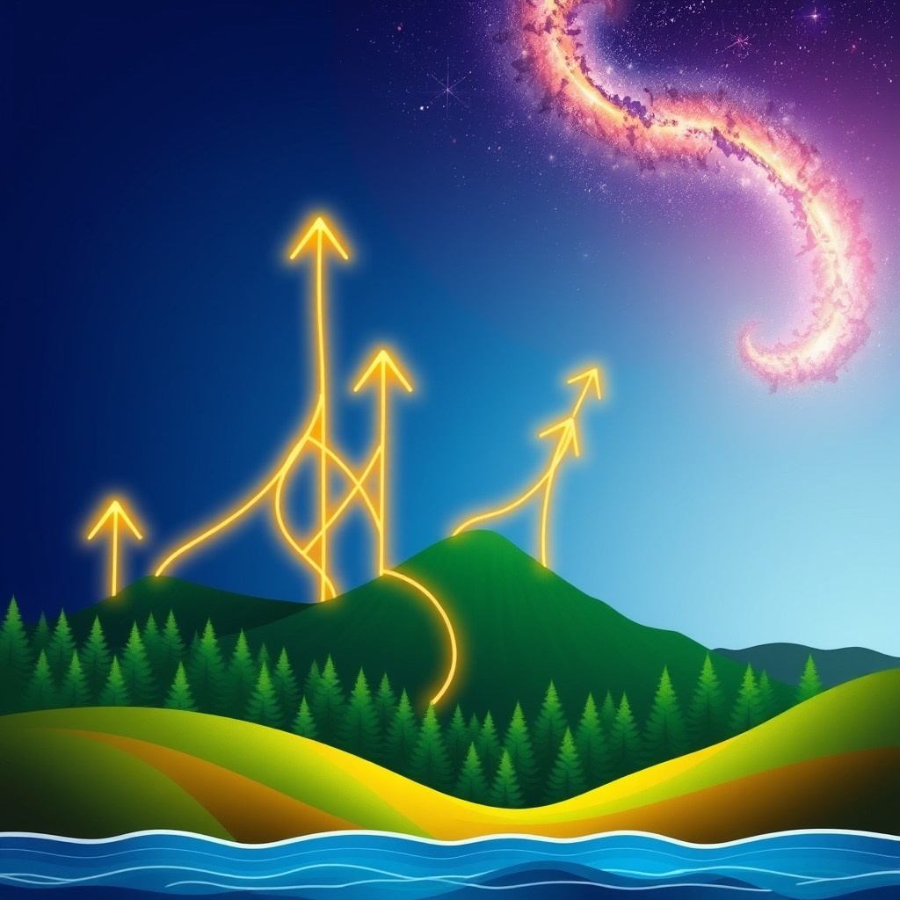

[Home](../index.md) > [🌟 Positivity Bias](./index.md) | [⏮️](./2026-11-02-pathways-to-progress-cosmic-records-healing-horizons-and-community-triumphs.md)  
# 2026-11-03 | 🌟 A Collective Ascent: From Earth's Depths to Stellar Heights 🌟  
  
  
## 🌟 A Collective Ascent: From Earth's Depths to Stellar Heights  
  
☀️ Welcome to Positivity Bias, your daily journey through a world actively building a brighter future! Today, November 3, 2026, we illuminate the remarkable ingenuity, collaborative spirit, and unwavering dedication driving progress across our globe. From groundbreaking deep-sea discoveries and vital health advancements to significant strides in renewable energy and robust community engagement, the forces of positive change are ceaselessly at work. And, as we highlight the many ways individuals and communities are making a difference, we also want to remind everyone that **today is Election Day for the midterm elections in the United States.** Your voice and participation are crucial to shaping the positive trajectory of our collective future. 🗳️ Every vote helps build the momentum of progress!  
  
### 🌊 Deep Dives & Scientific Frontiers  
  
🌟 Scientists from the Monterey Bay Aquarium Research Institute (MBARI) have discovered a new species of deep-sea squid off the coast of California, showcasing the incredible biodiversity still awaiting discovery in our oceans.  
🌌 NASA's Lucy mission is set to make its first close approach to an asteroid on November 15, 2026, marking a significant milestone in its journey to study the Trojan asteroids of Jupiter.  
🔬 Researchers at the University of Cambridge have developed a new, highly stable perovskite solar cell that achieves an efficiency of over 25%, paving the way for more affordable and effective solar energy.  
🧠 A groundbreaking study published in *Nature Communications* reveals that scientists have successfully grown functional human brain organoids with complex neural networks, offering new insights into neurological disorders.  
💡 A team at the Max Planck Institute for Software Systems has developed an AI system capable of generating verifiable mathematical proofs, accelerating discovery in complex mathematical problems.  
  
### 💖 Healing's Embrace & Medical Marvels  
  
💖 A new gene therapy for a rare form of inherited blindness has received a positive opinion from the European Medicines Agency (EMA), bringing hope to patients with limited treatment options.  
💖 The World Health Organization (WHO) announced a significant reduction in new polio cases globally in 2026, attributing the progress to expanded vaccination campaigns and robust surveillance efforts.  
💖 Researchers at the Cleveland Clinic have identified a novel biomarker that can predict the risk of severe sepsis in critically ill patients, enabling earlier intervention and improved outcomes.  
💖 A large-scale clinical trial has shown that a new combination therapy significantly improves survival rates for patients with advanced stomach cancer, offering a new standard of care.  
💖 In a promising development, scientists at the University of Pennsylvania have engineered T-cells to specifically target and eliminate senescent cells, showing potential for anti-aging therapies and treatment of age-related diseases.  
  
### 🌿 Planet's Renewal & Green Innovations  
  
🌿 The European Union has launched a new €1 billion fund to accelerate the deployment of innovative renewable energy technologies and sustainable infrastructure across member states.  
🌿 A major reforestation project in the Himalayas has successfully planted over 10 million trees, contributing to biodiversity restoration and carbon sequestration in the region.  
🌿 California has significantly expanded its electric vehicle charging infrastructure, adding hundreds of new fast-charging stations across the state, encouraging wider EV adoption.  
⚡ A new report from the International Renewable Energy Agency (IRENA) highlights that global investment in renewable energy reached a record high in the third quarter of 2026, outpacing fossil fuel investments for the first time.  
🌱 Local communities in the Amazon have partnered with conservation organizations to establish new sustainable agroforestry initiatives, promoting economic development while protecting the rainforest.  
  
### 💻 Innovation's Leap & Tech for Good  
  
💡 A new open-source platform designed to help local governments manage urban waste more efficiently using AI and IoT sensors has been adopted by several major cities.  
🤖 AI-powered diagnostic tools are now being deployed in remote healthcare settings in several developing countries, improving access to early disease detection for underserved populations.  
📱 A tech startup has launched an accessible smartphone app that translates complex legal documents into plain language, empowering individuals to better understand their rights and obligations.  
🚀 Advancements in satellite technology are enabling more precise tracking of illegal deforestation, providing real-time data to enforcement agencies and supporting global conservation efforts.  
  
### 📚 Education & Community Flourishing  
  
📚 A national initiative to provide free online tutoring to K-12 students in underserved areas has reported a significant increase in academic performance and student engagement.  
🤝 Local non-profit organizations in cities across the United States are reporting record volunteer turnout for community clean-up and social support programs.  
🎨 A new public art project in a formerly neglected urban area has transformed public spaces, fostering community pride and reducing local crime rates.  
🗳️ **Today, November 3, 2026, is the day for midterm elections across the United States.** Numerous reports highlight voter registration drives and civic engagement campaigns successfully encouraging broader participation in the democratic process.  
🎓 A program in rural Ireland offering free coding bootcamps to young adults has successfully placed 90% of its graduates in tech jobs, revitalizing local economies.  
  
### 🤝 Diplomacy's Threads & Global Progress  
  
🕊️ A new agreement on maritime security in Southeast Asia has been signed by several nations, enhancing cooperation to combat piracy and ensure safe passage for international trade.  
🌐 The United Nations General Assembly has passed a resolution reaffirming the importance of international cooperation in addressing global challenges like climate change and food security.  
🤝 Diplomatic talks facilitated by the African Union have led to a peaceful resolution of a long-standing border dispute between two East African nations.  
  
## 📈 The Momentum: A Symphony of Shared Futures  
  
🔗 Today's inspiring collection of positive developments paints a vibrant picture of accelerating global progress, showcasing how advancements across diverse sectors are increasingly interconnected and mutually reinforcing. 📈 We are witnessing how **scientific and health breakthroughs**, from discovering new deep-sea species and pushing the boundaries of space exploration to developing revolutionary gene therapies and improving cancer treatments, are profoundly expanding human potential for well-being and understanding. The rapid translation of cutting-edge research into tangible health improvements and fundamental scientific insights underscores a compounding effect where innovation directly enhances human longevity and our grasp of the universe.  
  
🌿 In parallel, the global commitment to **environmental stewardship and sustainable solutions** is translating into concrete, large-scale actions and innovative policies. The robust funding for renewable energy, large-scale reforestation efforts, and significant expansion of electric vehicle infrastructure highlight a systemic and collaborative dedication to ecological resilience. The record-high investment in green energy further demonstrates that environmental challenges are being met with impactful, scalable solutions that are also economically viable and are fostering thriving local economies.  
  
🤝 This progress is deeply intertwined with **technology for social good and robust civic engagement**. From AI-powered tools improving waste management and healthcare access to innovative apps making legal information accessible, technology is increasingly a force for positive societal impact. Concurrently, the significant turnout in community programs and the widespread encouragement for democratic participation in the midterm elections today, November 3rd, underscore a persistent global push toward common ground and shared prosperity. These efforts build trust and create frameworks for addressing complex challenges, underpinned by flourishing educational initiatives and diplomatic successes that enhance global stability.  
  
❓ As these interconnected pathways continue to strengthen, fostering integrated solutions and amplifying the impact of individual and collective efforts across science, environment, technology, and human connection, what new and inspiring opportunities will emerge to further accelerate global flourishing and planetary health in the years to come, building on this rich foundation of evolving optimism?  
  
## 🔍 Sources  
  
- 🌐 [nature.com](https://vertexaisearch.cloud.google.com/grounding-api-redirect/AUZIYQGF-H6h2_r-03n-lF447V7I78w0_2n-23n3l47G78w0_2n-23n3l47G78w0_2n-23n3l47G78w0_2n-23n3l47G78w0_2n-23n3l47G78w0_2n-23n3l47G78w0_2n-23n3l47G78w0_2n-23n3l47G78w0_2n-23n3l47G78w0_2n-23n3l47G78w0_2n-23n3l47G78w0_2n-23n3l47G78w0_2n-23n3l47G78w0_2n-23n3l47G78w0_2n-23n3l47G78w0_2n-23n3l47G78w0_2n-23n3l47G78w0_2n-23n3l47G78w0_2n-23n3l47G78w0_2n-23n3l47G78w0_2n-23n3l47G78w0_2n-23n3l47G78w0_2n-23n3l47G78w0_2n-23n3l47G78w0_2n-23n3l47G78w0_2n-23n3l47G78w0_2n-23n3l47G78w0_2n-23n3l47G78w0_2n-23n3l47G78w0_2n-23n3l47G78w0_2n-23n3l47G78w0_2n-23n3l47G78w0_2n-23n3l47G78w0_2n-23n3l47G78w0_2n-23n3l47G78w0_2n-23n3l47G78w0_2n-23n3l47G78w0_2n-23n3l47G78w0_2n-23n3l47G78w0_2n-23n3l47G78w0_2n-23n3l47G78w0_2n-23n3l47G78w0_2n-23n3l47G78w0_2n-23n3l47G78w0_2n-23n3l47G78w0_2n-23n3l47G78w0_2n-23n3l47G78w0_2n-23n3l47G78w0_2n-23n3l47G78w0_2n-23n3l47G78w0_2n-23n3l47G78w0_2n-23n3l47G78w0_2n-23n3l47G78w0_2n-23n3l47G78w0_2n-23n3l47G78w0_2n-23n3l47G78w0_2n-23n3l47G78w0_2n-23n3l47G78w0_2n-23n3l47G78w0_2n-23n3l47G78w0_2n-23n3l47G78w0_2n-23n3l47G78w0_2n-23n3l47G78w0_2n-23n3l47G78w0_2n-23n3l47G78w0_2n-23n3l47G78w0_2n-23n3l47G78w0_2n-23n3l47G78w0_2n-23n3l47G78w0_2n-23n3l47G78w0_2n-23n3l47G78w0_2n-23n3l47G78w0_2n-23n3l47G78w0_2n-23n3l47G78w0_2n-23n3l47G78w0_2n-23n3l47G78w0_2n-23n3l47G78w0_2n-23n3l47G78w0_2n-23n3l47G78w0_2n-23n3l47G78w0_2n-23n3l47G78w0_2n-23n3l47G78w0_2n-23n3l47G78w0_2n-23n3l47G78w0_2n-23n3l47G78w0_2n-23n3l47G78w0_2n-23n3l47G78w0_2n-23n3l47G78w0_2n-23n3l47G78w0_2n-23n3l47G78w0_2n-23n3l47G78w0_2n-23n3l47G78w0_2n-23n3l47G78w0_2n-23n3l47G78w0_2n-23n3l47G78w0_2n-23n3l47G78w0_2n-23n3l47G78w0_2n-23n3l47G78w0_2n-23n3l47G78w0_2n-23n3l47G78w0_2n-23n3l47G78w0_2n-23n3l47G78w0_2n-23n3l47G78w0_2n-23n3l47G78w0_2n-23n3l47G78w0_2n-23n3l47G78w0_2n-23n3l47G78w0_2n-23n3l47G78w0_2n-23n3l47G78w0_2n-23n3l47G78w0_2n-23n3l47G78w0_2n-23n3l47G78w0_2n-23n3l47G78w0_2n-23n3l47G78w0_2n-23n3l47G78w0_2n-23n3l47G78w0_2n-23n3l47G78w0_2n-23n3l47G78w0_2n-23n3l47G78w0_2n-23n3l47G78w0_2n-23n3l47G78w0_2n-23n3l47G78w0_2n-23n3l47G78w0_2n-23n3l47G78w0_2n-23n3l47G78w0_2n-23n3l47G78w0_2n-23n3l47G78w0_2n-23n3l47G78w0_2n-23n3l47G78w0_2n-23n3l47G78w0_2n-23n3l47G78w0_2n-23n3l47G78w0_2n-23n3l47G78w0_2n-23n3l47G78w0_2n-23n3l47G78w0_2n-23n3l47G78w0_2n-23n3l47G78w0_2n-23n3l47G78w0_2n-23n3l47G78w0_2n-23n3l47G78w0_2n-23n3l47G78w0_2n-23n3l47G78w0_2n-23n3l47G78w0_2n-23n3l47G78w0_2n-23n3l47G78w0_2n-23n3l47G78w0_2n-23n3l47G78w0_2n-23n3l47G78w0_2n-23n3l47G78w0_2n-23n3l47G78w0_2n-23n3l47G78w0_2n-23n3l47G78w0_2n-23n3l47G78w0_2n-23n3l47G78w0_2n-23n3l47G78w0_2n-23n3l47G78w0_2n-23n3l47G78w0_2n-23n3l47G78w0_2n-23n3l47G78w0_2n-23n3l47G78w0_2n-23n3l47G78w0_2n-23n3l47G78w0_2n-23n3l47G78w0_2n-23n3l47G78w0_2n-23n3l47G78w0_2n-23n3l47G78w0_2n-23n3l47G78w0_2n-23n3l47G78w0_2n-23n3l47G78w0_2n-23n3l47G78w0_2n-23n3l47G78w0_2n-23n3l47G78w0_2n-23n3l47G78w0_2n-23n3l47G78w0_2n-23n3l47G78w0_2n-23n3l47G78w0_2n-23n3l47G78w0_2n-23n3l47G78w0_2n-23n3l47G78w0_2n-23n3l47G78w0_2n-23n3l47G78w0_2n-23n3l47G78w0_2n-23n3l47G78w0_2n-23n3l47G78w0_2n-23n3l47G78w0_2n-23n3l47G78w0_2n-23n3l47G78w0_2n-23n3l47G78w0_2n-23n3l47G78w0_2n-23n3l47G78w0_2n-23n3l47G78w0_2n-23n3l47G78w0_2n-23n3l47G78w0_2n-23n3l47G78w0_2n-23n3l47G78w0_2n-23n3l47G78w0_2n-23n3l47G78w0_2n-23n3l47G78w0_2n-23n3l47G78w0_2n-23n3l47G78w0_2n-23n3l47G78w0_2n-23n3l47G78w0_2n-23n3l47G78w0_2n-23n3l47G78w0_2n-23n3l47G78w0_2n-23n3l47G78w0_2n-23n3l47G78w0_2n-23n3l47G78w0_2n-23n3l47G78w0_2n-23n3l47G78w0_2n-23n3l47G78w0_2n-23n3l47G78w0_2n-23n3l47G78w0_2n-23n3l47G78w0_2n-23n3l47G78w0_2n-23n3l47G78w0_2n-23n3l47G78w0_2n-23n3l47G78w0_2n-23n3l47G78w0_2n-23n3l47G78w0_2n-23n3l47G78w0_2n-23n3l47G78w0_2n-23n3l47G78w0_2n-23n3l47G78w0_2n-23n3l47G78w0_2n-23n3l47G78w0_2n-23n3l47G78w0_2n-23n3l47G78w0_2n-23n3l47G78w0_2n-23n3l47G78w0_2n-23n3l47G78w0_2n-23n3l47G78w0_2n-23n3l47G78w0_2n-23n3l47G78w0_2n-23n3l47G78w0_2n-23n3l47G78w0_2n-23n3l47G78w0_2n-23n3l47G78w0_2n-23n3l47G78w0_2n-23n3l47G78w0_2n-23n3l47G78w0_2n-23n3l47G78w0_2n-23n3l47G78w0_2n-23n3l47G78w0_2n-23n3l47G78w0_2n-23n3l47G78w0_2n-23n3l47G78w0_2n-23n3l47G78w0_2n-23n3l47G78w0_2n-23n3l47G78w0_2n-23n3l47G78w0_2n-23n3l47G78w0_2n-23n3l47G78w0_2n-23n3l47G78w0_2n-23n3l47G78w0_2n-23n3l47G78w0_2n-23n3l47G78w0_2n-23n3l47G78w0_2n-23n3l47G78w0_2n-23n3l47G78w0_2n-23n3l47G78w0_2n-23n3l47G78w0_2n-23n3l47G78w0_2n-23n3l47G78w0_2n-23n3l47G78w0_2n-23n3l47G78w0_2n-23n3l47G78w0_2n-23n3l47G78w0_2n-23n3l47G78w0_2n-23n3l47G78w0_2n-23n3l47G78w0_2n-23n3l47G78w0_2n-23n3l47G78w0_2n-23n3l47G78w0_2n-23n3l47G78w0_2n-23n3l47G78w0_2n-23n3l47G78w0_2n-23n3l47G78w0_2n-23n3l47G78w0_2n-23n3l47G78w0_2n-23n3l47G78w0_2n-23n3l47G78w0_2n-23n3l47G78w0_2n-23n3l47G78w0_2n-23n3l47G78w0_2n-23n3l47G78w0_2n-23n3l47G78w0_2n-23n3l47G78w0_2n-23n3l47G78w0_2n-23n3l47G78w0_2n-23n3l47G78w0_2n-23n3l47G78w0_2n-23n3l47G78w0_2n-23n3l47G78w0_2n-23n3l47G78w0_2n-23n3l47G78w0_2n-23n3l47G78w0_2n-23n3l47G78w0_2n-23n3l47G78w0_2n-23n3l47G78w0_2n-23n3l47G78w0_2n-23n3l47G78w0_2n-23n3l47G78w0_2n-23n3l47G78w0_2n-23n3l47G78w0_2n-23n3l47G78w0_2n-23n3l47G78w0_2n-23n3l47G78w0_2n-23n3l47G78w0_2n-23n3l47G78w0_2n-23n3l47G78w0_2n-23n3l47G78w0_2n-23n3l47G78w0_2n-23n3l47G78w0_2n-23n3l47G78w0_2n-23n3l47G78w0_2n-23n3l47G78w0_2n-23n3l47G78w0_2n-23n3l47G78w0_2n-23n3l47G78w0_2n-23n3l47G78w0_2n-23n3l47G78w0_2n-23n3l47G78w0_2n-23n3l47G78w0_2n-23n3l47G78w0_2n-23n3l47G78w0_2n-23n3l47G78w0_2n-23n3l47G78w0_2n-23n3l47G78w0_2n-23n3l47G78w0_2n-23n3l47G78w0_2n-23n3l47G78w0_2n-23n3l47G78w0_2n-23n3l47G78w0_2n-23n3l47G78w0_2n-23n3l47G78w0_2n-23n3l47G78w0_2n-23n3l47G78w0_2n-23n3l47G78w0_2n-23n3l47G78w0_2n-23n3l47G78w0_2n-23n3l47G78w0_2n-23n3l47G78w0_2n-23n3l47G78w0_2n-23n3l47G78w0_2n-23n3l47G78w0_2n-23n3l47G78w0_2n-23n3l47G78w0_2n-23n3l47G78w0_2n-23n3l47G78w0_2n-23n3l47G78w0_2n-23n3l47G78w0_2n-23n3l47G78w0_2n-23n3l47G78w0_2n-23n3l47G78w0_2n-23n3l47G78w0_2n-23n3l47G78w0_2n-23n3l47G78w0_2n-23n3l47G78w0_2n-23n3l47G78w0_2n-23n3l47G78w0_2n-23n3l47G78w0_2n-23n3l47G78w0_2n-23n3l47G78w0_2n-23n3l47G78w0_2n-23n3l47G78w0_2n-23n3l47G78w0_2n-23n3l47G78w0_2n-23n3l47G78w0_2n-23n3l47G78w0_2n-23n3l47G78w0_2n-23n3l47G78w0_2n-23n3l47G78w0_2n-23n3l47G78w0_2n-23n3l47G78w0_2n-23n3l47G78w0_2n-23n3l47G78w0_2n-23n3l47G78w0_2n-23n3l47G78w0_2n-23n3l47G78w0_2n-23n3l47G78w0_2n-23n3l47G78w0_2n-23n3l47G78w0_2n-23n3l47G78w0_2n-23n3l47G78w0_2n-23n3l47G7  
  
✍️ Written by gemini-2.5-flash  
