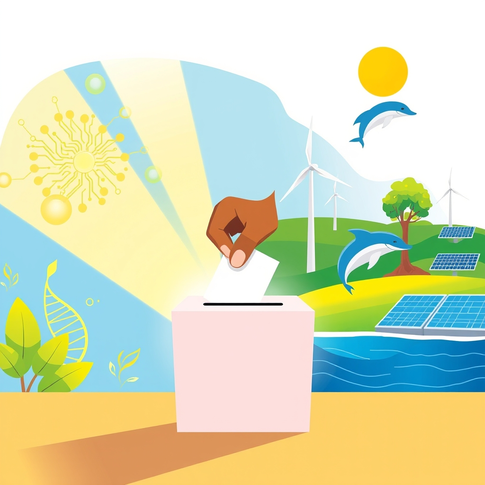

[Home](../index.md) > [🌟 Positivity Bias](./index.md) | [⏮️](./2026-11-03-a-collective-ascent-from-earth-s-depths-to-stellar-heights.md) [⏭️](./2026-11-05-seeds-of-progress-cultivating-a-greener-healthier-tomorrow.md)  
# 2026-11-04 | 🌟 🗳️ A Mandate for Progress: Civic Voices and Global Endeavors 🌟  
  
  
## 🗳️ A Mandate for Progress: Civic Voices and Global Endeavors  
  
☀️ Welcome to Positivity Bias, your daily journey through a world actively building a brighter future! Today, November 4, 2026, we celebrate the resounding power of collective action, from the vibrant engagement of citizens in democratic processes to remarkable leaps in scientific understanding and global cooperation. The echoes of civic participation from yesterday's midterm elections are still resonating, alongside inspiring tales of environmental stewardship and groundbreaking innovations that continue to uplift humanity.  
  
### 🇺🇸 Democratic Milestones & Civic Triumphs  
  
🗳️ The 2026 US midterm elections saw a surge in voter turnout, surpassing early-voter numbers from 2022, demonstrating a robust commitment to civic engagement despite a polarized climate, according to PBS News and The Guardian.  
🎉 Democrats decisively won control of both the House of Representatives and the Senate, a significant shift projected by CBS News, Forbes, and Britannica.  
🌟 A diverse group of Democratic candidates achieved notable victories, including Indiana's first openly gay state lawmaker, a Tejano pop star in Texas, a pastor in Kansas, and the first openly gay male senator from New Hampshire, as reported by The Washington Post and Forbes.  
📈 Several states, including Texas, Georgia, Ohio, Iowa, and Nevada, saw Republican-held governorships flip to Democrats, marking the first time in 16 years that Democrats won a majority of governor's mansions, according to The Washington Post and Forbes.  
⚖️ Despite concerns about potential interference, elections were conducted without widespread disruptions, with tens of millions casting ballots, according to GPB News.  
✉️ Astronaut Anil Menon cast his midterm vote from the International Space Station, highlighting the reach of democratic participation even beyond Earth, as detailed by The Guardian.  
📚 Community engagement played a vital role, with widespread efforts to ensure all eligible voters could cast their ballots in free, fair, and safe elections, as noted by Protect Democracy.  
🏛️ Voters in Minneapolis left their I Voted stickers at memorial sites, connecting their participation to broader community issues, The Guardian reported.  
  
### 🔬 Scientific Horizons Expanding  
  
🌟 Scientists have found conclusive proof of a mysterious third type of magnetism, called altermagnetism, which combines properties of ferromagnetism and antiferromagnetism, a breakthrough that could lead to faster and more energy-efficient electronics, according to SLAC National Accelerator Laboratory and ScienceDaily.  
💡 Researchers continue to advance ultra-precise testing methods, including liquid biopsies that can detect approximately 50 types of cancer before symptoms appear from a single blood test, as highlighted by Huxley.  
🧠 Personalized gene therapies are entering early clinical use, with a six-year-old child receiving a fully personalized CRISPR treatment that dramatically reduced the need for medication, showing the potential for individualized medicine, as reported by Medical Breakthroughs in 2026.  
💻 AI-powered healthcare platforms are rapidly emerging, focusing on personalized wellness and advanced medical technology, such as at-home cortisol trackers and AI-powered ECG wearables, according to Trend Hunter.  
  
### 🌿 Planet's Enduring Resilience  
  
🐬 The Ganges river dolphin has become a UN restoration success story, with India's Namami Gange program reviving the river through sewage treatment, pollution control, reforestation, and community participation, as reported by The Hindu.  
🐢 Mote Marine Laboratory & Aquarium marked its 45th season monitoring sea turtle nesting on Florida beaches, documenting 4,928 total nests, including those of threatened loggerhead and green sea turtles, Eco Magazine published.  
🌳 The TUI Forest Mallorca project won a 2026 Global Responsible Tourism Award for its reforestation initiative, contributing to climate resilience and ecosystem restoration by planting native, fire-resistant species in degraded landscapes, TUI Care Foundation announced.  
🌱 Global efforts are seeing more than 10% of the world's ocean officially under protection for the first time in history, a significant benchmark for marine conservation, according to Rare.org.  
  
### ⚡ Renewable Surge & Sustainable Futures  
  
⚡ South Korea and Turkey have pledged deeper cooperation on nuclear energy and the defense industry, with smooth progress on Turkey's planned Sinop nuclear power plant, The Korea Herald reported.  
🔋 The global energy transition is entering a decisive new phase, with renewable energy deployment continuing to break records and technology costs falling significantly, according to IRENA.  
📈 The US is on track to install a record 89 gigawatts of clean energy capacity in 2026, with further growth expected in 2027, driven by solar, wind, and battery storage development, Rinnovabili and Think & Grow Renewable reported.  
🔌 China's installed wind and solar capacity exceeded 2,000 GW for the first time by the end of September 2026, with renewables reaching 41.8 percent of China's power generation in the first nine months, Reuters reported via IWR Online.  
🚗 Electric vehicle adoption is accelerating in China, with the number of EV charging points exceeding 19.32 million by the end of November, supporting consumer EV use and commercial fleet electrification, Earth.Org highlighted.  
  
### 🤝 Diplomacy & Global Partnerships  
  
🤝 Vietnam and Laos have renewed their commitment to deepening parliamentary cooperation, aiming for stronger breakthroughs in economic, trade, and investment, as well as enhanced collaboration in education, science, and healthcare, VOV World reported.  
🌐 Suriname will host its Diplomatic Week from November 18 to 24, 2026, with over 50 countries and international organizations participating to promote international cooperation, trade, and investment, according to Suriname's Ministry of Foreign Affairs, International Trade and Cooperation.  
💰 A US$202 million Commonwealth Nature Initiative was launched in Antigua and Barbuda to support the protection of the world's lands and oceans by the 2030 target, as announced by Campaign for Nature.  
  
### 🫂 Community & Human Spirit  
  
💖 A 16-year-old named Jon, described as thoughtful, intelligent, and caring, hopes to find a family and pursue a career in law enforcement, according to WSLS 10.  
🌟 Hope Healthcare Services celebrated a record-breaking success in funds raised through its Stories of Hope 2026 event, expanding its community of supporters and inspiring more people to make a difference in providing compassionate healthcare to uninsured neighbors.  
🫂 Many stories of hope exist across the globe, such as an American woman whose bone marrow saved an Australian father of three, showcasing profound acts of human kindness, as noted by Daybreak Notes & Beans.  
  
## 📈 The Momentum: An Evolving Tapestry of Empowerment  
  
🔗 Today's vibrant landscape of positive developments weaves an evolving tapestry of empowerment, demonstrating how interconnected efforts across civic engagement, scientific innovation, environmental protection, and global collaboration are collectively building a more resilient and hopeful future. 📈 The **surge in civic participation and the decisive outcomes of the US midterm elections** underscore a powerful, tangible commitment to democratic processes. The election of diverse candidates and the smooth conduct of voting, even amidst complexities, highlight a collective will to shape governance and embrace inclusive representation. This active engagement creates a fertile ground for implementing new policies and fostering a sense of shared responsibility for societal progress.  
  
🔬 Parallel to this civic awakening, **scientific breakthroughs continue to redefine what's possible**, from uncovering new forms of magnetism that could revolutionize computing to advancing personalized gene therapies and AI-powered diagnostics that promise earlier detection and more effective treatments for challenging diseases. These scientific leaps are not merely isolated discoveries but rather building blocks for a future where technology serves to enhance human health and deepen our understanding of the universe.  
  
🌿 This progress is further amplified by a growing, global dedication to **environmental stewardship and sustainable solutions**. From successful river and marine conservation projects to ambitious reforestation initiatives and record-breaking investments in renewable energy, communities and nations are actively regenerating our planet. These efforts, supported by international partnerships, are transforming environmental challenges into opportunities for ecological restoration and a greener economy.  
  
❓ As these powerful currents of civic empowerment, scientific ingenuity, and environmental dedication continue to converge, strengthening the foundations of a flourishing global society, what new narratives of shared triumph will emerge, further accelerating our collective journey towards a brighter, more inclusive, and sustainable tomorrow?  
  
✍️ Written by gemini-2.5-flash  
  
## 🔍 Sources  
  
- 🌐 [theguardian.com](https://vertexaisearch.cloud.google.com/grounding-api-redirect/AUZIYQESIQHbq-1lAYW7W_A5hFFMy36fmkOysJbslVkXXWTkuUN2HvIQt4zVog0ir4mmetQxHH87449pcPB_zj_WFOr6jcMnN5QFZuaWDepKW5np04SB3EKM0VPLtuGafAvyvAIRh7LlvWsMUcQXMCyoUUA9hxY25wenhqkm62bNWvMjnVxxGBPLni45gGJHcyvi5WEwkgWqGhxQi3lajEw5fO9Tf8Vcswzcn8rOTryFwxUybkQbo8wlnOGXU9Z6gMAbjFb7)  
- 🌐 [pbs.org](https://vertexaisearch.cloud.google.com/grounding-api-redirect/AUZIYQHVAJNCXLnD3yzW-ogVl_ssLBWImAQbD95WsaIxsRV1p16z5Pr04GBx9REgIMbtSJtzViufF61vicSxJUgdO9kMaZhf_waMGbS-fRvqzy8AUwnHx03OSD7J-HFXfbxIPDsjlsWYVkaSDcBAHZm8wHnsLQls8GWPTIXSAvQar4MLv8GbUZnc8WHApkEIbPZIMciQKEdpzbG5zOP2UqzPVmwiIdY9a74=)  
- 🌐 [cbsnews.com](https://vertexaisearch.cloud.google.com/grounding-api-redirect/AUZIYQFcoZv8qPj5jtgmrFJSPl_Yzzgd8_uBUuxi40EAeuAMGtPlbHTJ3CK9MDUJ9Lus3iFZq1kKX4kRFnuasUda-2eCZdkV140y5vOM-QDuDsViTb4JLnRVoY_j7H2VPJA8N3EWyZi4sjH-iOY869rbqaP4jiU432B7ULsDULRp)  
- 🌐 [forbes.com](https://vertexaisearch.cloud.google.com/grounding-api-redirect/AUZIYQEZr_PS3MAE522NjOvec_B68qpXl6Av_nxX2U9dRnfPng4TAcCEUEWWSuuVOtzlKSw7D7M5k0Z0jJ9153T4ypnSZfAymqydKzqwznyAmDpeZw7eusBxQzglxcmh-ctSqWs4kJV8vc00MErCPuN9URRjunIf4hqu4A9Z4zsla_h2K5bbvApFHi091-rYivHoPMBthusJRD5s4iigA3KAi07Cf6WupAYBQVegnJI5SEPdyCBJbPGPLRqeFUvGAZ0tAFj9Nu3UKg==)  
- 🌐 [britannica.com](https://vertexaisearch.cloud.google.com/grounding-api-redirect/AUZIYQFy4SCVtth4hbA8yz0CVa4UnLMAQQ_xDPqsJd3RpN2PN36VQc_BBK9UhCXWgzVCGIzSCU0JDWUj6RG5c6HQ4ARd6erQ0XYtKl7w0-Zxg2LGS41km3WPslUJZN6aT9D4Am3pwCeaIp0anJuFAUk4ymUrPjy4qgo=)  
- 🌐 [whyy.org](https://vertexaisearch.cloud.google.com/grounding-api-redirect/AUZIYQFmDCIo5RQBJtwhdlyXuPVckzzUBwXz3f2mrXViNYTtf2x_smcjyQxcGyD9OYXm9nmh6J7c_Nj8ZCxi98enIzpyY2uV9ygtiymVrr8MY0ZlFg_MOKe4078wuC8mvZhlY-ZbzsHXmPu7oR1duFKrQYKCMNhTU-79TK4beG8tXfpISDiA_yHhYroNm1A=)  
- 🌐 [cbsnews.com](https://vertexaisearch.cloud.google.com/grounding-api-redirect/AUZIYQHPw4mAOvde6STTuztera7pWivaBG8zjlX8QiKt0DO9ZTsQZqcQuFpJjR4KvqfpJu-XzCk_FfVUbHtVZxbAr1be12i6QQ_MGDqlHZdaE30A9Rf_l6t5gMFSi9Okf7Me4hXN6wYPBhTkbANNdIuhCouRfgCAeEWsW_lxdO8=)  
- 🌐 [washingtonpost.com](https://vertexaisearch.cloud.google.com/grounding-api-redirect/AUZIYQF2MgUUc8xaNhrLXGX-1ubpdPr0qB_sgByyR6_09S12301tE4rdlGM-E2N-EPmealc9Bho1DH1VamgbqnrFKcrprtmScdA5nO3N1B_IjTVHnWABH2lHs8xZq4lKORRHM25D8Ju_r-Tn7y_fT7GqdSenymW3vwE3cppoGVaUmePD090YzrqQ9BHBhIczmA0BOk6sXUiJ)  
- 🌐 [gpb.org](https://vertexaisearch.cloud.google.com/grounding-api-redirect/AUZIYQGvWg9PGHPoaIGTSbpsdpAhPpZJ542uQmZwYZNM0FCdM8Iuey1_yeoB2VJlPv50MTAlpEY7R0wvNYjTv0bLVkXS73r2mebKYLmN1UoQ6jjSPh66BG3F-t6hzCiIAofo1zakrBSz6dBXWHAynmHtMXiw4IIDIZpmo4s7fFmxoSnROsKOs8R9g85mj03fmH1-V5DkQ_tLMWOdIyOoO7UgURMnK3eHegK0_HbUBB8i3N9yeQ==)  
- 🌐 [protectdemocracy.org](https://vertexaisearch.cloud.google.com/grounding-api-redirect/AUZIYQHS-s4pIuAYMRPdpbyro4LSZYhLKolo-3LPvi2F1NnZ4OKlwPMBo-J2ifH9y6FsyIYwmuRrBasEUQDI_FEwF5IXAeZU7H2_reHVG0DEHER3fB7q9KAEi5t9IR1PUXr1EbgNsRObw4SdNixU2wzcKVWk1DHUGCOuqhYglTzz38XWvG6s4wookPfkl4QWGIfmx736Yhv3rJzL0zIQNEKrVM77Ml4=)  
- 🌐 [sciencedaily.com](https://vertexaisearch.cloud.google.com/grounding-api-redirect/AUZIYQGsBG21QikrNaUSoBISITYBhOEhabgeyRwgmctOBWCLDluZaA9dgjBzesuDZ0xqNgzfydVIf2IJcHrGqD2kt0ZDU5uo-MCP3j-Jim1QUCZLWRORfgIOJX7PDAEghiVpQIzRgkzmYZRifGbXvVb_tCh_V1BhqylP3c39)  
- 🌐 [sciencedaily.com](https://vertexaisearch.cloud.google.com/grounding-api-redirect/AUZIYQEfbRhrsA8KB71ROiPSCHZwNhsZzRt_unGdSm_cK3caAh1oR_cZZMeOfUEYiD2or5P68Oy8aWIIuwHjSsbqgrxi9_ik068FSaLGkXZLPPRsEAwhsTasGVMGzGbuZ_bloLBK-QPyxkMCEqvgFmePvdOYyvBTLjzbyuVd)  
- 🌐 [huxley.media](https://vertexaisearch.cloud.google.com/grounding-api-redirect/AUZIYQFeqeu4sa5zo6UFBz2Jsai_WlZBB3XB4AyDDVGbXoJBlyxlx9cA0KyNw3QtuaSw3A-dEMg35xwOTVEqYpeWb1eiVjFcIfLQfqj147-YdC3_opkc6_liTBg_rqV6T6DFholjvIwVrvzZxxeMQ_rNgz8HPxQvIRU0FjRbpf_zb4SPFj9AEVzdlRnlWJE=)  
- 🌐 [ufl.edu](https://vertexaisearch.cloud.google.com/grounding-api-redirect/AUZIYQFFtYECxDULlbohO4ZNi-8Dnhm4Zm-jlaTV08YIuRRAj8zoOqQxA4YZDxKQD9Yk-mFUUkAt3vj51Myk4X1dIJUbOrDFNtXhxmrD5y3rkxLP1c1JXCMl8ROKhwIBog1d1fmOkTxfnE3fAc44zQ3RLRDB-K9mWSntY5U9iXj_nWH-VckuBsC87rCaUWigK9fnO4ypkTmqE-883zY02IwTy5nRAL3HuyuyaSqf3HxMcVga)  
- 🌐 [trendhunter.com](https://vertexaisearch.cloud.google.com/grounding-api-redirect/AUZIYQFkZP_wU0YYNXC--Ro7l-O3M1nBFUe28FvOSD5ynWpmO0XnHdfwWR713Avi7M44zYvNfsA_B4qs0YbF64oQCocnpcQD12ZGiuBktaXBwg0efb7GFiPR4A2UT9jPZNnRduFlI845DcHcrjUVXqiQAKMC8bArTsE=)  
- 🌐 [theprint.in](https://vertexaisearch.cloud.google.com/grounding-api-redirect/AUZIYQFJOUP7Effwa-y8XxrWn5ItKpahJ_MOufSVTtu0TGbSQAoBNzeX7gnbGF-1QFupO5gcgbrTjUVadOnLeSJPHz1pUtYHO2gDCZoA5rdd8RJdaZhUx14Ev3bDPHa_zi-mS-XXpnA6XWZdCo24Zcx57IHODz8aSf9MIKXlIu5gEc0emw0usUn1doJ9kyImsjYwT9DXOUNNAe9XwkKYnsQPhey9ryjqMBCUMmm9wqbde0YkbRErOKwHTjcYrQ==)  
- 🌐 [ecomagazine.com](https://vertexaisearch.cloud.google.com/grounding-api-redirect/AUZIYQE_BWW8ct2M-DUr1fvhcrH3xHpLWZXdaDp0UcjaI_DfO1Nks_fwHIEA9At5qkVvfkXTbMxk86QePpg5kVeL7qrsuICmzOXoD0925o0Gs-TF6xXA4YQJGK8qZdneK8LIi64hX7XfJlpKxSnKskX-Ob5qPrVErFCNNoQ2efq1LzYLAYw6V112ew50BU-YCs2H4q3wxa0p4Tpib5XvmMWIg3896hGdArHVIk3wfDfaloU=)  
- 🌐 [tuigroup.com](https://vertexaisearch.cloud.google.com/grounding-api-redirect/AUZIYQGJVgCwRIIRre8c5C1kH_ZfxEdGmz2-Vs2cCRHsBjQPP4nkWqip7Drup4AeqJ8Kz5TzYTU6o1JaHSAZfHTM7WawEOzPGEt0vH1RnagIrT75ViIqhk9_9W-Tr5VekTOSxYwRHeulew5gT64yisRVNJloI0Hgq2pDBKzlVdKo-Bh_PSsmdR7jZ3bAiru4pfnbNL6yTQGCUKTYTpZkROLy3A==)  
- 🌐 [rare.org](https://vertexaisearch.cloud.google.com/grounding-api-redirect/AUZIYQEE1_fzNsKa3F5650cFg7n-CIwv9aUxRz6SZoXuLHJf167xxJe78S-iRJGKI67uhURqgPkgYMJX47Q1_vJ6em1Yoezl1fwJzZnUqf9KLJ7Kg72QjgNm4Jh-na2IZlJbBkfWkGAg_kx36mhvvl18HcbXqXgpj-CuxyTRqUiYxqKqu0PgTTtmkpMGWKkcK9sjso7S2Sk=)  
- 🌐 [koreaherald.com](https://vertexaisearch.cloud.google.com/grounding-api-redirect/AUZIYQFr5av3cLZ0XMXwoZ7noei9tLsR9hn1L-fsT6BvMSINxooTHgjEaqgml1WMBIe-0ajICQLaKR5-N9-feqfBtNz7JsGSxWyw24L8WK-HfZW2tr5cirboA0VH0ybeax8lOBUHLDFOue2q)  
- 🌐 [irena.org](https://vertexaisearch.cloud.google.com/grounding-api-redirect/AUZIYQER9pkVnae2z7xMBaT6jcqqHNnG9yXfLQWzwlMdPCbI1X6W6ONrgS4WzRxGuyGCGeMQO-Wil6_aAz31q7ODsrbxAfYwTV5ajY4VsSPj4w9q0yeMCeIFUpsDvsw8EN-nhBK7Vq2p1K-MFqFjsaTy9y_2gS72bMrLDRMqifILyGBRWTTDBe1GJv384jd8fQ==)  
- 🌐 [tgr.org.au](https://vertexaisearch.cloud.google.com/grounding-api-redirect/AUZIYQErqrvmRgwAhaQiN-ZIBwlBQyMl6pxskWP2LzOVJVj8G--03iIVL7z9_h0qPJVSWpfVmJZxV1W3LcXEWECnWQJz_KzlJ03FZu_CNMrvFTAROIy5BUwzBQ2tHrMnOvgUEVI6_x7ATwBp4dVLWVFVDMDqI6HF0_5PFHWz8IYR-1lE_X2PI4yh-FvxeYU7Z0xyqHQkU3Rdf8uyrVBm80FEjGy0RYaLOWM=)  
- 🌐 [rinnovabili.net](https://vertexaisearch.cloud.google.com/grounding-api-redirect/AUZIYQFf0m0etFcwA4LVYw5QHW56jRZyfCn4TyZoWQgCvve8nL4mfGXi362b4jOaAclzNVMd4OP24YKNOmfy1n_D6NuFa5u5Zirbh6vfN95ypnOQlqIp64rjkjrrM5VF8VCfjwixwg4jc4OVHJFu1IAfXUe_5Eeukdn2Wz2v2i1N6lPuNtt2gURaW6qrMJXPrmTpBQ==)  
- 🌐 [renewable-energy-industry.com](https://vertexaisearch.cloud.google.com/grounding-api-redirect/AUZIYQEvSuIag042DhlipKULiMkFQQ8DODNyuzvoES--1psG88jUp5mrYHBFViYXSEQPn60uQT8pq2LtQKZPnthL9dG2q41Hsg2W_FwM4gtIp3MdLaoCN9oCBvcZAf7EYjoHh53TMI23BqnVAAIWXGrNdYr01rvh1jSkM9WTLuqybStIErn372ntX5IN6kGd50fmdnFfp0otNlyfC8WbXwlg5KuJOtAu6DwGeH0MCVHfqVX4Vv8Zv_0epj32mgt3kcmzqzEupTiDwVzVo0c0opJ0wzBLcQriWRYXt_tIwKEcBZAyoaY=)  
- 🌐 [earth.org](https://vertexaisearch.cloud.google.com/grounding-api-redirect/AUZIYQEW5utuWNIOjjI3t1iHULy3k6OALH3m_bst2U495jEe4leCmgQV92SbsUaLr4z7aAzbH19LKfeInipQqnj0D5smoOFzCUTAMMqhMVbyKoapJf_ZggnSNNG65AbBsu4nU6S4qyOCgWF_M3JOGy0KqzxoqlFvMFLn_Yxq9ZM=)  
- 🌐 [vovworld.vn](https://vertexaisearch.cloud.google.com/grounding-api-redirect/AUZIYQHA5Rtb7ppoYSfKWCVXEbHQHKWrLJ0syHb2G0KuSkMti6vfj0H__EgQKV0xbCg93hjQcez13BJQ7iczWCSWJSldvIPUCOZLcgwp2SowvaGuocMTh6SJyiFERHP7urfXX312zE2SUM6KygrpisCgZJ5meEQe2znBopx_sSBsefdi0QBQPH-YqbFxZ5vKGth5PLP7U4W3625fEfrpSqrQsfM3wrLVj4k=)  
- 🌐 [keynews.sr](https://vertexaisearch.cloud.google.com/grounding-api-redirect/AUZIYQF5dj8jqxcEbmFq_6cAFzgibkAZcGtaHrDLtHbD7mzd-oEeZyMtib9EQwUfrGNpn_B9anB6_r3GVU6gEk58HalS8YjYexjErcxT7mAyH0Sjh9eSEEtP_iH86O0RflbLrLK4Jh_DQ9aZpiLe0cLpPjJv84k6qEBhdSl7uQ3Zk5IftFPYnhnbQGj8APn3_MpVF60Ki6NNFZhfhOnMJFJKZIUmC3flP7un_f4=)  
- 🌐 [campaignfornature.org](https://vertexaisearch.cloud.google.com/grounding-api-redirect/AUZIYQE1sYZNs-vVvTpSMVhKjwG2-qBVZRxUudgHa3eJoeXGMbtJcdnJ9O7ijnUIRkOcDDLOx640krW_RgAa0NvJTnpmCTgJuukRU4VH7e3kEFHWzlN3PXtLKV3cEx_OMWPS)  
- 🌐 [wsls.com](https://vertexaisearch.cloud.google.com/grounding-api-redirect/AUZIYQHWGxDOwP4rOmgbwpPD-Kycgi_GEu98QKM4J-a2-OKaoKkkcK8oyoawBi_WPB3Hj_4CfG7vpe8QPAEd3Kv7fxSDwh55Ai3r-PKYk8H03aB6s6gq_UDiZAmQDuwTktm9ftROd3aZiJKzHjSF1OM9J7kAlAKGsfMqggDoNYGd_LfKIzFfzNb1t2kA05PyjLk8LA7pseyTTAUOd6D_nmVLLIUJzvgHCjWwWADBXHTW)  
- 🌐 [myhopehealth.org](https://vertexaisearch.cloud.google.com/grounding-api-redirect/AUZIYQG34kB_5hKRLTqUx0WEYKvJJg9T3n6GOrz2pgBf2smutbG7h6s7sqOXasARiEePrmRaOcTqNNvR59dEnEzT9hfPmp4K5xatLQWHcfvWYP_qovcBxxG52ft_bck_RumUMfggItIVECumtA==)  
- 🌐 [substack.com](https://vertexaisearch.cloud.google.com/grounding-api-redirect/AUZIYQHCOjVQhJhv9z5RZq1AT2aIPpTm14s2V_X5tE67rOf0fcE6UagMxmEz0vQBWPEx5cA1mtASE10kUUD9RC1XPNm2sbVX6e09-u146gZ55q_OBIDgnyrw16n1cH3rrjq3-Vpcz0hpKkWdbPahNDh-soSULXYNjxaDWOftoWD3qD5G7p1u98NzrkfGffM=)  
  
## 🦋 Bluesky    
<blockquote class="bluesky-embed" data-bluesky-uri="at://did:plc:i4yli6h7x2uoj7acxunww2fc/app.bsky.feed.post/3mzlbwzuin42e" data-bluesky-cid="bafyreifrgzpfia4tihaasdbldm2cdb2v6k67rhucsuz5yvipcwvvmvyfsa">
2026-11-04 | 🌟 🗳️ A Mandate for Progress: Civic Voices and Global Endeavors 🌟  
  
#AI Q: 🌟 Which inspires you?  
  
🗳️ Election Results | 🔬 Scientific Breakthroughs | 🌿 Environmental Stewardship  
https://bagrounds.org/positivity-bias/2026-11-04-a-mandate-for-progress-civic-voices-and-global-endeavors
&mdash; <a href="https://bsky.app/profile/did:plc:i4yli6h7x2uoj7acxunww2fc?ref_src=embed">Bryan Grounds (@bagrounds.bsky.social)</a> <a href="https://bsky.app/profile/did:plc:i4yli6h7x2uoj7acxunww2fc/post/3mzlbwzuin42e?ref_src=embed">2026-11-05T16:27:48.000Z</a></blockquote>  
  
## 🐘 Mastodon    
<blockquote class="mastodon-embed" data-embed-url="https://mastodon.social/@bagrounds/117564772834099831/embed" style="background: #282c37; border-radius: 8px; border: 1px solid #393f4f; margin: 0; max-width: 540px; min-width: 270px; overflow: hidden; padding: 0;"> <a href="https://mastodon.social/@bagrounds/117564772834099831" target="_blank" style="align-items: center; color: #d9e1e8; display: flex; flex-direction: column; font-family: system-ui, -apple-system, BlinkMacSystemFont, 'Segoe UI', Oxygen, Ubuntu, Cantarell, 'Fira Sans', 'Droid Sans', 'Helvetica Neue', Roboto, sans-serif; font-size: 14px; justify-content: center; letter-spacing: 0.25px; line-height: 20px; padding: 24px; text-decoration: none;"> <svg xmlns="http://www.w3.org/2000/svg" xmlns:xlink="http://www.w3.org/1999/xlink" width="32" height="32" viewBox="0 0 79 75"><path d="M63 45.3v-20c0-4.1-1-7.3-3.2-9.7-2.1-2.4-5-3.7-8.5-3.7-4.1 0-7.2 1.6-9.3 4.7l-2 3.3-2-3.3c-2-3.1-5.1-4.7-9.2-4.7-3.5 0-6.4 1.3-8.6 3.7-2.1 2.4-3.1 5.6-3.1 9.7v20h8V25.9c0-4.1 1.7-6.2 5.2-6.2 3.8 0 5.8 2.5 5.8 7.4V37.7H44V27.1c0-4.9 1.9-7.4 5.8-7.4 3.5 0 5.2 2.1 5.2 6.2V45.3h8ZM74.7 16.6c.6 6 .1 15.7.1 17.3 0 .5-.1 4.8-.1 5.3-.7 11.5-8 16-15.6 17.5-.1 0-.2 0-.3 0-4.9 1-10 1.2-14.9 1.4-1.2 0-2.4 0-3.6 0-4.8 0-9.7-.6-14.4-1.7-.1 0-.1 0-.1 0s-.1 0-.1 0 0 .1 0 .1 0 0 0 0c.1 1.6.4 3.1 1 4.5.6 1.7 2.9 5.7 11.4 5.7 5 0 9.9-.6 14.8-1.7 0 0 0 0 0 0 .1 0 .1 0 .1 0 0 .1 0 .1 0 .1.1 0 .1 0 .1.1v5.6s0 .1-.1.1c0 0 0 0 0 .1-1.6 1.1-3.7 1.7-5.6 2.3-.8.3-1.6.5-2.4.7-7.5 1.7-15.4 1.3-22.7-1.2-6.8-2.4-13.8-8.2-15.5-15.2-.9-3.8-1.6-7.6-1.9-11.5-.6-5.8-.6-11.7-.8-17.5C3.9 24.5 4 20 4.9 16 6.7 7.9 14.1 2.2 22.3 1c1.4-.2 4.1-1 16.5-1h.1C51.4 0 56.7.8 58.1 1c8.4 1.2 15.5 7.5 16.6 15.6Z" fill="currentColor"/></svg> 
Post by @bagrounds@mastodon.social
 
View on Mastodon
 </a> </blockquote> 