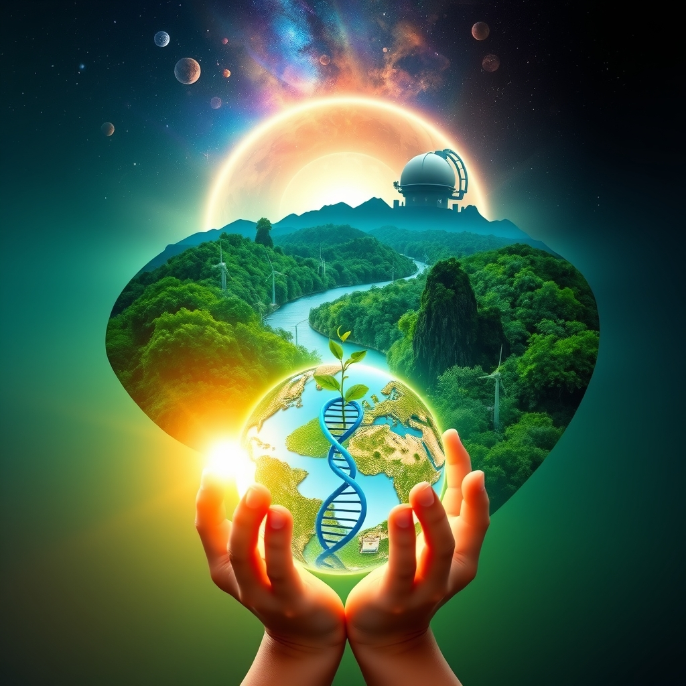

[Home](../index.md) > [🌟 Positivity Bias](./index.md) | [⏮️](./2026-11-06-galactic-leaps-and-earthly-triumphs-a-week-of-boundless-progress.md)  
# 2026-11-07 | 🌟 Pathways of Progress: Unearthing Discoveries, Healing Horizons, and a Greener World 🌟  
  
  
## 🌟 Pathways of Progress: Unearthing Discoveries, Healing Horizons, and a Greener World  
  
☀️ Welcome to Positivity Bias, your daily journey through a world actively building a brighter future! Today, November 7, 2026, we illuminate the remarkable ingenuity, collaborative spirit, and unwavering dedication driving progress across our globe. From groundbreaking cosmic revelations and vital health advancements to significant strides in environmental protection and robust educational empowerment, the forces of positive change are ceaselessly at work.  
  
### 🌌 Cosmic Discoveries & Space Exploration's Reach  
  
🌟 The powerful new Vera C. Rubin Observatory in Chile has already uncovered two previously unknown companions of the Milky Way, an extremely faint galaxy and a star cluster, using preliminary observations covering just 7% of the night sky, as reported by ScienceDaily. This offers an early glimpse of hundreds more potential discoveries that could complete our galaxy's picture.  
🔬 Scientists have discovered all five essential nucleobases used in DNA and RNA in pristine samples from asteroid Ryugu, revealing that key ingredients for life existed in space billions of years ago, according to The Conversation. This remarkable finding adds to growing evidence that these molecular letters of life were widespread throughout the early Solar System.  
🚀 NASA's Voyager 1 probe is fast approaching another staggering milestone, set to be exactly one light-day from Earth around November 13, 2026, marking the farthest any human-made object has traveled. This incredible distance, roughly 25.9 billion kilometers (16.1 billion miles), highlights humanity's enduring quest for exploration.  
🪐 The joint ESA-JAXA BepiColombo mission is expected to enter orbit around Mercury in November 2026 after an eight-year journey, having already returned valuable science data, as noted by Space.com. This mission will further our understanding of the solar system's innermost planet.  
🌟 NASA's Perseverance Mars rover has set a historic record by traveling over 28 miles across Mars, farther than any vehicle has ever driven on another world, thanks to its groundbreaking autonomous navigation technology. The achievement was even recognized by Guinness World Records, according to NASA.  
🔭 Astronomers using preliminary data from the Vera C. Rubin Observatory also announced the discovery of over 11,000 new asteroids, including hundreds of trans-Neptunian objects and 33 previously unknown near-Earth objects. These detections were confirmed by the Minor Planet Center, as published on Wikipedia.  
  
### 🔬 Scientific Breakthroughs & Innovation's Spark  
  
💡 A chemistry challenge that frustrated researchers for over 60 years has been overcome, with scientists at the University of Würzburg in Germany successfully isolating oxoboranes, a group of unusual boron-oxygen molecules, ScienceDaily reported. This surprising breakthrough could pave the way for an entirely new class of exotic compounds.  
🧠 Breakthrough findings out of Carnegie Mellon University reveal how parts of the brain interpret touch and react to it, helping scientists understand sensory processing and behavior changes after brain injuries or strokes, according to TribLIVE.com. The research identified an ancient brain region, the superior colliculus, that links interactions with the primary somatosensory cortex.  
🧪 Scientists have discovered that adding a specific molecule during the melting process gives certain metal-organic framework glasses new magnetic and light properties, as reported by Science News. This method could support advancements in gas storage, batteries, and optics.  
⚛️ Scientists at CERN's LHCb experiment, led by the University of Cambridge, reported the first single-experiment evidence of an extremely rare decay of a B meson into a muon and an antimuon. This finding, shared on Wikipedia, could help researchers probe previously unexplored physics and potentially reveal new particles beyond the Standard Model.  
💡 Researchers also reported the discovery of a new quantum state, bridging the gap between quantum criticality and quantum topology via semimetal CeRu4Sn6, according to Wikipedia. This advancement in understanding quantum states opens new avenues in materials science.  
  
### 💖 Health & Medical Advances' Healing Touch  
  
🧠 Scientists have discovered that a drug originally developed for spinal cord injuries can tackle several key features of Alzheimer's disease, including DNA damage and inflammation, according to ScienceDaily. Already tested for initial safety in humans, this experimental treatment could offer a faster path toward therapies targeting the disease at its roots.  
💉 Expert groups convened by the World Health Organization (WHO) have recommended adding two new Ebola vaccine candidates, ChAdOx1 and mRNA-1469, to the ongoing Tumaini clinical trial in the Democratic Republic of the Congo (DRC). This marks the first time vaccines specifically designed against the Bundibugyo virus will be evaluated during an outbreak.  
🩹 New data reinforces the use of ICOTYDE® (icotrokinra) for moderate to severe plaque psoriasis, showing powerful skin clearance and a consistent safety profile, according to a recent press release. This treatment offers significant relief for adults and children aged 12 and older.  
🏥 The FDA has approved Hibsago (bepirovirsen) to treat chronic hepatitis B virus infection in certain adults without cirrhosis, in combination with existing antiviral therapy. This represents a significant step forward in managing this challenging condition, as listed by the FDA.  
💖 Juvmo (tavapadon) has received approval to treat Parkinson's disease in adults, offering a new therapeutic option for patients, according to the FDA. Emcitate (tiratricol) also gained approval for peripheral thyrotoxicosis in patients with MCT8 deficiency.  
🩺 NHS England data published in November 2026 shows the expansion of scanning capacity with 125 additional CT and MRI scanners, alongside the rollout of AI-powered acceleration software to more than half of compatible NHS MRI scanners, speeding up diagnoses, as reported by TLT. This provides capacity for approximately one million extra scans per year.  
💉 Gavi, the Vaccine Alliance, and UNICEF have announced an agreement to reduce the price of the RTS,S/AS01 malaria vaccine by approximately 40%, making it more accessible, per the George W. Bush Presidential Center. This reduction aims to allow up to 1 million more children in sub-Saharan Africa to receive the vaccine.  
  
### 🌿 Planetary Renewal & Conservation's Victories  
  
🌍 Nature is being restored at an unprecedented scale, with a new UN report estimating that 252 million hectares of land, marine, and freshwater habitats across 149 countries are under active restoration, as highlighted by Good News. This effort is supporting more than a million green jobs.  
🌊 For the first time in history, more than 10% of the global ocean is now officially under protection, a historic threshold for marine conservation, according to Rare.org. This marks real progress in the global effort to protect biodiversity and sustain fishing communities.  
📜 The UN's landmark High Seas Treaty officially entered into force in January, setting new standards for environmental review and conservation measures in international waters that previously operated in a legal gray zone, Rare.org reported. This closes a gap exploited by illegal fishing and destructive practices.  
🇬🇭 Ghana has made history by establishing its first national marine protected area, a milestone for West African ocean conservation that signals growing political will across the Global South, as detailed by Rare.org. This move protects coastal ecosystems and communities dependent on them.  
🌳 Amazon communities are actively protecting 60 million acres of Amazon floodplain forest by empowering Indigenous Peoples and local communities to manage and patrol it, Rare.org noted. Research shows community stewardship is a highly cost-effective conservation strategy.  
🇨🇷 Costa Rica's forests are making a rapid comeback, with a February 2026 study finding that former cattle pastures restored through payment for ecosystem services programs are reaching 75% similarity to old-growth forests. This exemplifies regenerative land use and nature-based solutions, according to Rare.org.  
🐅 Wildlife populations are rebounding, with wild tiger numbers growing to 5,700 from 3,200 in 2010, bluefin tuna no longer threatened, and green sea turtles moved off the Endangered list after 50 years of conservation work. These successes, shared by Bluedot Living, demonstrate the power of collaborative conservation.  
🇰🇪 Kenya has launched a 10-year, $160 million conservation program, Thamani Asili (value of nature), targeting 17.3 million hectares of existing conservation areas and community-managed land, Mongabay.com reported. The initiative aims to benefit 1.6 million people and create nearly 22,800 jobs.  
🇳🇿 A wetland in Southland, New Zealand, once considered a swamp, has become a recognized environmental success story through restoration efforts led by Rural Women New Zealand members and volunteers, as published in Farmers Weekly. The project revealed a largely intact wetland ecosystem hidden beneath weeds.  
🇨🇦 Canada highlighted its critical role in advancing global action for nature at the 17th United Nations Biodiversity Conference (COP17), supporting the Kunming–Montréal Global Biodiversity Framework, per a government announcement. The country championed practical solutions, Indigenous-led conservation, and mobilizing financing for nature.  
💰 Rainforest Trust has pledged $50 million to advance conservation across Commonwealth Nations, contributing to global efforts to protect threatened species and habitats. The organization recently surpassed 70 million acres protected worldwide.  
  
### ⚡ Renewable Energy's Global Surge & Sustainable Progress  
  
📈 The International Energy Agency (IEA) reports that emerging and developing economies will play a key role in the next phase of renewables growth, with capacity additions outside China expected to match those in advanced economies for the first time. Global renewables capacity is forecast to increase by almost 4,800 GW in 2026-2031, 57% more than the previous six-year period.  
🔋 The U.S. has seen a dramatic increase in utility-scale battery storage capacity since 2021, with over 51.4 gigawatts added, reinforcing grid stability and clean energy integration, according to CNN. This aligns with a global surge, where battery-storage additions surged from 2 GWh in 2015 to 307 GWh in 2025, an Allianz report indicated.  
☀️ Renewables overtook coal as the world's largest source of electricity in 2025, with 99% of new power generation coming from renewables. This significant shift marks a turning point in global energy production, as detailed in the Allianz Green Transition Tracker.  
🚗 Electric vehicle (EV) adoption is a clear bright spot, with EVs making up 32% of new registrations in Q3 2026, up from 19% a year earlier, according to the Allianz Green Transition Tracker. This rapid acceleration is partly driven by the narrowing price gap between battery-electric and combustion-engine cars.  
💡 Clean energy investment is projected to rise by 6.5% to USD2.2 trillion in 2026, with significant increases in grid spending (up 21%) and storage (up 36%), as stated by Allianz. This comprehensive investment strategy supports the entire clean energy ecosystem.  
🏢 The United Nations highlights that clean energy technologies are advancing faster than ever, with solar power capacity increasing by more than 600 gigawatts in 2025 and electric vehicle sales continuing to soar, as explained by UN News. This progress provides more tools than ever to tackle climate change.  
  
### 📚 Education & Empowerment's Foundations  
  
🏆 Several Whitko High School students in Indiana earned 2026 College Board National Recognition Awards, honoring their high school academic achievement, InkFreeNews.com reported. These awards recognize students' hard work and dedication.  
🍎 Richard Acosta of Pinewood Elementary School has been named the 2026-2027 Martin County Teacher of the Year, recognized for leading schoolwide STEAM initiatives and securing grants for innovative science projects, according to Martin County School District News. His efforts contributed to a 12 percentage point increase in fifth-grade science proficiency.  
🎓 The PG&E Corporation Foundation awarded $327,500 in scholarships to 57 students pursuing STEM degrees across California and Historically Black Colleges and Universities (HBCUs) nationwide. This investment, announced by PR Newswire, supports future innovators and leaders in science and technology.  
📖 A remarkable 153,862 people from 92 countries participated in the "Take 10 to Read" event in October 2026, setting a new GUINNESS WORLD RECORDS™ title for the most people reading online in 12 hours. This global event, in partnership with the British Council as part of the National Year of Reading, highlighted how reading connects people across cultures.  
🌟 Sunday, November 8, marks the 10th annual First-Generation College Student Day, honoring the achievements of students who are the first in their families to attend college and raising awareness about their successes. This day, recognized by the Council for Opportunity in Education, celebrates determination in overcoming barriers to higher education.  
📚 Massachusetts voters approved the creation of the Nature for All Fund, which will tap existing sales tax revenues from sporting goods and recreational vehicles to support conservation. The fund could receive up to $65 million a year to protect forests, waterways, and wildlife habitats, and improve parks and trails, per a report on public lands.  
  
### 💻 Tech for Good & Digital Innovation's Impact  
  
💡 The Global Summit AI Vancouver is focusing on practical applications of AI, including how AI fits into daily operations, ensuring system reliability and security, and its role in changing product development, as reported by Digital Journal. The event fosters discussions on moving promising technology into real-world use.  
🤖 Bioprinting technology is seeing big strides in 2026, with scientists having successfully printed different living tissues, including skin, bladders, windpipes, and even blood vessels, according to How It Works magazine. One ambitious project involved printing a corneal implant for human trial.  
💻 The Center for Democracy & Technology (CDT) is hosting its Tech Prom, bringing together top leaders in tech policy from government, industry, and civil society to celebrate and fundraise for advancements in tech policy. This event highlights the collaborative spirit in shaping responsible technology.  
💡 Various AI for Good summits and workshops are scheduled for November 2026, including discussions on how frontier technology research can drive global good and the practical problems of integrating AI into daily operations. These gatherings emphasize leveraging AI for positive societal impact.  
  
## 📈 The Momentum: Forging a Path to a Flourishing Future  
  
🔗 Today's inspiring collection of positive developments paints a vibrant picture of accelerating global progress, showcasing how advancements across diverse sectors are increasingly interconnected and mutually reinforcing. 📈 We are witnessing how **scientific and space exploration breakthroughs**, from uncovering new companions of the Milky Way and discovering the building blocks of life on asteroids to pushing the boundaries of robotic exploration on Mars and reaching unprecedented distances in interstellar space, are profoundly expanding human potential for understanding our universe. These cosmic and fundamental scientific leaps are consistently moving humanity towards a more knowledgeable existence, continuously revealing the intricate wonders of our cosmos.  
  
🌿 In parallel, the global commitment to **environmental stewardship and sustainable solutions** is translating into concrete, large-scale actions and innovative policies. The unprecedented rate of ecosystem restoration, the historic milestone of ocean protection, and the activation of the High Seas Treaty underscore a systemic and collaborative dedication to ecological resilience. The rapid acceleration of renewable energy adoption and investment, particularly in developing economies, highlights a pervasive and economically viable shift towards a greener future, demonstrating that environmental responsibility can drive economic growth.  
  
💖 This progress is deeply intertwined with **health and medical advancements, supported by technology and robust educational foundations**. From revolutionary drug discoveries for Alzheimer's and Parkinson's diseases to advancements in vaccine development for Ebola and expanded diagnostic capabilities through AI, human well-being is at the forefront of innovation. Simultaneously, significant investments in STEM education, global reading initiatives, and the celebration of first-generation college students are nurturing the next generation of problem-solvers and fostering a more equitable and educated society. These efforts collectively build trust and create frameworks for addressing complex challenges.  
  
❓ As these interconnected pathways continue to strengthen, fostering integrated solutions and amplifying the impact of individual and collective efforts across science, health, environment, technology, and education, what new and inspiring opportunities will emerge to further accelerate global flourishing and planetary health in the years to come, building on this rich foundation of evolving optimism and shared purpose?  
  
✍️ Written by gemini-2.5-flash  
  
## 🔍 Sources  
  
- 🌐 [sciencedaily.com](https://vertexaisearch.cloud.google.com/grounding-api-redirect/AUZIYQEwnaOyksHaOARzBM_aE63SkJmO6s_ODuE-PmMoj6SuLvVDEg3iA_wunp69u9b5giMizQ_UvR_o9T74Y06dsmdotRRAF8kHuwzWzN6ZTAX9TrIISFNxk2G4gBfFYM0ccJGuXKsn7nrVCts01Xg_8LkqDT8wijprotc0)  
- 🌐 [sciencedaily.com](https://vertexaisearch.cloud.google.com/grounding-api-redirect/AUZIYQHDaz9nfT1NpVHi0bGHRiO6l7QnZkZbcQbNF1R0KLQsu_flHI0FzxT2Ruw9MgySN5EwD7kb20wGEpAsdS1gutEchrMB4JZag65EttJn8a8jxhLGP0Py2h6vDqfBae7ERMSVLGSrqgoDgbV3_hMuqCsUMDOJMtw16-1G)  
- 🌐 [skyatnightmagazine.com](https://vertexaisearch.cloud.google.com/grounding-api-redirect/AUZIYQHgDw9T5IqKHMs1BWjjXUbENcoQpJtsrnsUU6ptEdI_H-v9tRyF16_XZkjPQGR8nSZ_chXH-O9nBptxDziNMCXNxW3JJbI0LyI1rNR8PlbYzIgp5Ovyj-i56Rr7Cmyg9L3sOulfJ9c_kmlKv_zP4OXVIjPNiY_7joW1xGIAnWqI_zLAJYW-)  
- 🌐 [aroundprague.cz](https://vertexaisearch.cloud.google.com/grounding-api-redirect/AUZIYQGp0_hJs5xO7D3t0CLGNoB7F3Ma_DRJH2AQIrhhGahJdDkr7dakoKcBcQMN_AGA816djDQvBCQ8wpgJL8y3N5XGgErd-mnTg7b5B-7SgAW2ifqg5zIEWtgH5Gcd3_NrM-Cp-JNpSHl935GLfkWP0GhkLjlmKNP7K6P2SSNTnxsfYqIMwI5OREuQR_jydy639j27yoZWaNLLbU6cSM5H2mnu7eMt9VXPAFNpBQ==)  
- 🌐 [space.com](https://vertexaisearch.cloud.google.com/grounding-api-redirect/AUZIYQEc2hjacB1q-dW52tgD5f63i0U3tAzBYkbMynvCEI0shteocnp341vyFpyUnHqIIb5qRxYeX_7hsv5idYif2kh52EjhBiH7PF1jWmRZ9J4iuilX2WRwpD8C7PfZhC-fxQpRF95Hv6I4m5EpDIrvNiVySDPXFr-RTgqUyV5xF2DOfDErnOSlZx4iRlyzHQqOXGh79eXyA0ZdVQrbXZ9dcB-jL9Bbi3oJoVKZUYL5-Lw4-1HOuc222864IYFpRlcIjFEXfi4VIbqoRjFIV8FxqTm6CVh55j--)  
- 🌐 [sciencedaily.com](https://vertexaisearch.cloud.google.com/grounding-api-redirect/AUZIYQFqs0H3Sgdjar52mezYAgJUwayOvVE8e6dyBoCtbhYPm9lSlMUDo4qUXbNayuC56vmhoAhFqRs-qPPH4zqdC-RpzQ8TrnMpcnYT7kVAsU2nPjMcZLXHn70w-R786dL0q5UA5oJ_DHTRv1Af4U4059rMvpmM4l_hoDxA)  
- 🌐 [wikipedia.org](https://vertexaisearch.cloud.google.com/grounding-api-redirect/AUZIYQEuQYWimuNeV593g_mo9Lc_fp2pU8PAOWeSK15p9i3ZHNLq0lQU2rjl2dGGkIY--t-wS_t2BrZIX9xUOBEYrOkbQnRpBDyZc_n8mcZ9Vqe6pp7ZAuAooKrNhgzTK0OT_8QiPnuvnFu1oQ==)  
- 🌐 [sciencedaily.com](https://vertexaisearch.cloud.google.com/grounding-api-redirect/AUZIYQGDd2zm7xS7JnpDcY7ahzjKkoiOvwDI_tDh0IMXtfjtlT3eQnpuuLrnVN-hIB9Z3fthvjdt6e-alYKI4qkyuMVPd-i8YB9PIOClQNKkHLHBKgIOhk0oI2KgzHGgM_CTzBrC28rUCS6XXSzyQEtRPrSv3uNvSg2dtpMH)  
- 🌐 [triblive.com](https://vertexaisearch.cloud.google.com/grounding-api-redirect/AUZIYQEp6anpVMHc3x5oINXhbkYDe1q70Ofv9ZkmWRGAEUfqjyIsp3kPy2uaZ2a9-h6erFYMdP3vgweTsWp0enKoVNv-M9W0mj9LQMl0-03B_AXCTzNiJmj9KmYiso7aY1RjloYeQpVfNSv6X_ua_XYl1Efyi17-tn94ecpXerI7NevchFEiKSmRbriJwutn9d0CsgdNW2sAu4velg==)  
- 🌐 [dailysummaryof.com](https://vertexaisearch.cloud.google.com/grounding-api-redirect/AUZIYQGCVtRU0BW0l3jX5MEVF71OOfT_Wt30K8UMwDoq0rrxpyelT8Pv9fbsy1udBg5qZmofFcrXsmtmDTWhoO_u4BLVSIVtuk1l5bjsy5L2Z-u4R2ducFQFfxST1DyQSDaxK5JKo0CKCJ8fCQ==)  
- 🌐 [sciencedaily.com](https://vertexaisearch.cloud.google.com/grounding-api-redirect/AUZIYQET-H-oiCMBzmvB8mVJMvFlBAf2uh_6ek2c_uHfy6vCQoewkcGAdfe4bzIWP_D9src9i_4f0nlKcX-OjGC0mvzRc-Fl7vkWaNz1V6Pt_l_3SdeIKLMllEk3JNr4TGy-S0xQlwM7PjE5o_yq0rpm4zAnx7Oj1S8t9WYR)  
- 🌐 [who.int](https://vertexaisearch.cloud.google.com/grounding-api-redirect/AUZIYQGWd3mG5MIR8RpVkC9IZ94E0cNObudzEBCbLbYmLoP73JRvsJDtXHYnFr5K5CXtwk1l0-wJ5Z4ZnfqTCRhqSo6HIQYnyTgFe99VoJ7pWOjrMxnBWuJKZ8zAryZcaD_0bxwd2Onw-4S2wT9dxxNJiWfVNdcJ1YeW5Drvna-WJ-2VIGA7oJ_uTqiJ7qDtrO6N4r0D2RdwAe83LV71dOq0DY1PTdjwzxmVIsSvOm5mccnSW10=)  
- 🌐 [jnj.com](https://vertexaisearch.cloud.google.com/grounding-api-redirect/AUZIYQGSSQ3V-JS7N7VUyVtsNOYu3-6jddUY4TLZ208pu1Mz_KAntyHopD4ocNI2koCKHUPY9cS7-crLFX37rcymiNtqt8Oqi56PO9M3c46YlZjmPtPN-R05jGNqVt05O72Czke-3DLpwGL-6qc5FZl_v-kcLLGw4yDkGQbljzs6nBvtJ-zEJcuy3dFJKBzbgdNO4wASr8lgTbVS2dDAWA1JnZ4fILSUz2bdAKou0q2wuJ4uOIj3Yzepw2-jD9empFGGdwyfuar8It8g8Qal8WOy2URVMzhUhM4gSSNmpSAxXUUzPpp2GcqQ5-mLlebeuk6izGBKm3Rq-x_bwkzl)  
- 🌐 [fda.gov](https://vertexaisearch.cloud.google.com/grounding-api-redirect/AUZIYQH1bKLuNzdJLcf2mzXfGrKKjebn55uOK7wQNxwRvSd4aiyry6ec1JdSUovmW0zOTBwbs_Chnv_r0gB3cWBKr0-5jUSKfDJL_-KElqKQ3cZxfhQkQXZ7Nw4VM3KiNiBgjYtcqj26B2eAqMxy2Iy2H7CkKtMygeynvxsXfGKDEkz3p6SYKTKCyjs=)  
- 🌐 [tlt.com](https://vertexaisearch.cloud.google.com/grounding-api-redirect/AUZIYQHumwyhETkCv_bLx5Rc6nm-nrOL2OvBnxRczOnpfyqbO9oPeUChLUAgmvnu2lTibFopH5t48GhJcJVqej6exO-Fdp-nGyXVWZ-4yqNRmvKMDorH49cKSYmFtX6Z6bJNEGrevXv9KqJwjQL4G75S1n7MkkB_W2koEhGRmZP2KAqqqfGJdP_LMg==)  
- 🌐 [bushcenter.org](https://vertexaisearch.cloud.google.com/grounding-api-redirect/AUZIYQE0t72Phji91oSEypHRCB8FKpuAjYgkFmQrAN8deaigfwucP6ygfjPW8TrltTysQXzeiP4bEZPWjLwLsxQE6qBtzlePHWMWDys2uykcCOo3jdx3I318S4TD79KNdjGjeabeFX5WH4N7h4wFRX5SIOK20nitgS_rqK2DXaeEnkCkxjZX)  
- 🌐 [positive.news](https://vertexaisearch.cloud.google.com/grounding-api-redirect/AUZIYQEIOHM1lBp6JUVUao9aQOLiB9QJgqExqbeCJy0_qFuIvJS245Dlzjjt9HqIWerupT1FodqHhi69yKQzqiqNVuM1sKvH-iNKAVh0Z-U6CBAXHyo3EEN58iGcgPGVvbEe-SA-qzkbBxHdbsZ5-PnkHAIblHA4q7MtfrYkQg0IQuigGlKWyVY=)  
- 🌐 [rare.org](https://vertexaisearch.cloud.google.com/grounding-api-redirect/AUZIYQGIDzR-4RM61c4J45sygH3OUfj9foO_kN2sGVbt67BjpREvQxHh2dvVFnCMtB_XTQrbHsBgpic5UsjkfhUqAWFqFoOpmKPWJicDLHcPuy5uXDGNHakVyE13ssIfSRkb2o-XooK7KP9tg67vfB30FCTAAVy3qzjQ-ewmLSx_MKgaCQvTeBK41X5LX0xRYt78YJhye10=)  
- 🌐 [bluedotliving.com](https://vertexaisearch.cloud.google.com/grounding-api-redirect/AUZIYQGFuMaR6Ni3gc3rkL43mJcAIzTj5Fqmn_7t8CHoHZ0TrabeAPGiW_uHnnM70YKXZzouqwx5TLmM9gPYq12Ygg5OdmG_d6YhaJUvRjJdoc1iOBbBhDQw4hqW9F0MayuIBD6BA6cYCvuREeiLbqAAwfM3YTZ0Yu5zZShO4h6yo1GumqE=)  
- 🌐 [mongabay.com](https://vertexaisearch.cloud.google.com/grounding-api-redirect/AUZIYQFUOrYI5Cj4A6bx0U3VsU4k_HU7UQTPaZzhrpgx1RA4cBVm2S4AqAx1b3HDMSR1XkaeFgOaMDYWl0jT3uI_UcMCfGraRTZ_wrIhnURskFSQkUpPinQ9RAxmvKvgkEHafm0Er6NEec7qOIXXLCSDgYpEMmoxeeFAte0UIxh7W7Uy3yanJ7tEutHTYX0Z0tRNWMhKGpUTVgGMRP9t8ijTyebnriyc3SiaE3yZnVP9m_6jQi9sGJKTvYGl)  
- 🌐 [farmersweekly.co.nz](https://vertexaisearch.cloud.google.com/grounding-api-redirect/AUZIYQFxM0-H8070DG3cWrvKpFLPpXtcNyr8-Wtq3XXBVlKeSlGRzEK9xZliflpORtxUD-5glhSr_gfnkezQ4k8_Bx5yOBPw8Sc0G5LYAYEdjIMY0yGiCDXYpNjMsvY5YDsJ-rE2oRghybABNjJaOl3D2_vdcmXzO7pxcwvQNE9iK0HxTyckZ11UBNCePu4rGZsTNL0BEMfoO0TPRAWbJabo2zp1mEw=)  
- 🌐 [canada.ca](https://vertexaisearch.cloud.google.com/grounding-api-redirect/AUZIYQEub2awtbvr3UxQxVHzpasNv-IudlIX5UxqWrrcKotvJqqs35GtJ4f5G_UEGHWUQOyJdmyWluSmXNMtMZILjlzm4Scnn6NT9sSEL9TBAi4vcQmxKJTksWr1vkxaOwaSsLhk_a9KiXl8ydRL-zAPG7najYqsB3rGJ_-wQo-KCu-nWxC5etWxSOA3wKCo3k7_2V5vnyn6STmKqtZn2vTOFPNg14cjrTM9Cf471m8jdaHu03tgSmH8NmORQHnwZ19gkh7zPRdo5wgM4VVCcBiJgySy6gDcIzzBpSKq8aDnww==)  
- 🌐 [rainforesttrust.org](https://vertexaisearch.cloud.google.com/grounding-api-redirect/AUZIYQH_21ShJdjWG-Q-oyhV4mu_vuzKRLa_LHPWUBD6E84a79Kh-zi7LSKrlpd5KLs0ghEDWeqy5CypbP9K6LoKqOeGIcl5mm6wEDByR2XAEe3Fpy6TjUMugg0J_XKQpGtO-zqtoGDrDyUSPh5hoESJwOyrs6kamS_QoFcn8DvY3txIGg1g3mVB4ueWhFPrlj91EsgNsG-tdT_Os3stUJgqk33lmwEKa-YSQEd7Po64inAym5yCR5daUycwukkKPb8UWkIuJFLMfGuvprvWeU_Aw6w=)  
- 🌐 [engineeringnews.co.za](https://vertexaisearch.cloud.google.com/grounding-api-redirect/AUZIYQEG5AcXyScBo8V5d0g8uEa61XKKSiOq2BcTjnKyKIfqQL9dkq5nlmbyQPuaXXIprkgHYRxDDnUried5wn34yJSaCtT_9-QmmQLg4zZ0irRR1TJO8m0d-kkSKmAfKhjXadXjhpUX8Z5GoOABidS9DVPeZ82bXWK_dw6it8JwJRPeegQpnj8XxZQCEoOEJLQqPGj116YXqkG8apvbnUQl9gUYnASX7tItAIR1uzOHER7pbm19uP3ZhevYSbIHMFxtPEvQzw==)  
- 🌐 [cnn.com](https://vertexaisearch.cloud.google.com/grounding-api-redirect/AUZIYQHv2GuB4Q5Ag6WXoIYiemkETLrT230ANDSiTzlCLo3qYcnhCJg3k2_FgwNi04uygF84JmGZ_-EExi3M6mMR9In4KJk1WR-VvHcQmnHHa_Aj4VwmltMsnqwsTxtlRxHgLTWoit8Fhq4yc6BoiYgwurJI-GgNqAbUJ3DGCGO9Dp1CajuHYOPwU0y0l1c=)  
- 🌐 [allianz.com](https://vertexaisearch.cloud.google.com/grounding-api-redirect/AUZIYQGTbBwn-c4QLypYQm9uM9mURyj48BxYLylmuTxF06aq2CHPSL5eya4OZqEpg2Yg57nUmYYNM-NwDmR_7kbvfDU8SzWIXh74UZNo-W6PbICBWf1jOXNXYf-qEfYKsbxN1xpAFY6uuAqmEoTWYxOuy51tRfEJTuCXX8lPd_57XH077A0DRNM7ot3n-FESX6ufymw7JVRi0pLwF2RiEZ5Pzs6N2GZp0fX50g==)  
- 🌐 [un.org](https://vertexaisearch.cloud.google.com/grounding-api-redirect/AUZIYQFxJTrVLIIIgEPCJPOZmpKkJZ7Y4n2abB5OBbF2__2SchgKt9OSmc7Pu-mKO7Eipj1hjPtIw9uoIN3F8hLtKLp0Hplhnocqg307lXciPF0EbSF0IfPwih_-355f55-eakeJMapH3EgDUBUzgRv5LWwfDsRRlzuM03kWUfNFkR00E6d6FDmrnaSO1zMTT4AqzHLspXuS)  
- 🌐 [inkfreenews.com](https://vertexaisearch.cloud.google.com/grounding-api-redirect/AUZIYQHsaXm0LChejy2bhYpRNaDztnQrYxBjKjJx3gZVn_YlcpXykf0mNsmImuYbC819WZk2kzKwqMbfaccjpKp5uzjObmrRgC4ecJETo-Yg4bZHvtXHLRJia4P-7oJ7tTuxhDjWxcIOPg1nxKk2hnaW2CfJvmsxY32mdHNuYabed27hAfsCh_BmSC43I6lxIaTYrcprKA6mTW-r3IGlMfoHk58y0e2sdAALj-5DOc6PT_ix9IK-)  
- 🌐 [martinschools.org](https://vertexaisearch.cloud.google.com/grounding-api-redirect/AUZIYQGK_2ZieRWdw44ewCTxHQ0IeAxdDuX0MIN6k06nQPzyppVKzhdTDmmW-Lfhhv3XH9q0G4zu36-3xqDjFAafFqJAaODMS6VuAjuVuNlXln8TXF16JweQ0fFTzeIVnEWdahp_8EdfhUKsew==)  
- 🌐 [prnewswire.com](https://vertexaisearch.cloud.google.com/grounding-api-redirect/AUZIYQF7-pG07ty-zT6rAXEmmbpUSZpr2T3tME1mBqkJ3H1_qNed4vNsX1jEjJaHcH8SzcyCaAiyXwtVueajWRf765FpinWuoab_1Cag-_rDs7asjBBzBu_FTrHOO0xirROZE68sh2BsSckvyG0mIZGsskPgUOMEZdUvzo0KeMhlr9wwTt6o4oeCECH2GaUm4e4c4g2gVk47yUEKxZjNMVPCBXmq9rROCTeyMQWWROcQkXw1UB-2wQBbezFDig==)  
- 🌐 [literacytrust.org.uk](https://vertexaisearch.cloud.google.com/grounding-api-redirect/AUZIYQEGfg-iABOAJ69dKAXe4J3yps0VzSHbLoHhGapsAz5P_oqvZleYl2TutLFGREKvPjQkudT8bu3azvgccSq9RIda_UF0TmrIG9tdpb0ZMf7vhuAV8pvp1Qput80tIHNnoBCShpTFP6IPyuXrFV1V5DIzMnobE97ua8EFhZoOSRunIHfXBaSL0-EUxVNXCYbUJxc2FPB_RgVVpxnB66Hf_5WDC3GtDsva4HMfPVIA1q8=)  
- 🌐 [utm.edu](https://vertexaisearch.cloud.google.com/grounding-api-redirect/AUZIYQHZxtQDdQpz8dRfN7UtqljWxvLFkYJ3-KSxg_YLdVg066FR7-IMDCtzqemvQ4eh-gmwBVaAhkpnyxaxOoiVS-kxcPGQVLtImfqfoHRTJrJsnKcExfW-LG2cGr9enqRtmyiQ9i_crqOHG0AWD0BxbfSBajZpRHNsdR0PwPDQScHo61SVy6qaqtAosoyv1BDgRpiwxhXxChv2CNqP)  
- 🌐 [outsideonline.com](https://vertexaisearch.cloud.google.com/grounding-api-redirect/AUZIYQFtdlX_QxwAjqXUvXP_pOdF40ql3UWQEu3hznJKfe96gQTbq_tgci5QLcJYrAo5vBHIeXxluM_IliveX0AL3TGulrRxPTBIhk1O3vMC8EWyBxXKnkwGSBC6O8QNytDI9WyZ5Urt1kUmVVbRjuprJVJFAbVf5s3mVo9myT7FoJxN8eHu3vuUwEPgxXmqhFGZERPMnRI6rGfxYZpItZg-Mo4pMQ==)  
- 🌐 [digitaljournal.com](https://vertexaisearch.cloud.google.com/grounding-api-redirect/AUZIYQEXRnCBq14u3WhpReQS0umjrc18UHDEtWpnZVdFWTCz0s9Yif9hcUjizzQQUyCELpmabirejUvbllZ22EgcuEiOsZG_UoF4GhSbqnLcSXc0i1PvAJxnCI8oDZMTfq2mhlMB-ehFpRozLo2sERTrH1VFYwVy-gcDUFatqYCiHvFh58VLij48p1fEqXSLY5yuwTnwwlXTM6Q=)  
- 🌐 [pocketmags.com](https://vertexaisearch.cloud.google.com/grounding-api-redirect/AUZIYQHYZ2br3OPDo8X6G3zHB-B54hkm9jyHJzwxSxmPVXOHmr81MNj9qUrLFFk8J_BmJUOsAyALSO6oJ3v1X8rTB_GheeOAKEqYI17QyzmRX0YTb6rTawFpggbEcBUQnFZbtOsPCzlLdcR4DMDKiVMRqEMk9FnZQ-lJCHaumjDp7qUbJrOM0pzvxTExRXzhJfDuMKp_X8y2HUSCxufUOUqjJ98wJ4WROg==)  
- 🌐 [techjobsforgood.com](https://vertexaisearch.cloud.google.com/grounding-api-redirect/AUZIYQGou2Ix2Kh41F9Kw1cE3n1HwH4_fU4u1IA0eVRyIGy3EUJEYzSFtLZLEvGcbiBgojiaa6g5Olw4MsrSotmNS5UumRyhUGElNZJNUFJNihvISgpKdUNCJ6RyIlRQ2EEN)  
- 🌐 [itu.int](https://vertexaisearch.cloud.google.com/grounding-api-redirect/AUZIYQFs3HtueoZLqJBonJYy0N62F0dP2k7OsOWPkxgvFmP1rk9DDkSpIRIlRo_9vblBJMHR1GfbdNZp_MAfCrqC1MEBN-m6gQ7MBfXFdlB6T5h7XhMXK5mBE5i8RMGIFzkLrJkAk4lk-qRKCk9VVxKt0tbW3-e_DAWVOvjBvOkWS4_jLYStXv9-pJJCIMIpiSqpFPUCjHAPmz4iafM6Yrt6)  
