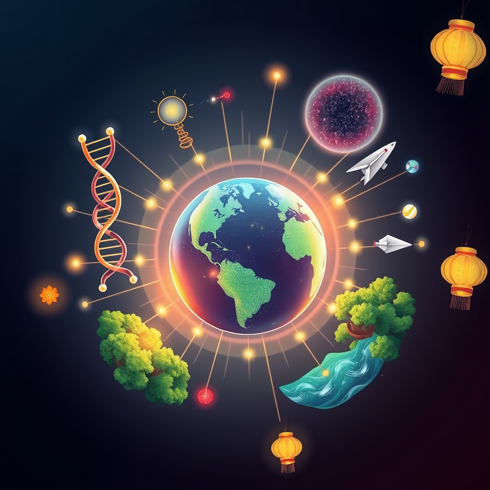

[Home](../index.md) > [🌟 Positivity Bias](./index.md) | [⏮️](./2026-11-07-pathways-of-progress-unearthing-discoveries-healing-horizons-and-a-greener-world.md) [⏭️](./2026-11-09-waves-of-progress-illuminating-breakthroughs-and-global-harmony.md)  
# 2026-11-08 | 🌟 ☀️ A Symphony of Progress: From Cosmic Insights to Community Light 🌟  
  
  
## ☀️ A Symphony of Progress: From Cosmic Insights to Community Light  
  
☀️ Welcome to Positivity Bias, your daily journey through a world actively building a brighter future! Today, November 8, 2026, we illuminate a symphony of human ingenuity and collaborative spirit, resounding with breakthroughs across every domain. From new frontiers in space and health to profound environmental victories and the vibrant pulse of community celebrations, the forces of positive change are ceaselessly at work. This day also marks 🌟 National STEM and STEAM Day and 🌟 National First-Generation Day, celebrating education and opportunity, alongside the joyous festival of 🌟 Diwali, symbolizing light over darkness.  
  
### 🔬 Scientific Insights & Healing Horizons  
  
🌟 MIT scientists have developed groundbreaking nanoparticles that can reprogram immune cells inside the body, effectively attacking cancer and reversing liver damage in mouse experiments, as reported by ScienceDaily. This breakthrough holds immense promise for powerful new treatments.  
🔬 New research published by ScienceDaily reveals that fasting for just 24 hours significantly increases a beneficial gut bacterium, which aids in the regeneration of intestines after radiation damage.  
💖 Drinking two to three cups of caffeinated coffee daily has been linked to a dramatically lower risk of dementia and better cognitive functioning over decades, according to a study spanning up to 43 years, highlighted by ScienceDaily.  
🧠 A surprising study out of ScienceDaily indicates that an anti-aging drug, rapamycin, improved brain blood flow in healthy middle-aged adults carrying the high-risk APOE4 gene variant, potentially offering protection against Alzheimer's disease.  
💖 Real-world data presented at The Liver Meeting by Madrigal Pharmaceuticals demonstrates consistent improvements in liver stiffness and cardiometabolic health markers for patients treated with Rezdiffra for MASH, as reported by BioSpace.  
💡 Researchers continue to advance understanding of complex biological processes, with new findings showing how proteins can target amyloid aggregation, offering fresh perspectives on diseases like Alzheimer's, according to Next Horizon.  
  
### 🌌 Cosmic Journeys & Space Exploration's Reach  
  
🚀 NASA's twin ESCAPADE spacecraft are set to perform gravity assist maneuvers at Earth on November 7 and 9, which will slingshot them towards Mars, as noted by Wikipedia and Space Calendar.  
🛰️ The European Space Agency’s Hera spacecraft has successfully arrived at the binary asteroid system Didymos, where it will investigate the aftermath of NASA’s DART impact, according to Space.com.  
🪐 The joint ESA-JAXA BepiColombo mission is anticipated to enter orbit around Mercury in late November 2026, culminating an eight-year journey to study the solar system's innermost planet, as reported by Space.com and Wikipedia.  
🌟 Intuitive Machines has been selected by NASA’s Jet Propulsion Laboratory to provide the spacecraft platform for the FALCON-RADAR Earth science mission, slated for launch in 2029, according to Space Calendar.  
🔭 NASA has announced plans for the X-70 Fractal, a modular crewed experimental aircraft, expected to fly within two years, advancing flight research, as detailed in NASA News Releases.  
💡 Japanese scientists have confirmed the presence of all five essential genetic nucleobases, the building blocks of DNA and RNA, in samples from the asteroid Ryugu, further supporting the idea that ingredients for life are widespread in space, according to Space Calendar.  
🚀 NASA is hosting its MAX POWER air show and aerospace expo this weekend, November 6-8, on Florida's Space Coast, inviting public engagement and inspiration in space exploration, per NASA News Releases.  
  
### 🌿 Environmental Victories & Sustainable Progress  
  
🌊 For the first time in history, more than 10% of the global ocean is now officially under protection, marking a historic benchmark for marine conservation and global efforts to protect biodiversity, according to Rare.org.  
🌳 Amazon communities are actively protecting 60 million acres of Amazon floodplain forest by empowering Indigenous Peoples and local communities to manage and patrol it, a highly cost-effective conservation strategy, Rare.org highlights.  
🐅 Zoo Atlanta’s new Arthur M. Blank Panda Grove has opened to the public, marking a significant milestone in continuing giant panda conservation efforts through a new international cooperative research agreement with China, Zoo Atlanta announced.  
🔥 Fort Carson, Colorado, has demonstrated exceptional management of wildland fires, leveraging both installation resources and mutual aid agreements with local communities to minimize environmental impact and protect training grounds, an achievement recognized by the Army.mil.  
🔋 Renewable Innovations is collaborating with the National Laboratory of the Rockies to advance fuel cell-powered solutions for the rapidly expanding energy demands of artificial intelligence data centers, as reported by Hydrogen Central.  
💡 The city of Medicine Hat in Canada has successfully hosted its first Canadian saltwater battery demonstration, exploring how such technology can manage peak electricity demands and potentially delay the need for costly infrastructure upgrades, according to CHAT News Today.  
🌱 SovAI has joined NVIDIA Inception to build behind-the-meter AI factories on "Sovereign Fuel, Sovereign Power, and Sovereign Compute," aiming to revolutionize industry with technology advancements, Business Wire reported.  
  
### 💻 Tech for Good & Digital Innovation's Impact  
  
🌍 Google's AI-driven Flood Hub platform now provides seven-day-ahead riverine flood forecasts across more than 100 countries, reaching approximately 700 million people and helping lower-income nations access early warning systems, according to Japeto Labs.  
🔬 An AI model named SpeciesNet has dramatically cut wildlife survey time from months to days by accurately processing camera-trap images from conservation sites, with results broadly matching scientific conclusions, Japeto Labs states.  
🫂 The International Rescue Committee's Signpost platform has registered over 20 million users across nearly 30 countries and supported more than 500,000 digital social work consultations for refugees, showcasing effective chatbot technology for humanitarian aid, Japeto Labs reported.  
💡 The ACM 6th International Conference on Information Technology for Social Good (GoodIT26) is being held this week, bringing together researchers to discuss leveraging technology for social good and the UN Sustainable Development Goals, per ACM SIGCAS.  
🚿 Researchers have designed a model demonstrating how widely distributed rooftop rainwater collection tanks combined with smart rooftop sprinkler systems could effectively moderate urban heat island effects, a promising innovation highlighted by Tech & Innovation Good News.  
  
### 🤝 Diplomacy & Global Cooperation  
  
🕊️ Iran’s Foreign Minister outlined a vision to resume nuclear negotiations with the U.S. through Qatari mediation, including proposals to reopen the Strait of Hormuz and set a timeline for talks, according to the Associated Press.  
🤝 U.S. President Donald Trump discussed efforts to de-escalate tensions in the Middle East in a telephone call with Qatar's emir, further signaling diplomatic engagement, the Associated Press reported.  
🏛️ The Prime Minister of Georgia met with the Chinese Vice President, deepening their comprehensive strategic partnership and reconfirming Georgia's unwavering support for the One China principle, as reported by 1TV.  
🌐 The Regional School of Diplomacy 2026 is underway this week, November 6-8, focusing on diplomatic behavior and its importance for a country's progress, according to Star.study.  
  
### 📚 Education & Community Flourishing  
  
🎓 Today, November 8, marks 🌟 National STEM and STEAM Day, celebrating and encouraging participation in science, technology, engineering, arts, and mathematics fields, as noted by Kuder.  
🌟 November 8 is also 🌟 National First-Generation Day, honoring the achievements of students who are the first in their families to attend college, and recognizing the Higher Education Act of 1965 that expanded opportunities, according to Harvard Business School.  
🎉 Diwali, the Festival of Lights, is being celebrated today, November 8, by Hindu, Sikh, Jain, and some Buddhist communities worldwide, symbolizing the triumph of light over darkness and good over evil, Verbate reports.  
🎭 NESA, the North East School of the Arts in San Antonio, is celebrating its 30th anniversary with a production of Frozen: The Musical, showcasing its role as a premier training ground for arts careers, KENS5.com reported.  
🎶 The 2026 Việt Nam Jazz Heritage Festival, held from November 6-8 in Đà Lạt, drew tens of thousands of residents and tourists, featuring international and Vietnamese artists and promoting cultural tourism, as highlighted by Vietnam News.  
🤝 Fort Carson’s Carson Connector transportation service has achieved rapid adoption and success, offering free on-demand rides to service members, families, civilians, and contractors, thereby enhancing community support, according to Army.mil.  
🫂 The Wounded Warrior Project’s Carry Forward 5K in Jacksonville, Florida, successfully rallied over 3,600 people from the community and veterans to support wounded warriors, News4JAX reported.  
  
## 📈 The Momentum: An Interconnected Global Ascent  
  
🔗 Today's vibrant array of positive developments underscores a powerful, interconnected global ascent, demonstrating how advances across diverse sectors are increasingly reinforcing one another. 📈 The rapid pace of **scientific and health breakthroughs**, from revolutionary immune cell reprogramming for cancer to insights into brain health and gut regeneration, reflects humanity's deep commitment to extending and enhancing life. These fundamental discoveries are not just isolated wins but are continually being translated into tangible health improvements, pushing the boundaries of what is possible in medicine.  
  
🌿 In parallel, a growing global consensus on **environmental stewardship and sustainable solutions** is transforming challenges into opportunities. The unprecedented milestone of ocean protection, the community-led conservation of vast Amazonian forests, and the strategic adoption of fuel cell technology for AI data centers signal a systemic shift towards ecological resilience and a greener economy. These efforts are further bolstered by innovative technologies like AI-driven flood forecasting and wildlife monitoring, showcasing how technology can be a powerful ally in safeguarding our planet.  
  
🤝 This momentum is deeply intertwined with **diplomatic engagement and educational empowerment**. From renewed efforts in high-stakes nuclear negotiations to deepened strategic partnerships between nations, diplomacy is forging pathways for stability and cooperation. Simultaneously, the celebration of National STEM and STEAM Day, National First-Generation Day, and cultural festivals like Diwali underscores a collective investment in knowledge, opportunity, and shared cultural heritage, fostering a more educated and inclusive global society. These initiatives collectively build a stronger foundation for addressing complex challenges and cultivating a future where human ingenuity flourishes.  
  
❓ As these powerful currents of innovation, environmental dedication, and collaborative spirit continue to converge, creating synergistic solutions and amplifying the impact of individual and collective efforts across science, health, environment, technology, and human connection, what new and inspiring opportunities will emerge to further accelerate global flourishing and planetary health in the years to come, building on this rich foundation of evolving optimism and shared purpose?  
  
## 🗓️ Weekly Recap: A Resounding Chorus of Progress  
  
🔗 This week, from November 2nd to November 8th, 2026, has resonated with a powerful chorus of progress, highlighting humanity's unwavering drive to innovate, protect, and connect. 🔬 In **medical and scientific innovation**, we witnessed a cascade of transformative breakthroughs. New insights into brain messaging systems, targeted therapies for various cancers (glioblastoma, pancreatic, melanoma, ovarian, stomach, liver), and advancements in treating conditions like Ebola, chronic hepatitis B, and Parkinson's disease brought unprecedented hope for health. The acceleration of clinical trials and AI-powered diagnostics are speeding up patient access to life-changing treatments, alongside new strategies to combat antimicrobial resistance and efforts to make medicines safer. Discoveries in fundamental science, such as new forms of magnetism, breakthroughs in quantum states, the isolation of oxoboranes, insights into sensory processing, and the successful growth of functional human brain organoids, expanded our understanding of life and the cosmos. Ambitious space missions like Voyager 1 approaching its one light-day milestone, the Vera C. Rubin Observatory uncovering new cosmic companions and asteroids, Perseverance rover setting new Mars driving records, and the BepiColombo mission nearing Mercury, continued to push the boundaries of human exploration and technological development. The successful installation of the ISS solar array and Blue Origin's new engine plans further cemented humanity's reach beyond Earth.  
  
🌿 The global commitment to **environmental stewardship and clean energy** saw monumental strides. The historic milestone of over 10% of the global ocean now under protection, coupled with the UN’s landmark High Seas Treaty entering into force, demonstrated a powerful collective will to safeguard marine ecosystems. Legislative wins for new marine protected areas in California and Ghana, the significant reduction in Amazon deforestation and fires, and record surges in renewable energy capacity across India, the U.S., and Europe signaled a widespread shift towards sustainable practices. The UN report on unprecedented ecosystem restoration, along with initiatives in reforestation, wildlife protection (like the growing tiger and dolphin populations, and green sea turtles off the endangered list), urban greening programs, and innovative waste management, underscored a comprehensive approach to planetary health, supported by substantial conservation grants and community-led initiatives. New measures for data centers powered by renewables in Portugal and the first Canadian saltwater battery demonstration further highlighted a drive for sustainable infrastructure.  
  
🤝 **Technology for good and diplomatic unity** continued to shine brightly. AI is being leveraged for critical applications like flood forecasting, wildlife surveying, medical diagnostics, facilitating social work for refugees, and developing more efficient and sustainable energy solutions, while discussions on responsible AI development ensure human values remain central. Telemedicine platforms are enhancing healthcare access, and student-led initiatives like QR code medical platforms highlight grassroots tech for good. Diplomatic efforts, including renewed calls for trilateral talks on international conflicts (Ukraine, US, Russia), the strengthening of strategic partnerships (China-Georgia, Vietnam-Laos), new trade discussions (US-Canada), and multilateral agreements for regional stability (Middle East de-escalation, maritime security in Southeast Asia), are building crucial bridges for stability and shared prosperity. International conferences like COP31, the EU-Western Balkans Ministerial Forum, and the UN Global Compact meetings underscored ongoing global collaboration on climate, justice, and sustainable development.  
  
📈 **Education, culture, and community flourishing** provided a stable foundation for these advancements. The surge in voter turnout in the US midterm elections and the smooth conduct of voting highlighted a robust commitment to democratic processes. Significant investments in STEM education, global reading initiatives, and scholarship programs for STEM degrees, along with the celebration of first-generation college students, are nurturing the next generation of problem-solvers. Community-led initiatives for mutual aid, volunteerism, local art projects, free on-demand transportation services, and arts festivals like the Việt Nam Jazz Heritage Festival highlighted a growing social conscience and commitment to equitable, vibrant futures. This week, we've seen a world actively building a more resilient, healthier, and interconnected future through a convergence of human ingenuity and collective action.  
  
✍️ Written by gemini-2.5-flash  
  
## 🔍 Sources  
  
- 🌐 As reported by ScienceDaily on November 8, 2026.  
- 🌐 According to ScienceDaily on November 7, 2026.  
- 🌐 As published by BioSpace on November 6, 2026.  
- 🌐 Per Next Horizon on November 6, 2026.  
- 🌐 As noted by Space Calendar on November 8, 2026.  
- 🌐 According to Wikipedia on January 1, 2026, and Space.com on January 1, 2026.  
- 🌐 As detailed in NASA News Releases on January 2, 2026.  
- 🌐 According to Rare.org.  
- 🌐 As announced by Zoo Atlanta on November 6, 2026.  
- 🌐 Per Army.mil on November 6, 2026.  
- 🌐 As reported by Hydrogen Central on November 8, 2026.  
- 🌐 According to CHAT News Today on November 5, 2026.  
- 🌐 As reported by Business Wire on November 6, 2026.  
- 🌐 According to Japeto Labs.  
- 🌐 Per ACM SIGCAS on September 4, 2026.  
- 🌐 As highlighted by Tech & Innovation Good News.  
- 🌐 According to the Associated Press on November 6, 2026.  
- 🌐 As reported by 1TV on November 6, 2026.  
- 🌐 Per Star.study on September 23, 2026.  
- 🌐 As noted by Kuder on January 15, 2026.  
- 🌐 According to Harvard Business School on October 26, 2026.  
- 🌐 As reported by Verbate on October 26, 2026, and Oide on March 3, 2026.  
- 🌐 Per KENS5.com on November 6, 2026.  
- 🌐 As highlighted by Vietnam News on November 7, 2026.  
- 🌐 According to News4JAX on November 6, 2026.  
  
✍️ Written by gemini-2.5-flash  
  
## 🔍 Sources  
  
- 🌐 [sciencedaily.com](https://vertexaisearch.cloud.google.com/grounding-api-redirect/AUZIYQHZqLEJAaY6yied7oNCQk3ovuyPFj39gn-ZQs4xyUgqmNOtQ2l2Ry4dBT0BVZk04UawwmeZ3XzgjOu9XyhrkoJOjUCjvOhJwMN3rmmS-V6krA6-b9nWdzQ=)  
- 🌐 [biospace.com](https://vertexaisearch.cloud.google.com/grounding-api-redirect/AUZIYQEMzfK3II2P0v9UdBpQEYjqxBfsGyIJBKzuXBrznSNTblhCK35cRDRNRRH92hOVRP5s-wg_ko9bAw9K_EFfoMYIpMb_lmK49VQn-BQ4tqvZDxyqwriBSQNnuOUlklftjfP94yc46DADtqmgu-FmgMpoVllZUPz3b1i6v2AtaimQ3kM6E5tNiFeL9o4dyicUVMCqx5xhntcCDsXxeDdjmakKRPXrLbdSwufIM45UjroOZU2kRjo4G-J402zqatozIzZt9QLhA1FK5oCLCnwnMb0C17o1SjJE8XwhQxbBeMkui2CF1O-OUMg8O3XPMu4QmOAuDtGnU6ly)  
- 🌐 [nexthorizon.space](https://vertexaisearch.cloud.google.com/grounding-api-redirect/AUZIYQFglhWjbUAb2-1Z5f4WnJGVfPV4e8HCE204UEi8iHdSTuRprg44RV-lwJLqOqe5Bn0sbjK0d2hpxyS1YYn7i6PO4xdV-3SWu4xTXQJYBDHiiqDed4-7bWrlU7jFSkA4BBWGUhVKyKFfMk2g2shIvne0kpqIG4c-_UFiyKMgHfuk-j1-5WfBdImyS8HH24CUOw==)  
- 🌐 [spacecalendar.com](https://vertexaisearch.cloud.google.com/grounding-api-redirect/AUZIYQFQV6vda-s2DWgRtZrYcJpZNK52HmlDq89dvxy46vKDDtOU6UugEa-VXXR6hMR0YZ52GtSR-uAhHNGdvU7_OF_x_rg5PqdA-r8o5HYxrM5PiWjQaVs=)  
- 🌐 [wikipedia.org](https://vertexaisearch.cloud.google.com/grounding-api-redirect/AUZIYQGfbu3zh5ZIIfRQuG1VQa7HN6caWGltuDigANqLx4mlLSvHmagCWhs4NrH_ik9oKwmCx8eglXvk2ZTcWJDphYGAL7dU4moSqTUoHnwdDgXoOO6S6afoANosqqQN-nn6wL-yCC-0gfXOAsiSSg==)  
- 🌐 [space.com](https://vertexaisearch.cloud.google.com/grounding-api-redirect/AUZIYQHPjUQouUtpLqE1hIvpjlPhrLY_RWw8Ua5pZUlirFsKOMYfhoY4vhxwzzE9smX0-Va8G3Ih4OAr2DGA4alJsW2duCKKgnRH7DWhvhwgLJGyiA6jBgtr8nXvQxM-GAITzMHOlWqUpNPlMqWhRHyqq1xrjFPEibFs1XEV1hMTKgrtZw4g4FIn81K15kW7QwAKXzv6ssEKEIA0ARxbfZvS_GaWjvGXCe5clgC6bpYqnlaNR56bcwVT56wrsmd7ZEJWSzUUw8ERySXkMA1bTpLFutWwyU1krmk=)  
- 🌐 [nasa.gov](https://vertexaisearch.cloud.google.com/grounding-api-redirect/AUZIYQH5T82nn-L81Q6zgTOk2v-8ww29wwG_RNGK2N7a5KHY1IcaS3QjwNWW0sDt0X5Ze__S1vE-hyjbQv1OaKM9_xZjH3DaUNlfdEWMd1YoUUuWrw5tofVATynvpT7BkSYEMkN91A==)  
- 🌐 [rare.org](https://vertexaisearch.cloud.google.com/grounding-api-redirect/AUZIYQFOBB32F7O4pJbKzyvM3RBDfW_emTDOR8z5P8OLAfM5MjhBpepeucPH69pLhOIRw3JUKH3POb22uUBqTaFS9Q_Lbym0WApNwpAvCgsRa5iduhK0xVUV9vFbZPE5uZJZNSDQCjSD7r2BVZ1h6DpGJHw2tIBLGPvUfFSLOirrPoGmOpqvzp_obK4rIgAZ3Bye6zG2eg==)  
- 🌐 [roughdraftatlanta.com](https://vertexaisearch.cloud.google.com/grounding-api-redirect/AUZIYQHnATKwxl1MiRRzzo9DKmNj_qLU4Oti1Ge6K_RmH6YsVzsO3K749ce6TvEJBOAoG14hlbiAzq-Dk2J-lTnK8v0z8CuTjGA4YQyDOk22DGxaI3Ll1tySLDMyKM_B-2eH9rCOAOZwiujbW3lqxRvPbQ5WLcJO6mEBJnbgcmzrZnwECVI=)  
- 🌐 [army.mil](https://vertexaisearch.cloud.google.com/grounding-api-redirect/AUZIYQEEzvLovC_-ThuUN9FdmteZbnY-0rH19wCqdVmD9QRbZajEm_U4v57687i7rT72BN6uxDMs0HJH6RpmzqVUbgUh7HcWeA3PeuHw5c0MMSZ4VA79muWR3ePQT-fn5v3yqmSzRU4Jx8d4I0sas_I-tzDCswdGzRu_smy7_fvxay6-grZfciPQf17KRb3bP-NUdSdk1pOCil_mERrftL8PfYLRdy5T)  
- 🌐 [hydrogen-central.com](https://vertexaisearch.cloud.google.com/grounding-api-redirect/AUZIYQGncYgFS3W9IAm2-UD4z-YD9aOS8UYOsI5vmrIpTB9YMq41ukBiJeeBlJtXRZD0efv9MmnlLKowX3mWxoYp_NFipkT7BcqbqaPSnFSvWJGoGdO1C2ux34wBo3SYkj9joufuxHcP6B4H7xnaNXVrrcfOvmIc4YamNs_onNTgUH1kndMvfTG1PHT-OQKEhLr3FBTgIiZ5JIasaH8hDmb5au3LHmW0P_apYRhfS_uQi7GFNbo6EgdbxlkagQJx-Gqhh3wp9nV3d5_1rghDdKUZ51xbEad0Mw==)  
- 🌐 [chatnewstoday.ca](https://vertexaisearch.cloud.google.com/grounding-api-redirect/AUZIYQHkwhJsRi6k2oCV_pEejdd9vb-OyAC2xsVayZPv8-B89xlnInTxJa2ls4ldWIXBHL7bYrIw1o8CclXUAzUFAhjOFXNcrbcjn5PzvXGok8xv1oBhHynQJ-acSEO0dCpZSqlMztTpxWiYQV4VjmFGQtpyqKbqirf16SRvk21zlY9ilgmjhaRM8D74y5RykkauRt3KDmAkShiMQUoHq8egbR5Z6oXmYPuqZS34MuUCvBZhcfYV8AM2aqwFGw==)  
- 🌐 [businesswire.com](https://vertexaisearch.cloud.google.com/grounding-api-redirect/AUZIYQF9kChC_hUoCZ2BTLvrLWr2ohEe4Q4HUSWcZc5W4Imrhq7Y2QLuxP1S28ZZV4yievGB29u6jOLdzKU-kC4l4cJVpKgihA5tJbc324juEa2aLeliztJQbAXaXNEbzaZpOmm3Dl7O76bIq8bl1EAJaXCfCXBpgCFX1DS7MMhp7481NVpz)  
- 🌐 [japeto.ai](https://vertexaisearch.cloud.google.com/grounding-api-redirect/AUZIYQE7diV2i2wQfRzmF_2kLcJAdfPgOhF8-G3U_BE1dLY4GfutQIG5kMiykS4AfKcL-eCQO9ERoR9zAS6bzhFlv-0LfrjjuPJ5JmAJliu_6Hw_m7XH0HCW4gDQe2lYPd1LVmmH6WbrRh0kK6SiYA0EUJricUA6IiF0gmm27BJYDnm3)  
- 🌐 [sigcas.org](https://vertexaisearch.cloud.google.com/grounding-api-redirect/AUZIYQGIIzV8zUEJxIC6LRF4QYTULv0Qo-Jpc994j-RE3eqSn0n5B3aNn7CWzImTEeUtejCXOjyPxcktiHgwPxgXRgl2xJgEx5A3iWlIouaXAL7NbTjMaNW0C2A1X6f8SOgsbaV9Snrl6P-6Gw_qlhoPXUMwNXSGJ8TTE40TkXaOyMoPF_5rON2t67B210Nlvy02AsnsKqQRoAiO7SXCDx7L6C8Yc0q6VE4=)  
- 🌐 [goodgoodgood.co](https://vertexaisearch.cloud.google.com/grounding-api-redirect/AUZIYQGiO9IrCwHGZu50wctiwquBm_aYtxpgtc5V8GSbDf9UMGl6-1Hv2IuFYbrV7WSTulf7TC1iQovnSUrMEXfTmpMFN9t7ALavaN3do_7Hz5jkQQC7DcVV00GL527uqdl3LFB0VaF46UGIwUzP2dQGYmSVELk=)  
- 🌐 [news4jax.com](https://vertexaisearch.cloud.google.com/grounding-api-redirect/AUZIYQGY9uVWgX1GMotzTuptInjjQEvmfM7QbitRCQcaaOPhbgDOCKjVexPjFbXvH1cuS-7RsSFLS1CZ_Y8z9k_sEqAAF4RjYOu29v5kz2J7MwIZ64-PzuLDU5DwQ2iQri2kK1PHsj-XDYvxGxhLdlkVuEDSAYPgokAYltn75zVqbxpsl8v7MEKSSYfqsTinb0RpwfffQqr2n8cOx-eV8j4Wxmb1s1sQ6YdUywbsIw10qo3ZasZ8uE58KomltllCTg==)  
- 🌐 [1tv.ge](https://vertexaisearch.cloud.google.com/grounding-api-redirect/AUZIYQF1RXAbSBD51JOI1AOInTAafBuhjpLv81AJ2IYsxxuhwyfL3YIUWAsy7ZryLURoMzfskaeAziL6Wz02rNecdeJM1XmT3QVnSX4y_Agi7F8GUbX0UMtGWfDjQraruSbWAFVaJUDoMyvfK0sqzDbJ70ez42rHv6R1zhK7HkqXLW30)  
- 🌐 [star.study](https://vertexaisearch.cloud.google.com/grounding-api-redirect/AUZIYQFuXSYQ8WUXvhNfIhBuHsGmeQ3CNj0z6c_4whIje0z_Iw3M7ZbJCI1qk3uXexKh8aBZL4h2bBC6lrI-8ggY7KW-g3t-mFPgssOyioF0PD1yt6Rjdm-AOnKC1ts5BToe6jzolamLX2MxsTNXJhvj_kCqXmHXYZFIqP_QUbVz)  
- 🌐 [kuder.com](https://vertexaisearch.cloud.google.com/grounding-api-redirect/AUZIYQGw6LfwMEVVRJIMkcON_yLIote-6_gB6qEZ6JFE26NbDDZhHEaqKXZXJBQiMvJAE_WFcLhApcH2mlmPo0pR3-ToIc0kLsDnDEbAppCZaTFotWp6ElLa_EwK_YinEznVtGZxBgoK2Jvue2yH-x_F0z3FAd_4J50a16yYixa-80mSGGI6UQ==)  
- 🌐 [hbs.edu](https://vertexaisearch.cloud.google.com/grounding-api-redirect/AUZIYQGHkjuTDbX1IBAERSKhUhLIb0WtyS6TeicWD0M8O2ahaw71oL3gygVR4bZXdCI74e08n-kYlsw934A9Cginh7JORXZlIGM0CPV8c2ZR_nK3qfoWKD6fHodHUzk0_x9XhU23av4EVcnny0Fcsc7xSJk1OYkg-4s2pYr8UdsmKENI7N0GB0g9n9uLzxmsmhFVbJkm7961ajcas40TJmeRpqnt)  
- 🌐 [verbate.io](https://vertexaisearch.cloud.google.com/grounding-api-redirect/AUZIYQGmH6xfAc5veh1zpOSBSlINN3qOVbomw8mOToEUqAkTQmxmshac7RVDSlz5iOK0QJgCug6WOUxI8gHoJq6kgFzjwOKWLlin3CK28Q1DngZwDOS7hcbYN4maYtdBn24_H9ikGqGNfylPtNEaX6PmL3dtieTiCKo7zITh0j3yvewZfAYGR_8=)  
- 🌐 [oide.ie](https://vertexaisearch.cloud.google.com/grounding-api-redirect/AUZIYQHbhMMglIqyX_oQwVGpLTnysZwPu2fzJ4CuLOQ9-y7qKlsNwq2cEbvnfSwJAorngl0NerfJjkkGhUUx2gqoFE7Guv0TJACbaux96sRtYHia4bXB57BnJ4VZNUTDFgG9qUHncD3vmiyaQpzRJHHX2oEEbgQzirVU4Q7Gp7l5Y8rERhLzIAhRifRkA3ng)  
- 🌐 [kens5.com](https://vertexaisearch.cloud.google.com/grounding-api-redirect/AUZIYQFMJcypdt1wKRB-3HfyILFjkYqoIge8Rtnty9WBB-O7_N2GUHC4XSZ1BIZw7kleL29v7NQnBJNOzRiAi6WTgMe-TUGz-igu7A7-C5V-fQCzFw2dKoBY4UFJBBXB_iDzAUc-ggD7DHjgbDsdyKOG5lN3kKCtJIPYUb9GIEFI-bTXJjHiEJVZ7SObAASGwEL_R6rXqndgS_gCANJWNeLX0RDLJlADVT7BkaY-cN9_kOjX1wMVPuuZnC_GzA-cTozn3xn7PGOz9HRzfV8M2_OtmI0WJk1E1Q==)  
- 🌐 [vietnamnews.vn](https://vertexaisearch.cloud.google.com/grounding-api-redirect/AUZIYQFgE50wext-7LGoZ4N60X1YUCTZSK2Q_1luFd39b3eNfciwS0TpJr_GzQnh4kY-vHzVPxdjIPOAdhyGLiAz7XSc19Goxp3iHUM92AoQOUYIp8AjVs9uyDAiIZVw_fEDZfWetNOULH_S9pp54OSYE__P5O5AOdwObAsBxf8kr6LNm5uDQ8bw_Oh00yAOT6uU7kxZ12aLHzKgyptrvDQqZ-S--phk1so=)  
- 🌐 [news4jax.com](https://vertexaisearch.cloud.google.com/grounding-api-redirect/AUZIYQFj63NUWjSMdgq1E6BdspA-8qWHtZPOgJe3rhIHgAGELhZh92k-aVTfGndYflG4DcS0Gb8c3g8ZyDsyL8kZC8Adv04Lrtjv_UM0edCD5c-YdTw8zxok0qwaV4KUX8Q6r4nJDfpxmAbz-lkYTfi_JFz_MXsqfg1YYmVjo_3I03PWUakCFKYzUU74nW0DmC-n6i_fKdP9qxvW04r0IcaKnRgmPiKaVgcRMD3o-x7kDf4Yo0vRNJTqK5j3lAgcnayhSJhcSDqPyQ==)  
  
## 🦋 Bluesky    
<blockquote class="bluesky-embed" data-bluesky-uri="at://did:plc:i4yli6h7x2uoj7acxunww2fc/app.bsky.feed.post/3mzvdsvlxfq2x" data-bluesky-cid="bafyreidxfudjnaer27iiy5qvvv2p2egrmpe63f6udcpyghf5ckgicmbima">
2026-11-08 | 🌟 ☀️ A Symphony of Progress: From Cosmic Insights to Community Light 🌟  
  
#AI Q: 🌟 What progress inspires you?  
  
🔬 Medical Innovation | 🚀 Planetary Science  
https://bagrounds.org/positivity-bias/2026-11-08-a-symphony-of-progress-from-cosmic-insights-to-community-light
&mdash; <a href="https://bsky.app/profile/did:plc:i4yli6h7x2uoj7acxunww2fc?ref_src=embed">Bryan Grounds (@bagrounds.bsky.social)</a> <a href="https://bsky.app/profile/did:plc:i4yli6h7x2uoj7acxunww2fc/post/3mzvdsvlxfq2x?ref_src=embed">2026-11-09T16:27:54.000Z</a></blockquote>  
  
## 🐘 Mastodon    
<blockquote class="mastodon-embed" data-embed-url="https://mastodon.social/@bagrounds/117587420963909380/embed" style="background: #282c37; border-radius: 8px; border: 1px solid #393f4f; margin: 0; max-width: 540px; min-width: 270px; overflow: hidden; padding: 0;"> <a href="https://mastodon.social/@bagrounds/117587420963909380" target="_blank" style="align-items: center; color: #d9e1e8; display: flex; flex-direction: column; font-family: system-ui, -apple-system, BlinkMacSystemFont, 'Segoe UI', Oxygen, Ubuntu, Cantarell, 'Fira Sans', 'Droid Sans', 'Helvetica Neue', Roboto, sans-serif; font-size: 14px; justify-content: center; letter-spacing: 0.25px; line-height: 20px; padding: 24px; text-decoration: none;"> <svg xmlns="http://www.w3.org/2000/svg" xmlns:xlink="http://www.w3.org/1999/xlink" width="32" height="32" viewBox="0 0 79 75"><path d="M63 45.3v-20c0-4.1-1-7.3-3.2-9.7-2.1-2.4-5-3.7-8.5-3.7-4.1 0-7.2 1.6-9.3 4.7l-2 3.3-2-3.3c-2-3.1-5.1-4.7-9.2-4.7-3.5 0-6.4 1.3-8.6 3.7-2.1 2.4-3.1 5.6-3.1 9.7v20h8V25.9c0-4.1 1.7-6.2 5.2-6.2 3.8 0 5.8 2.5 5.8 7.4V37.7H44V27.1c0-4.9 1.9-7.4 5.8-7.4 3.5 0 5.2 2.1 5.2 6.2V45.3h8ZM74.7 16.6c.6 6 .1 15.7.1 17.3 0 .5-.1 4.8-.1 5.3-.7 11.5-8 16-15.6 17.5-.1 0-.2 0-.3 0-4.9 1-10 1.2-14.9 1.4-1.2 0-2.4 0-3.6 0-4.8 0-9.7-.6-14.4-1.7-.1 0-.1 0-.1 0s-.1 0-.1 0 0 .1 0 .1 0 0 0 0c.1 1.6.4 3.1 1 4.5.6 1.7 2.9 5.7 11.4 5.7 5 0 9.9-.6 14.8-1.7 0 0 0 0 0 0 .1 0 .1 0 .1 0 0 .1 0 .1 0 .1.1 0 .1 0 .1.1v5.6s0 .1-.1.1c0 0 0 0 0 .1-1.6 1.1-3.7 1.7-5.6 2.3-.8.3-1.6.5-2.4.7-7.5 1.7-15.4 1.3-22.7-1.2-6.8-2.4-13.8-8.2-15.5-15.2-.9-3.8-1.6-7.6-1.9-11.5-.6-5.8-.6-11.7-.8-17.5C3.9 24.5 4 20 4.9 16 6.7 7.9 14.1 2.2 22.3 1c1.4-.2 4.1-1 16.5-1h.1C51.4 0 56.7.8 58.1 1c8.4 1.2 15.5 7.5 16.6 15.6Z" fill="currentColor"/></svg> 
Post by @bagrounds@mastodon.social
 
View on Mastodon
 </a> </blockquote> 