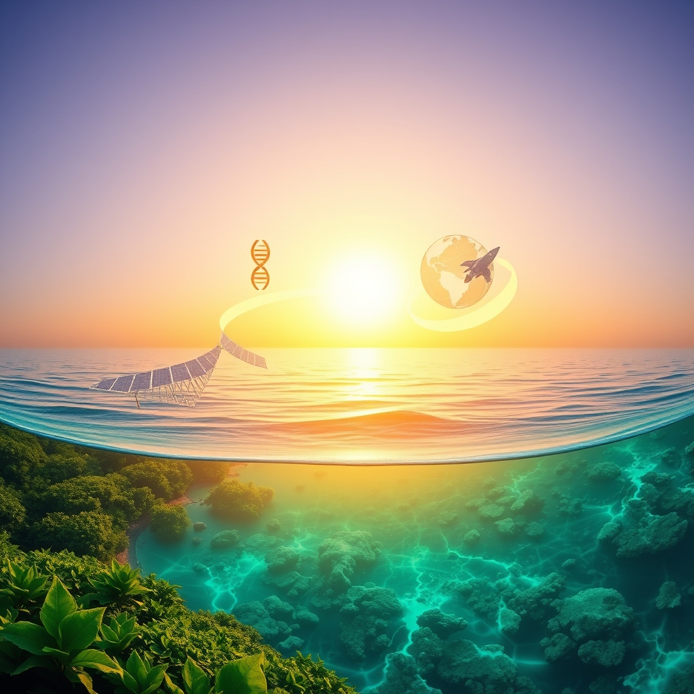

[Home](../index.md) > [🌟 Positivity Bias](./index.md) | [⏮️](./2026-11-08-a-symphony-of-progress-from-cosmic-insights-to-community-light.md) [⏭️](./2026-11-10-pathways-of-progress-illuminating-global-advances.md)  
# 2026-11-09 | 🌟 Waves of Progress: Illuminating Breakthroughs and Global Harmony 🌟  
  
  
## 🌟 Waves of Progress: Illuminating Breakthroughs and Global Harmony  
  
☀️ Welcome to Positivity Bias, your daily journey through a world actively building a brighter future! Today, November 9, 2026, we spotlight the relentless march of human ingenuity and collaborative spirit, resounding with breakthroughs across every domain. From new frontiers in health and space to profound environmental victories and the vibrant pulse of community initiatives, the forces of positive change are ceaselessly at work. This period also celebrates 🌟 American Education Week, honoring everyone who contributes to our schools, and acknowledges 🌟 Native American Heritage Month, celebrating rich cultures and contributions.  
  
### 💖 Health's Expanding Horizons & Scientific Insights  
  
🧠 A surprising new study from UTHealth Houston suggests that a stronger flu shot could offer older adults significantly greater protection against Alzheimer's disease. This research, published on ScienceDaily on November 7, hints at new preventative avenues.  
💡 Scientists at UC San Francisco have developed a powerful new cancer therapy that remains inactive until it reaches the brain, where it switches on to attack deadly tumors. This groundbreaking approach successfully wiped out deadly brain tumors in every mouse tested, ScienceDaily reported on November 8.  
💊 A naturally occurring molecule may help breast cancer survivors overcome brain fog and exhaustion that lingers after treatment. A UCLA study, as noted by ScienceDaily on November 9, found that women taking a supplement derived from this molecule experienced relief.  
🧪 Pantethine, a readily available vitamin B5 derivative, has been discovered by scientists to calm overactive immune cells and may help fight psoriasis. The supplement successfully prevented psoriasis in mice, ScienceDaily published on November 9.  
🔬 New cardiovascular research from NYU Langone Health is being presented at the American Heart Association Scientific Sessions 2026, examining long-term treatment strategies for stable coronary artery disease and the impact of cleaner indoor air on cardiometabolic health. NYU Langone Health announced these findings on November 6.  
📊 The Madrid International Society of Liquid Biopsy Meeting 2026 is fostering international collaboration and knowledge exchange, focusing on advances in liquid biopsy for cancer diagnosis, monitoring, and precision oncology. The meeting, celebrating its 10th anniversary, brings together experts from November 7-9, as reported by OncoDaily on November 8.  
  
### 🌌 Cosmic Ventures & Space Exploration's Reach  
  
🚀 NASA is actively recruiting a new class of astronauts to expand its Artemis program, preparing for a permanent human presence on the Moon. Officials announced this initiative during a Kennedy Space Center air show on November 7, promoting lunar exploration and advances in aviation, as reported by the Associated Press.  
🌕 NASA has revealed an accelerated plan to land astronauts on the Moon in 2028, with SpaceX and Blue Origin developing competing lunar landers. A crucial orbital test is scheduled for 2027, according to ScienceDaily on November 9.  
🛰️ The European Space Agency’s Hera spacecraft has successfully achieved its first close-up look at the Didymos binary asteroid system, which was previously impacted by NASA’s DART mission. Space.com highlighted this achievement on November 6.  
🎮 An experimental European spacecraft made history by playing the iconic video game Doom after operators used voice commands from Earth, marking the world's first demonstration of orbital voice control, Space.com reported on November 9.  
🔭 Astronomers have filtered out starlight from James Webb Space Telescope observations to reveal a giant exoplanet, showcasing the telescope's powerful capabilities, as published by Space.com on November 6.  
  
### 🌿 Environmental Guardianship & Green Energy Tides  
  
🌊 For the first time in history, more than 10% of the global ocean is now officially under protection, marking a historic benchmark for marine conservation and global efforts to protect biodiversity. Rare.org highlighted this significant 2026 win.  
📜 The UN’s landmark High Seas Treaty officially entered into force in January 2026, setting new standards for environmental review and conservation measures in international waters previously operating in a legal gray zone. Rare.org emphasized this as a key conservation win.  
🇬🇭 Ghana has made history by establishing its first national marine protected area, signaling growing political will across the Global South to protect coastal ecosystems and the communities dependent on them, according to Rare.org.  
🌳 Amazon communities are actively protecting 60 million acres of Amazon floodplain forest through empowering Indigenous Peoples and local communities to manage and patrol it. This community stewardship is a highly cost-effective conservation strategy, as noted by Rare.org.  
💰 Voters across the United States have demonstrated continued bipartisan support for protecting natural lands and strengthening community resilience, approving 19 of 22 conservation funding measures on November ballots and generating an estimated $16 billion in public funding. Trust for Public Land announced these results on November 5.  
📈 Global renewable power capacity is forecast to increase by almost 4,800 gigawatts in the 2026-2031 period, nearly 60% more than the previous six-year period, with solar PV accounting for over three-quarters of this growth. The International Energy Agency reported on November 6 that energy security concerns are spurring faster renewables growth across a widening constellation of countries.  
🔋 New York has awarded $13 million to develop long-duration energy storage projects, advancing critical solutions for grid stability and clean energy integration, Renewables Now reported on November 9.  
☀️ Malaysia is set to develop a 500-megawatt hybrid solar project, demonstrating a significant investment in clean energy infrastructure, as announced by Renewables Now on November 9.  
💨 Nordex has secured an 84-megawatt wind turbine order in Albania, marking an expansion of wind power in the region, Renewables Now reported on November 9.  
  
### 🤝 Diplomacy's Threads & Global Cooperation  
  
🕊️ US-led peace talks for Russia and Ukraine are scheduled to begin on Tuesday in Abu Dhabi, United Arab Emirates, with security guarantees topping the agenda. This marks the first such trilateral talks since February, the Associated Press reported on November 9.  
🌐 US President Donald Trump is scheduled to meet Qatari Prime Minister and Foreign Minister Sheikh Mohammed bin Abdulrahman Al-Thani at the White House on Monday, November 9, as diplomatic efforts to end the conflict with Iran continue. TDI reported on this meeting.  
📜 The White House has outlined a proposed European security framework alongside security guarantees for Ukraine, preparing for trilateral peace talks with Ukraine and Russia. This initiative was detailed by US President Donald Trump's envoy Jared Kushner in a social media post following discussions in Brussels, as reported by RFE/RL on November 6.  
🏛️ The 31st United Nations Climate Change Conference (COP31) is scheduled to begin in Antalya, Türkiye, this week, with negotiations focusing on reducing greenhouse gas emissions and supporting vulnerable countries. CNN reported on November 5 that these talks lay the foundation for growing reliance on renewables.  
  
### 📚 Education & Community Flourishing  
  
🎓 This week, November 9-13, marks 🌟 American Education Week, a comprehensive celebration of American education that recognizes everyone contributing to school communities, from teachers and staff to volunteers, students, and families. Touch Archive highlighted this observance.  
🌟 Sunday, November 8, was 🌟 National First-Generation Day, honoring the achievements of students who are the first in their families to attend college and recognizing the Higher Education Act of 1965 that expanded opportunities. Harvard Business School noted this important day.  
🎉 Diwali, the Festival of Lights, was celebrated on November 8 by Hindu, Sikh, Jain, and some Buddhist communities worldwide, symbolizing the triumph of light over darkness and good over evil. PepTalk mentioned this joyous festival.  
🏆 Education Insights has announced the Global Education Impact Awards 2026, a new initiative celebrating institutions, educators, and organizations making meaningful contributions to the future of education, with categories including innovation in teaching, digital transformation, and community engagement. CIO Fortune Magazine reported on this.  
🍎 Newly elected Democratic governors in several states are prioritizing literacy achievement, signaling a renewed focus on foundational education skills, according to Education Week on November 5.  
  
### 📈 The Momentum: Converging Currents of Progress  
  
🔗 Today's vibrant collection of positive developments illustrates a powerful, interconnected global ascent, revealing how advancements across diverse sectors are consistently reinforcing one another. 📈 The **rapid pace of scientific and health breakthroughs**, from revolutionary cancer therapies targeting the brain to new insights into Alzheimer's prevention and the promise of personalized medicine through liquid biopsies, reflects humanity's deep commitment to extending and enhancing life. These fundamental discoveries are not just isolated wins but are being swiftly translated into tangible health improvements, pushing the boundaries of what is possible in medicine and well-being.  
  
🌿 In parallel, a growing global consensus on **environmental stewardship and sustainable solutions** is transforming challenges into opportunities. The unprecedented milestone of over 10% of the global ocean now under protection, the activation of the High Seas Treaty, and the continuous flow of voter-approved funding for conservation demonstrate a systemic shift towards ecological resilience and a greener economy. These efforts are further bolstered by the accelerating deployment of renewable energy technologies and strategic investments in energy storage, proving that environmental responsibility can drive robust economic growth.  
  
🤝 This momentum is deeply intertwined with **diplomatic engagement and educational empowerment**. From renewed efforts in high-stakes peace talks between global powers to ongoing diplomatic discussions aiming to de-escalate regional conflicts, diplomacy is forging pathways for stability and cooperation. Simultaneously, the celebration of American Education Week, National First-Generation Day, and the Global Education Impact Awards underscores a collective investment in knowledge, opportunity, and shared cultural heritage, fostering a more educated and inclusive global society. These initiatives collectively build a stronger foundation for addressing complex challenges and cultivating a future where human ingenuity flourishes.  
  
❓ As these powerful currents of innovation, environmental dedication, and collaborative spirit continue to converge, creating synergistic solutions and amplifying the impact of individual and collective efforts across science, health, environment, technology, and human connection, what new and inspiring opportunities will emerge to further accelerate global flourishing and planetary health in the years to come, building on this rich foundation of evolving optimism and shared purpose?  
  
✍️ Written by gemini-2.5-flash  
  
## 🔍 Sources  
  
- 🌐 [sciencedaily.com](https://vertexaisearch.cloud.google.com/grounding-api-redirect/AUZIYQEyyjkNTwc69Z1HfmDmD0N3Z6QTjGIxs44VY-kh3aPU2Dy5wn68zqH4tdLGgpHHmwlFXnHQPUK573e_erIEzdsocvLuCodkEttUaXN8g4zdHdK9OXN-oNnfF1wb20BltUMz)  
- 🌐 [sciencedaily.com](https://vertexaisearch.cloud.google.com/grounding-api-redirect/AUZIYQGzEfJa3IpV25OJrgFo9TUb_W69YQ3jJY0wUqIxOZPjrI8xGV7g9MVo3xcNPVCqiT1nwTbZ_5zsErPTnt3zG9PTLhVHP8qMfD9HuybrvrIHQkXEXpgtxGFKIuiAIjs=)  
- 🌐 [prnewswire.com](https://vertexaisearch.cloud.google.com/grounding-api-redirect/AUZIYQGMA1NOdQoQtkPQQRmRPvyfdrnMdaiD7c7MOjzqh4jYD6SRMP9SAKA5Qqpgzw3Y1YIoSoJ01i22KlaVnig6QJ7umso-9LXCgTCg0lGOeR0B0cfkHfRCgPKQkXCxes4uSNxffi81YZG5vCYS12XQIGoqud_g9rp10pJ1W5tjcp4YfJmI2f2lLcqy6zzyk5B41AmNYJbtS3b4jTIkUIWk-nu4jYld_6JKOrEZ8TUq62Ua7F3Nt8yCuaE_wky_cqKB37ZXFmOKx3A=)  
- 🌐 [nyulangone.org](https://vertexaisearch.cloud.google.com/grounding-api-redirect/AUZIYQHaeRgLzrQLMoJ6F1NhZzPkwuzekw2JFE6LtCKlVLhRvjriXUWzh11t8Fz3gMGOL3vedvmktCtoCs4SFtfbr5Lt0duiLsk8EI5wiFPdlU-yTNtZwxGrF3eT_9wI8KunYfOenOShcRMlksN8wS22r6A2-GckXo-WUpTMhJOUa4eI0r_xSdfV22TNXvVOCJjVGjNescA8V2Lfe3n5K11pFkQszQ==)  
- 🌐 [oncodaily.com](https://vertexaisearch.cloud.google.com/grounding-api-redirect/AUZIYQEenf61rrBljm62fY_8zD9MSV1A_rCPZYT-vOemLF-QDT9Rm-zG1IdqSkknJu8YUVZKPhdEYXbR3KyhmAElphXqphWGXPnSazgJKEOPUnedzIYDXMZd2SRibf99XAQOiTNZZ46Vms--YeIo)  
- 🌐 [5newsonline.com](https://vertexaisearch.cloud.google.com/grounding-api-redirect/AUZIYQGmhdc2dAbXA6GAjkv1R7sBlqN2qGCxf-QTmM3HUqh5MRh4jORS_j7Ni0eLGCATkNYoK5U3cM5iBwncm2k7B7kWSBnAyG-J-RjQqMySrvXaiQ5nw4CeorTOiczcEjUV1kzrlsFWPOQr-w9--VC76HY4Ws1TkSHRqgbwoe57sm7lbQML2sSX4q9f2T6lQszRyVxsGNcxKdi1psC1lGZSg-iFD1tN5_Fg_DGTt0c-dobJC69ZM4VqMZI0CuEoOjUVAF1Y93Dy)  
- 🌐 [space.com](https://vertexaisearch.cloud.google.com/grounding-api-redirect/AUZIYQGz2VvGLMtr_qPsv4VtA63QLkvBTCi-Z8nSVFe3_KpaHYUhMTGDgmXcgTrbwbLUNBCTyamLSAtrWGRfsj7P-6rIuZvQUVBqO0fWTnBIorAdgtw=)  
- 🌐 [livescience.com](https://vertexaisearch.cloud.google.com/grounding-api-redirect/AUZIYQEra7Jb41wXHa6ZQG5Wrk9g_5gteJy0SuTturMQaJG0po4XmgfFId3N2YwJHkAsHbVD3PCnV-F7uJ07o9lopY_IVe5k4_q5RuXgGiDiQFZCVC1lTIQ51vQ=)  
- 🌐 [rare.org](https://vertexaisearch.cloud.google.com/grounding-api-redirect/AUZIYQGP6F9XL0h-eGgl_sqMnph62oPazoM-FFoGi2RuvIQScm2aOPLrb_JqFM8K149FqaMjJzAWWOCjkPKFIXURE3AdD5KXUCZkTfq-X8TOe8Oi7Ak8Mo8H4tJw9KTWcDYE31WSSlY3lB1yXhcX9x8LUxrmXblt4NGq2iuZXeUBXsS7t945td3OiIurKfX9m31alDMAhrU=)  
- 🌐 [tpl.org](https://vertexaisearch.cloud.google.com/grounding-api-redirect/AUZIYQF3tpqfyW2CO-OpRT3Lt7tcKWruWiQjrJFfgDXKUi8PVcwZ6UEHwcZV_GXf7o6TgzaNTcfOeX7t5LY9cuYA4EF78cDn1xk7CAmVOgExz0w68u680GrCZytReh_heZ241XnIAc-G9XaCcZ3e6koGEvAVr7I5Ih-u85ulUjPnLWcV5uvbujdbvWOKwvAwZo3V653ibGYPIQn5IW262TJb-0ez4zBXrWMyhXrqxH25iKVTtZeEcWfhMiAab-0IAtXIWqJgU3TVimDylTpm2ojhrQVbrg39lDNJ-_vtuGxdsCGM2kecj5c7udpA78IXF9M=)  
- 🌐 [iea.org](https://vertexaisearch.cloud.google.com/grounding-api-redirect/AUZIYQHeYu3oykSG8wiQGX6ru9h0XvDi9nFSEGpvfcO7JX6eeVfXjHe7EbPEzUxgfy6Q2Ko92TShYhJtT_aBzTrsM4nXGtPLvVLPBS6FD4Lrzg6r-Y2J7tAsjguFDC0qVLybbzcdvoc2ZEo57YLOTmZJK_m4NGPTc35blLHX81debg6Kg0RkEChY9N0m1_hy4hot9k8UCyP9SMjPt72A3aGNUdYg4S-Ctr54venxnEgsuNsVCBtcIHoxov4=)  
- 🌐 [renewablesnow.com](https://vertexaisearch.cloud.google.com/grounding-api-redirect/AUZIYQHcR8FdH2QAOTY2eZuePdN_dtFmHQNR-FmoJF-p-6VYPynf0BiD4uCFa_YveaIACDzwwNnimZDr8fp3cK_J0xwL85rJszymlaVJOcvw5mk0s7W5gb0Q)  
- 🌐 [caledonianrecord.com](https://vertexaisearch.cloud.google.com/grounding-api-redirect/AUZIYQFPTFeJCWfmgWH9CN4S22mQ0dCE_Jp7vf4fXI5YuzeanoPY4VUB-hKDiblcMBG37nQbhoJTsu3ia_doleNYuBk5OYDRdMKHFzeIvZR2QB22VaREebLduriEdB8ZYafhKvhxkDxtA12gZqpRn-6vCmVzvyOs_jyF9itai7Bd6_jmtOObiuTjXUhoXzDuy9DY88jPqTbwvviMMeh-Il1AKmdwsBcAgtd_8lNjOqr-f9DVoSpK8YzY5rwTVuMt6f_NU_CFNGUu7cksxCXx9_gi3zdw0zntBMiDPRoQ5ZUcCunJwxWcXFU2WXvzQIkNH7sT8zE=)  
- 🌐 [thediplomaticinsight.com](https://vertexaisearch.cloud.google.com/grounding-api-redirect/AUZIYQEycUhjh_HIZjhwfe9r_9jjzobSTQBoksyupSxUnKCvgEbNfXj4KLYIl06Iqj-AZDm3RjxgSkn2kjge8m1hU8wlfmOqfT1zq8UdxSxiR7I8LWXTlmx7hAw3-ss-7rCkXfUs88pGBIj6E5903LcOABtY2l9fe296Fx2IINlmhEtpQZ7H9l3TE7PO8atLK1L-JFdtCdS35DGNOAKGS72jIGBX2uTZnp-P)  
- 🌐 [rferl.org](https://vertexaisearch.cloud.google.com/grounding-api-redirect/AUZIYQGYX5-85OE5CPmd2vxDqslOfnjpPnQUotFMkOe7sf9uKse7KQA0wkW2YMoBAHkxSOqYDvD2gcmBn2hGBoVHFg5yOz_7vPSpSmVN43si4GBSQoCxli75Uk5WBjsoirATswP9phl8KN2mUijjd7H9mqPYUq0N7gRFQdIotBAFlr3im7C4-nngD5Gozmj4UhX-YxrF1A4hdq5tevCqxwteed6pLmoHMvcznXTOzhVbygcGYYE=)  
- 🌐 [cnn.com](https://vertexaisearch.cloud.google.com/grounding-api-redirect/AUZIYQHjPYNwvTW0rIWudfeZx3aUd86IgRK8KTBmrfvN5DnVlNAeA6-jOo5777h3gA2JUwXfYUUESXoGGMniHitOijS8KLakQ-9SoPVY5Omb92HecFcN8rzbVo_u6xueQ_hWkTmnR-Vhg_KgGURBWt2xCA54eBOekkal3EQPcX8tY07oN0hvllpvPkwKtCA=)  
- 🌐 [toucharchives.org](https://vertexaisearch.cloud.google.com/grounding-api-redirect/AUZIYQGW_7uXzPHDf0I2ZftJkF9mofBzrpwrjOiWsSQpj39t6exZN9Lt9r6yKFbajVg1Ndng5ITQ34oxyP8olhKyCTKA5pVDmH1z6gLkXviGBvtse5oawqzOgcGQpzoLxie23TqKv2-DvxnHo0mcNewBCLdiT1zaBOojHpJjl_3dB_VFB3TC-1OfUADZhvbRZnqwWnu_0AgMBwwMT6sexlwAlyD4BzhzGZ7qnpiyb1V35wLjM45t8Yus_LPOaSrN9MRMDpXwJMx__RgrhbYQG5L87OIZad3isObfRWWAA5vOtQsRSrb_Q1_Hzg3i4YwJ3z-FDvzizAJZB3HopsKjQivuXfCUAK8QA58=)  
- 🌐 [hbs.edu](https://vertexaisearch.cloud.google.com/grounding-api-redirect/AUZIYQF2mAf6iGZkrpnF-wTCLe-VNfO5VR2a5ej1xGd2nyo3k8Xak3E9Mo7sEBOK6EzDhnzodwTVz3khGYpjybE9uQl1W4yreP7bY0vuOfuNpJh9M9GQvWin0t1QETtZODWYpWX3IVHTazmoU318fD9jts-2O-oMmrDyUlgGZIuhIo7nq9fWWssQLN4fo5qN2YTftCEGA89JFaVDx9uP22IGDVpY0w==)  
- 🌐 [getapeptalk.com](https://vertexaisearch.cloud.google.com/grounding-api-redirect/AUZIYQFQI4LHBgvTxO9UzLwz2D6H_j4ZcdeyhbnbVec7iHUmee1pKTRfJcl16aBOI7G2iOly7oXeiTSkLa_P70-MqLtmtu7sPaQmjJpOBTYEcgjiJbj2G2SgHstYn8PDMK_FM27w8ccsSTlE4F2XU_Surbm8D44RF7QlGXdNSGMXpxsHlhh_9cRehE6o)  
- 🌐 [ciofortune.com](https://vertexaisearch.cloud.google.com/grounding-api-redirect/AUZIYQEocjMp_YGgeFx10OpUUFmLaa5G6IW2kM_T26-RHjdamwsncK7BTwOQUJfjWmt4RwP2Rllj43bsbueDc_D3U0naGJU-EXapwnQa7JG1deLO3y_aP4RVvaPrJa6Sh2BQ7fT-CRTql-hcP5i1nUCmhjuWYxs21GTIQbcp07rqqSiKVUfsyvfQ0FfcdtettgJuxH8vhwLtxtWns_9ETYvK_E_ComhN0-uZU-oLeNvDpAFqrSIbAd2LSnFp6zdpTgEqvch6CUWAmExgJB0o59E=)  
- 🌐 [edweek.org](https://vertexaisearch.cloud.google.com/grounding-api-redirect/AUZIYQGvvTdet1avbFRzg-wgJUMAfz9uEI-cxmwNr6P8TCmVfF540IsWQfsrrsRICnNrFmnzWSyQId72c8TOLRxbKGCoCNX38EioBrzJeb_tVMHJmsRt)  
  
## 🦋 Bluesky    
<blockquote class="bluesky-embed" data-bluesky-uri="at://did:plc:i4yli6h7x2uoj7acxunww2fc/app.bsky.feed.post/3mzxuattgt62c" data-bluesky-cid="bafyreidnty725acim3olbg2rvjhmx2xilcts6bvhjny43zyit6f4j6lf5u">
2026-11-09 | 🌟 Waves of Progress: Illuminating Breakthroughs and Global Harmony 🌟  
  
#AI Q: 💡 Pro?  
  
🧠 Health Discoveries | 🚀 Space Ventures | 🌿 Eco Conservation | 🤝 Diplomacy Talks  
https://bagrounds.org/positivity-bias/2026-11-09-waves-of-progress-illuminating-breakthroughs-and-global-harmony
&mdash; <a href="https://bsky.app/profile/did:plc:i4yli6h7x2uoj7acxunww2fc?ref_src=embed">Bryan Grounds (@bagrounds.bsky.social)</a> <a href="https://bsky.app/profile/did:plc:i4yli6h7x2uoj7acxunww2fc/post/3mzxuattgt62c?ref_src=embed">2026-11-10T16:27:22.000Z</a></blockquote>  
  
## 🐘 Mastodon    
<blockquote class="mastodon-embed" data-embed-url="https://mastodon.social/@bagrounds/117593082322667183/embed" style="background: #282c37; border-radius: 8px; border: 1px solid #393f4f; margin: 0; max-width: 540px; min-width: 270px; overflow: hidden; padding: 0;"> <a href="https://mastodon.social/@bagrounds/117593082322667183" target="_blank" style="align-items: center; color: #d9e1e8; display: flex; flex-direction: column; font-family: system-ui, -apple-system, BlinkMacSystemFont, 'Segoe UI', Oxygen, Ubuntu, Cantarell, 'Fira Sans', 'Droid Sans', 'Helvetica Neue', Roboto, sans-serif; font-size: 14px; justify-content: center; letter-spacing: 0.25px; line-height: 20px; padding: 24px; text-decoration: none;"> <svg xmlns="http://www.w3.org/2000/svg" xmlns:xlink="http://www.w3.org/1999/xlink" width="32" height="32" viewBox="0 0 79 75"><path d="M63 45.3v-20c0-4.1-1-7.3-3.2-9.7-2.1-2.4-5-3.7-8.5-3.7-4.1 0-7.2 1.6-9.3 4.7l-2 3.3-2-3.3c-2-3.1-5.1-4.7-9.2-4.7-3.5 0-6.4 1.3-8.6 3.7-2.1 2.4-3.1 5.6-3.1 9.7v20h8V25.9c0-4.1 1.7-6.2 5.2-6.2 3.8 0 5.8 2.5 5.8 7.4V37.7H44V27.1c0-4.9 1.9-7.4 5.8-7.4 3.5 0 5.2 2.1 5.2 6.2V45.3h8ZM74.7 16.6c.6 6 .1 15.7.1 17.3 0 .5-.1 4.8-.1 5.3-.7 11.5-8 16-15.6 17.5-.1 0-.2 0-.3 0-4.9 1-10 1.2-14.9 1.4-1.2 0-2.4 0-3.6 0-4.8 0-9.7-.6-14.4-1.7-.1 0-.1 0-.1 0s-.1 0-.1 0 0 .1 0 .1 0 0 0 0c.1 1.6.4 3.1 1 4.5.6 1.7 2.9 5.7 11.4 5.7 5 0 9.9-.6 14.8-1.7 0 0 0 0 0 0 .1 0 .1 0 .1 0 0 .1 0 .1 0 .1.1 0 .1 0 .1.1v5.6s0 .1-.1.1c0 0 0 0 0 .1-1.6 1.1-3.7 1.7-5.6 2.3-.8.3-1.6.5-2.4.7-7.5 1.7-15.4 1.3-22.7-1.2-6.8-2.4-13.8-8.2-15.5-15.2-.9-3.8-1.6-7.6-1.9-11.5-.6-5.8-.6-11.7-.8-17.5C3.9 24.5 4 20 4.9 16 6.7 7.9 14.1 2.2 22.3 1c1.4-.2 4.1-1 16.5-1h.1C51.4 0 56.7.8 58.1 1c8.4 1.2 15.5 7.5 16.6 15.6Z" fill="currentColor"/></svg> 
Post by @bagrounds@mastodon.social
 
View on Mastodon
 </a> </blockquote> 