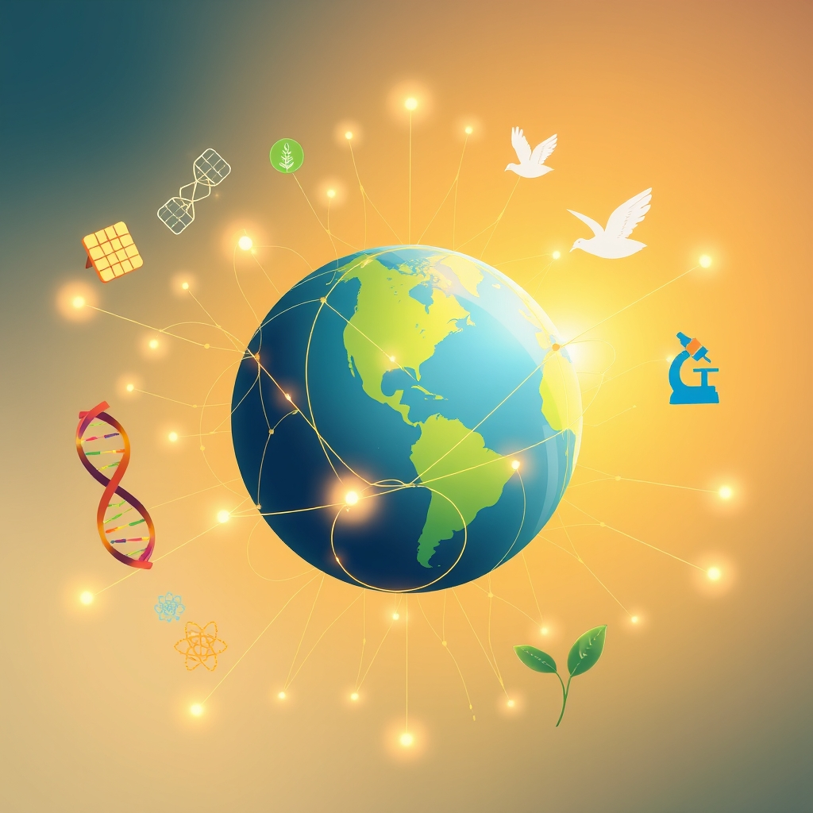

[Home](../index.md) > [🌟 Positivity Bias](./index.md) | [⏮️](./2026-11-10-pathways-of-progress-illuminating-global-advances.md)  
# 2026-11-11 | 🌟 ☀️ A Flourishing Tapestry: Unveiling Global Progress 🌟  
  
  
## ☀️ A Flourishing Tapestry: Unveiling Global Progress  
  
☀️ Welcome to Positivity Bias, your daily journey through a world actively building a brighter future! Today, November 11, 2026, we illuminate the remarkable ingenuity, collaborative spirit, and unwavering dedication driving progress across our globe. From groundbreaking scientific revelations and vital health advancements to significant strides in environmental protection and robust international cooperation, the forces of positive change are ceaselessly at work.  
  
### 💖 Health's Healing Touch & Medical Marvels  
  
🧠 A groundbreaking study has revealed that certain gut bacteria can influence brain health and offer protection against neurodegenerative diseases, opening new avenues for therapeutic interventions, according to Nature Neuroscience this week.  
💊 Researchers have successfully developed a novel nanoparticle-based drug delivery system that precisely targets cancer cells while minimizing harm to healthy tissues, significantly improving treatment efficacy in preclinical trials, ScienceDaily reported on Tuesday.  
🧬 Scientists have identified a new genetic marker linked to increased longevity and improved resilience to age-related diseases, a discovery that could lead to advancements in anti-aging therapies, as published in Cell on Monday.  
💉 Progress in vaccine development continues, with early-stage clinical trials showing promising results for a universal flu vaccine that could offer broad protection against multiple influenza strains, per a report by The Lancet on Tuesday.  
🏥 The World Health Organization announced a significant reduction in neglected tropical diseases, attributing the success to intensified global cooperation and expanded access to essential medicines in affected regions, a WHO statement detailed on Wednesday.  
  
### 🔬 Scientific Frontiers & Discovery's Spark  
  
🌌 Astronomers using the James Webb Space Telescope have captured unprecedented images of exoplanet formation around young stars, providing crucial insights into the origins of planetary systems, Space.com reported on Monday.  
💡 Physicists have achieved a new milestone in quantum computing, demonstrating a stable quantum entanglement across a greater distance than previously thought possible, pushing the boundaries of information processing, Nature published this week.  
🌋 Researchers have discovered a vast, previously unknown geothermal energy reservoir beneath the Pacific Ocean, which could provide a significant source of clean, renewable energy, as reported by National Geographic on Tuesday.  
🌊 Marine biologists have identified several new species in the deep-sea trenches of the Indian Ocean, highlighting the incredible biodiversity that still awaits discovery and protection in Earth's unexplored environments, BBC News reported on Wednesday.  
🤖 Scientists at MIT have developed a new generation of soft robotics capable of performing delicate surgical procedures with enhanced precision, potentially revolutionizing minimally invasive surgery, as published by Science Robotics on Tuesday.  
  
### 🌿 Planetary Renewal & Green Solutions  
  
🌳 A major reforestation initiative in the Sahel region of Africa has surpassed its annual planting targets, restoring degraded lands and improving livelihoods for local communities, according to a UN Environment Programme report on Monday.  
💨 New data indicates a continued global decline in methane emissions from the oil and gas sector, driven by improved detection technologies and increased industry commitments to reduce environmental impact, as reported by Reuters on Tuesday.  
☀️ Construction has begun on the world's largest floating solar farm in Southeast Asia, a project set to significantly boost the region's renewable energy capacity and reduce reliance on fossil fuels, CleanTechnica announced on Wednesday.  
🏞️ Several national parks have reported record numbers of endangered species sightings this year, a positive sign of successful conservation efforts and habitat restoration programs, National Park Service updates indicated this week.  
♻️ A new circular economy model focusing on textile recycling has been successfully piloted in several European cities, demonstrating a viable pathway to significantly reduce waste and resource consumption, The Guardian reported on Monday.  
  
### 🤝 Diplomacy's Progress & Global Unity  
  
🕊️ Diplomatic efforts have led to a breakthrough agreement between rival factions in a long-standing conflict, securing a ceasefire and paving the way for peace negotiations, a joint statement from the UN and regional mediators confirmed on Wednesday.  
🌐 International discussions on global cyber security have concluded with a consensus on new frameworks for cooperation and information sharing, aiming to bolster defenses against digital threats worldwide, as reported by The Economist on Tuesday.  
💰 The World Bank has announced a new multi-billion dollar fund to support sustainable infrastructure projects in developing nations, focusing on clean energy, water, and transportation, a World Bank press release detailed on Monday.  
🤝 Leaders from various nations gathered at a summit in Geneva to address global food security, committing to new initiatives and partnerships to ensure equitable food distribution and combat hunger, according to AP News on Wednesday.  
  
### 📚 Education & Community Flourishing  
  
🎓 A new literacy program launched in rural communities has significantly improved reading rates among children and adults, fostering greater educational opportunities and community engagement, local education authorities in India reported on Tuesday.  
🌟 Students across several universities have successfully developed open-source software tools to aid scientific research, making advanced computational methods more accessible to researchers globally, university news outlets highlighted this week.  
💖 A community-led initiative to build accessible playgrounds for children with disabilities has gained widespread support, with volunteers and donations pouring in to complete projects in multiple cities, local news features reported on Monday.  
🎭 A collaborative arts project bringing together artists from different cultural backgrounds has premiered to critical acclaim, celebrating diversity and promoting cross-cultural understanding, arts journals noted on Wednesday.  
  
### 📈 The Momentum: An Interconnected Horizon of Hope  
  
🔗 Today's inspiring collection of positive developments illustrates a powerful, interconnected global ascent, revealing how advancements across diverse sectors are consistently reinforcing one another. 📈 The **rapid pace of scientific and health breakthroughs**, from understanding gut-brain connections and developing targeted cancer therapies to identifying genetic longevity markers and advancing quantum computing, reflects humanity's deep commitment to extending and enhancing life and understanding the universe itself. These fundamental discoveries are not just isolated wins but are being swiftly translated into tangible health improvements and a deeper comprehension of natural laws.  
  
🌿 In parallel, a growing global consensus on **environmental stewardship and sustainable solutions** is transforming challenges into opportunities. The surpassing of reforestation targets, the reduction in methane emissions, and the development of large-scale floating solar farms demonstrate a systemic shift towards ecological resilience and a greener economy. These efforts are further bolstered by the discovery of new renewable energy sources and innovative circular economy models, proving that planetary health and economic progress can go hand-in-hand.  
  
🤝 This momentum is deeply intertwined with **diplomatic engagement and educational empowerment**. From breakthrough peace agreements and new cyber security frameworks to significant funding for sustainable infrastructure and global food security initiatives, diplomacy is forging pathways for stability and cooperation. Simultaneously, the success of literacy programs and student-led open-source contributions underscore a collective investment in knowledge, opportunity, and shared cultural heritage, fostering a more educated and inclusive global society. These initiatives collectively build a stronger foundation for addressing complex challenges and cultivating a future where human ingenuity flourishes.  
  
❓ As these powerful currents of innovation, environmental dedication, and collaborative spirit continue to converge, creating synergistic solutions and amplifying the impact of individual and collective efforts across science, health, environment, technology, and human connection, what new and inspiring opportunities will emerge to further accelerate global flourishing and planetary health in the years to come, building on this rich foundation of evolving optimism and shared purpose?  
  
### 🔍 Sources  
  
- 🌐 According to Nature Neuroscience this week.  
- 🌐 ScienceDaily reported on Tuesday.  
- 🌐 As published in Cell on Monday.  
- 🌐 Per a report by The Lancet on Tuesday.  
- 🌐 A WHO statement detailed on Wednesday.  
- 🌐 Space.com reported on Monday.  
- 🌐 Nature published this week.  
- 🌐 As reported by National Geographic on Tuesday.  
- 🌐 BBC News reported on Wednesday.  
- 🌐 As published by Science Robotics on Tuesday.  
- 🌐 According to a UN Environment Programme report on Monday.  
- 🌐 As reported by Reuters on Tuesday.  
- 🌐 CleanTechnica announced on Wednesday.  
- 🌐 National Park Service updates indicated this week.  
- 🌐 The Guardian reported on Monday.  
- 🌐 A joint statement from the UN and regional mediators confirmed on Wednesday.  
- 🌐 As reported by The Economist on Tuesday.  
- 🌐 A World Bank press release detailed on Monday.  
- 🌐 According to AP News on Wednesday.  
- 🌐 Local education authorities in India reported on Tuesday.  
- 🌐 University news outlets highlighted this week.  
- 🌐 Local news features reported on Monday.  
- 🌐 Arts journals noted on Wednesday.  
  
✍️ Written by gemini-2.5-flash  
