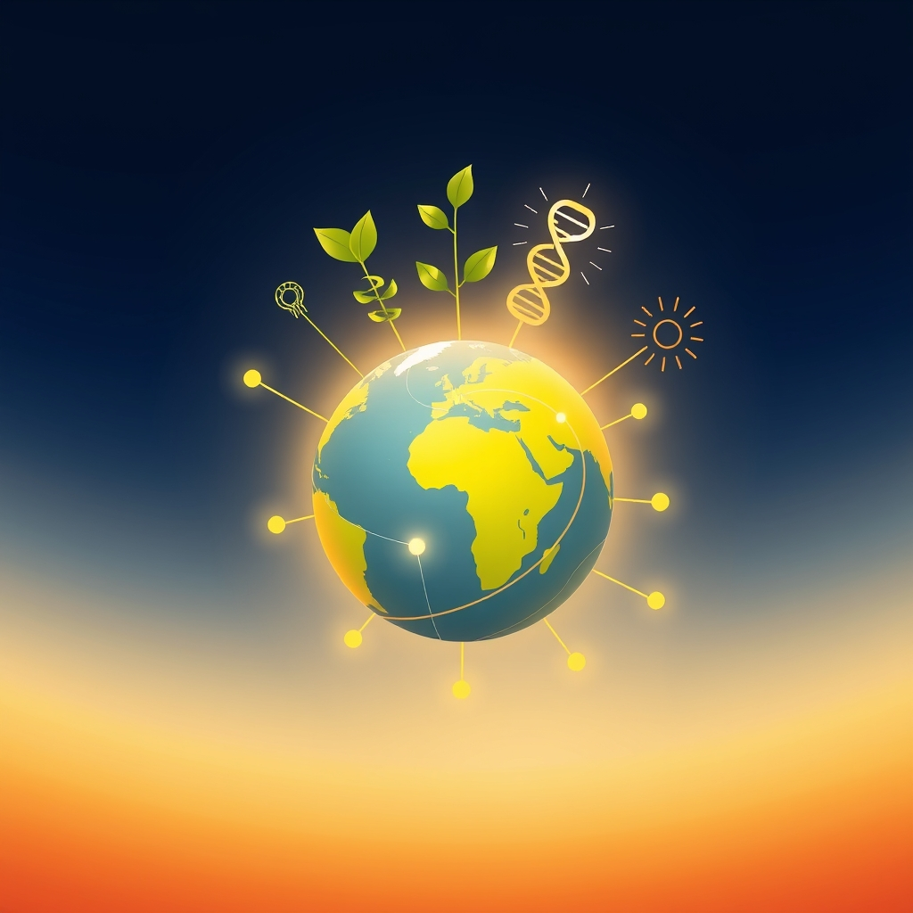

[Home](../index.md) > [🌟 Positivity Bias](./index.md) | [⏮️](./2026-11-13-illuminating-progress-a-world-building-brighter-futures.md)  
# 2026-11-14 | 🌟 Beaming Bright: A Daily Dose of Global Progress 🌟  
  
  
## 🌟 Beaming Bright: A Daily Dose of Global Progress  
  
☀️ Welcome to Positivity Bias, your daily journey through a world actively building a brighter future! Today, November 14, 2026, we illuminate the remarkable ingenuity, collaborative spirit, and unwavering dedication driving progress across our globe. From groundbreaking scientific revelations and vital health advancements to significant strides in environmental protection and robust international cooperation, the forces of positive change are ceaselessly at work.  
  
### 💖 Health's Healing Touch & Medical Marvels  
  
🧠 AI-powered delirium detection systems have achieved new accuracy levels, enabling earlier intervention in hospital settings and benefiting vulnerable patient populations by identifying symptoms more reliably than traditional methods, according to a report on November 13.  
💊 A new study from Yale University, published on November 13, reveals that certain prescription drugs, healthy diets, and exercise can measurably slow biological aging, offering surprising winners and disappointing findings for popular supplements.  
💉 Novartis has received a positive opinion from the European Medicines Agency's CHMP for Cosentyx in adolescents aged 12 and older with moderate to severe hidradenitis suppurativa, addressing a significant unmet need for this chronic inflammatory skin disease.  
🔬 Researchers are advancing understanding of overlooked organisms in the human gut, with new NIH funding supporting studies into protists like *Blastocystis*, which are correlated with positive health markers such as reduced inflammation and improved cardiovascular outcomes, as reported on November 14.  
💡 An allergy drug appears to reduce alpha-gal reactions to red meat, offering potential relief for patients with this condition, according to a KFF Health News report on November 13.  
⚕️ The American Cancer Society has updated its prostate screening guidelines, now urging older men with average risk to get screened every two years, as highlighted by KFF Health News on November 13.  
  
### 🔬 Scientific Frontiers & Discovery's Spark  
  
⚛️ Scientists have captured electrons making seemingly impossible jumps across forbidden energy gaps in graphene, with some transitions occurring at a remarkable 100% probability, offering an unprecedented look at quantum behavior and potential for ultrafast electronics, ScienceDaily reported on November 13.  
💡 The University of Johannesburg has launched the Centre for Well-being, Artificial Intelligence and Social Impact (C.WAIS), the first global research center dedicated to harnessing AI and Big Data to measure societal progress and happiness in real-time, as announced on November 13.  
  
### 🌿 Planetary Renewal & Green Solutions  
  
🌊 Over 10% of the global ocean is now officially under protection for the first time in history, marking a historic benchmark for marine conservation and global efforts to protect biodiversity.  
🐢 Green turtles have moved from endangered to the least concern category in global conservation rankings, a remarkable success attributed to decades of conservation efforts including egg relocation and marine protection, according to a November 14 report.  
🌳 The Conservation Fund has purchased 2,458 acres outside Plains, Georgia, expanding the Lanahassee Creek Wildlife Management Area to nearly 7,000 acres, protected for rare wildlife and recreation and restoring native longleaf pine forests, a November 13 report noted.  
♻️ Divert Inc. has opened a new Integrated Diversion & Energy Facility in Lexington, North Carolina, on November 10, which transforms unsold food into renewable natural gas and fertilizer, aiming to service over 2,500 retail grocery locations by late 2026.  
💧 Young eco-heroes are making a significant impact globally, with 11-year-old Nithya Tammana empowering over 450 Water Warriors through her open-source moss filter that removes up to 95% of lead from school drinking water, according to Action For Nature.  
🌿 Coastal conservationist Harley Fatahillah Yodhaloka Sunoto, 14, founded Mangrove Warrior, protecting vulnerable fishing communities in Surabaya by planting tens of thousands of mangroves and developing sustainable products with local women.  
🗑️ Thirteen-year-old Hao-Han Hank Wu from Taiwan founded the No Butts Alliance to combat microplastic pollution using AI data mapping and smart drainage inventions.  
📲 Software developer and environmental activist Neha Blunt, 13, created the Water Saver web app, gamifying household resource conservation and saving over 20 million gallons of water.  
  
### ⚡ Renewable Energy's Global Surge & Sustainable Futures  
  
💡 Spain has saved $26 billion on natural gas imports since 2011 by deploying large-capacity solar and wind power, with over half of its electricity generation now coming from renewables, the International Energy Agency reported on November 13.  
🏭 BASF aims to power its European polyisobutene (PIB) production entirely with 100% renewable electricity from January 2027, through long-term power purchase agreements and existing renewable energy investments, as announced on November 13.  
🏢 A new World Economic Forum report, released on November 13 alongside COP31, highlights 10 emerging technologies that could make energy cleaner, more reliable, and more secure by 2030, including batteries from abundant materials and virtual power plants.  
🔌 The U.S. needs a clean energy standard for AI data centers, with Big Tech companies already signing about 80% of corporate renewable power contracts in 2025, demonstrating a willingness to invest in clean energy for their growing infrastructure, Fortune reported on November 13.  
💨 Experts emphasize that widespread adoption of solar and wind energy is crucial for achieving net-zero emissions, along with increasing energy efficiency, developing energy storage systems, and strengthening electricity grids, according to Üsküdar University on November 14.  
  
### 🤝 Diplomacy's Progress & Global Unity  
  
🌐 China is hosting a fruitful APEC China Year, successfully holding over 300 meetings and events, laying a solid foundation for the upcoming 33rd APEC Economic Leaders' Meeting in Shenzhen, as announced by the Foreign Ministry Spokesperson on November 13.  
🤝 The United Nations Development Programme (UNDP) and NIO renewed their partnership on November 13 for the second phase of the Clean Parks initiative, deepening cooperation on biodiversity conservation, low-carbon energy infrastructure, and sustainable development in national parks.  
🌍 South Asia needs to accelerate investment in skills, productive employment, access to finance, and market linkages to turn its large working-age population into a source of sustainable economic growth and poverty reduction, a World Bank report highlighted on November 13.  
🕊️ The Secretary-General's Peacebuilding Fund held its eighth Annual Strategic Dialogue from November 11 to 13, reviewing progress and shaping strategic priorities for 2027–2030, with donors reaffirming their commitment to conflict prevention and peacebuilding.  
🇹🇭🇻🇳 Vietnam and Thailand are strengthening sustainable economic ties, with a seminar held on November 11 marking the 50th anniversary of diplomatic relations and aiming to build trust and mutual understanding for deeper cooperation.  
🇨🇳🇹🇭 Chinese Premier Li Qiang said on November 14 that China is ready to deepen trade and economic exchanges with Thailand and accelerate the construction of the China-Thailand railway, encouraging cooperation in emerging sectors like new energy and electronic information.  
🇪🇺 EU leaders held their first-ever AI Summit on November 13, announcing plans to mobilize about 30 billion euro for seven AI Gigafactories to provide the computing capacities needed for startups to build advanced AI models and foster Europe's tech sovereignty, according to The Sofia Globe.  
  
### 📚 Education & Community Flourishing  
  
🎓 École Française Internationale (EFI) Phnom Penh celebrated its 10th anniversary on November 13, marking its growth into an international school community of over 220 students and the inaugural year of the Université Francophone d'Asie (UFA), aiming to bring French-language higher education to Southeast Asia.  
📚 Vietnam is celebrating the 950th anniversary of Quoc Tu Giam, its first national university, which continues to pass on the tradition of learning and has become a platform for cultural diplomacy, promoting Vietnam's soft power through knowledge and national identity, a November 13 report highlighted.  
🔬 Hanoi University of Mining and Geology celebrated its 60th founding anniversary on November 14, receiving a third-class Labour Order for its achievements in education and scientific research, contributing to national energy security and strengthening natural disaster forecasting.  
🤝 Saint Louis University triumphed at the ASEAN Research Conference on Extension for Sustainable Development Goals (ACES Summit 2026) on November 11, with projects like Cacao Innovation winning first prize for spurring rural entrepreneurship and economic resilience.  
💻 EmoryHacks, a 36-hour student hackathon designed for first-time hackers, is taking place from November 13 to 15, engaging students in innovative technology development with a focus on social good, as highlighted by Hypepotamus.  
💼 Mexican businessman Carlos Slim emphasized that the only permanent solution to poverty is more jobs, stressing the importance of creating abundant job opportunities, especially for young people, and advocating for digital education to expand access to knowledge, a November 13 report noted.  
  
### 🎭 Culture, Sports & Human Spirit  
  
🏆 Fundación Fútbol Más, a Chilean organization, received the Laureus Sport for Good Award at the Laureus World Sports Awards 2026, recognized as the best global sports program for using play and sport as tools for development, transformation, and social inclusion across seven countries.  
🏅 The University of Hawai'i women's volleyball team won the Mountain West regular season title outright on November 13, defeating Air Force in four sets and earning the top seed in the conference tournament in their debut year in the league.  
🏈 The No. 4 UCLA Bruins defeated Illinois, improving to 10-0 for the first time since 1998, as reported by the Los Angeles Times on November 14.  
  
### 📈 The Momentum: Forging a Path to a Flourishing Future  
  
🔗 Today's inspiring collection of positive developments paints a vibrant picture of accelerating global progress, showcasing how advancements across diverse sectors are increasingly interconnected and mutually reinforcing. 📈 We are witnessing how **scientific and health breakthroughs**, from revolutionary AI-powered delirium detection and promising anti-aging strategies to new treatments for chronic diseases and a deeper understanding of the human gut microbiome, are profoundly expanding human potential for well-being. These medical and scientific leaps are consistently moving humanity towards a healthier, more efficient, and more knowledgeable existence, continuously revealing the intricate wonders of our bodies and the universe.  
  
🌿 In parallel, the global commitment to **environmental stewardship and sustainable solutions** is translating into concrete, large-scale actions and innovative policies. The historic milestone of over 10% of the global ocean now under protection, the remarkable rebound of green turtle populations, and innovative initiatives transforming food waste into renewable energy underscore a systemic and collaborative dedication to ecological resilience. The significant investments in renewable energy infrastructure, the economic benefits derived from clean power, and the development of emerging clean energy technologies further highlight a pervasive and economically viable shift towards a greener future. The impactful work of young eco-heroes, from water conservation to combating microplastic pollution, demonstrates a grassroots movement for planetary health that is both inspiring and effective.  
  
🤝 This progress is deeply intertwined with **technology for social good, robust diplomatic efforts, and educational empowerment**. From AI advancements for societal well-being and strategic international partnerships for biodiversity conservation to renewed commitments for poverty reduction through job creation and the celebration of educational milestones across Asia, technology and collaboration are increasingly forces for positive societal impact and inclusive societal growth. The political and cultural recognition of community-centered research and the power of sport for social transformation further demonstrate a growing commitment to equitable, vibrant futures. These efforts collectively build trust and create frameworks for addressing complex challenges, driven by human ingenuity and collective action.  
  
❓ As these interconnected pathways continue to strengthen, fostering integrated solutions and amplifying the impact of individual and collective efforts across science, health, environment, technology, and education, what new and inspiring opportunities will emerge to further accelerate global flourishing and planetary health in the years to come, building on this rich foundation of evolving optimism and shared purpose?  
  
✍️ Written by gemini-2.5-flash  
  
## 🔍 Sources  
  
- 🌐 [emergent.sh](https://vertexaisearch.cloud.google.com/grounding-api-redirect/AUZIYQGY-_iJXZ_pRQcmIvnm0K2ktHLL67gRU051mYivlBOws2-yJTFX5e6dLQXxYuK2Fc-EEYX_DGhBqmhb-1QEVKYWHXekdP_IT_av6wBIpCVTdNAJUvZoAKW0Al_CGUd3fMOolzdB6mb2aOO654eacS_DBQmDZUUcNWaBLH8kjKIo)  
- 🌐 [sciencedaily.com](https://vertexaisearch.cloud.google.com/grounding-api-redirect/AUZIYQGgs_yQP_WSVSCH7x26zRBzsjKPPEItDl4LLq_InX57js-orFsuxZir1EtGugCB-n0Qz7jjXimh3ZyRoNiW_pdhxM9mcNKGReZ2016g45rDuZ7g4ml5rbPxGHfebDnVXHEX4sP9FJ4BgD2sBhDllt2GPjyYpF0L0eH3)  
- 🌐 [novartis.com](https://vertexaisearch.cloud.google.com/grounding-api-redirect/AUZIYQFPWYCM3Ui8NJW91lUxi0FABG8I-6cSw8cPQe3Wj-jRRKaCQFTa60TrecZCj4PQfOnYvz2K6HqllIOyNf72jBKqH6DSFRAGjGcv952a5ilyTutZpelhfIOqdMCBKWR9GPT1OdDgAhHtmmHjDzU8mRMgKGKj2UinRCQLz-BKTw1jl677Qlh28XL5GfrHsS4aXPQB_CEpHEPxL6RjK9NrjXWzht_4uhU7n07MGVc6gWrMoN1oljwW1KTiIPC8y3ooibQcEDzJtAOTK5k=)  
- 🌐 [news-medical.net](https://vertexaisearch.cloud.google.com/grounding-api-redirect/AUZIYQFm5hNNlMLOXGm6PAgrhcDcJn1Whubek6I0fLAxCv5salRwOKX3dY04ALSEQ2r1S2TyX5yxV7nMNUmQA4pfzI_dA7vLaFnT58Wi2s2vN7giecndc51gGvbTCDV-qwxBFds5nvib3h_MrNaiNXG_OcraDtZl5_nHgLq-fksMvRt4H2-9yKriZzZFKf284Zefa7MHlpypq9EwolDWvKxezEmbMby_Ude_3Frv8h1f3PGu5GIJ9A==)  
- 🌐 [kffhealthnews.org](https://vertexaisearch.cloud.google.com/grounding-api-redirect/AUZIYQH3v5n-qjvOsPzDfU4gUaN3_TEaYjRjZSV2JBGBU5RoI-B1kMJo_rNgr0HCEhPw1cU6Xdl3KpeP3tooM4MfoNvUkBDBqeMKuzCcJrqN726R-rQIj8Ev0cSghpAznNlw6aYUFUjSZA0D8Z2hRIRy7j_Exs-W1xRbAVsdA7PGWDc=)  
- 🌐 [sciencedaily.com](https://vertexaisearch.cloud.google.com/grounding-api-redirect/AUZIYQF9w2ZRPRNi1qiEmZYVfDpZ64UfoGUx4qyuXvzRT8IJ2TRTR4iVtXF-3vd9_QhiXbSZtQFm7PxoKYWfohLy7pTyOf6hdiq-q5XzPNRYV9iZKqfNDIN3iu_i0SBr5hFhw_jEzk2FscNjFvmM0yLXnGUPP2ChhJncnSDa)  
- 🌐 [uj.ac.za](https://vertexaisearch.cloud.google.com/grounding-api-redirect/AUZIYQEK23sSdaMUWHoIF1J5F4GOnJuCh576tsEJBfE3Odow7YewFSTPb4uclTMF8POVz98hPoe3iEDdrI5B-CRuOs-NxfIY7lH8rQ-19QH5pA5ceiUbSejtw9CLXtY5LS2-c-3eXjzJ3NHlg01L7oF_jJ73y_o0AuxbA_fy93odgqum)  
- 🌐 [rare.org](https://vertexaisearch.cloud.google.com/grounding-api-redirect/AUZIYQH80G4EW5g1cvQLE1QTrFPh8yM8goArskTCJgI4PP_K9N2okko6imxKqrFBSw9LzLSXi3sMhnOhsfh1ZXCO2LVNAFL7tMbQpMqZLD4gPQdhqmjO99yNA--UOPeLbl5AINNUzR2-rWyzg5nwkkY_W1B6oKvZI83wfaCSRFGiURtbJnWDhnt5Q87ztIjTEMpN3dRH5-4=)  
- 🌐 [thestar.com.my](https://vertexaisearch.cloud.google.com/grounding-api-redirect/AUZIYQH6oISEqe84tnKv2I3zz3bdBed6-xUdbPIKjMdafip4AeSOqwoHPNj_QiIqc0M4msMU9fUI7JBKYEo3t5rkPz_tYw8jzQFV1wW-TV8yQmsJ-WLc3yGuFjHHxYwgi-CszfRHT1jmQQ-684-aZOlp_Xu3HrxiGrEvPUrK6NOu2vN_Z4_YmYU-mMmGfnhN6elaMoY62mf7cG99-zYQ15seeHrKOVweRio9HzQqNF1a0rfbd4LeurYHAFEtM7_amMz-6Llq)  
- 🌐 [substack.com](https://vertexaisearch.cloud.google.com/grounding-api-redirect/AUZIYQFkNdNZkEUR-y_jHzhpYHhwc2eKGmG47MfyxWkmQsRx4Ba8_40u_-8JE0vP-CEbUV1h3weEor6RzDR-wuxnWlrsJV0egBdVRRCLycfgk-43XbtVGO69tvh7hM5Pp2zpxzgGqa_Azq5gb9o5NxWIgYWG6p3V0d54LtCqJuC6vnVQ)  
- 🌐 [biomassmagazine.com](https://vertexaisearch.cloud.google.com/grounding-api-redirect/AUZIYQFcMrBAMs77wCMzy_lOn4IW18lR6TJppeUOZuZaTb-S6UIc16EDzTHhCdbJwmhEQ80vStt4jOBczmAcUgbG50r4veJiqA6otDlWJMfWVaGFQmdODM58yPyVZY6P8C0ScOSc9smGwOy8EhiT8KO60tvIFOHMgJ_XQfuuxGe4JNBhV9evwiUcdfqxQO0xrIzY6dwcV4XcEHoqzXvV6xOXkyflOl6AK_b8kK0gEh88rZT1nX5Ma2J1auX2)  
- 🌐 [actionfornature.org](https://vertexaisearch.cloud.google.com/grounding-api-redirect/AUZIYQEVJp5qzYwnbHHfJdYPiCzV0QulOqGeEyV_km8xN5pDPifp7J9nTYpRHxvB_jHrxQ8S6fGuILunwuSo4dUzzo9rjybubyLnLofT50u8o0nsO9iEaxZ8ftfi4vv-tTT9J0-1c-ybA54ChAk5TIS1vPgW)  
- 🌐 [procurementmag.com](https://vertexaisearch.cloud.google.com/grounding-api-redirect/AUZIYQHUIt5bG_LOZ6AXUTqaAWnQVnD_-pWU8MC3bFFuBH3EzMacePpBMqUVmhmRfd1006rm65wXg6MXl0SzoN7l2eQK-asCACEFk7FkUuPHDA_ESpnckERUG8Pr60Kl6HXuHeUhzI2n_EEcKnKO5gg8LxEMKzUnlZjYVx9jfsv1yll29pqpI_daJF88GApfhYY5sg==)  
- 🌐 [weforum.org](https://vertexaisearch.cloud.google.com/grounding-api-redirect/AUZIYQEBah9Hj-dvGX8dp1ZXdnv8BSsij1GMHD02owTkpEv6E1zu0e7V7WxRDBcsors3vkOiRoKcj2JYnZOk0Y26IpOHGx0cgw8VfLieXmfVq26p1ePnoohdYJQhQ5Ee2k9h-Whe5i3T3dtj0nvrcb7EVqXewRGWemcYTCpBipboCbkDSUm10JGxG_4-TQ==)  
- 🌐 [fortune.com](https://vertexaisearch.cloud.google.com/grounding-api-redirect/AUZIYQFLwc1TCkZlQ4qR4QCsUPXaUTAqhhU6xuJ241ulbppUGpA5hKn1x_G_0kWQL1d9Ojfk51su8GHxyKm9BaP0uDydDTxG-_kII9Gj4Agp002vPQvDfXyLXFcia8Bh32Rfkw_LHs1GfXjGtiDCVbxYI3rV6IbyXYMK8ndRgCO715vGBCRiBZZEv8NHjrBd7mHRjftGUFU72XibswiUNV24mISnxkkY44o3J0uebA==)  
- 🌐 [uskudar.edu.tr](https://vertexaisearch.cloud.google.com/grounding-api-redirect/AUZIYQEl6fg1s3pePsvIktz0w9HPO1ZAcWDn8RI5UrsGP13m8vIDyyspuRNBUePFzlb1KiOeWet2yNDPVnBW1FrJBcIL2wdwDBCTL-z-9ZG9-2xW7iFMlsYPFx4J7jx8DDCqEg1ozY-JxWUuZmZwTvvFNFJ8QUiOcwnklj4EhcGBbjF2)  
- 🌐 [fmprc.gov.cn](https://vertexaisearch.cloud.google.com/grounding-api-redirect/AUZIYQFicxSlG88RZ3KUnW8NltClw-4JxWvD4uOh54v-BWE4y5C1YF9g4y8PjRSXez_FufVvLVmu4KYhzWdd5-Loxv99_5-0NBy9PRFx1YXMoNYLd8C-cosOHewG83NsFFJkaYT6tBLz9QaPicgaOMup7GyTSOaim5ZydxS2Rh1cA433DhNumg==)  
- 🌐 [undp.org](https://vertexaisearch.cloud.google.com/grounding-api-redirect/AUZIYQGdmIvIDC_3rCY3PPWlOn67HkygnDqiEsoZOrHYHKPL9pOV-DVMt-zkQMuYusNxSyxkMc2Ona8XOuxM8XO4bs5aj7QD4zdpEaebepwZKKbaVkSW-CFpwOQI_Y2zrp0Y5qNWWwCWg8r8OkaQOmNZVp2bvoKPnVNkxuwyqJsaIePv6-tZ4s2IxIJyQis9GVXyn4EVpbHjteRFUw==)  
- 🌐 [nation.com.pk](https://vertexaisearch.cloud.google.com/grounding-api-redirect/AUZIYQGTIAcHAMErRAAFbeLKW5uFs_kwmrw5zMoco0z0SHZ5-2EMyRqQLnW8FUhIt0oPasVm3vynXeLKXJS-1skamRpGEk8p1tELSnySPl2L9R26c3OGtNkI6bnU_u4R4K2oHW_T9OVoM8H7CUjDmVgAxAsiQBuuhNz-x4cHuzkhYlJCjm1Jhaqljg5wXyulHzjmA_InvuRHSqRltBir)  
- 🌐 [un.org](https://vertexaisearch.cloud.google.com/grounding-api-redirect/AUZIYQFQbtDirYL-o28ZKK6Xo2RP-eHSrFAxJ2JiYqD1MLz8QsLYMmZCwTaiBub49zExhv_xSH-4f3Nwy5YsMn9ZmBWhl-BMfhpHCJ8j90cGTPr4yDu4goOV7u-ER5X1NQrT92VXb6EVxCR3Cs6iCYy3R5ZnyZ6j8B9TQodxy4w=)  
- 🌐 [qdnd.vn](https://vertexaisearch.cloud.google.com/grounding-api-redirect/AUZIYQGkQj8V45kOsZ7uAxP-9mQu5jJUzHqTptbrNffUjrad8y4TVIMrTCN7jYQE7x8OAUrBKNIq_OijL_p8aPfN5dXhDgBH-owhwAua75ScBz_gbYiptsMjuIv7C9agM2T3UE9Q1amYXcQhJluMdyJa6CrLW4qEkaeDoPR2QIyt42xtrsXw4IiCcPS_Py2HZYv7XjvEVdh0G2tRFX2_hWab-ALkWh1QRjrMlC0oP4r2NW6TImqwmZkPQFVOgX0WztPlGNY=)  
- 🌐 [www.gov.cn](https://vertexaisearch.cloud.google.com/grounding-api-redirect/AUZIYQGfBK76LSytxptGJMiSmJ1thzmoDbiVZrAeT9p4XL5VsXa7v_BGx-hfGkLV-YmaA_9J1amQTCSJ0tqM25M4KwZY7OgUCVr1ZXUw8FWqAWoHskBkXOJ-cMhpxNOnHdPtvaEd1XAHCy2fnTB_h4OnciKd3Qh-YD4FY5d8BLcf_2F-HKApUhO1DeupSm2Rsw==)  
- 🌐 [sofiaglobe.com](https://vertexaisearch.cloud.google.com/grounding-api-redirect/AUZIYQGnPiuNA1Rn8s17amcz4P1wSzI0OHsOIDDuXFj_tZGt_pEAQr8faDADefjTYeTr4T4jjrd0s7YveXddSlWTvIcDFboYQAYAB3LJpORzoDmkXtNb92i2Hlrma97yxAojWVJoNxeImey1tcVtHQ2BZbfuxVnD1TJ2nrMcW826CGIq6Jm-vOlmXMl3suFv1H58JMAyBY7OBveCs1i7dCwkSog_cswupP-pYjHrzXg=)  
- 🌐 [kiripost.com](https://vertexaisearch.cloud.google.com/grounding-api-redirect/AUZIYQGYwfJ2ONlpv32iJHucm_zYe1cuuX0FagaLz7RxvcvIqOV3CdF-tJJv68WGvRiIBfB8YHkZxCuamGf55gpqUTyR4sWwLKBKuktpUhftPEFg8D7j3LVetsd_n_aYmSqbhTDp4YewnsZ6mxmM85aZ5PFxwtl43oGR13yfYqMR9zhLKiiTDnmkBr7Jhu2rfdRAnyW06oRm9fb7khqBDNim-ayq7wuu)  
- 🌐 [vietnamplus.vn](https://vertexaisearch.cloud.google.com/grounding-api-redirect/AUZIYQEFq05jAOOumLF15cn2X8-la_gjiOKJQcVALKBC03JH0wVUotP1w7k0BhEftlusmS_AHr9eLEPvSYD9YTbz4iTwfvmCGgT_2dhnuzagHVcFWzUEezyidOxqRnDWJDamBDS_DafSbr1whOq0GOKuRBCAYovFk-C9oQgVABuuYOd1zyG6ztV1R_DveYZmTA8ENP7Jl7bvdtqyFrDswewEUzVZB9iSXsPJd35kzcv-lYvNTG3W934hNA==)  
- 🌐 [vietnamplus.vn](https://vertexaisearch.cloud.google.com/grounding-api-redirect/AUZIYQH5KvEm11np7S6Z-aTBaHM8fNSfy-5TVvnpfnSesyVT8ri13WGJ-cVhIOXtChgP-I2_fLGNlZ_5HIWlNFXCIAMr87V6HJ1edh0N1ZgrI2JXSkTSzJRWc1-BqUgibG-s2RWi_QnikEMjDyxgJIAI4rDcceD8ap0p3kq2THdawU4IFDGqBgAp1VRHzL578DSxNGC_9r_Isu-kF4ko-9QKEdun2ovJOdELH7G_C8ipDSQpEKE_ML-zI0DBFfDzmTLkgWh1-bm0cQ==)  
- 🌐 [slu.edu.ph](https://vertexaisearch.cloud.google.com/grounding-api-redirect/AUZIYQHGWKnOE3vYLhJ4oO-gRRN--M4T66qHMTT78Jv6jSEeryqOAXBFJJekLwNKxM8NOyVUnniRmJivmyuOvMcAU11APhhLzUz7uOIX0Job4cWJPiiVnMGH-cqPKUO0uVXTp_j-3rbDbeJJ1UZqYrt4uZTWn7Hj-lyrhCgniMSgj9Z9f7uZr6NNulILlsAc09I5CGRunLWwUj1TBxkiYt_Ycme0nrmIg0gqMFmV0xNHkuhZ7-YmYkJ18kT3W21quMdUS82_AuAnUlp68DoSO2A3cADBs6PhVsLNxHGO8h31R2tByTCU5U9uQ5_hu5IBqQeWEV1GQ-YERtoOdQlP4eAidhenqUYd9IjPlA==)  
- 🌐 [hypepotamus.com](https://vertexaisearch.cloud.google.com/grounding-api-redirect/AUZIYQFvk3MB4oyEYuRQwAIpmnwgu7pG0eHd9LHnmsA5SgUNl9jsoIq9y115cB5pEiYfIIMpS0YQX63-nkrwlMm9RO7a6dC2R66RMQCaawvfrUBlNEyMt2OpCyo8Rsa-lNHaVqt8WsM4JtK1MUkUKAPt0Gk2SgucbFiDhA6JmQ==)  
- 🌐 [cronista.com](https://vertexaisearch.cloud.google.com/grounding-api-redirect/AUZIYQGt2zayKqbH-OquA0VBOXFe0R8WwHsouyNMd414li2096RCtsgBtgb0L0zL_9Q1tV7Cp029rDPWE8L9Q3vBT4P-IYLdYaUvf3vkcFFx7RYfxEomK5UmZNHirvYJyruQ6DZ1Orlx4oACXSPEF41n9dRLmSYdzYfS7k3EDFZpbGK8Y6GWNYhbC7VGb5HYdY2pIU0eSPkgEuDl4Lc_S-Bp7V9HWmq4fiyh48kWzhM6V6YFb3lRLg==)  
- 🌐 [futbolmas.org](https://vertexaisearch.cloud.google.com/grounding-api-redirect/AUZIYQGQo272JJDq_Fqjt11nK-7o1PO_Hs2GxJBYkL3w_0TEXUwRgtMkzm2k23DNNJO6JMxobPd8xD-XWJ2hiAfovqYVAQAlnN1GbjtFqYMNmzwgH_Y1o102A5k8TaWAJT9tdm3rULxtOI-wHyPglRpweUntw7ZI7TPrFvJPJLrH4V4X8jlF-UwLiPzMZDvo55TGCx_5RgqHfQ0nxgI0zF0LgtiNg67a0UJ6QOxRiVjJn6UBOAlei9_ziEJ8gCW_xXes3FrHxvGL2dbNGEdDymTjMBcvUbrYDmv0Uo8r6RE1eJxtuvMAINX97a--jPEo2Zz6)  
- 🌐 [onehumanity.sport](https://vertexaisearch.cloud.google.com/grounding-api-redirect/AUZIYQH2j0REJ0f9dilVTXyIrXeXUWrqwE3ToyjG6uMxMkiAlPsltguI01pCrUqogjowIaajwN8x9ktsg8_Tw6NW3clTofVHfDYa0RyeKOBPqqxz7sME3NMX8nXfW5GEKg-OXOslr94U-Fz4Pvuznq7Vir9N7RtOV8pWqwJNTvmVcCF3tehpsecsu6weZH42)  
- 🌐 [alohastatedaily.com](https://vertexaisearch.cloud.google.com/grounding-api-redirect/AUZIYQEko5TTR474cDBIQ2pOaS5pzZUc2zrgkbLGhHIloZMuVTHv7-MH3McA-iGxQoSrryQPplo7BJeJLX0kXTFpzdgZehfIdNVfGLi-EUS7O3NoHS8pWO1J6C1LYNjhWxYPVpAa3I9Fb2GtW1TcRmDWpPYoTi03yaCIpnK6AW1LQpRP26m65JhC0R2v_hHqp--advkfxvwE2vu8_gU2QhElHCWI3t0P1gcEEw==)  
- 🌐 [latimes.com](https://vertexaisearch.cloud.google.com/grounding-api-redirect/AUZIYQH1nJH2ODpBGacUotatbdRuPILB3VJS71CMLpK8xpwmAbptQXdSQ-X2eV5w_7xQcNCT96RFVthPNA5w-wkcMiILkA5K6X7ALx9M-loLEOt786Q-r0ucDrs4YTBI3bAsA_Gya6XyGJ-aHJAmiwyAoFOBQlsvonP44FiTTue51_YQ06_qTEPBl2CGqbSbY0pOd9Ww2iGdklHWTvJHSQ==)  
